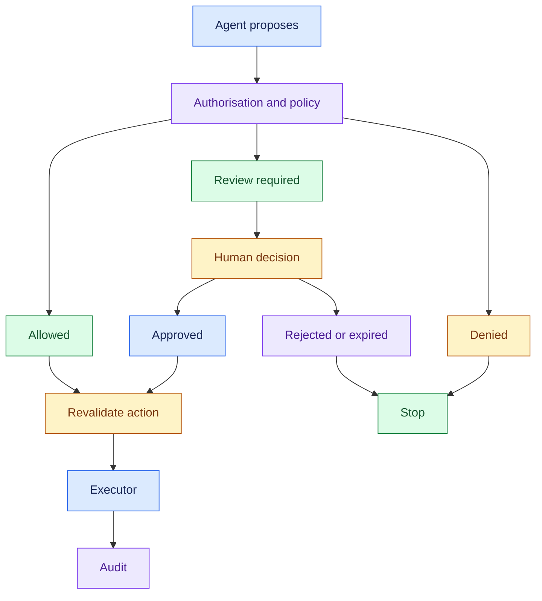
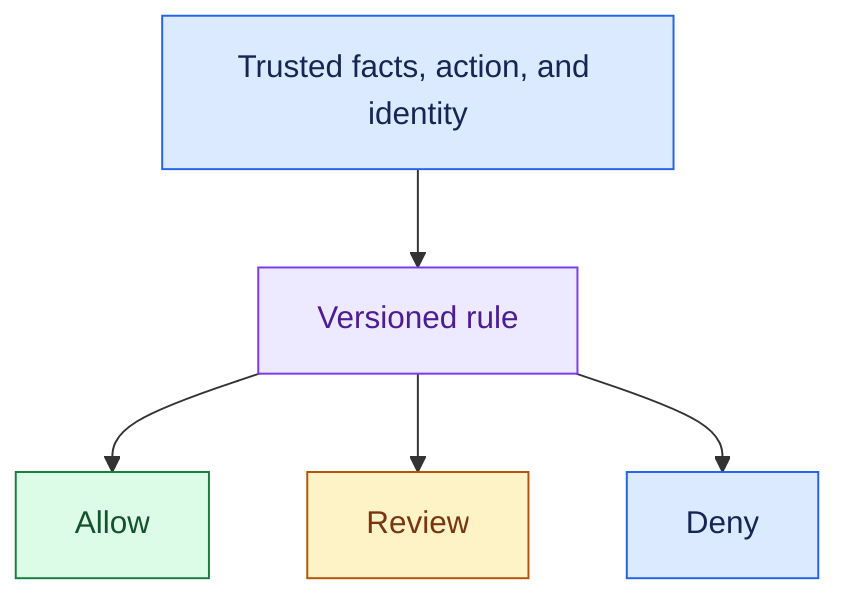
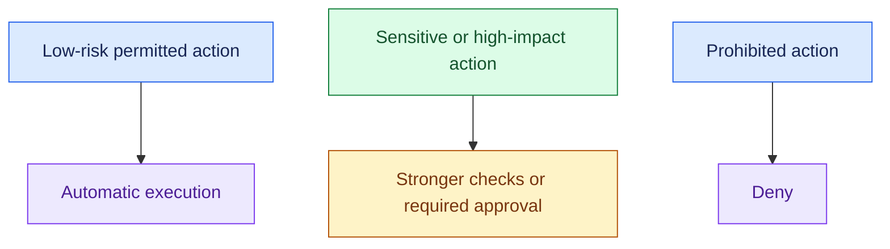
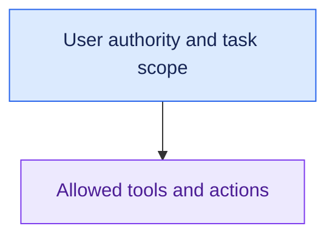
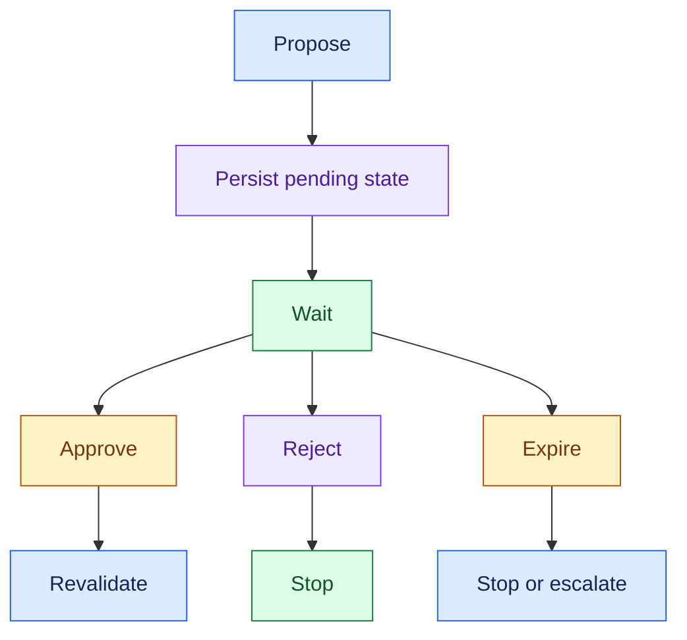
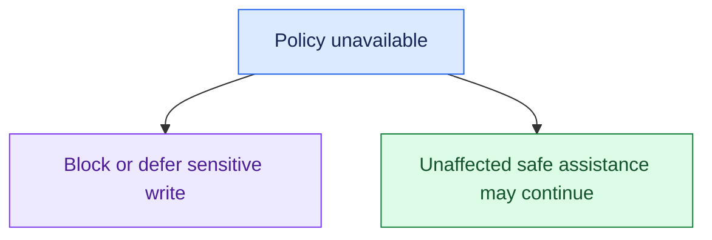
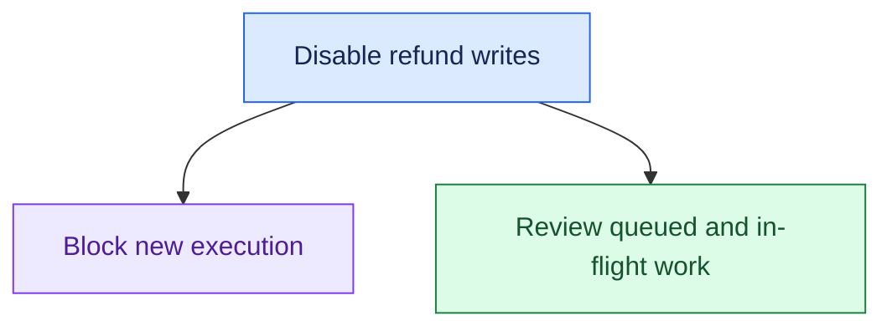
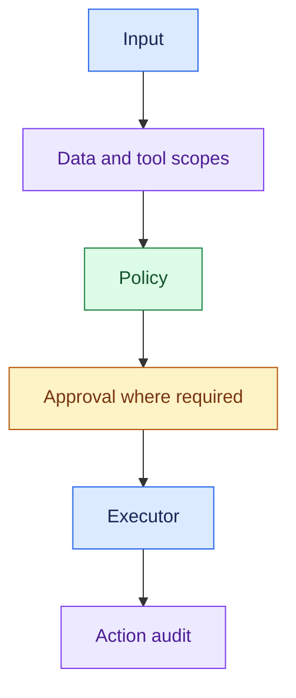

# Review 8: Guardrails, Policy & Human Approval

## Interview Review

### 1. What the Interviewer Is Testing

- Can you turn autonomy into explicit permitted and prohibited actions?
- Can you keep deterministic business rules outside model discretion?
- Can you design human approval as a durable workflow?
- Can you stop unsafe execution when controls fail?

### 2. Core Mental Model

- **Agent recommends → Policy decides → Executor acts.** Guardrails support this boundary; prompts alone do not enforce it.

### 3. Essential Concepts

#### 1. Deterministic Policy: Encode the Business Rule

- Put explicit eligibility, amount, region, and approval rules in a trusted policy or code path.
- Models can extract facts and propose actions; authoritative rules decide permission.

> “I’d implement the customer's refund thresholds as deterministic checks, not ask the model to decide which threshold applies freely.”

- If the source facts are incomplete or untrusted, a deterministic rule can still receive bad inputs.
- Validate the facts and source of authority too.

#### 2. Risk Classification: Match Controls to Consequences

- Consider financial impact, reversibility, sensitive data, affected users, and uncertainty.
- Agree on classes and controls with the customer.

> “Which actions can run automatically, and which need approval because of their impact?”

- Illustrative refund thresholds are examples, not universal policy.
- Define boundary values and the cases between thresholds explicitly.

#### 3. Least Privilege: Limit What the Agent Can Reach

- Grant only the data and operations needed for the current task and user's authority.
- Read and write scopes should be separate where appropriate.

> “A support agent's access should not become unrestricted administrator access just because the workflow uses AI.”

- Enforce checks in execution and data access, not only in the model's instructions.

#### 4. Human-in-the-Loop: Give the Reviewer a Real Decision

- Human-in-the-loop (hitl) should include the requested action, evidence, recommendation, policy reason, and approve/reject choices.

> “The reviewer should see what will change and why approval is required.”

- Review packet:
- Action + target + amount + evidence
- Policy reason + recommendation + expiry

- Review does not guarantee correctness.
- Make the decision clear and restrict who may approve.

#### 5. Durable Approval: Wait Without Losing State

- Persist the proposed action and approval status.
- Resume through an authorised approval event or lookup; define rejection, expiration, and unavailable-approver behaviour.

> “For an approval that may take hours, I’d store the pending task and resume after a valid decision.”

- Bind approval to the action and relevant inputs.
- If the amount, recipient, or facts change, recheck policy and obtain new approval where needed.
- Handle repeated approval events without duplicate writes.

#### 6. Fail-Open vs Fail-Closed: Choose by Operation

- Fail-open permits an operation when a check fails; fail-closed blocks it.
- For sensitive writes, missing policy or permission checks should stop execution.

> “If refund authorisation is unavailable, I’d stop or defer the refund rather than bypass the check.”

- Do not disable the whole application automatically.
- Decide what can safely continue within established boundaries.

#### 7. Kill Switch: Stop the Dangerous Capability

- Provide a trusted operational control to disable a tool, action type, tenant, or agent path.
- Check it at the execution boundary.

> “I’d be able to disable refund execution while keeping policy answers and order reads available if safe.”

- A switch cannot undo a completed action.
- Define what happens to already submitted work and pending approvals.

#### 8. Defence in Depth: Enforce at Multiple Relevant Boundaries

- Combine input validation, scoped retrieval/tools, policy, approval, execution checks, and audit.
- Retrieved text or tool output cannot grant new authority.

> “I’d keep safety controls outside the model and enforce them again where the business action occurs.”

### 4. Requirement → Component Reasoning

| Requirement | Component / pattern | Why | Trade-off |
|---|---|---|---|
| Enforce refund rules | Deterministic policy | Stable business decision | Rule ownership/versioning |
| Limit access | Scoped authorisation | Restrict data and operations | Identity integration |
| Review high-impact action | Approval workflow + review packet | Human decision with context | Delay and reviewer workload |
| Wait hours for approval | Durable state + resume event | Preserve pending task | Expiry and consistency handling |
| Never bypass failed checks | Fail-closed execution | Avoid unchecked writes | Deferred service |
| Stop harmful behaviour quickly | Kill switch at executor | Disable specific capability | In-flight work needs handling |
| Explain the business action | Audit record | Link evidence, policy, approval, result | Retention and privacy |

For a refund request:

- Apply customer rules to allow, review, or deny the proposal.
- Resume the stored task after a valid manager decision.
- Recheck the action, permissions, policy, and kill switch before execution.

### 5. Important Distinctions and Gotchas

1. **Prompt vs enforcement:** instructions guide the model; trusted controls decide actual access and execution.
2. **Model confidence vs permission:** confidence cannot authorise a financial action.
3. **Approval vs unconditional execution:** approved actions still need current access, policy, and action validity checks.
4. **Fail-closed action vs total outage:** block the sensitive write while preserving safe unaffected functionality.
5. **Kill switch vs rollback:** stopping new execution does not reverse completed transactions.

### 6. Trigger → Concept Table

| Hear… | Think… | Discuss… |
|---|---|---|
| “Refund amount threshold” | Deterministic policy | Exact boundaries and rule version |
| “High impact / irreversible” | Risk classification | Approval and safe stopping |
| “Only this user's account” | Least privilege | Identity and operation scope |
| “Approval tomorrow” | Durable HITL | State, expiry, resume, revalidation |
| “Policy service down” | Fail-closed writes | Defer sensitive execution |
| “Disable refunds now” | Kill switch | Execution boundary and in-flight work |
| “Document tells agent to bypass policy” | Untrusted data | No new authority from content |

### 7. Interview Phrases

> “The model can propose the action, but deterministic policy decides whether it is allowed.”

> “Approval must refer to the exact action and inputs that will be executed.”

> “I’d fail closed for sensitive writes while keeping safe unaffected capabilities available.”

> “The kill switch belongs at the execution boundary, where it can block the side effect.”

### 8. Practice Questions

1. Refunds below one threshold run automatically and above another require approval. Where do rules live, and what must you clarify about the middle range?
2. Why is a highly confident model not the final authority for a refund?
3. Policy checks are unavailable during a large refund. What stops, and what may continue?
4. Approval takes hours, and the requested amount changes while waiting. How do you resume correctly?
5. A kill switch disables refund execution. What happens to queued requests, pending approvals, and already submitted payments?

---

## One-Page Memory Card: Guardrails, Policy & Human Approval

- **Core question:** Who has authority to permit an action, and what happens when that authority or its checks are unavailable?

### Recall Flow

- Agent recommends → Policy decides → Executor acts.

### Checklist

| Control | Remember |
|---|---|
| Policy | Deterministic rules from trusted facts; explicit boundaries and versions |
| Risk | Impact, reversibility, sensitive data, uncertainty; customer-defined classes |
| Least privilege | Only the data, tools, and operations needed for user/task scope |
| HITL | Human-in-the-loop with action, evidence, reason, recommendation, choices |
| Durable approval | Persist proposal/status; approve, reject, expire; authorised resume |
| Revalidation | Approval matches action; check changed facts, policy, access |
| Fail-closed | Missing sensitive-action checks block or defer writes |
| Kill switch | Disable selected execution capability; handle queued/in-flight work |
| Audit | Evidence, rule, approver, exact action, result, controlled retention |

### Trigger → Concept

| Hear… | Think… |
|---|---|
| “Amount limit” | Deterministic rule, exact threshold boundaries |
| “High-risk action” | Review or stronger controls |
| “Only authorised customers” | Scoped permissions |
| “Manager tomorrow” | Durable approval and expiry |
| “Policy down” | Block/defer sensitive writes |
| “Disable refunds” | Execution kill switch |
| “Bypass checks in this document” | Data is not authority |

### Do Not Confuse

1. **Prompt vs control:** telling a model to follow policy does not enforce permission at the API.
2. **Confidence vs authorisation:** certainty about a recommendation is not permission to act.
3. **Approval vs automatic execution:** changed inputs need revalidation and possibly renewed approval.
4. **Kill switch vs undo:** stopping new writes does not reverse completed ones.

### Approval Packet

- Action / target / amount
- Supporting facts and evidence
- Policy reason for review
- Recommendation
- Approver identity + decision + expiry

- Bind the decision to the proposed action.
- Restrict who can approve.
- Handle duplicate approval events safely; no repeated side effects.
- If the action changes, do not reuse approval blindly.

### Failure Rules

- Stop or defer sensitive writes when authorisation or required policy checks fail.
- Keep unaffected policy answers and permitted reads available when safe.
- Missing approval → remain pending, expire, or escalate according to customer rules.
- A kill switch should cover execution even when a task has already passed earlier checks; already submitted actions need outcome tracking.

### 30-Second Answer

Practise these points as one spoken answer:

- “I’d separate recommendation from authority: the agent proposes, policy and permissions decide, and a controlled executor acts.”
- “High-impact cases would use a durable human approval workflow tied to the exact action.”
- “Before execution I’d revalidate inputs, authorisation, and policy.”
- “Missing checks would block sensitive writes, and a kill switch would disable the relevant action path while audit records preserve what happened.”

## Sources (checked 27 Sep 2026)

- [OWASP GenAI LLM07:2025 System Prompt Leakage](https://genai.owasp.org/llmrisk/llm072025-system-prompt-leakage/): access control before model context
- [OWASP GenAI LLM06:2025 Excessive Agency](https://genai.owasp.org/llmrisk/llm062025-excessive-agency/): access control before model context; untrusted retrieved and tool input
- [OWASP GenAI LLM01:2025 Prompt Injection](https://genai.owasp.org/llmrisk/llm01-prompt-injection/): untrusted retrieved and tool input
