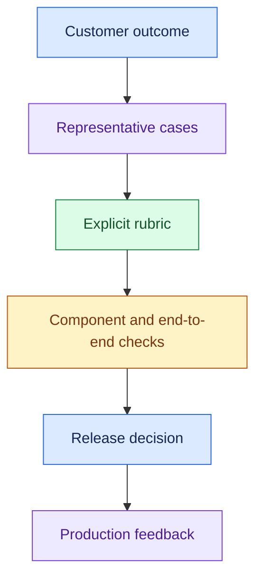
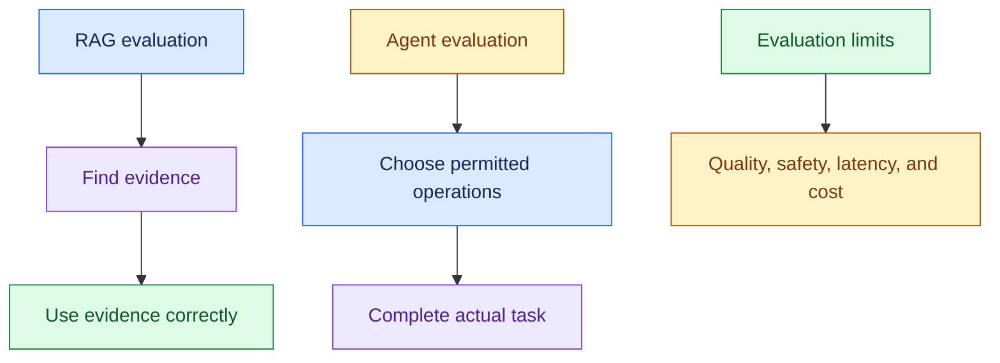
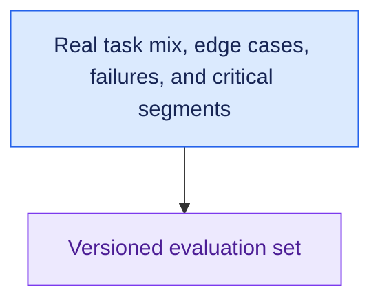
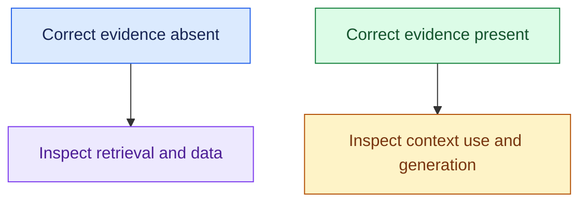
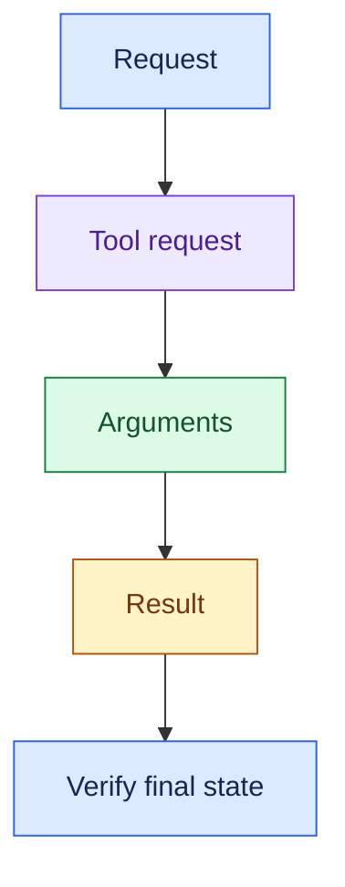
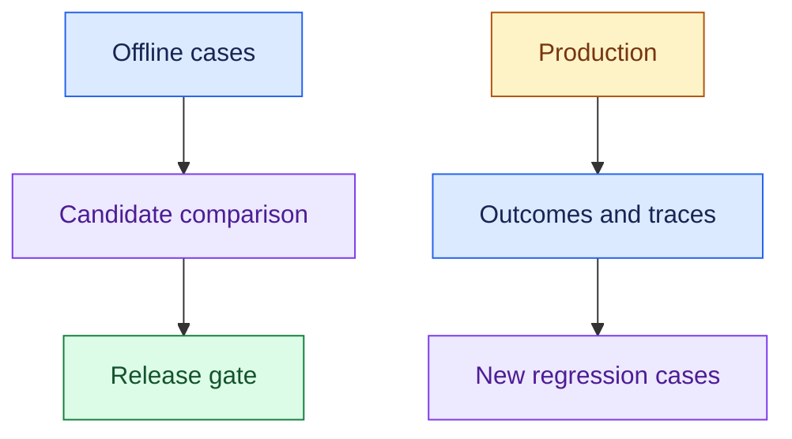
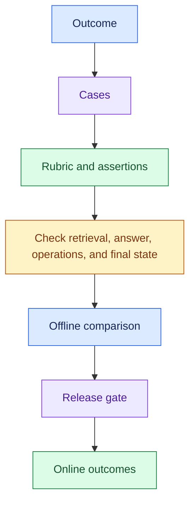

# Review 13: AI Evaluation

## Interview Review

### 1. What the Interviewer Is Testing

- Can you turn “good AI” into measurable criteria?
- Can you evaluate retrieval, generation, agent operations, and task outcome separately?
- Can you use deterministic checks and semantic review appropriately?
- Can you connect offline tests to real production outcomes?

### 2. Core Mental Model

- Check actual task completion as well as response quality.

### 3. Essential Concepts

#### 1. Define Success: Start From the Task

- Agree on correct completion, unacceptable outcomes, and operating limits.
- A refund task succeeds only when the correct permitted refund is confirmed, not when the model says “done.”

> “What must be true in the system of record for us to count this task as successful?”

#### 2. Representative Dataset: Cover Real Work and Hard Cases

- Include normal requests, ambiguous inputs, missing evidence, restricted data, tool failures, long workflows, and harmful instruction attempts.
- Separate development examples from held-out assessment.

> “I’d report results by task and risk segment, not only one overall score.”

#### 3. Retrieval Evaluation: Did We Find the Evidence?

- Check relevance and recall against labelled evidence, with a defined retrieval cutoff.
- Inspect whether relevant content survives into final context.

> “I’d separate candidate retrieval from context selection so we know where evidence was lost.”

#### 4. Answer Evaluation: Correct, Supported, and Useful?

- Evaluate correctness, groundedness, relevance, citations, and appropriate limitation statements.
- Groundedness means claims are supported by evidence; stale evidence can still make an answer wrong.

> “I’d check claim support and case correctness rather than reward the presence of a citation.”

#### 5. Agent Evaluation: Inspect Operations and Outcomes

- Check routing, tool selection, argument validity, access/policy compliance, observable trajectory, and actual completion.

- Evaluate recorded operations and decision summaries, not private model chain-of-thought, which is often hidden and not always faithful.
- Allow different valid paths when the task permits them.

> “The response and the enterprise state must agree about what happened.”

#### 6. Deterministic Checks: Test Explicit Conditions

- Use code or trusted assertions for schemas, required fields, known tool permissions, policy boundaries, duplicate effects, latency limits, and confirmed final state.

- Are tool arguments valid?
- Is the action authorised?
- Was the correct order updated?
- Did execution avoid duplicate refunds?

> “I’d use deterministic checks wherever the requirement has an unambiguous test.”

#### 7. Semantic Evaluation: Use Clear Rubrics

- Human or model-assisted judges can assess relevance, completeness, explanation quality, and claim support.
- Calibrate against expert labels and inspect disagreements.

> “A judge score is evidence from a rubric, not an unquestionable ground truth.”

- Keep judged content separate from judge instructions.
- Track judge/rubric versions and limitations; do not rely on the same model's self-confidence as proof.

#### 8. Offline vs Online: Test Before and Observe After Release

- Offline evaluation supports repeatable candidate comparisons.
- Online evaluation uses production traces, outcomes, overrides, and user feedback to detect real behaviour and drift.

- User ratings are useful but biased and incomplete.
- Reopened tickets or incorrect downstream state can contradict a positive rating.

#### 9. Compare and Diagnose: Quality Within Operating Limits

- Compare candidates on the same task set with quality, policy, latency, and cost criteria.
- Repeat or quantify uncertainty for variable behaviour where needed.

> “I’d locate the failing stage and critical segment before claiming an overall improvement.”

### 4. Requirement → Component Reasoning

| Requirement | Evaluation pattern | Why | Trade-off |
|---|---|---|---|
| Verify enterprise knowledge answers | Evidence labels + claim rubric | Separate retrieval and generation | Labelling effort |
| Confirm business actions | Tool/state assertions | Check real completion | Test-system integration |
| Detect policy violations | Boundary and permission cases | Check critical constraints | Maintaining realistic cases |
| Assess open-ended quality | Calibrated human/model rubric | Score semantic properties | Judge variability |
| Compare candidates | Versioned held-out benchmark | Repeatable comparison | Coverage limits |
| Catch production regressions | Outcome/traces + feedback | Observe actual workload | Delayed/noisy labels |

For a support workflow, check:

- Policy retrieval and support for each answer’s claims.
- Order-tool arguments and refund approval.
- Confirmed payment state and duplicate prevention.
- Resolution and reopened-ticket outcomes.
- Report latency and cost alongside task success.

### 5. Important Distinctions and Gotchas

1. **Retrieval vs generation:** missing evidence and mishandled evidence need different fixes.
2. **Groundedness vs correctness:** evidence support does not establish freshness or applicability.
3. **Deterministic vs semantic:** explicit assertions vs rubric-based judgement.
4. **Offline vs online:** controlled comparisons vs actual production behaviour; neither replaces the other.
5. **Response quality vs completion:** polished language cannot prove a cancelled order or issued refund.

### 6. Trigger → Concept Table

| Hear… | Think… | Evaluate… |
|---|---|---|
| “Wrong policy retrieved” | Retrieval | Relevant evidence at cutoff |
| “Right policy, unsupported claim” | Generation | Claim support and rubric |
| “Says cancelled, order active” | Task success | Confirmed downstream state |
| “Wrong tool arguments” | Deterministic checks | Schema and task-specific values |
| “New prompt better on 20 cases” | Coverage/uncertainty | Held-out segments and failures |
| “Ratings high, tickets reopen” | Online outcomes | Resolution and delayed feedback |
| “Judge approves everything” | Calibration | Expert disagreements and rubric |

### 7. Interview Phrases

> “I’d evaluate retrieval, generation, and final task completion separately.”

> “I’d use code for explicit assertions and calibrated rubrics for semantic quality.”

> “I’d report critical segments and failure cases instead of hiding them in an average.”

> “Offline evaluation informs release; online outcomes show whether it works in practice.”

### 8. Practice Questions

1. Design evaluation for policy answers and an action-taking refund workflow.
2. Which assertions can be deterministic, and which need semantic judgement?
3. A model cites the wrong policy but sounds correct. How do retrieval and answer checks catch it?
4. The response says an order was cancelled, but it remains active. What evidence proves failure?
5. A candidate improves overall scores but fails more high-risk cases. How do you make the release decision?

---

## One-Page Memory Card: AI Evaluation

- **Core question:** Did the system complete the right task, using permitted operations and acceptable evidence, within operating limits?

### Recall Flow

### Checklist

| Layer | Check |
|---|---|
| Dataset | Real task mix, held-out cases, critical segments, ambiguity/failures |
| Retrieval | Relevant evidence, recall at cutoff, final context retention |
| Answer | Correctness, groundedness, relevance, citation support, limitations |
| Agent | Routing, tools, arguments, permissions, policy, observable trajectory |
| Outcome | Confirmed final state, successful resolution, no duplicate effects |
| Deterministic | Schema, exact values, permissions, thresholds, state assertions |
| Semantic | Human/model rubric for meaning, completeness, support; calibrated judges |
| Offline | Repeatable candidate comparison before exposure |
| Online | Production outcomes, traces, overrides, ratings, reopened cases |
| Operations | Latency, cost, failures, task-level efficiency |

### Trigger → Concept

| Hear… | Think… |
|---|---|
| “Missing source” | Retrieval/data evaluation |
| “Source present, wrong answer” | Generation/context use |
| “Wrong tool/input” | Deterministic operation checks |
| “Sounds done, state unchanged” | End-to-end task failure |
| “Only 20 good examples” | Coverage and held-out testing |
| “Ratings disagree with outcomes” | Online labels and delayed results |
| “Judge unreliable” | Rubric calibration and expert review |

### Do Not Confuse

1. **Good answer vs successful task:** enterprise state must match the claim.
2. **Grounded vs correct:** stale or inapplicable evidence can support a wrong answer.
3. **Assertion vs judge:** exact conditions vs semantic assessment.
4. **Offline vs online:** controlled evidence vs real production outcomes.

### Evaluation Rules

- Define success and unacceptable behaviour with the customer first.
- Include missing-answer, denied-access, tool-failure, and uncertain-action cases.
- Use the same benchmark for candidate comparisons; report task/risk segments, not only averages.
- Inspect variable outcomes when conclusions depend on small differences.

- Capture observable tools, results, state transitions, decision summaries, and evidence.
- Private model reasoning is often hidden and may not faithfully explain behaviour.
- Different trajectories can be valid; evaluate constraints and outcomes rather than forcing one exact sequence.

- Model-assisted judging needs a clear rubric, versioning, and calibration against expert judgements.
- A model's confidence and a thumbs-up are not sufficient proof.
- Add production failures and overrides to future regression cases while maintaining a held-out assessment boundary.

### 30-Second Answer

Practise these points as one spoken answer:

- “I’d define task success and build representative normal, edge, and failure cases.”
- “I’d check retrieval and claim support separately, then verify tool calls and final system state.”
- “I’d use code for explicit assertions and calibrated rubrics for semantic quality.”
- “I’d compare quality, safety, latency, and cost offline, then monitor real outcomes and regressions in production.”

## Sources (checked 27 Sep 2026)

- [Chen et al. 2025, Reasoning Models Don't Always Say What They Think (arXiv 2505.05410)](https://arxiv.org/abs/2505.05410): chain-of-thought is not always faithful
- [Zheng et al. 2023, Judging LLM-as-a-Judge with MT-Bench and Chatbot Arena (arXiv 2306.05685)](https://arxiv.org/abs/2306.05685): LLM-judge bias, calibration
