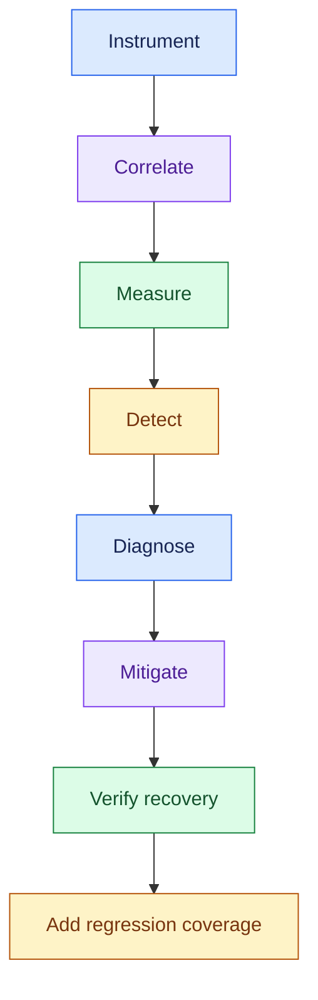
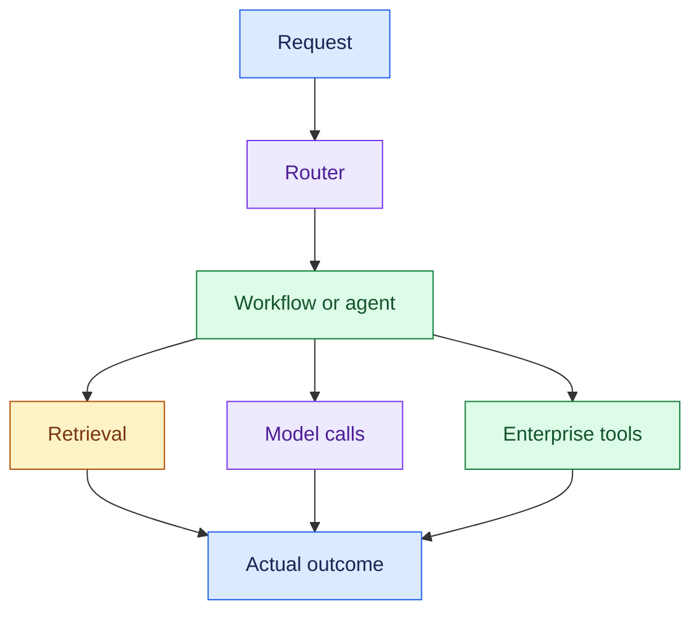
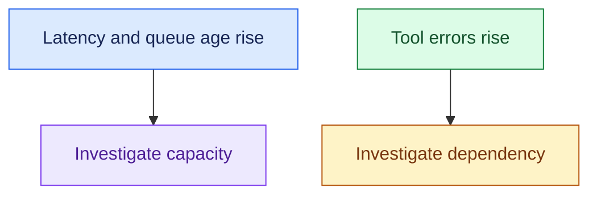
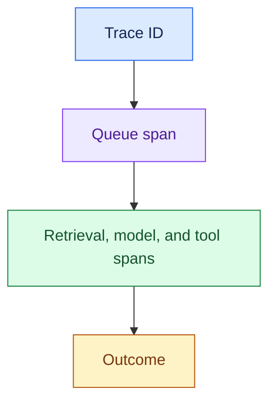
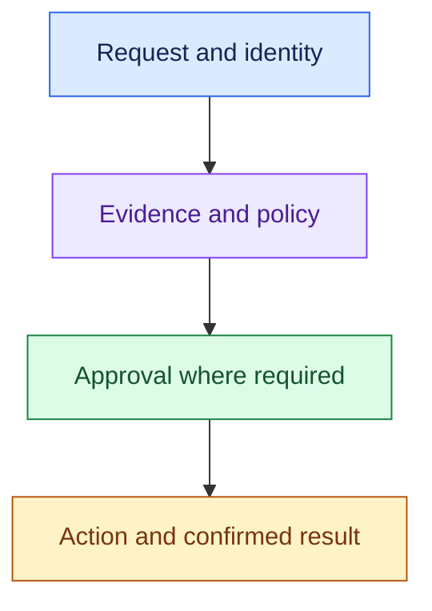
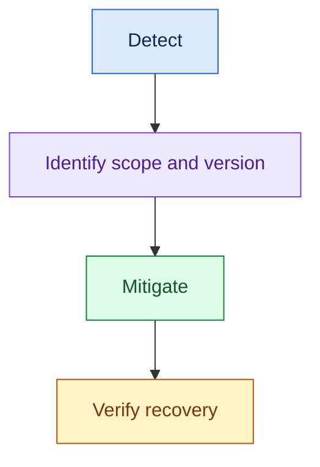

# Review 15: Observability & Production Operations

## Interview Review

### 1. What the Interviewer Is Testing

- Can you explain a slow, failed, expensive, or incorrect request from evidence?
- Can you distinguish logs, metrics, traces, and business audit?
- Can you connect operating targets to measurements and incident response?
- Can you collect useful AI telemetry without unrestricted sensitive-data logging?

### 2. Core Mental Model

- The order and branching depend on the task.
- Correlate the whole path, including queue wait, retries, and asynchronous continuation.

### 3. Essential Concepts

#### 1. Logs: Record Specific Events

- Use structured events for errors, state transitions, policy outcomes, and dependency responses with task/request identifiers.

> “Logs tell me what happened at a specific step, with enough context to investigate.”

- Structured event fields: task ID, timestamp, stage, version, and status or error.

- Avoid indiscriminate prompt, credential, or document dumps.
- Access and retention must match data sensitivity.

#### 2. Metrics: Measure Patterns Over Time

- Track request/task rates, latency distributions, failures, queue age, active work, tokens, cost, escalations, and task outcomes.

> “Metrics show whether the problem is widespread and which workload is affected.”

- Segment by important workload, tenant cohort, and release version.
- Keep metric dimensions bounded; individual request IDs belong in logs/traces, not unrestricted metric labels.

#### 3. Distributed Traces: Follow One Task Across Boundaries

- Use correlated spans for queue, retrieval, model calls, tools, and orchestration.
- Carry identifiers across async jobs and retries where possible.

> “For the eighteen-second request, I’d inspect the trace's critical path and slow spans.”

- Parallel spans overlap; nested spans must not be double-counted.
- Trace sampling affects which requests remain inspectable.

#### 4. AI Telemetry: Capture More Than Server Health

- Record the model, provider, configuration, tokens, and call count.
- Link retrieval source IDs, controlled tool records, retries, and agent steps to the task.
- Capture outcome signals and minimise sensitive fields.

> “I’d connect model and tool usage to the task outcome; CPU and HTTP status alone are not enough.”

- Capture evidence references and decision summaries, not private model chain-of-thought, which is often hidden and not always faithful.
- Apply minimisation or redaction to sensitive fields.

#### 5. Audit: Reconstruct Business Decisions

- Record who requested and approved an action, applicable evidence/policy, exact action, and confirmed result.
- Protect audit records according to customer access and retention requirements.

> “For a disputed refund, I need the business decision trail, not only a latency trace.”

#### 6. SLI / SLO / SLA: Measurement, Target, Commitment

- A service-level indicator (sli) is the measured service behaviour.
- An SLO is its target.
- A service-level agreement (sla) is an agreed service commitment, often including consequences.

- SLI: Measured share of eligible tasks completed within X
- SLO: Target share over an agreed window
- SLA: Customer agreement about the promised service

> “I’d define the measurement boundary and eligible requests before setting the target.”

- Targets and exclusions must be explicit.
- Do not imply universal numbers or invent contractual terms.

#### 7. Alerts and Runbooks: Make Detection Actionable

- Alert on customer impact, meaningful target breaches, dangerous actions, or actionable dependency/queue conditions.
- Define owner, investigation steps, and permitted mitigation.

> “An alert should tell the responder what is affected and what to do next.”

- Avoid alerting on every harmless fluctuation.
- Latency and uptime alerts do not replace quality or confirmed-action checks.

#### 8. Production Learning: Turn Incidents Into Better Coverage

- Correlate delayed task outcomes, reopened tickets, human overrides, and version changes.
- Add validated failure cases to evaluation and improve instrumentation gaps.

> “After mitigation, I’d verify recovery and turn the incident into a regression case.”

### 4. Requirement → Component Reasoning

| Requirement | Pattern / component | Why | Trade-off |
|---|---|---|---|
| Explain one slow task | Correlated distributed trace | Locate critical path | Instrumentation and sampling |
| Detect broad degradation | Metrics + workload/version views | Observe patterns | Aggregation can hide segments |
| Diagnose specific failures | Structured logs | Inspect exact events | Sensitive-data and retention limits |
| Attribute AI cost/behaviour | Model/tool/retrieval telemetry | Link usage and outcome | Collection/label effort |
| Explain business action | Controlled audit records | Reconstruct authorisation and result | Storage and privacy |
| Respond consistently | Alerts + owned runbooks | Connect detection to mitigation | Maintenance and alert fatigue |

- **Support example:** an eighteen-second case may show twelve seconds of queue wait and a tool retry.
- A disputed refund separately needs policy, approval, action identifier, and payment result.
- A reopened case links delayed failure to its release version and original task.

### 5. Important Distinctions and Gotchas

1. **Logs vs metrics vs traces:** specific events vs aggregate behaviour vs one correlated path.
2. **Observability vs audit:** system diagnosis vs explanation of a business decision/action.
3. **SLI vs SLO vs SLA:** measurement vs internal target vs agreed commitment.
4. **Response success vs task success:** a successful HTTP response can contain a failed or unconfirmed business operation.
5. **More data vs useful evidence:** sensitive dumps and uncontrolled dimensions can harm operations without improving diagnosis.

### 6. Trigger → Concept Table

| Hear… | Think… | Inspect… |
|---|---|---|
| “Slow request yesterday” | Trace | IDs, queue, critical spans |
| “All tenants slower” | Metrics | Rate, saturation, versions, dependency patterns |
| “Exact error?” | Structured logs | Stage and error category |
| “Tokens and cost rose” | AI telemetry | Calls, models, retries, workload mix |
| “Why did it refund?” | Audit | Evidence, rule, approver, actual result |
| “Did we meet the promise?” | SLI/SLO/SLA | Defined window and service commitment |
| “Alert but no owner” | Operations gap | Runbook and response responsibility |

### 7. Interview Phrases

> “I’d use metrics to locate the scope, traces to locate the slow path, and logs to inspect specific failures.”

> “I’d correlate usage and operations with actual task outcomes.”

> “Observability explains system behaviour; audit explains the business action.”

> “I’d define measurement boundaries, owners, and mitigation steps alongside the targets.”

### 8. Practice Questions

1. A request took eighteen seconds yesterday. What identifiers and spans would you need?
2. Explain logs, metrics, and traces using one refund workflow.
3. Which AI-specific signals reveal an agent loop or model-cost regression?
4. A customer disputes a refund. What audit facts differ from operational telemetry?
5. Define an SLI and SLO for interactive response latency, and explain how an SLA differs.

---

## One-Page Memory Card: Observability & Production Operations

- **Core question:** Can we explain the system's behaviour and act on customer-impacting problems?

### Recall Flow

### Checklist

| Evidence | Role |
|---|---|
| Logs | Structured events: timestamp, task/request ID, stage, version, status/error |
| Metrics | Task rates, latency percentiles, errors, queue age, active work, cost/outcomes |
| Traces | Correlated spans across queue, router, agent, retrieval, models, tools |
| AI telemetry | Model/config, tokens, calls, steps, retries, evidence IDs, controlled tool records |
| Audit | Identity, evidence, policy, approval, exact action, confirmed result |
| Targets | Defined SLI, SLO, window, eligible workload; customer SLA if applicable |
| Operations | Actionable alerts, owner, runbook, mitigation, recovery verification |
| Learning | Delayed outcomes, overrides, reopened cases, release-linked regressions |

### Trigger → Concept

| Hear… | Think… |
|---|---|
| “One slow task” | Trace and critical path |
| “Broad slowdown” | Metrics and saturation by segment |
| “What error occurred?” | Structured event logs |
| “More model spending” | Tokens, calls, retries, model/workload mix |
| “Why issue this refund?” | Business audit |
| “Met target / promise?” | SLI vs SLO vs SLA |
| “Nobody responds” | Owned alert/runbook |

### Do Not Confuse

1. **Logs/metrics/traces:** events / trends / correlated execution path.
2. **Observability/audit:** system behaviour / business decision and action.
3. **SLI/SLO/SLA:** measured indicator / target / agreed service commitment.
4. **HTTP success/task success:** returning a response does not prove an action completed.

### Target Example

- SLI: Observed share of eligible tasks completed within X
- SLO: Agreed target share for a defined window
- SLA: Customer service commitment and agreed consequences

- Confirm X, the workload, window, and exclusions.
- Track first useful output and final completion separately when appropriate.
- Infrastructure health alone does not measure answer quality or business success.

### Diagnostic Rules

- Start with impact, scope, and version changes.
- Inspect queue wait separately from processing.
- Follow async task IDs and retries.
- Parallel spans overlap; nested durations cannot be summed blindly.
- Sampling may mean the exact historical trace is unavailable, so preserve enough metrics and events for useful diagnosis.

- Minimise sensitive data in telemetry and restrict retention/access.
- Use evidence references and decision summaries rather than private model reasoning, which is often hidden and not always faithful.
- Avoid request IDs as unbounded metric dimensions.
- After mitigation, verify recovery and add validated failure cases to regression coverage.

### 30-Second Answer

Practise these points as one spoken answer:

- “I’d correlate requests and tasks across queues, retrieval, models, and tools.”
- “Metrics would show customer impact, traces would identify the critical path, and structured logs would explain specific events.”
- “AI telemetry would connect calls, tokens, and operations to outcomes, while audit would capture business decisions.”
- “Defined targets, owned alerts, and runbooks would turn that evidence into incident response and learning.”

## Sources (checked 27 Sep 2026)

- [Chen et al. 2025, Reasoning Models Don't Always Say What They Think (arXiv 2505.05410)](https://arxiv.org/abs/2505.05410): chain-of-thought is not always faithful
- [Prometheus - Metric and label naming](https://prometheus.io/docs/practices/naming/): bounded metric labels
