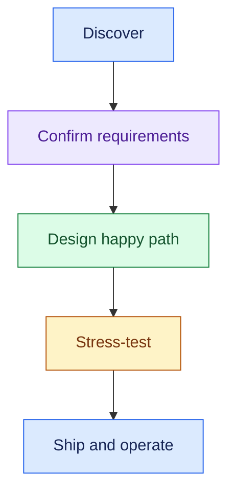
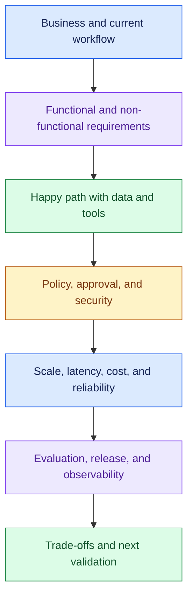
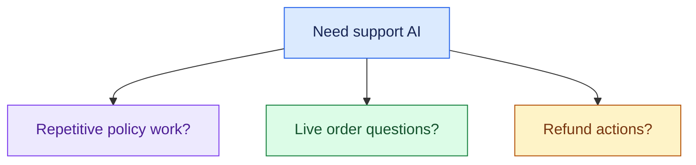
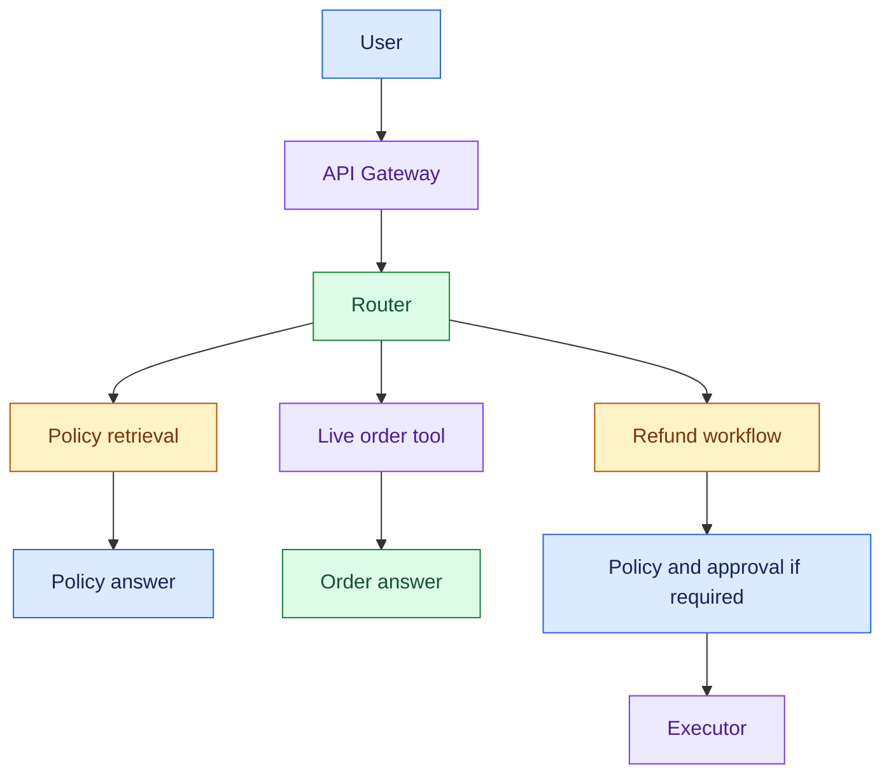
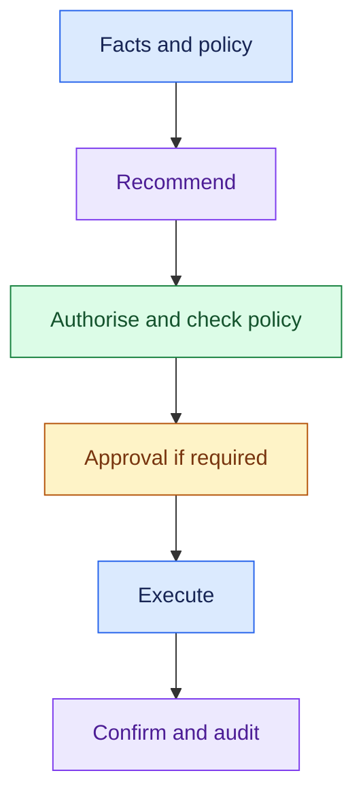
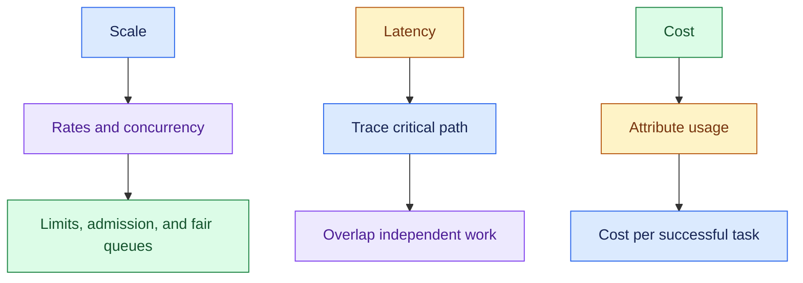
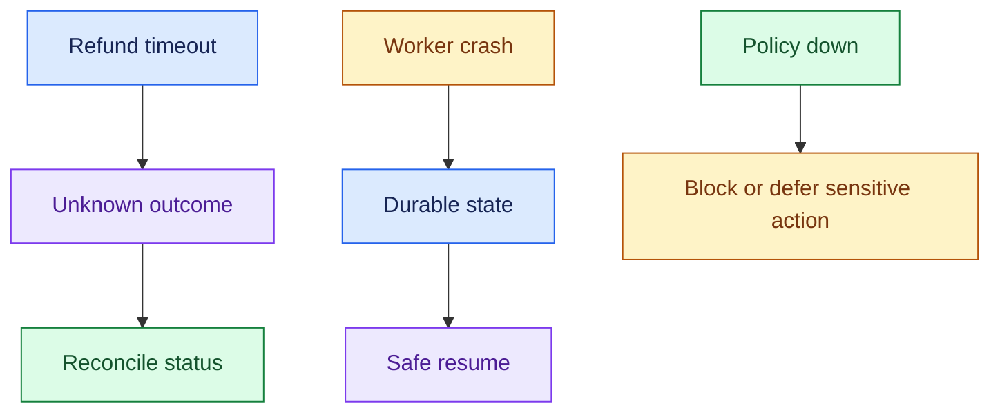
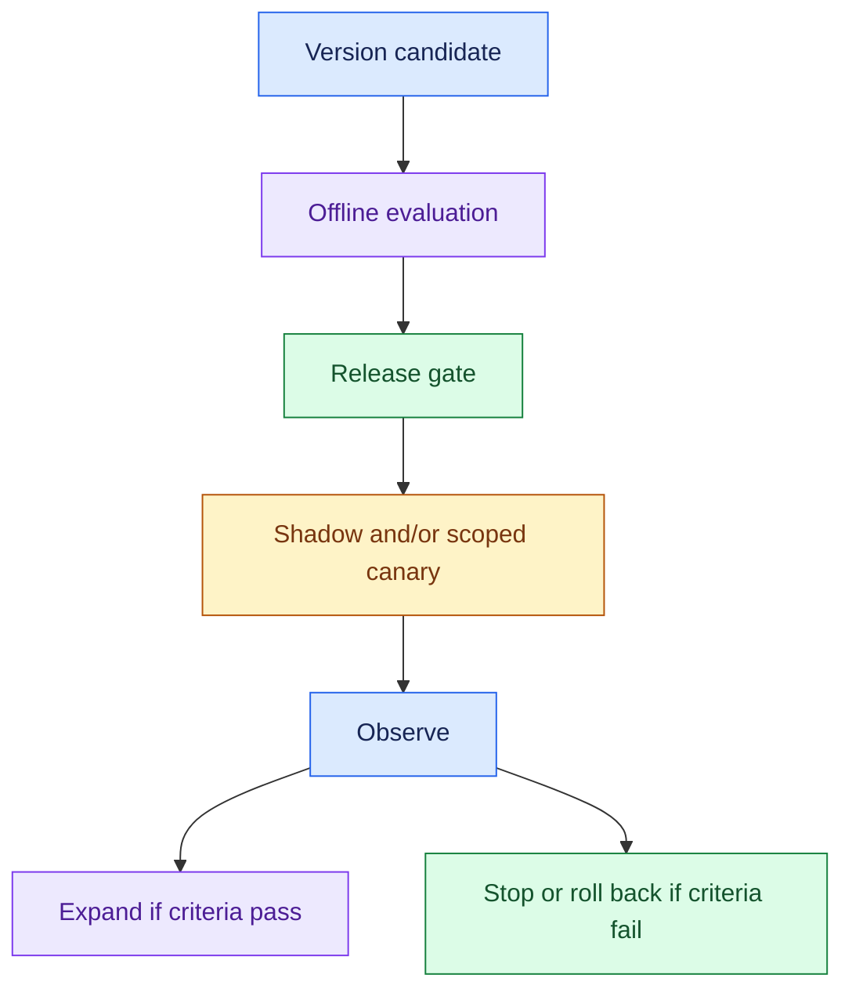
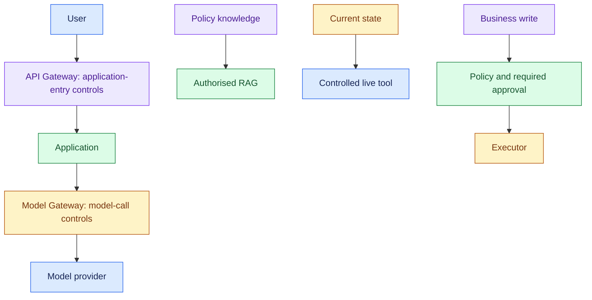

# Review 18: End-to-End FDE Interview Execution

## Interview Review

### 1. What the Interviewer Is Testing

- Can you lead a customer problem from discovery to a justified design?
- Can you connect requirements, data, tools, actions, and operating constraints?
- Can you adapt when scale, risk, or customer priorities change?
- Can you explain how the system is evaluated, released, and operated?

### 2. Core Mental Model

Keep the full interview flow available:

- NFRs: non-functional requirements.
- RAG: retrieval-augmented generation.
- HITL: human-in-the-loop.
- Cover these areas according to relevance; do not force an agent or an action workflow into an answer-only use case.

### 3. Essential Concepts

#### 1. Open With Discovery: Start Above the Architecture

- Clarify the business outcome and current workflow.
- Let customer answers guide questions about users, scale, data, autonomy, success, failures, and constraints.

> “What problem matters most, and how is this handled today?”

#### 2. Summarise Requirements: Confirm Before Designing

- State capabilities and measurable operating limits separately.
- Include access boundaries, permitted writes, approvals, and safe failure behaviour.

> “Let me summarise what the system must do, the operating limits, and the assumptions we still need to confirm.”

- Must do: Policy answers + order reads + approved refunds
- Must meet: Agreed quality, latency, availability, cost, security

- Do not invent targets as customer facts.
- Label provisional assumptions explicitly.

#### 3. Draw the Small Happy Path: Assign Responsibilities

- Start with the minimum components that satisfy confirmed needs.
- Explain each box through its requirement.

> “This component exists because the customer needs ___.”

- API Gateway = User → Application control.
- Model Gateway = Application → Model control.
- Add centralised model-call control when provider routing, limits, fallback, or tracking requires it.

#### 4. Walk One Real Request: Make the Diagram Concrete

- Follow inputs, trusted identity, evidence, live reads, model calls, policy, action, and actual outcome.
- Identify context and durable state where needed.

> “For a refund request, I’d retrieve the applicable policy and read live order facts before recommending an action.”

#### 5. Choose Autonomy Deliberately: Workflow Before Unneeded Complexity

- Use defined workflows for known steps and rules.
- Add bounded reasoning where observations need to guide the next step.
- Justify multi-agent coordination with a concrete benefit.

> “Which part requires flexible reasoning, and which part can stay deterministic?”

- Bound tools, steps, retries, tokens, time, and cost.
- A model's confidence is not authority to perform a business write.

#### 6. Stress-Test the Design: Scale, Latency, Cost

- Translate user count into peak requests, concurrent tasks, and model/tool demand.
- Identify the bottleneck, protect capacity, and keep tenants fair and isolated.

> “I’d optimise the measured bottleneck while preserving the agreed quality and safety floor.”

#### 7. Explain Failure and Recovery: Include Unknown Writes

- Classify failures; set deadlines, bounded safe retries, fallback, and escalation.
- Persist long tasks and approval state.
- Reconcile writes that may have completed remotely.

> “A timeout does not prove a refund failed; recovery must not issue it twice.”

#### 8. Evaluate, Release, Operate: Close the Production Loop

- Evaluate retrieval, supported answers, tool arguments, policy compliance, and confirmed task outcomes.
- Version behaviour, gate candidates, and limit exposure with appropriate rollout controls.

- Observe latency, cost, errors, usage, and actual outcomes.
- Audit business actions.
- Shadow candidates must not duplicate real writes.

#### 9. Close With Trade-Offs and Next Evidence

- Summarise how the design meets the problem, why it is appropriately simple, and which assumptions require validation.

> “I’m choosing X because of requirement Y. The trade-off is Z, and I’d verify it using W.”

- Name what would change the design: new workload, stricter residency, failed quality targets, approval delays, or rising cost.

### 4. Requirement → Component Reasoning

| Discovery answer | Requirement | Design consequence | Trade-off |
|---|---|---|---|
| Policies are reference material | Supported policy answers | Permission-aware RAG | Freshness and retrieval quality |
| Order state changes frequently | Current facts | Live order API | Dependency latency/failure |
| Refunds affect payments | Controlled writes | Policy + executor + idempotency | State and reconciliation |
| Managers approve some cases | Durable human review | Approval state + resume path | Delay and reviewer load |
| Tasks run for minutes | Deferred completion | Queue + durable jobs + status | Result-delivery complexity |
| Several tenants share capacity | Isolation and fair service | Scoped data + quotas/scheduling | Operational complexity |
| Multiple providers needed | Controlled model calls | Model Gateway if justified | Fallback compatibility |

### 5. Important Distinctions and Gotchas

1. **Discovery flow vs script:** use the customer's answer to select the next question; check coverage afterward.
2. **Logical responsibility vs separate service:** a small architecture can combine responsibilities without losing the boundary.
3. **Checklist vs mandatory pipeline:** skip irrelevant capabilities; permissions and failure handling apply throughout.
4. **Response vs task result:** “Refund completed” must match confirmed payment state.
5. **Completeness vs depth:** give a coherent end-to-end design, then deepen the areas the customer or interviewer makes important.

### 6. Trigger → Concept Table

| Hear… | Think… | Next move |
|---|---|---|
| “Design an AI system” | Discovery | Outcome and current workflow |
| “What must it do?” | FRs | Summarise capabilities and permitted actions |
| “Now 100K users” | Workload/scale | Rates, concurrency, bottleneck |
| “Too slow / expensive” | Measurement | Critical path / total cost per success |
| “Can it act automatically?” | Autonomy/policy | Permission, rule, review, executor |
| “What if it fails?” | Recovery | Dependency-specific behaviour and unknown writes |
| “How would you ship it?” | Evaluation/release | Gate, cohort, monitor, rollback |
| “Why this design?” | Trade-offs | Requirement, simpler option, evidence |

### 7. Interview Phrases

> “Before choosing architecture, I’d understand the outcome and current workflow.”

> “I’ll confirm the requirements and assumptions, then walk through one representative request.”

> “I’ll keep known business rules deterministic and use bounded reasoning where it adds value.”

> “Next I’d stress-test this for load, slow dependencies, and uncertain actions.”

> “I’ll close with evaluation, rollout, operating visibility, and the main trade-offs.”

### 8. Practice Questions: Full Cases

- Solve without opening earlier reviews.
- Use the five-stage flow and explain one request, one failure, and one trade-off.

1. **Customer support:** answer policies, check orders, issue permitted refunds. Cover discovery, requirements, RAG/tools, approval, duplicate prevention, scale, and confirmed outcomes.
2. **Enterprise knowledge:** millions of documents with employee-specific permissions. Cover ingestion, authorised retrieval, freshness, latency, and answer evaluation.
3. **Logistics or SRE operations:** investigate exceptions/incidents and perform allowed remediation. Cover events, tools, scoped access, bounded reasoning, policy/HITL, recovery, kill switch, and audit.
4. **Deep research:** work lasts 10–20 minutes across several sources. Cover async status, durable progress, evidence quality, task budgets, cost, and recovery.
5. **Multi-tenant platform:** enterprise customers share multiple model providers. Cover the two gateways, isolation, fairness, quotas, attribution, provider compatibility, and rollout.

### Final Self-Check

- Can I explain:
- Why this problem matters?
- What the system must do and within which limits?
- Why each box exists?
- Where data, state, authority, and side effects live?
- What happens during failure and overload?
- How we prove success and operate the release?

---

## One-Page Memory Card: End-to-End FDE Interview Execution

- **Core question:** Can I take a vague customer prompt through a justified, testable, operable design?

### Recall Flow

### Checklist

| Stage | Say / cover |
|---|---|
| Discover | Why, today, who/how much, data/integrations, autonomy, success, boundaries |
| Require | Capabilities, allowed actions, approvals, safe failures; measurable operating limits |
| Design | Minimum justified responsibilities; walk one request with evidence and live data |
| Authority | Agent recommends → policy decides → executor acts; scoped access throughout |
| State | Conversation, workflow progress, approval, action identifier/status where needed |
| Scale | Peak rates/concurrency, bottleneck, limits, admission, fair queues, durable workers |
| Latency/cost | Critical path; fewer unnecessary calls; cost per successful task |
| Recover | Deadlines, bounded safe retry, compatible fallback, reconcile unknown writes |
| Ship | Retrieval/answer/tool/outcome evaluation; version, gate, scoped rollout, rollback |
| Operate | Traces/metrics/logs, actual outcomes, audit, owners and mitigation |
| Close | Requirement → choice → trade-off → verification; open assumptions |

- FR = functional requirement.
- NFR = non-functional requirement.
- RAG = retrieval-augmented generation.
- HITL = human-in-the-loop.

### Trigger → Concept

| Hear… | Think… |
|---|---|
| “Need AI” | Discover the business pain |
| “Documents / current state” | RAG / live API |
| “Take action” | Permission + policy + executor |
| “Manager approval later” | Durable HITL |
| “100K users” | Actual peak workload |
| “Slow / costly” | Critical path / task economics |
| “Failure / timeout” | Safe recovery and unknown outcome |
| “Ready to release?” | Evidence, gate, cohort, monitoring |

### Do Not Confuse

1. **Framework vs fixed script:** follow customer answers and revisit missing buckets.
2. **Capability vs separate service/agent:** add complexity only when a requirement justifies it.
3. **Answer vs business result:** confirm downstream state before claiming completion.
4. **Coverage vs exhaustive depth:** establish the coherent design, then deepen important areas.

### Architecture Anchors

- State customer-confirmed targets or label assumptions.
- Check data/tenant permissions before retrieval or tools, preserve action identifiers during recovery, and never let shadow evaluation duplicate business writes.
- Async delivery suits long work but does not remove completion, cost, or capacity limits.

### 30-Second Opening

Practise these points as one spoken answer:

- “I’d first clarify the business outcome and current workflow, then users and scale, data and integrations, autonomy, success criteria, and constraints.”
- “I’d summarise the requirements and assumptions, sketch the minimum architecture, and walk one request.”
- “Then I’d test it against scale, latency, cost, and failures, and explain evaluation, rollout, observability, security, and trade-offs.”
