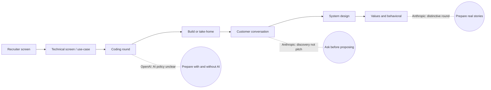

# OpenAI and Anthropic: interview-centric guide (shared pack)

This is a condensed, shared guide for Applied AI / FDE loops at OpenAI and Anthropic. It sits beside `OpenAI_Anthropic_Condensed_Plan.xlsx` (the reading plan) and `worked_solutions/` (coding). Known material (Databricks, Unity Catalog, MLflow, LangGraph basics) is deliberately left out. Where a theme touches your own work, the guide says "your story" and leaves the specifics to you.

Everything about the companies' loops comes from public guides, not first-hand reports. See "Confidence and sources" at the end.

## 1. How to use this pack

| Step | What | Time |
|---|---|---|
| 1 | Skim this guide once | 45 min |
| 2 | Work the Core Plan in the workbook, top to bottom | about 55 hours |
| 3 | Do the coding track (`OpenAI_AI_Assisted_Coding_Round/` plus `worked_solutions/`) | about 25 hours |
| 4 | Final week: weight by company (section 3) and take the timed final exam last | as needed |

No fixed deadline, so the Excel "Start Here" tab converts hours per day into days.

## 2. The loop as a map

Stages differ between guides and between roles, so treat this as a superset of what you may meet.

## 3. What each company appears to weight

| Theme | OpenAI | Anthropic |
|---|---|---|
| Coding | Practical, staged, refactor, tests; AI policy conflicting | Practical multi-stage; live rounds no-AI unless told |
| Build / take-home | About 5 hours on OpenAI APIs with a recorded video walkthrough (FDE report) | 3 to 4 hour build against a brief (one guide) |
| Evaluation | "How do you know it works" is a differentiator | Evaluation harness design is a listed focus |
| Customer conversation | Walkthrough and presentation skill | Simulated discovery call: ask, do not pitch |
| MCP and tooling | Function calling, structured outputs | MCP deployment is a listed topic |
| Values | Standard behavioral | Distinctive: conflict, mistakes, mission skepticism |

## 4. The shared core in eight themes

Each theme: the frame to say first, what you will be asked, an answer skeleton, and where to read more. Use the workbook for the exact documents.

### 4.1 Discovery and scoping (both; critical for Anthropic)
- **Frame:** "Before I design anything I want to understand the job to be done, who the users are, what happens today, what a good outcome is, and what the constraints are."
- **Expect:** A vague request such as "we want an AI assistant for support".
- **Skeleton:** Current workflow and pain, success metric and baseline, data and access, risk tier of mistakes, who approves, constraints (latency, cost, regulatory), what has failed before. Then restate the problem and propose a smallest useful first release.
- **Traps:** Pitching a solution in the first two minutes, naming a model before the problem, ignoring who owns adoption.
- **Docs:** discovery workbook, executive communication templates.

### 4.2 Architecture and RAG (both)
- **Frame:** Retrieval quality is a data and permissions problem before it is a model problem.
- **Skeleton:** Ingestion and parsing, chunking with metadata, hybrid retrieval, rerank, context packing, generation with citations, evaluation and feedback loop.
- **Failure modes to be able to name:** stale index, bad parsing, wrong chunk size, missing filters, permission leakage, lost-in-the-middle, conflicting sources, silent embedding mismatch after a model change.
- **Permissions:** filter by tenant and ACL before ranking and before top-k; include permissions in cache keys. See `retrieve` in `worked_solutions/solutions.py`.
- **Data plumbing:** sync and CDC, ACL propagation, deletion and revocation, identity mapping.

### 4.3 Agents, tools, MCP and human approval (both)
- **Frame:** "LLM where there is ambiguity, deterministic code where correctness or safety matters."
- **When not to use an agent:** fixed steps, strict correctness, tight latency or cost.
- **Skeleton for an agent design:** goal and boundaries, tool catalogue with read/write and risk tier per tool, state and memory, loop with step and budget limits, approval points, failure handling, tracing, evaluation.
- **Side-effect tools:** idempotency keys, approval, audit log, never cache denials. See `IdempotentProcessor`.
- **MCP:** client, server, tools, resources, prompts; narrow permissioned tools; identity propagation; treat tool output as untrusted; schema drift and timeouts as failure modes.
- **HITL:** risk tiers, approval queue and SLA, override and audit fields, automation maturity ladder (suggest, draft, approved write, autonomous within limits).

### 4.4 Evaluation (both; OpenAI's differentiator)
- **Frame:** "Evaluation is a process, not a metric."
- **Skeleton:** Define risk and dimensions, build a golden set from real cases, automated checks first (schema, tools used, groundedness), then LLM-judge with calibration against human labels, regression on every change, shadow and canary in production, customer acceptance criteria.
- **Agent-specific:** trajectory evaluation (right tools, right order, no loops), tool-call accuracy, cost per task, human override rate.
- **Judge pitfalls:** position and verbosity bias, self-preference, drift, leakage of eval data into prompts.

### 4.5 Security and privacy (both; strong for Anthropic)
- **Prompt injection:** treat all retrieved and tool content as untrusted data; least privilege per tool; policy check on proposed actions; approval for side effects; detect anomalies.
- **Data:** tenant isolation, PII redaction, retention and deletion, audit trails, OAuth/OIDC/SAML basics.
- **Red-team habit:** for each feature, name the attack, the signal that detects it, the mitigation and the launch gate.

### 4.6 Production operations and incidents (both)
- **Incident frame:** stabilise, scope the blast radius, communicate, find the cause with evidence (retrieval, context, generation, tools, infra), fix, prevent recurrence.
- **Debugging order:** reproduce, classify the failure layer, inspect traces, blame the model last.
- **Cost and latency:** decompose per request (tokens in and out, retrieval, tool calls), then cache with permissions, route by difficulty, batch where latency allows.
- **LLMOps:** prompt registry and versions, golden sets, canary and rollback.

### 4.7 Customer conversations and executive communication (both)
- **Rewrite technical updates for executives:** lead with the decision and the risk, then evidence, then next step.
- **Failed demo:** acknowledge, isolate, show a fallback, agree a follow-up. Do not improvise fixes live.
- **Objections:** restate, find the concern behind it, answer with evidence, propose a safe pilot.

### 4.8 Values and behavioral (critical for Anthropic)
- Prepare 6 real stories: a moral or ethical conflict, a time you were wrong, pressure from an executive, a customer you said no to, a failure you owned, and a time you changed your mind.
- Use situation, your decision, what it cost, what you learned. Keep it honest; Anthropic guidance describes the round as probing ethical reasoning and mistakes.
- Form a considered view on AI safety and be ready to disagree thoughtfully.
- Your story: pick examples from your own delivery work rather than a library script.

## 5. Coding track in brief

- **OpenAI:** staged gates, refactor with tests green, edge cases and tests unprompted; with or without AI, depending on the policy you confirm.
- **Anthropic:** practical multi-stage exercise; live rounds are reported as no-AI unless told, so practise without your assistant too.
- **Worked solutions** (`worked_solutions/solutions.py`, tests in `test_solutions.py`, 23 tests passing):

| Problem type | Function or class | Key decision |
|---|---|---|
| Tool-call validation | `validate_tool_args` | Validate before executing; report all errors at once |
| Retry with backoff | `retry_with_backoff` | Retry only transient errors, jitter, cap |
| Idempotent processor | `IdempotentProcessor` | Same key and payload returns the same result; failures not cached |
| Circuit breaker | `CircuitBreaker` | One probe in half-open |
| Rate limiter | `RateLimiter` | Lazy token refill, per-tenant buckets |
| Permission-aware retrieval | `retrieve` | Filter before ranking; deny by default |
| Loop detector | `LoopDetector` | Repeats and short cycles |
| Fallback router | `FallbackRouter` | Deterministic order, per-model breakers, only retryable errors fall through |
| Output repair | `repair_json` | Cheap fixes first, then fail loudly |

## 6. Final-week checklist
- Confirm with each recruiter the stages, tools and AI policy for coding.
- Run two timed mocks from the coding kit.
- Answer 20 weak-vs-strong questions aloud.
- Rehearse your six values stories (Anthropic).
- Take the final exam last and score it.
- Have two questions of your own per interviewer.

## 7. Confidence and sources

| Claim | Confidence |
|---|---|
| Anthropic live interviews are no-AI unless stated; take-homes no-AI unless stated | High (official page) |
| OpenAI coding is practical and staged | High (several guides) |
| OpenAI AI policy in coding rounds | Low-medium (guides conflict) |
| Stage lists and timings for both companies | Low-medium (guides differ; none first-hand) |
| Anthropic values round and customer-conversation round | Medium and low-medium |

Sources:
- [Anthropic: how to collaborate with Claude during our hiring process](https://www.anthropic.com/candidate-ai-guidance)
- [Aced: Anthropic FDE interview guide](https://www.tryexponent.com/guides/anthropic-forward-deployed-engineer-interview)
- [Perspective: Anthropic Applied AI Engineer interview process](https://getperspective.ai/blog/anthropic-applied-ai-engineer-interview-process-frontier-lab-2026)
- [Aced: Forward Deployed Engineer interview guide 2026](https://www.tryexponent.com/blog/forward-deployed-engineer-interview-the-definitive-2026-guide-fde)
- [Aced: OpenAI FDE candidate experience](https://www.tryexponent.com/experiences/openai-forward-deployed-engineer-interview-0b9c09)
- [interviewing.io: OpenAI interview](https://interviewing.io/openai-interview-questions)
- [IGotAnOffer: OpenAI coding interview](https://igotanoffer.com/en/advice/openai-coding-interview)
- [Applied AI prep: OpenAI Applied AI Engineer guide](https://appliedaiprep.com/blog/openai-applied-ai-engineer-interview-guide)
