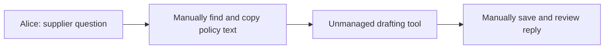
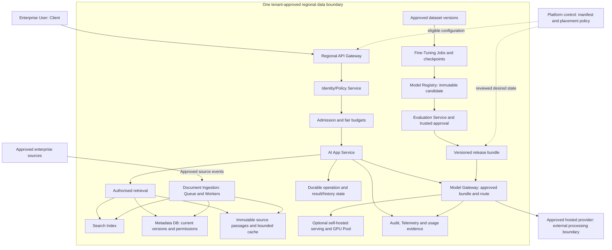
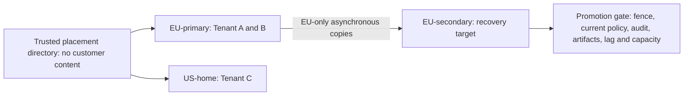

# Stage 0: Enterprise Use Case and Target Architecture

Alice, a procurement analyst in Tenant A, needs to answer a supplier question using current internal policy, draft a reply, and reopen the saved result. Other employees and companies need the same workflow with their own permissions, documents, budgets, and approved processing regions. The twelve stages build the platform that supports this journey.

Read this orientation before Stage 1. Allow about 25–35 minutes, including the walkthrough and recall questions. You do not need to understand every component yet. Stage 0 previews the destination; Stage 1 still starts with no system and builds the smallest useful drafting path. This is a hypothetical enterprise case. Requirements and numbers are teaching assumptions, and production integrations remain unverified.

## 1. Understand the Problem

### The Customer and the People Using the Platform

An enterprise wants employees to use approved AI tools without copying confidential documents into unmanaged services. The course follows one supplier-assistance workflow inside a reusable multi-tenant Enterprise AI Platform. A tenant is one customer organisation with its own users, policy, data, and resource budget.

| Person or team | Job in the supplier workflow | Required outcome |
| --- | --- | --- |
| Alice, enterprise user in Tenant A | Ask what confirmation is needed before promising a delivery date; prepare a supplier reply | A permitted, cited policy answer and a saved draft |
| Another employee in Tenant A | Use the same application with a different document permission set | Shared infrastructure does not expose Alice’s private history or restricted evidence |
| Tenant B and Tenant C | Run their own supplier-assistance workflows | Separate customer data and fair access to finite shared capacity |
| Tenant administrator and data owner | Connect approved sources and manage access, retention, and data purpose | Updated and deleted documents do not remain usable through stale indexes |
| Application team | Configure the supplier task, prompts, approved tools, and acceptance cases | Change behaviour through reviewed contracts rather than copied policy code |
| Release approver and model operations | Compare candidate prompts, retrieval settings, models, or adapters | Promote only a version with matching quality, safety, and lineage evidence |
| Platform and operations teams | Run shared services, budgets, regional recovery, and support | Diagnose failures, control cost, and preserve customer guarantees |

### One Complete Customer Story

Alice asks, “What confirmation do we need before promising a supplier delivery date?” The source policy says written confirmation is required. She should receive that rule with the exact source version and passage, then use it to prepare a reply. She reviews the draft; actually emailing a supplier is outside the implemented course workflow.

The platform must distinguish three related actions. Drafting from approved supplied text needs no document search. Answering from enterprise policy requires authorised current evidence. Preparing or indexing a long document needs durable background execution so a browser disconnect does not lose accepted work. All three belong to the same supplier workflow, but have different completion contracts.

Without the platform, Alice manually copies text into a drafting tool and saves the result herself. The tool has no trusted view of enterprise permission changes, source versions, or the organisation’s approved model route.



Starting diagram. Text alternative: Alice manually finds policy, copies it into a tool, and saves a draft. There is no implemented enterprise platform at the start of Stage 1.

### Functional Requirements for the Destination

| Requirement | What the reader should expect the target system to do | Where the design grows |
| --- | --- | --- |
| Authenticated drafting and saved history | Accept approved text, generate a draft, commit it, and let its owner reopen it | Stages 1 and 6 |
| Long-running work | Persist accepted jobs, bound retries, and inspect failures or uncertain effects | Stage 2 |
| Enterprise knowledge | Ingest changing sources, publish versioned passages, and retrieve current permitted evidence | Stages 3 and 6 |
| Shared service at higher demand | Scale the application while bounding requests, tokens, queues, and tenant shares | Stages 4 and 5 |
| Recoverable operations | Preserve operation identity and distinguish committed, stale, failed, and unknown outcomes | Stage 7 |
| Controlled AI changes | Evaluate task and safety slices; approve immutable bundles; canary and roll back eligible routes | Stage 8 |
| Model choice | Select an approved hosted route or assess a justified self-hosted alternative | Stage 9 |
| Governed custom behaviour | Compare prompting and retrieval with a bounded tuning trial; track data-to-model lineage | Stage 10 |
| Approved regional service | Keep data and processing inside tenant policy; recover only to an eligible regional cell | Stage 11 |
| Reusable internal platform | Onboard applications through versioned contracts with named owners and controlled migration | Stage 12 |

### Non-Functional Requirements and Planning Targets

These requirements describe correctness, availability, latency, isolation, and cost rather than another product feature. The numbers below come from different teaching stages. They are workload scenarios, not simultaneous measurements of one deployment.

| Requirement or assumption | Illustrative target or rule | Source and limit |
| --- | --- | --- |
| Pilot demand and latency | One active pilot user, 200 requests per eight-hour day, brief 0.5 requests/second peak; healthy p95 below five seconds | [Stage 1](../01-mvp/guide.md); a proposed target, not a measured service |
| Result durability | A completed saved-success response follows committed answer/history state | [Stage 1](../01-mvp/guide.md); the provider is outside the database transaction |
| Isolation and current access | Trusted services enforce tenant, user, resource access, approved egress, and audit | [Stage 6](../06-enterprise-security/guide.md); model text cannot grant permission |
| Overload | Bound queues and independent request/token/concurrency budgets; apply explicit tenant shares | [Stage 5](../05-overload-fairness/guide.md); scheduling cannot create provider capacity |
| Custom behaviour gate | At least 196 of 200 frozen schema cases pass, with zero known safety violations | [Stage 10](../10-fine-tuning/guide.md); supplied fixture counts do not prove real model safety |
| Regional recovery | A/B content stays in approved EU cells; C has a US home; assumed RPO ≤60 seconds and RTO ≤600 seconds | [Stage 11](../11-multi-region/guide.md); unavailable authority or unsafe promotion can miss the target |
| Recovery capacity scenario | Combined A/B peak of 60 requests/second, 1,000 tokens/request, and two-second active slots | [Stage 11](../11-multi-region/guide.md); plan app replicas, token budget, and slots separately |
| Economics | Count failed attempts, idle reserve, storage/networking, and operating labour per successful workflow | [Stages 11](../11-multi-region/guide.md) and [12](../12-staff-platform/guide.md); prices and savings are assumptions |

The 95th percentile, p95, is the latency threshold met by 95% of the defined measured population. Recovery point objective (RPO) bounds the acceptable data-loss window. Recovery time objective (RTO) bounds the acceptable restoration interval. A regional switch is incomplete until permitted customer work can succeed, not merely when a route changes.

## 2. Learn and Design

### The End-to-End Target Architecture

The destination has four connected paths: customer requests, enterprise document ingestion, quality/model changes, and platform/regional control. A component is a logical responsibility first. Several roles can share one application initially; the diagram does not prescribe a separate microservice, vendor, broker, or GPU deployment for every box.



Target diagram. Text alternative: an authenticated regional request passes current policy and admission, gathers authorised source evidence, calls an approved model through Model Gateway, and commits its result. Ingestion supplies versioned source/index state. Evaluation and optional training supply approved release identities. Platform control configures eligible regional execution; customer prompts stay out of the global control plane. A hosted provider is an approved external processing boundary whose geography and handling require separate checks.

The [offline architecture map](guide.html#target-map) shows the same four paths with selectable stage highlights. The full explanation remains visible without JavaScript. Read the customer request lane first, then inspect how the other lanes supply it.

### What Each Boundary Is Responsible For

| Boundary | Components | Why it exists and what it must not claim |
| --- | --- | --- |
| Identity and ingress | Client, API Gateway, Identity/Policy Service | Verify the caller and trusted tenant scope; a claimed tenant header or prompt is insufficient |
| Admission and execution | Bounded admission, fair scheduler, AI App Service | Protect finite request/token/slot capacity and execute the task; more app replicas do not remove downstream limits |
| Enterprise evidence | Document Ingestion, Queue, Workers, source objects, Metadata DB, Search Index, immutable cache | Turn source changes into retrievable passages while checking current versions, deletion, and access before disclosure |
| Model execution | Model Gateway, approved hosted adapter, optional self-hosted engine/GPU Pool | Resolve an approved compatible route and bounded request; spare GPUs do not authorise retrying unknown remote work |
| Durable outcomes | Operation records, saved results/history, job state | Persist identity and known completion; missing or processing state does not prove that an external call never happened |
| Quality and model lifecycle | Evaluation Service, release bundle, dataset versions, Fine-Tuning Jobs, Model Registry | Bind evidence to a specific candidate; successful training is not deployment approval |
| Operations | Audit, Telemetry, usage evidence | Trace decisions, detect failures, and reconcile spend; raw confidential prompts do not belong in unrestricted logs |
| Platform and regions | Versioned app manifests, placement policy, regional cells, migration controller | Reuse contracts and constrain placement/cutover; historical configuration is not current authorisation |

The Metadata DB is the logical relational authority for relevant state; this overview separates history and policy boxes to show different guarantees, not to require separate databases. Likewise, durable jobs can start with a database-backed queue. Later stages evaluate external services only when the requirement warrants them.

### Regions and Trust Boundaries

A regional cell contains the request and data services needed for assigned tenants. Tenant A and B have EU-primary and an eligible EU-secondary recovery target. Tenant C has US-home. A global directory carries only separately classified opaque placement information; it does not copy A/B prompts or documents into the US cell.



Regional diagram. Text alternative: A/B use EU cells and C uses its US cell. The EU secondary becomes a writer only after exclusive ownership and current eligibility are verified. Asynchronous copies can lose acknowledged operation evidence within the assumed recovery window; a missing copied row does not permit blind redispatch.

### Checkpoint: Does the Model Decide Access?

A restricted supplier pricing note is the best search hit. May the platform send it to the model and ask the model to hide it from Alice?

<details>
<summary>Reveal after answering</summary>

No. Trusted retrieval and current policy must stop the restricted content before model disclosure. Search relevance does not establish permission, and a model instruction cannot repair an unauthorised data transfer.

</details>

## 3. Observe and Experiment

### Follow Alice’s Request From Start to Finish

The [interactive walkthrough](guide.html#request-walkthrough) adds direct step selection, Previous/Next, Reset, and blocked/uncertain branches to this complete static flow. This is a request explanation, not an executing model or production simulator.

```mermaid
sequenceDiagram
 participant C as Alice and Client
 participant G as Regional API Gateway
 participant P as Current identity and policy
 participant A as AI App Service and operation store
 participant R as Authorised retrieval
 participant M as Model Gateway
 participant H as Saved history
 C->>G: Supplier question and stable operation key
 G->>P: Verify caller, tenant and allowed region
 G->>A: Admit bounded work under trusted scope
 A->>R: Resolve current permitted source versions
 alt No permitted current evidence
 R-->>A: No permitted current evidence
 A-->>C: Refuse grounded answer; no restricted context sent
 else Permitted evidence and approved route
 A->>M: Approved bundle, bounded context and fresh budget grant
 alt Known result and successful final commit
 M-->>A: Answer and original bundle identity
 A->>H: Commit answer with original source references
 A-->>C: Saved-success result and citation
 else Provider outcome unknown or final commit fails
 A-->>C: Inspectable incomplete or unknown state; no blind retry
 end
 end
```

Sequence diagram. The full target rechecks current resource access and audits protected disclosure. A duplicate completed grounded request preserves the original answer/bundle and revalidates its original evidence. Release changes affect future operations rather than rewriting saved facts.

| Step | Responsible component | Input and resulting state | Failure or boundary to remember |
| --- | --- | --- | --- |
| 1. Identify and place | API Gateway and Identity/Policy Service | Verified principal and trusted tenant resolve an allowed regional ingress | Reject spoofed scope or wrong-region processing before protected data crosses the boundary |
| 2. Inspect and admit | AI App Service, operation store, admission | Stable tenant/user/key identifies new work or a duplicate; queues/deadlines are bounded | A conflicting payload rejects; a duplicate is inspection/replay, not a new model attempt |
| 3. Gather evidence | Retrieval with current policy and Metadata DB | Read current permitted versioned passages, such as `supplier-policy:v1:c0` | Deleted, stale, or forbidden content cannot enter model context; no evidence means no grounded policy answer |
| 4. Select and reserve | Model Gateway, approved release and shared budget guard | Bind model/route/configuration and reserve finite request/token/slot capacity before dispatch | An unapproved or unavailable route does not become eligible because another endpoint is healthy |
| 5. Generate | Approved serving adapter | Send permitted context and bounded output request through the approved provider path | A lost response can mean the provider already executed and charged; do not automatically call another model |
| 6. Commit | Operation/result store | Save known answer, original bundle, and source references before saved success | A failed final write cannot acknowledge a completed saved result |
| 7. Reopen and observe | Scoped history, current policy, audit and Telemetry | Alice reopens the permitted result; operations correlate outcome and usage evidence | Another tenant cannot read it; protected replay may be blocked after original-source access is revoked |

For the example policy, the answer should explain that Alice needs written supplier confirmation before promising a delivery date. Its source reference identifies the exact policy passage. The draft can ask the supplier for that confirmation. The model must not invent a confirmed date merely because the output schema is valid. Citations identify evidence; checking whether the answer follows that evidence still needs evaluation.

### The Supporting Flows That Make This Possible

| Flow | End-to-end path | Connection to Alice’s request |
| --- | --- | --- |
| Document change | Approved source event; durable ingestion job; bounded parser/extractor; immutable versioned passages; current metadata/tombstone; published index | Supplies current permitted evidence. A deletion or newer version must invalidate old visibility even if cached text remains |
| Prompt or model release | Frozen task/safety cases; immutable prompt/retriever/model configuration; bound evaluation report; trusted approval; eligible canary; controlled release pointer | Supplies the specific approved behaviour bundle used by new requests. Rollback keeps current access and saved-result identity |
| Optional customisation | Separately approved training data; immutable dataset splits; pinned base/recipe; training/checkpoints; candidate registry; evaluation/approval; existing serving gate | Attempts to improve stable behaviour after simpler options fail. It does not replace retrieval for changing facts or permissions |
| Regional outage | Detect failure; fence old writer; check allowed destination/current policy/audit; verify copies/artifacts/capacity; promote once; reconcile uncertain operations | Restores only eligible service. If no allowed region is safe, return unavailable rather than route A/B content to C’s US cell |
| New internal application | Named app owner; versioned manifest; contract checks; eligible read-only shadow; pilot; generation-checked cutover; observe; eligible reversal | Reuses the supplier platform while the app team still owns task behaviour and outcomes |

### A Capacity Preview With Correct Units

Use Stage 11’s recovery scenario as a preview, not a new benchmark. At 60 requests/second and 1,000 budgeted tokens/request, token demand is 60 ×1,000×60 =3.6 million tokens/minute. At two assumed active seconds/request, the steady-state active-slot estimate is 60×2 =120. A bigger application fleet cannot fix a provider quota below the required token budget.

If one app replica supports an assumed 20 requests/second and we plan at 70% utilisation, it supplies 14 planned requests/second. The app calculation is ceil(60/14)=5 replicas. We still need sufficient database/search capacity, provider request quota, token quota, active slots, and ready model capacity. The later lessons teach those independent bottlenecks and the limits of this arithmetic.

### Checkpoint: The Saved Acknowledgement Was Lost

The model returned an answer, but Alice’s browser did not receive saved success. Should she submit a new key and switch providers?

<details>
<summary>Reveal after answering</summary>

Inspect the original operation using its stable scoped identity. If the answer committed, return the existing permitted result. If the remote outcome or final commit is uncertain, preserve that state and reconcile it. A new key or provider can duplicate work and cost without resolving the original outcome.

</details>

## 4. Think Like a Staff Engineer

### What the Course Builds, Proposes, and Defers

| Evidence level | What exists in this learning workspace | What it does not establish |
| --- | --- | --- |
| Executable local slices | Python/SQLite exercises for persistence, jobs, source versions, policy/budgets, release/gateway controls and migration metadata; deterministic browser worksheets | A deployed end-to-end enterprise platform or production identity/network service |
| Target architecture and decisions | Regional service boundaries, approved serving alternatives, governed training lifecycle, recovery and platform operating model | Actual GPUs, model training, provider processing geography, distributed writer fencing, cloud recovery or measured service objectives |
| Deferred specialisations | Distributed training is D0 context; GPU internals, pretraining and machine-unlearning research are optional specialist work | Missing first-priority production integration evidence cannot be replaced by studying more advanced theory |

Self-hosted inference and fine-tuning are conditional paths, not mandatory product features or claims that a model has been trained. Start with an approved hosted adapter and simpler prompt/retrieval interventions. The course introduces added infrastructure when a concrete requirement changes the earlier design.

The target keeps configuration and execution separate. Global platform control validates desired app/placement/release state. Regional services handle protected requests and data. A control-plane outage can freeze changes while an eligible regional runtime continues; an unavailable current policy or mandatory audit service still blocks protected disclosure.

### Failure Questions to Carry Into Every Stage

| Changed condition | Customer-visible consequence | Required response |
| --- | --- | --- |
| Tenant A floods the provider | B/C wait or time out despite healthy app replicas | Bound admission and queues; reserve shared budgets and preserve tenant shares |
| A policy document changes or is deleted | An old passage might answer Alice incorrectly or expose revoked material | Preserve version/tombstone authority and recheck current policy before disclosure |
| A new model is worse on escalation cases | Fast technically valid responses give bad supplier advice | Block or withdraw the candidate using version-bound quality/safety evidence |
| A region fails after accepting work | Copied history may be behind and the original provider effect may be unknown | Fence ownership, validate eligible recovery, and hold ambiguous operations |
| A previous route loses data approval | A convenient rollback would restore forbidden processing | Re-evaluate current eligibility; use a permitted alternative or remain unavailable |

When explaining the whole design, start with Alice’s outcome and then trace the boundaries. “I verify her tenant and region, obtain only current permitted policy, call an approved bounded model route, and commit the answer before saved success. Ingestion keeps evidence current; evaluation governs changes; platform and regional controls preserve those guarantees as usage grows.”

## 5. Validate and Carry Forward

### How the Twelve Stages Reach This Destination

The map is a preview. A role appearing here does not count as teaching or mastery of its curriculum module. Stage 0 adds no first-taught module assignments; the existing twelve-stage, 56-module, 18-domain map remains authoritative.

| Stage | Pressure that earns the next change | What to locate in the target architecture |
| --- | --- | --- |
| [Stage 1](../01-mvp/guide.html): Build the MVP | Alice needs a saved draft from supplied text | API, hosted-model adapter, trusted scope, Metadata DB/history |
| [Stage 2](../02-distributed-execution/guide.html): Distributed Execution | Long work outlives an interactive request or worker | Durable jobs, Queue, Workers, epochs and uncertain-effect inspection |
| [Stage 3](../03-enterprise-knowledge/guide.html): Enterprise Knowledge | Supplied text cannot answer from changing internal policy | Document Ingestion, source versions, Search Index and authorised context |
| [Stage 4](../04-application-scaling/guide.html): Scale the Application | One application instance or data path becomes a bottleneck | Stateless replicas, shared authority and bounded immutable caches |
| [Stage 5](../05-overload-fairness/guide.html): Handle Overload and Fair Scheduling | One tenant consumes finite shared provider capacity | Bounded admission/queues, fair scheduling and request/token/slot budgets |
| [Stage 6](../06-enterprise-security/guide.html): Enterprise Security | Enterprise identity, isolation and data handling become explicit | Identity/Policy Service, current resource checks, audit and approved egress |
| [Stage 7](../07-reliability-consistency/guide.html): Reliability and Consistency | Crashes, stale replicas and lost responses break naive retries | Consistency by data class, durable operation evidence and recovery |
| [Stage 8](../08-evaluation-releases/guide.html): Production AI Quality and Releases | A behaviour change regresses supplier outcomes | Evaluation Service, immutable bundles, approval, canary and rollback |
| [Stage 9](../09-inference-gpu/guide.html): Inference and GPU Infrastructure | Serving cost, latency or data-path constraints need comparison | Model Gateway, approved providers, optional self-hosted engine and GPU Pool |
| [Stage 10](../10-fine-tuning/guide.html): Fine-Tuning and Model Customization | Stable behaviour misses justify a governed challenger | Dataset versions, Fine-Tuning Jobs, checkpoints and Model Registry |
| [Stage 11](../11-multi-region/guide.html): Global Multi-Region Platform | Residency and regional recovery change placement and economics | Eligible regional cells, replication, fencing, capacity and usage evidence |
| [Stage 12](../12-staff-platform/guide.html): Staff-Level Platform Architecture | Several app teams duplicate risky integration work | Versioned manifests, shared contracts, ownership, migration and total cost |

### Recall Before Starting Stage 1

1. What is the customer’s complete outcome? Alice gets a permitted current policy answer, prepares a supplier reply, and reopens its committed saved result.
2. Why are drafting, grounded answering, and document preparation different paths? They need supplied text, current authorised evidence, and durable background progress respectively.
3. Which four paths form the target? Customer requests, document ingestion, quality/model lifecycle, and platform/regional control.
4. What must stay true as the system grows? Trusted current access, tenant boundaries, bounded capacity, approved releases/routes, and honest durable outcome reporting.
5. Must you build every target component in Stage 1? No. Build the smallest saved-draft path and use each later requirement to justify the next change.

Use the HTML map to locate a component without notes, trace Alice’s request aloud, and explain one blocked or uncertain outcome. Those orientation checks are unassessed. Production ownership is assessed by the individual stages’ deeper exit gates.

Continue to [Stage 1: Build the MVP](../01-mvp/guide.html), or open its [Markdown guide](../01-mvp/guide.md). Return here when a stage adds a component and locate its role in the final request flow.

### Source and Verification Record

This orientation synthesises the actual [Stage 1](../01-mvp/guide.md), [Stage 3](../03-enterprise-knowledge/guide.md), [Stage 5](../05-overload-fairness/guide.md), [Stage 6](../06-enterprise-security/guide.md), [Stage 7](../07-reliability-consistency/guide.md), [Stage 8](../08-evaluation-releases/guide.md), [Stage 9](../09-inference-gpu/guide.md), [Stage 10](../10-fine-tuning/guide.md), [Stage 11](../11-multi-region/guide.md), and [Stage 12](../12-staff-platform/guide.md) artifacts. See the [latest accepted architecture](../../architecture/current-system.md), [ADR portfolio](../12-staff-platform/guide.html#write-the-design-memo-and-decision-portfolio), [curriculum map](../../progress/curriculum-map.json), and [actual coverage](../../progress/coverage-status.csv).

The [orientation plan](stage-plan.md), [state](stage-state.json), and [validation report](validation.md) record scope and executed checks. Stage 0 does not change the accepted architecture or imply that the target system has been deployed.
