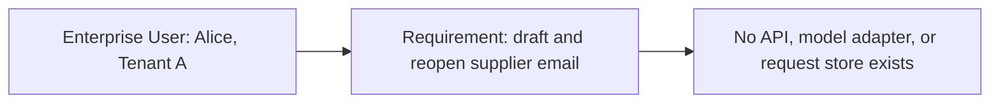
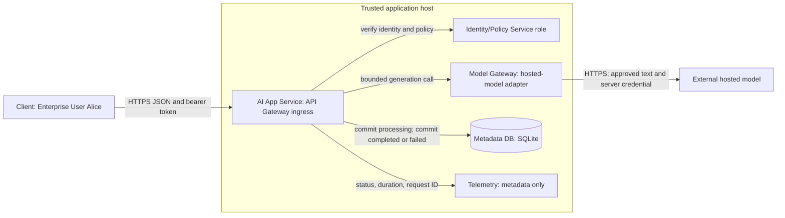

# Stage 1: Build the MVP

Alice, a procurement analyst in Tenant A, wants to draft a supplier email from text she provides and reopen the saved answer. Build that request path before adding document search, background jobs, or a platform of separate services.

This is an educational design for a hypothetical customer. All workload, latency, quota, retention, and token figures below are illustrative assumptions. The executable lab verifies a local slice with fixture identity and a deterministic model. It does not deploy an enterprise service or call a hosted model.

Follow five learning phases: understand the problem, learn and design, observe and experiment, think like a Staff engineer, then validate and carry forward. The detailed material stays within the original MVP scope.

## 1. Understand the Problem

### 1. Before This Stage

No system exists. There is no previous stage to inherit, no benchmark, and no existing identity integration. Alice currently copies text into an unmanaged drafting tool and saves the result manually. That workflow is the hypothetical starting requirement, not observed customer research.



Before diagram. Text alternative: Alice has a requirement; the platform has no implemented components.

The smallest useful outcome has four properties. A trusted identity identifies Alice. A server submits approved text to a model. The server saves the completed answer before reporting success. A later read returns only Alice’s own saved request.

### 2. The Customer Contract

Ask what Alice will do with the answer. She reviews and sends the email herself. The application neither sends messages nor makes procurement decisions. There are no internal document connectors, so it must not claim to answer questions from company policy or cite unavailable sources.


Before the formal contract, picture five moments in Alice’s workflow:

| Supplier-email moment | Name for the idea | Guarantee and limit |
| --- | --- | --- |
| Alice proves which account she uses; Bob still cannot open her saved draft | Authentication identifies the caller; authorisation checks access | Trusted code checks tenant and user on every history read; model text cannot grant access |
| Alice is willing to wait about five seconds for a saved draft | Service-level objective (SLO) | A measured target for a defined request population; a fast example does not prove it |
| Saving the answer and its completed label must agree | Database transaction | Local changes commit together or roll back; the separate provider is not inside that transaction |
| Alice double-clicks Submit after a network pause | Idempotency | Reusing the same scoped key can return the existing result; it does not guarantee one provider execution after every possible crash |
| Alice sees “saved” and expects to reopen the answer | Acknowledgement boundary | Report completion after the answer commit; partial or unsaved text is not a completed saved draft |

The 95th percentile, or p95, is the latency threshold met by 95% of the measured requests. Counting timeouts and errors alongside latency prevents fast rejections from looking like success. The rest of the lesson makes these promises precise. Learn the consequence first, then use the formal term to explain your design.

| Requirement | Illustrative acceptance criterion | Design consequence |
| --- | --- | --- |
| Draft from supplied text | One authenticated POST returns an answer and request ID | Synchronous API with a model adapter |
| Reopen a draft | A committed completed answer can be read by its owner | Durable relational request history |
| Isolate history | Tenant B cannot list or fetch Tenant A requests | Trusted tenant/user predicates on every read |
| Stay responsive | Healthy pilot p95 below five seconds | Deadline hierarchy and measured latency breakdown |
| Bound spending | Expected 1,200 input and at most 300 output tokens | Provider token limits and usage counters in the real integration |
| Protect supplied text | Only approved non-sensitive pilot text; credentials stay on server | Explicit provider boundary, no prompt/token logging |
| Retain briefly | Proposed 30-day history policy | Deletion/backup policy must be implemented before a real pilot |

The five-second value is a proposed service-level objective (SLO), a target measured over a defined population. It is not a promise this lesson has demonstrated. Define the pilot SLI, or service-level indicator, as elapsed time for valid authorised draft requests from server receipt to final response, with timeouts counted as failures. Track rejection rate separately so rejecting requests cannot make latency look healthy. Include user-side latency to detect network delays outside the server measurement.

The scope is one active pilot user, 200 requests during an eight-hour workday, and a brief 0.5 requests per second peak. Tenant B is a negative-test fixture, not a second launched customer. Confirm real demand, provider text handling, deployment region, and identity requirements before a pilot.

### 3. Learning Contract

| Taught at mapped depth | Depth | What you should be able to do |
| --- | --- | --- |
| 1.1 Requirements and architecture methodology | D3 | Turn user outcomes into boundaries, alternatives, and failure tests |
| 1.2 Estimation and capacity planning | D3 | Compute demand and identify which limit the units describe |
| 2.1 Networking fundamentals | D2 | Locate DNS, connection, TLS, and HTTP failures on the path |
| 2.2 APIs and streaming protocols | D3 | Build/debug a request contract and defend JSON versus streaming |
| 6.1 Database architecture | D2 | Explain keys, indexes, transactions, and the external-call gap |
| 7.1 End-to-end AI application design | D3 | Implement the representative auth-to-model-to-history slice |


Those six rows are the entire first-teaching assignment for Stage 1, not a sample of it. “Taught at mapped depth” describes the authored lesson and exercise coverage; learner mastery still requires the exit gates. No modules are revisited here.

Nearby concepts have narrower treatment:

| Module | Treatment here | First-teaching stage and target depth |
| --- | --- | --- |
| 1.3 Design documentation and communication | Context only: use an ADR, without teaching a documentation portfolio | Stage 12, D3 |
| 2.3 Gateway and service communication | Context only: name an ingress role; do not teach service-to-service architecture | Stage 6, D3 |
| 13.1 Identity and access control | Context only: trusted caller scope and fixture checks | Stage 6, D3 |
| 4.3 Background execution systems | Deferred: no durable jobs or worker recovery | Stage 2, D3 |
| 8.1 Document ingestion and indexing | Deferred: supplied text only, no internal knowledge pipeline | Stage 3, D3 |

The other 50 modules keep their own first-teaching stages in the [curriculum map](../../progress/curriculum-map.json). Context-only mentions do not increment completed coverage. [Coverage status](../../progress/coverage-status.csv) separately records authored checks and unassessed learner status.

D3 means explaining, choosing, building a representative slice, observing failure, and mitigating it. D2 requires architectural explanation and a small design exercise. This integrated lesson is estimated at seven to nine study hours; it does not replace learner practice. There are no revisit modules in Stage 1.

Before starting, be able to read basic Python, JSON, SQL, and HTTP. Stop at the MVP boundary. Defer retrieval, durable workers, caches, Kubernetes, GPU hosting, and advanced tenant scheduling until a requirement motivates them.

### 4. First Walk Through the Failure

Suppose the server calls the model and immediately sends Alice the text, then tries to save it. The database write fails. Alice saw a success, but reopening the request yields nothing. A model response alone has failed the customer contract.

Reverse the acknowledgement boundary. First insert a `processing` row and commit it. Then call the provider without an open database write transaction. After generation, update the row to `completed` with its answer and commit. Only then return a successful answer. If the final write fails, return a storage error; the earlier row may remain `processing` and need investigation.

This ordering creates a visible ambiguity: the provider might have generated and charged for an answer that the database never recorded. A database transaction cannot atomically include an independent hosted-model API. Preserve the request ID, avoid automatic retries, and make this gap explicit. Stage 2 can later strengthen job recovery; this lesson does not claim exactly-once model execution.

## 2. Learn and Design

### 5. Choose the Smallest Architecture

| Option | Where it wins | Cost or failure boundary | Decision here |
| --- | --- | --- | --- |
| One API process, synchronous JSON, SQLite | One host, light writes, short requests, simple local learning | Host-local file, serial writes, no automatic failover | Choose for the baseline and executable slice |
| One API process with a managed relational server | Independent storage operations, backups, several app hosts | Network dependency and database administration/cost | Credible pilot alternative when durability/operations require it |
| Browser directly calls model and saves history later | Disposable personal experiments | Exposes provider credentials unless separately mediated; splits policy and persistence | Reject for the customer contract |
| Durable job API with queue and workers | Long tasks must survive worker loss | More states, delivery semantics, recovery operations | Defer until the next motivating requirement |

SQLite is a relational database embedded in the process. It avoids a separate database server for the exercise. Its serialised writes make short transactions important; it is not evidence that a multi-host deployment can share this file safely. [SQLite isolation documentation](https://www.sqlite.org/isolation.html) describes its writer/isolation behaviour. A real pilot needs a durable volume and tested restore; serverless ephemeral files do not satisfy the saved-history requirement.

The API Gateway, Identity/Policy Service, and Model Gateway names below are logical roles within the AI App Service. Deploying a separate service for every box would add network failure paths without helping this workload. Keep a boundary in code so a later stage can change implementation with an explicit decision.


#### Checkpoint 1: Answer Before Revealing

Why is the model call outside the database write transaction? What problem would keeping that transaction open fail to solve?

<details>
<summary>Reveal the explanation after answering</summary>

<p>Keeping it open would extend database lock time while an external service responds. It would not make the hosted provider part of the local transaction. Commit the processing row first; then expose and handle the remaining external-call/commit gap.</p>

</details>

### 6. Architecture After the Change



After diagram. Text alternative: Client crosses the application boundary over HTTPS. The AI App Service checks trusted identity/policy, stores request state in Metadata DB, invokes the model through its adapter, and emits metadata-only telemetry. The hosted model is outside the application trust boundary. The lab replaces external identity and generation with local fixtures.

The Client is an API consumer in the executable; no production web client is built. The application owns request policy, response shape, and persistence. The model adapter owns provider-specific payload conversion and deadline/error translation. The Metadata DB owns request state. Telemetry is a design contract here; production traces and metrics exporters are not installed by the lab.

#### Identity and Tenant Scope

Authentication establishes who made the request. Authorisation decides which resource that identity can use. Derive `(tenant_id, user_id)` from trusted identity, never from the request body or model output. Apply both fields to history queries. Return the same `404` for an absent request and another tenant’s request to avoid confirming its existence. This matches the server-side enforcement approach in the [OWASP authorisation guidance](https://cheatsheetseries.owasp.org/cheatsheets/Authorization_Cheat_Sheet.html).

The exercise maps public fixture bearer tokens `demo-a` and `demo-b` to identities; it does not implement login or OAuth. For deployment, use an identity provider and validate the token’s signature or introspection result, issuer, audience, expiry, and accepted algorithm according to that provider’s contract. Fail closed if identity cannot be established. Bearer tokens confer access to their holder, so protect them in transport and storage; see [RFC 6750](https://www.rfc-editor.org/rfc/rfc6750.html). The localhost HTTP exception is solely for the fixture lab.

#### Networking on This Path

In deployment, the Client resolves the application hostname through the domain name system (DNS). A fresh HTTP/1.1 or HTTP/2 connection establishes TCP, then transport layer security (TLS), before carrying HTTP. Reused connections avoid repeating these setup costs. This lesson’s HTTP lab exercises loopback without DNS resolution or TLS; HTTP/3 is outside scope.

The application may separately resolve and connect to the hosted provider. Put connect, read, and total deadlines in the real adapter: a read timeout alone may not bound a slow stream of bytes. A DNS error, connection refusal, TLS certificate error, HTTP `401`, and HTTP `504` indicate different failed boundaries. Do not retry them all as if the model were slow. Inspect phase timings and dependency status before changing the model.

Use this proposed deadline hierarchy: provider total four seconds, app budget 4.5 seconds, ingress 5.5 seconds, Client six seconds. Reserve time for identity and two database transactions before selecting the provider timeout. If the non-provider work exceeds its budget, shorten the provider allowance from the remaining deadline. Cancelling a local wait does not prove the provider stopped computing or billing.

### 7. API and Data Contracts

Choose a complete JSON response for Stage 1. The Client needs a saved draft, and the illustrative healthy path fits the five-second target. The application can return `201` only once it has persisted the answer.

| Protocol | When to choose it | What changes in the failure contract |
| --- | --- | --- |
| Synchronous JSON over HTTP | Short, bounded request and final saved answer | One success boundary after answer commit |
| Server-sent events (SSE) | User benefits from progressive one-way text | Partial tokens can arrive before durable completion; explicit final saved event needed |
| WebSocket | Bidirectional, frequent live interaction | Connection lifecycle and application message/recovery protocol become your responsibility |

Streaming reduces perceived wait for the first text; it does not prove the final answer is saved or reduce the model’s total work. If added later, distinguish partial content from a final persisted request ID, and design disconnect recovery through history. HTTP request/response and status semantics are defined by [RFC 9110](https://www.rfc-editor.org/rfc/rfc9110.html); the particular idempotency policy below is our application contract.

```http
POST /requests HTTP/1.1
Authorization: Bearer demo-a
Content-Type: application/json
Idempotency-Key: supplier-draft-001

{"prompt":"Draft a short email asking our supplier to confirm the delivery date."}
```

Successful response shape, with an illustrative ID:

```json
{"id":"example-request-id","status":"completed","answer":"Draft: Please confirm the supplier delivery date before replying."}
```

| Operation or condition | Result | Caller action |
| --- | --- | --- |
| New valid request | `201`, committed ID and answer | Show saved draft |
| Same key, same prompt, already completed | `200`, same saved answer | Reuse result without a new model call |
| Same key, changed prompt | `409 key_conflict` | Choose a new key for an intentionally new operation |
| Same key still processing or failed | `409` with ID and state | Inspect history; no automatic generation retry |
| Invalid identity | `401` with bearer challenge | Re-establish identity; do not call provider |
| Invalid input or JSON | `400` | Correct request; no provider call |
| Encoded body above 20,000 bytes | `413` | Reduce body; no provider call |
| POST body is not application/json | `415` | Set the correct media type; no provider call |
| Provider timeout, failed state saved | `504` with request ID | Inspect failed history; provider outcome can be uncertain |
| Database unavailable | `503` | No completed success; inspect whether earlier row exists |
| `GET /requests/<id>` | Owner gets `200`; other tenant gets `404` | Show persisted state, not guessed model progress |
| `GET /requests` | Latest 50 own request IDs and states | Reopen one by ID; pagination is deferred |


Validate a request before creating its row or calling the model: require a JSON object, a non-blank prompt of at most 4,000 characters including surrounding whitespace, and a non-blank `Idempotency-Key` of at most 100 characters. Reject an encoded body above 20,000 bytes before parsing it, and require `application/json` for POST. The lab’s optional `mode` is restricted to `success` or `timeout` and exists only for fault injection. Extra body fields such as `tenant_id` never override trusted identity. These size rules are memory/input boundaries, not token-quota enforcement.

The key identifies an operation, not merely an HTTP connection. On network uncertainty, reuse the same key for the same prompt and inspect history. A new key intentionally permits a new provider attempt. Never turn a `503` or `504` into an automatic new-key retry. For this small pilot the API returns bounded error codes, not SQL errors, prompts, credentials, or provider internals.

The uniqueness key is `(tenant_id, user_id, request_key)`. This prevents a duplicate key from another tenant colliding with Alice’s request. Prompt equality is exact in the lab. In a real adapter, include every generation-affecting parameter in the equality/fingerprint contract. The test-only `mode` field selects fault injection and is deliberately outside business request identity.

#### Schema and Transaction Boundaries

```sql
CREATE TABLE requests (
    id TEXT PRIMARY KEY,
    tenant_id TEXT NOT NULL,
    user_id TEXT NOT NULL,
    request_key TEXT NOT NULL,
    prompt TEXT NOT NULL,
    status TEXT NOT NULL CHECK(status IN ('processing','completed','failed')),
    answer TEXT,
    error TEXT,
    created_at REAL NOT NULL,
    UNIQUE(tenant_id, user_id, request_key)
);
CREATE INDEX history_scope ON requests(tenant_id, user_id, created_at DESC);
```

The primary key locates a request. The unique constraint arbitrates duplicate submissions atomically. The history index follows the equality filters and then the ordering field. An index trades write/storage overhead for less scanning on the access path; demonstrate the choice with `EXPLAIN QUERY PLAN` instead of adding indexes for every column.

Use parameterised SQL, where values are bound separately from the statement. The [Python sqlite3 documentation](https://docs.python.org/3/library/sqlite3.html) explains parameter binding and connection transaction handling. The runnable code uses one connection per operation, short committed transactions, and explicit tenant predicates.

A transaction makes the local set of changes commit or roll back together. Here, the insert is one transaction and the final state change is another; neither surrounds the external call. History reads the same database, so after a successful answer commit it can read that answer without a replica-lag assumption. Disk durability still depends on database settings, filesystem/storage, and operating procedures. There is no replication or disaster recovery claim.

Allowed application transitions are `processing → completed` or `processing → failed`. A crashed process may leave `processing` forever because this stage has no recovery worker. A stale row is evidence to investigate, not permission to blindly repeat a charged call. Before production, add a reconciliation policy and represent unknown outcomes explicitly if needed.


#### Checkpoint 2: Answer Before Revealing

What goes wrong if the API returns HTTP 201 before the answer commit? What should the same key do after a completed response is lost?

<details>
<summary>Reveal the explanation after answering</summary>

<p>An early 201 tells Alice the draft is saved when the final write could still fail. A completed duplicate with the same key and prompt should return 200 with the stored answer and no new model call. A processing or failed duplicate returns 409 for inspection.</p>

</details>

## 3. Observe and Experiment

### 8. Trace One Request

```mermaid
sequenceDiagram
    participant C as Client
    participant A as AI App Service
    participant I as Identity/Policy role
    participant D as Metadata DB
    participant M as Model adapter
    participant P as Hosted model (stub in lab)
    C->>A: POST prompt + bearer + request key
    A->>I: Verify identity; derive tenant/user
    I-->>A: Trusted scope or reject 401
    A->>D: Insert processing row; commit
    D-->>A: Request ID durable
    A->>M: Generate within remaining budget
    M->>P: Bounded generation; no automatic retry
    alt Provider succeeds and final commit succeeds
        P-->>M: Answer
        M-->>A: Normalised answer
        A->>D: Update completed + answer; commit
        D-->>A: Committed
        A-->>C: 201 saved answer + ID
    else Provider times out
        M-->>A: ProviderTimeout
        A->>D: Update failed; commit
        A-->>C: 504 + ID if failed-state commit succeeds
    else Final storage operation fails
        D-->>A: Write/commit error
        A-->>C: 503; no completed answer acknowledgement
    end
```

Sequence diagram. Text alternative: Verify identity, commit a processing row, call the model, commit completed or failed state, then respond. If storage fails, report an error and preserve uncertainty. Invalid identity exits before persistence or generation. Duplicate keys are resolved before a new provider call.

Alice sends key `supplier-draft-001`. Her trusted scope is `(A, alice)`. The database reserves a new request ID. The adapter returns a deterministic supplier-email draft in the lab. The completed row commits before `201`. Alice then fetches the returned ID. Bob’s Tenant B token gets `404` for that ID and an empty history list.


#### Request Lifecycle: Advance One Boundary at a Time

Open the [clickable request walkthrough](guide.html#request-walkthrough). Select a step or use Previous/Next, choose success, provider timeout, or final-write failure, and predict the visible state before advancing. This is a deterministic explanation of the application contract, not an execution trace or latency benchmark.

| Step and responsible component | Input | Output or durable state | Possible failure |
| --- | --- | --- | --- |
| 1. Client submits | Prompt, bearer token, scoped operation key | JSON request sent to API ingress | Invalid JSON, oversized body, wrong media type, or blank prompt is rejected before generation |
| 2. Identity/Policy role verifies | Bearer identity plus attempted resource | Trusted `(A, alice)` scope | Unknown identity returns 401; caller tenant claims cannot grant access |
| 3. Metadata DB inserts | Trusted scope, key, prompt, new request ID | Committed `processing` row | Insert failure returns 503; duplicate key resolves before another provider call |
| 4. Model adapter generates | Approved prompt and provider budget | Answer, or provider timeout | A timed-out wait does not prove remote work stopped; do not automatically repeat it |
| 5. Metadata DB commits final state | Answer or timeout outcome plus request ID | `completed` with answer, or `failed` with error | Final write failure leaves the earlier `processing` row and an uncertain remote outcome |
| 6. AI App Service responds to Client | Result of the final state write | 201 saved answer, 504 saved failure, or 503 storage error | A lost response requires inspection/reuse of the same key, not a blind new attempt |

Static branch results: success commits `completed` before `201`; provider timeout commits `failed` before `504`; final completed-write failure leaves `processing` and returns `503`. The walkthrough assumes identity and the initial insert succeed. Earlier validation, authentication, duplicate, and insert failures are explained at their owning steps but are not additional selectable simulation branches.

### 9. Work the Numbers Before Buying Capacity

These calculations use a hypothetical stationary approximation, not observed latency distributions. Request rate measures arrivals; concurrency measures simultaneous in-flight work; tokens measure provider workload. They are different limits.

| Quantity | Calculation | Interpretation |
| --- | --- | --- |
| Average arrival rate | `200 / (8 × 3,600) = 0.00694 requests/s` | Workday mean hides bursts |
| Illustrative peak | `0.5 requests/s = 30 requests/min` | Must check provider RPM separately |
| Mean in-flight work at peak | `L = λW = 0.5 × 2.62 = 1.31 requests` | Little’s-law estimate in a stable regime; not a safe hard concurrency limit |
| Expected tokens/request | `1,200 input + 300 output = 1,500 tokens` | Output cap does not cap arbitrary input |
| Peak token demand | `30 × 1,500 = 45,000 tokens/min` | If a provider counts combined tokens this way; confirm actual quota rules |
| Workday token demand | `200 × 1,500 = 300,000 tokens/day` | 240,000 input and 60,000 output |
| Thirty-day logical storage | `200 × 30 × 8 KiB = 46.875 MiB` | Expected row payload only; add indexes, file overhead, backups, and headroom |

For an illustrative 60 requests/min and 50,000 combined tokens/min quota, peak demand uses 50% of request quota and 90% of token quota. The token limit is tighter. These are invented planning quotas, not vendor limits. Variable text lengths and bursts can exceed them even when the mean fits. This is not an admission/fairness implementation; those controls are deferred.

If input price is `p_in` per million tokens and output price is `p_out`, expected daily model cost is `0.24 × p_in + 0.06 × p_out`. Add platform and storage cost separately. Failed or disconnected requests may still consume billed work. No current provider price is assumed.

The lab limits input to 4,000 characters as a simple memory/body bound. Characters are not tokens, and non-ASCII text can use multiple UTF-8 bytes. A real adapter needs model-specific token counting or conservative rejection plus the provider’s context/output limits. The 8 KiB storage estimate is an average planning assumption, not the maximum possible row size.

#### Latency Budget

Use a deterministic healthy example: 50 ms network, 30 ms identity/app work, 20 ms request insert, 2,500 ms provider, and 20 ms answer update. Total: `50 + 30 + 20 + 2,500 + 20 = 2,620 ms`.

The non-provider budget is 120 ms. At a 4,000 ms provider deadline, a simulated late model produces `4,000 + 120 = 4,120 ms`, then a `504` if the failure-state write succeeds. A 4.5-second app budget has 380 ms remaining in this example. Real scheduling, network tails, authentication, and disk delay can consume it. Summing representative component times does not establish p95, and summing component p95 values does not generally give end-to-end p95.

### 10. Lab: Move the Deadline, Observe the Outcome

Open the [offline interactive lab](guide.html#lab). It varies provider duration (500–6,000 ms) and provider deadline (1,000–4,000 ms). Fixed overhead is 120 ms. These controls illustrate the latency/outcome trade-off without pretending to call a model.

The toy rule is: provider duration less than or equal to deadline completes; a larger duration times out. The equality case is an explicit modelling convention. Real deadline races require margins and integration tests.

| Scenario | Duration | Deadline | Client duration | Persisted state and response |
| --- | --- | --- | --- | --- |
| Healthy default | 2,500 ms | 4,000 ms | 2,620 ms | `completed`, `201` |
| Slow dependency | 5,000 ms | 4,000 ms | 4,120 ms | `failed`, `504` |
| Tight budget | 2,500 ms | 2,000 ms | 2,120 ms | `failed`, `504` |
| Boundary convention | 4,000 ms | 4,000 ms | 4,120 ms | `completed`, `201` in this toy model |

The visual lab assumes all database operations succeed, includes the state-write cost in the fixed overhead, and has no network variation, rate limits, or retries. It cannot prove the five-second SLO. A shorter deadline can reduce waiting while increasing failed requests; it does not make the provider faster. The same static worked cases remain readable without JavaScript.

#### Build and Debug the Representative Slice

The [Python API](labs/mvp.py) uses standard-library HTTP and SQLite. The model and identity integrations are fixtures, while the HTTP requests and database commits are real. Read the adapter’s interface, request state transitions, and scoped queries before running it. Public fixture tokens authenticate local test identities only. Do not expose this server or treat it as a production identity stack.

Run from the repository root, with Python 3.10 or newer and SQLite support:

```bash
python3 10_AI_System_Design/stages/01-mvp/labs/test_mvp.py
```

In a separate terminal, use a fresh disposable database path:

```bash
python3 10_AI_System_Design/stages/01-mvp/labs/mvp.py --database /tmp/stage1-demo.sqlite --port 8767
```

Send one request:

```bash
curl -i http://127.0.0.1:8767/requests \
  -H 'Authorization: Bearer demo-a' \
  -H 'Content-Type: application/json' \
  -H 'Idempotency-Key: supplier-draft-001' \
  --data '{"prompt":"Draft a supplier email asking for the delivery date."}'
```

Expect `201` and an ID. Repeat the exact command: expect `200`, the same ID and answer, and no additional model call. Fetch history using `GET /requests` with the same token. Fetch `/requests/<returned-id>` with `demo-b`: expect `404`. These are tests of tenant scope, not a proof of enterprise isolation.

Inject the representative failure with a new key:

```bash
curl -i http://127.0.0.1:8767/requests \
  -H 'Authorization: Bearer demo-a' \
  -H 'Content-Type: application/json' \
  -H 'Idempotency-Key: supplier-timeout-001' \
  --data '{"prompt":"Draft a supplier email.","mode":"timeout"}'
```

Expect `504 provider_timeout`. A history read shows `failed`; repeating that key returns `409` without a second model call. The stub raises immediately; elapsed wall time here is not the 4,120 ms timing simulation.

The integration suite also creates a SQLite trigger that rejects the final completed update after generation. Expect `503 storage_unavailable`, a remaining `processing` row, and `409` for the same key. This reproduces the external-call/commit gap. Inspect the row and model call counter; deleting the row and repeating generation would conceal the ambiguity. Restarting the app against the same file preserves completed answers; the suite recreates the App object to verify persistence, without claiming an abrupt power-loss test.

For the D2 database exercise, inspect the scoped history query using `EXPLAIN QUERY PLAN`, explain why the compound index helps, and describe when a managed relational database would replace the file. For the D3 extension exercise, implement a real adapter only in an approved test environment; cap tokens, enforce total deadlines, validate its error mapping, and retain all ownership/idempotency tests.


#### Checkpoint 3: Answer Before Revealing

Generation succeeded, the final update failed, and the row still says processing. Should you delete it and retry with a new key?

<details>
<summary>Reveal the explanation after answering</summary>

<p>No. The provider may already have generated and charged for the answer. A new key can repeat the work and hide the evidence. Keep the row, inspect storage and the request ID, and use an explicit reconciliation policy. Durable recovery is deferred to Stage 2.</p>

</details>

## 4. Think Like a Staff Engineer

### 11. Operations and Failure Diagnosis

| Observable signal | Likely boundary | Immediate action | Persistent fix or next check |
| --- | --- | --- | --- |
| `401`, no request row, no provider attempt | Identity verification | Check token validity and trusted issuer/audience | Repair identity configuration; never bypass scope checks |
| Provider timeouts with normal database latency | Dependency or deadline | Stop automatic retries; inspect provider outcome/latency | Revisit timeout budget and provider integration |
| `503`, provider call happened, row processing | Final storage operation | Treat outcome as unknown; inspect storage and request ID | Restore storage, reconcile row, design later recovery |
| Old processing rows after restart | Process died between commits | Check age and request traces before retry | Explicit recovery policy; durable execution in a later stage |
| Fast server timing, slow Client | DNS/connect/TLS/network | Compare phase and end-to-end timings | Connection reuse and correct timeout configuration |
| History contains another user’s request | Authorisation regression | Block affected access and investigate scope | Fix trusted predicates and run negative tests before reopening |

Record request ID, route, outcome/status, elapsed time, provider duration, database duration, input/output usage where available, and an appropriately protected tenant identifier. Never record bearer tokens or raw prompts/answers in ordinary logs. Useful counters include request outcomes, provider attempts, completed commits, and storage failures; compare attempts and commits to investigate gaps. A metric exporter and an alerting backend are proposed operations work, not shipped components of this lab.

Use a proposed pilot alert when timeout/error proportion breaches its agreed window, and when a `processing` row is older than the client budget plus investigation margin. Set thresholds after measuring the pilot; this lesson does not invent incident data. During a bad application release, stop new generation, retain the database, and roll back compatible code. A rollback cannot recover an answer never saved. Before opening a real pilot, test backups, restore, secret handling, identity, retention deletion, request size controls, and real-provider deadlines.

### 12. Staff Interview Practice

#### Why Start With One Application?

**Prompt:** A reviewer wants separate gateway, identity, model, and history microservices on day one. Defend your design.

**Spoken answer:** “The pilot needs one saved drafting flow for one active user. I keep identity policy and the model adapter as clear code boundaries inside one application. That makes the acknowledgement contract and failure trace easy to inspect. Separate services add deployments, credentials, and network failure points before we have independent scaling or ownership needs. I would split a role when its workload, team ownership, or isolation requirement justifies the operational cost.”

**Trade-off:** Simpler operation shares a failure domain. **Follow-up:** If two teams need independent release schedules, identify the first boundary to extract and its migration contract.

#### What Does Success Guarantee?

**Prompt:** The model answered but the final database write failed. Can you return `200` and retry the save later?

**Spoken answer:** “The user asked for a saved draft, so a successful response must follow the answer commit. I return a storage error if that commit fails. The earlier processing row lets us see an attempt existed, but it cannot prove what the provider did. I will not automatically call the provider again, because it may already have charged or generated. I need reconciliation and a stronger execution design before promising recovery.”

**Trade-off:** Durable acknowledgement may withhold generated text during a storage incident. **Follow-up:** If partial text is acceptable, specify a separate provisional-content state instead of silently weakening completed success.

#### Is the Pilot Small Enough to Ignore Capacity?

**Prompt:** Two hundred daily requests sounds tiny. Which limit could still fail first?

**Spoken answer:** “Daily mean hides the brief 0.5 request-per-second peak. At 1,500 expected tokens per request, that peak is 45,000 tokens per minute. Against our hypothetical 50,000-token quota it has little headroom even though request quota is only half used. Average in-flight work is about 1.31 requests at 2.62 seconds, but that is not a safe concurrency cap. I would measure burst and token distributions, then enforce limits when the workload requires them.”

**Trade-off:** Planning estimates guide limits but do not replace load measurements. **Follow-up:** Double input length and recompute the token bottleneck without changing RPS.

#### Why Not Stream Every Answer?

**Prompt:** A product manager wants immediate visible tokens. Does SSE solve the five-second target?

**Spoken answer:** “SSE can improve time to first visible text, but the total answer still needs generation and persistence. If tokens arrive before the answer commit, I must label them provisional and emit a distinct saved-completion event. A disconnect needs a history lookup, not an assumption that the operation failed. For this short pilot path I choose complete JSON first. I would adopt streaming after measuring the user benefit and defining the final commit contract.”

**Trade-off:** Simpler final responses offer less progressive feedback. **Follow-up:** Describe what the Client displays when a stream disconnects after the last token but before the saved event.

#### How Do You Prevent Cross-Tenant History Reads?

**Prompt:** Alice puts `tenant_id: B` in the body and guesses Bob’s request ID. What enforces isolation?

**Spoken answer:** “The trusted identity adapter determines tenant and user. The body cannot override them. Every read uses both scope fields, and an out-of-scope ID returns the same not-found response as a missing row. The model has no authorisation role. I test list and item reads with two identities. This is the baseline application control; enterprise identity lifecycle and stronger isolation options need later work and real integration tests.”

**Trade-off:** Application predicates are simple but demand consistent enforcement. **Follow-up:** If database row-level policy is introduced later, explain how it complements trusted application scope.

## 5. Validate and Carry Forward

### 13. Decision and Carry-Forward

[ADR-001](../../architecture/decisions/ADR-001-synchronous-mvp.md) accepts a synchronous single-application MVP for this educational architecture. [Current system](../../architecture/current-system.md) records version `v0.1-stage-01`; it is an accepted teaching baseline, not a deployment approval.

Keep the request schema, scoped history, adapter interface, no-automatic-retry rule, and commit-before-success contract. A future Stage 2 starts when document processing or another long task blocks interactive requests or must survive a worker crash. It can introduce durable jobs with a migration decision. No Stage 2 artifacts are generated here.

Unresolved pre-pilot questions include real identity/provider contracts, durable hosting, retention and backup deletion, a recovery policy for uncertain rows, measured load/latency, and cost/quota values. Keep these visible rather than marking the platform production-ready.


#### Complete Stage Package

Distribute the whole Stage 1 package, not the two guides alone. The archive `10_AI_System_Design/dist/stage-01-mvp.zip` preserves the `10_AI_System_Design/` root, including this guide’s labs/tests, plan/state, validation, font licences, curriculum/coverage records, current architecture, and ADR-001. Extract it into an empty directory and run the documented Python test command from that directory. The HTML needs no server, build, model key, or network.

The package excludes caches, render captures, databases, credentials, and the archive itself. See [validation](validation.md) for clean-extraction checks and untested production boundaries. Do not treat presence of a file or a passed fixture test as learner completion.

### 14. Self-Test and Recall

1. **What prevents a model response becoming an unsaved success?** Commit `completed` with the answer before returning `201`; return an error if the commit fails.
2. **Why not keep the transaction open during generation?** It extends lock duration over an unpredictable external call without making that provider part of the transaction.
3. **What changes if the same idempotency key has a different prompt?** Reject `409`; a new intended operation needs a new key.
4. **Why does a shorter provider deadline not prove a better SLO?** It can replace slow completions with failures. Count errors and measure the actual request population.
5. **Can the lab prove identity, TLS, and hosted-provider behaviour?** No. Those boundaries are simulated or absent and need separate integration checks.

For a 60-second memory card, recall these seven cues: user outcome first; trusted tenant/user scope; short transaction before model; bounded adapter call; final commit before success; external outcome may be unknown; RPS, concurrency, and tokens use different units.

### 15. Exit Gates

These boxes are learner work, not claims of mastery. Review after about one, seven, and 21 days.

- [ ] Explain the saved-draft contract and acknowledgement boundary without notes in two minutes.
- [ ] Draw the Client, AI App Service roles, Metadata DB, hosted-model boundary, and success/failure sequence.
- [ ] Defend synchronous JSON and local relational persistence against two credible alternatives under stated constraints.
- [ ] Diagnose timeout and final-write failure using status, durable state, and an observable signal.
- [ ] Run, modify, and debug the representative slice; retain tenant and duplicate tests while changing the adapter.

Stop after these gates. Defer distributed execution, recovery workers, retrieval, and production infrastructure to their assigned stages.

### References

- [RFC 9110: HTTP Semantics](https://www.rfc-editor.org/rfc/rfc9110.html): primary reference for HTTP methods and status semantics; application retry/idempotency choices remain explicitly local.
- [RFC 6750: Bearer Token Usage](https://www.rfc-editor.org/rfc/rfc6750.html): why bearer credentials need protected handling and transport.
- [OWASP Authorisation Cheat Sheet](https://cheatsheetseries.owasp.org/cheatsheets/Authorization_Cheat_Sheet.html): deny by default and verify resource access in trusted code.
- [Python sqlite3](https://docs.python.org/3/library/sqlite3.html): parameter binding and transaction API used by the executable.
- [SQLite Isolation](https://www.sqlite.org/isolation.html): local database concurrency/isolation constraints.

Sources checked 2 November 2026. Examples and budgets are authored assumptions. Local verification results and limitations are recorded in [validation.md](validation.md) and `stage-state.json`.
