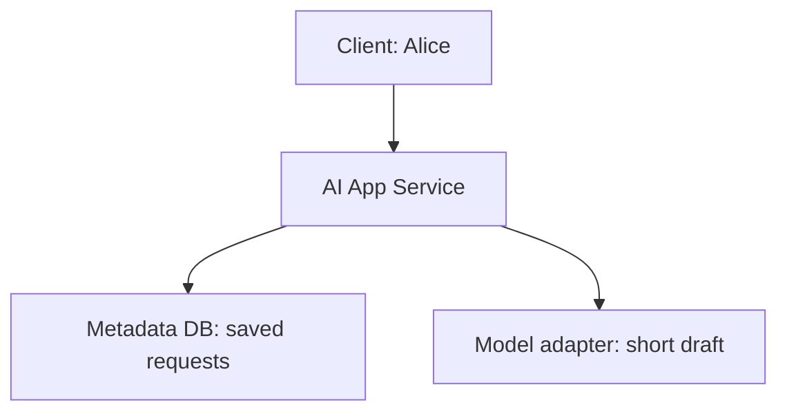
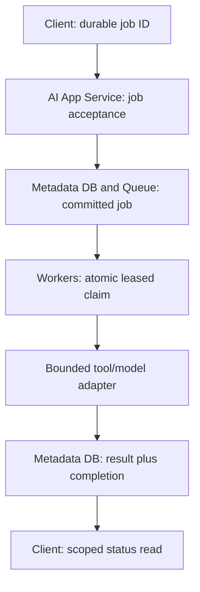
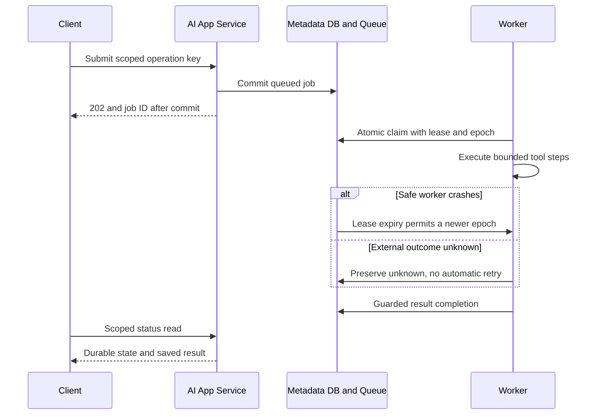

# Stage 2: Distributed Execution

Alice in Tenant A can already ask for a supplier-email draft and reopen its saved answer. She now supplies a document pack whose text preparation takes an illustrative 20 seconds. Keeping the browser request open would violate the Stage 1 waiting budget. Losing the process would lose in-memory progress. Add durable execution for this longer path while retaining the short drafting API.

This is the same hypothetical procurement platform. Numbers are planning examples; the runnable exercise uses SQLite and logical clocks, not a deployed broker, document parser, identity provider, or hosted model. Study budget: six to eight integrated hours. Learner mastery is unassessed.

## 1. Understand the Problem

### What Stage 1 Actually Built

[Stage 1](../01-mvp/guide.md) established trusted tenant/user scope, a short synchronous drafting path, request-key duplicate suppression, and an answer commit before completed success. Its Python API and tests remain unchanged. [ADR-001](../../architecture/decisions/ADR-001-synchronous-mvp.md) still applies to that endpoint. It did not implement worker recovery, background execution, or exactly-once provider calls.



Before diagram. Alice waits while the application generates and saves a short draft. Logical identity and telemetry roles remain inside the application; the drawing highlights the path changing now.

### New Pressure and Failure Walkthrough

Assume six document jobs arrive per minute and each needs 20 seconds of mostly external I/O. Alice should receive a durable job identifier within an illustrative 300 ms target and return later for the result. That acceptance latency is not a completion promise. Retain the original short API for directly supplied text.

If the application starts a thread and returns immediately, its restart can erase the task. If a worker removes a message before saving its result, a crash can erase the only execution record. If it saves the result and crashes before acknowledging delivery, another worker may receive the same job. Design for those crash positions before choosing a queue product.

| Alice’s experience                                  | Formal term            | Boundary                                                                                |
| ---------------------------------------------------- | ---------------------- | --------------------------------------------------------------------------------------- |
| Several documents are waiting or running at once     | Concurrency            | Overlapping work is not necessarily simultaneous CPU execution                          |
| Another worker takes over after one stops responding | Lease                  | Temporary authority expires; an expired worker may still be alive                       |
| A job returns after a lost acknowledgement           | At-least-once delivery | Repeat delivery is possible; side effects still need protection                         |
| The same submission returns the existing job         | Idempotent acceptance  | Scope the key by tenant/user and payload; do not claim every external call happens once |
| A task records how far it got                        | Checkpoint             | Only committed state survives; it cannot recover an unsaved provider answer             |

### Learning Contract and Coverage

| Module                                      | Treatment              | Depth and evidence                                                                         |
| ------------------------------------------- | ---------------------- | ------------------------------------------------------------------------------------------ |
| 4.1 Concurrency fundamentals                | Taught at mapped depth | D3: overlapping workers, atomic claims, stale-worker rejection, capacity exercise          |
| 4.2 Messaging and event streams             | Taught at mapped depth | D3: durable handoff, acknowledgements, redelivery, queue/log alternatives                  |
| 4.3 Background execution systems            | Taught at mapped depth | D3: job states, leases, bounded retry, deadline, dead/unknown outcomes                     |
| 7.3 Agentic application system architecture | Taught at mapped depth | D3: bounded tool loop, durable checkpoint, allowlist and side-effect boundary              |
| 6.1 Database architecture                   | Revisited from Stage 1 | D2: apply short transactions to atomic claim and completion; no repeated database tutorial |
| 5.3 Backpressure and overload management    | Context only           | First taught Stage 5, D3; this stage estimates capacity but does not teach fair admission  |
| 3.2 Distributed state and transactions      | Deferred               | First taught Stage 7, D3; no consensus or cross-service transaction implementation         |

Outcomes: explain durable acceptance versus completion; implement a race-safe claim; reject a stale completion; diagnose crash/redelivery; bound a tool workflow. Prerequisites are Stage 1’s persistence and scoped access contracts. The [curriculum map](../../progress/curriculum-map.json) remains the full assignment; mentioning a later module does not mark it completed.

## 2. Learn and Design

### Separate Acceptance From Execution

Create a new job path rather than silently changing `/requests`. The proposed `POST /jobs` facade validates an allowed job kind, a bounded payload/reference, and a scoped operation key. In one transaction it creates a `queued` row. Only after commit may it return `202` and a job ID with a status location. `202` means accepted for processing, not that generation finished; see [RFC 9110](https://www.rfc-editor.org/rfc/rfc9110.html). The executable tests the store behind this contract; it does not add an HTTP facade to Stage 1.

A status read uses trusted tenant and user from identity, never owner fields supplied in JSON. Proposed `GET /jobs/<id>` returns state, attempt count, and a saved result only when available. Unknown or out-of-scope IDs return the same not-found outcome. Keep public error codes bounded: invalid input `400`, unauthenticated `401`, conflicting key `409`, unavailable durable store `503`. The new route is a design contract, not a claim of executed HTTP tests for it.

The database-backed queue and job record are the same durable row here. No gap exists between saving a job and publishing to a separate broker. If a broker is introduced later, a transactionally recorded outbox can bridge database commit to publication, with duplicate-safe publication/consumption. Do not claim a database commit confirms broker delivery.

### Alternatives and Operational Cost

| Design                                                  | When it wins                                     | Failure or cost                                                       | Choice                                             |
| ------------------------------------------------------- | ------------------------------------------------ | --------------------------------------------------------------------- | -------------------------------------------------- |
| Thread or asynchronous coroutine inside web process     | Short overlapping network waits within a request | Restart loses unsaved work; no durable ownership                      | Not the durable job mechanism                      |
| SQLite job table, separate worker processes on one host | Small pilot with low claim/write rate            | Serial writer, polling load, shared host failure domain               | Choose for the representative slice                |
| Durable broker plus relational job state                | Independent worker fleet and delivery controls   | Two persistence boundaries; publication and acknowledgement recovery  | Credible next deployment choice, not required here |
| Append-only event log                                   | Independent consumers need replayable history    | Retention, offsets, partition ordering, and consumer state to operate | Defer; this workload needs work distribution first |

A queue distributes work among consumers; a replayable log stores an ordered history within its defined partitions for independently positioned consumers. Neither product name grants end-to-end exactly-once effects. Publisher confirmation concerns publication; consumer acknowledgement concerns delivery handling. Those are separate boundaries in [RabbitMQ’s acknowledgement documentation](https://www.rabbitmq.com/docs/confirms). Our local queue represents acknowledgement as the committed terminal state rather than a broker API call.

An asynchronous function yields while waiting for I/O; it does not create durable ownership. Threads can overlap blocking I/O. Multiple worker processes can use separate CPU cores, but all may still contend on the same database or provider quota. For CPU-heavy parsing, profile process execution; for provider waits, concurrency helps only while dependency and memory limits permit it. Do not hold a database write transaction for a 20-second task.

### Claim, Lease, and Completion

`claim(now)` starts `BEGIN IMMEDIATE`, finds one eligible row, increments its epoch and attempt count, sets a lease, and commits. That transaction prevents two workers from winning the same current claim in this SQLite exercise. SQLite serialises writers; it is not a shared-file solution for an arbitrary multi-host fleet. [SQLite isolation](https://www.sqlite.org/isolation.html) documents the local write boundary used here.

The epoch is a monotonically increasing ownership token. Completion must match job ID, epoch, active state, unexpired lease, and job deadline. If Worker 1 pauses, its lease expires, and Worker 2 claims epoch 2, Worker 1 cannot later overwrite Worker 2’s result using epoch 1. This fences database writes. It cannot stop Worker 1 from making an external call unless that external system also validates an appropriate key/token.

The local state machine is `queued → leased → completed`, with safe failure returning to `queued` after backoff. Attempts stop at three. Deadline expiry or exhausted safe attempts produces `dead`. The dead-letter area is a state in the same table, not a second broker. An expired lease marked as having started an external effect becomes `unknown` and is excluded from automatic retry. Reconciliation is a documented operator boundary, not an implemented provider lookup.



After diagram. API and worker roles are separated; SQLite remains one host-local durable store. Trusted identity still scopes acceptance/history. The hosted-model boundary remains external and stubbed; proposed Telemetry reports state transitions without raw prompts.

### Checkpoint 1: Choose the Acknowledgement Boundary

Should a worker acknowledge/remove a delivery before saving its output?

<details><summary>Answer before revealing</summary><p>No. A crash after removal but before result commit can lose the result and the recovery signal. Commit the durable result first. If delivery acknowledgement can then be lost, redelivery must recognise the saved completion and avoid repeating work.</p></details>

### The Bounded Agent Workflow

Alice’s document-preparation workflow can plan a small sequence: extract text, validate required supplier fields, and draft a review note. The model may suggest a next action, but trusted code checks an allowlist, parameter schema, tenant scope, remaining time, and a maximum of three tool steps. Store the next step and latest safe output durably. A restart reads that checkpoint instead of relying on a model’s conversation memory.

The exercise allows only `extract`, `validate`, and `draft`. `send_email` is rejected. The original customer requirement still says Alice reviews and sends the email herself. If later product scope adds an irreversible action, separate human approval, operation identity, and unknown-outcome reconciliation from the model’s proposed text. A checkpoint before an external call proves intent, not that the call did or did not execute.

For D3, implement/debug this control boundary: keep immutable job input, validate proposed tools outside the model, persist progress, reject an unapproved tool, and stop when step/time/attempt budgets expire. The fixture saves the latest tool output and step index; it is not a full agent engine or a complete transcript/event store. Rich tool-output retention and cancellation acknowledgement need explicit future design.

## 3. Observe and Experiment

### Request Walkthrough

The [offline walkthrough](guide.html#request-walkthrough) exposes success, worker crash before external effects, and unknown external outcome. At each step read the owner, input, durable output, and possible failure before advancing.



Sequence diagram. Acceptance commits before `202`; completion is a later event. Redelivery never grants a stale worker authority to overwrite newer state.

| Step     | Input and responsible component                 | Output and possible failure                                            |
| -------- | ----------------------------------------------- | ---------------------------------------------------------------------- |
| Accept   | API receives trusted scope, key, and payload    | Queue row commits; unavailable DB means no acceptance success          |
| Claim    | Worker asks durable Queue for eligible work     | Epoch/lease commit; racing worker gets no active duplicate claim       |
| Execute  | Worker reads immutable input and budgets        | Bounded checkpoint/tool result; unsafe external ambiguity is preserved |
| Recover  | Queue examines expiry and external-start marker | Pure work may redeliver; started external work becomes unknown         |
| Complete | Worker submits result with current epoch        | Completed commit or rejection of stale/expired authority               |
| Inspect  | API reads scoped job state                      | Saved output or explicit queued/leased/dead/unknown state              |

### Calculate the Required Concurrency

At six jobs/minute and 20 seconds/job, arrival rate is `0.1 jobs/s`. The required average in-flight work in a stable regime is `λW = 0.1 × 20 = 2 jobs`. Two workers each able to finish one job in 20 seconds provide exactly six jobs/minute with no nominal headroom. Choose three for the illustrative discussion: capacity becomes nine jobs/minute and utilisation is about 67%, before dependency quotas or runtime variability. These are workload calculations, not measurements of the Python fixture.

If 12 jobs arrive together and three independent workers take exactly 20 seconds/job, four waves finish at 20, 40, 60, and 80 seconds. This ignores claim/commit overhead and external contention. A 90-second job deadline leaves only 10 seconds of margin for the last wave. A 30-second browser timeout should not govern this longer job’s lifetime; return the durable identifier and poll at a bounded interval with backoff instead.

Assuming five state writes per job, six jobs/minute yields about 30 writes/minute, or 0.5 writes/s, before polling and retries. One hundred clients polling every second would add 100 reads/s even when the worker throughput is small. Include polling load in capacity estimates; do not fix a status-query bottleneck by adding more generation workers.

### Lab: Crash Position Changes Recovery

Open the [lease experiment](guide.html#lab). Its two controls are the lease interval (5–30 logical seconds) and crash position. A worker is assumed to stop at time zero; no real time elapses and no provider is called.

| Case              | Lease | Failure position            | Expected result                                                               |
| ----------------- | ----- | --------------------------- | ----------------------------------------------------------------------------- |
| Healthy           | 10 s  | None                        | Completed; no replacement attempt                                             |
| Recoverable crash | 10 s  | Before an external effect   | Earliest replacement at 10 s; pure work redelivers; stale completion rejected |
| Longer lease      | 30 s  | Before an external effect   | Earliest replacement at 30 s; slower failure recovery                         |
| Ambiguous call    | 10 s  | After external-start marker | Unknown; no new worker attempt authorised automatically                       |

An actual worker that lives longer than its lease needs a bounded heartbeat/renewal policy. This slice instead rejects expired completions and uses explicit logical-clock experiments. A shorter lease can improve recovery time but can create false takeovers during pauses. The epoch protects state writes, not duplicate billing.

Run the runnable tests from the directory containing `10_AI_System_Design/`:

```bash
python3 10_AI_System_Design/stages/02-distributed-execution/labs/test_jobs.py
```

The tests create a temporary database, instantiate/recreate worker stores, race two claimers, expire a lease, attempt a stale completion, record an external start, exhaust safe retries, enforce a deadline, and reject an unapproved tool. They exercise real SQLite commits with a simulated clock. They do not start an HTTP job endpoint or run a network broker. Inspect [jobs.py](labs/jobs.py), change a lease/deadline, and explain which test should fail before rerunning it.

### Checkpoint 2: Lease Expiry Is Not Proof of Failure

A model call started, its worker stopped answering, and its lease expired. May the replacement call the model immediately?

<details><summary>Answer before revealing</summary><p>No. A timeout or dead worker does not prove the provider stopped. The job enters unknown and requires reconciliation. Automatic redelivery is appropriate only for the defined safe portion of this exercise; an epoch fences local writes, not remote execution.</p></details>

## 4. Think Like a Staff Engineer

### Operate the Boundaries You Introduced

Track accepted jobs, queue age, claim latency, lease expiries, attempts, unknown/dead counts, tool rejection, and completion age. Separate acceptance latency from job turnaround. Metadata-only traces join request ID, job ID, and attempt epoch; avoid storing source text or tokens in ordinary logs. Exporters and alerts are proposed controls, not installed by the fixture.

When oldest-job age rises, first compare arrival and completion rates. Check available workers and provider quotas, then inspect DB lock time and slow tools. A growing queue with idle workers suggests claim/configuration failure; busy workers at a dependency limit need demand control rather than more claimers. Stage 5 will teach those admission/fairness controls in depth.

For a dead job, fix the poison input/tool bug before replay. For unknown work, preserve its operation identity and provider evidence; do not delete the row to make dashboards green. Cancellation should prevent unstarted actions and report whether a started action remains uncertain. This slice does not implement cancellation, heartbeat renewal, an outbox, or provider reconciliation. Deployment also needs durable storage, backup/restore, real identity, process supervision, and bounded tool networking.

### Interview 1: Why Not Use Async in the Web Server?

**Prompt:** A teammate says `async` solves the 20-second task. Defend the new path.

**Spoken answer:** “Async lets a process overlap waiting work; it does not make a task survive that process. The customer needs a durable identifier and eventual inspection after a restart. I commit a job before acknowledging acceptance, then let a worker claim it with bounded authority. I keep the original short drafting route. The extra queue state costs operations, but it addresses lost work rather than merely reducing blocked threads.”

**Trade-off:** More recoverable state versus simpler request handling. **Changed constraint:** If all tasks take 100 ms and can be safely abandoned, when would you remove this queue?

### Interview 2: Can You Promise Exactly Once?

**Prompt:** Result commit succeeds but delivery acknowledgement is lost.

**Spoken answer:** “The delivery can repeat, so I use the saved job state and scoped key to avoid repeating already completed work. A stale epoch cannot overwrite current state. None of that proves a separate provider executed once: a crash after its call but before our commit leaves uncertainty. I expose unknown state and require a reconciliation policy before retrying that boundary.”

**Trade-off:** Conservative unknown states need operator work. **Changed constraint:** The provider supports a documented durable idempotency key; explain what guarantee it adds and its retention limits.

### Interview 3: How Many Workers?

**Prompt:** Six arrivals/minute, 20 seconds each, two workers. Is capacity adequate?

**Spoken answer:** “Two workers yield six jobs/minute only under constant runtimes and no overhead. That is full nominal utilisation, with no margin for bursts or retries. Three workers give nine jobs/minute in the simplified model. I would validate the runtime distribution and provider budget before scaling. Polling and persistence can independently saturate the API/database.”

**Trade-off:** Headroom costs capacity. **Changed constraint:** If 80% of time is CPU parsing, compare thread concurrency with process workers and memory limits.

### Interview 4: Where Is the Agent Boundary?

**Prompt:** The model suggests sending the supplier email as a fourth tool call.

**Spoken answer:** “The current customer requirement keeps sending with Alice. Trusted code rejects that tool regardless of model instructions. The workflow has a three-step budget, scoped inputs, and durable progress. A new product requirement for sending would need a separate approval and external-effect contract. A checkpoint alone cannot prove whether an irreversible call happened.”

**Trade-off:** Bounded workflows sacrifice open-ended autonomy. **Changed constraint:** If approval arrives after the job deadline, what must be revalidated before resuming?

## 5. Validate and Carry Forward

### Recall and Exit Gates

1. **What does 202 establish?** Only the defined durable acceptance, not completed generation.
2. **Why keep a transaction short?** Do not hold a write lock over slow external work; commit authority before execution.
3. **What does an epoch protect?** Guarded local writes against a stale owner, not external actions.
4. **When is retry safe here?** In the explicitly safe pre-external/pure-work region, with bounded attempts and deadline.
5. **What stops an agent loop?** Trusted tool policy plus step/time/attempt budgets and persistent state.

The 60-second card: accept durably; claim atomically; separate overlap from durability; commit results before acknowledgement; fence stale writers; preserve external ambiguity; bound every tool loop. Review at about one, seven, and 21 days.

- [ ] Explain acceptance, execution, and completion without notes in two minutes.
- [ ] Draw the retained short API and the new job/queue/worker path.
- [ ] Defend the DB queue and a broker alternative under changed workload.
- [ ] Diagnose crash-before-effect and crash-after-effect with state and signals.
- [ ] Run, modify, and debug the claim/retry/checkpoint tests; learner completion remains unassessed.

### Decisions, Package, and Next Dependency

[ADR-002](../../architecture/decisions/ADR-002-durable-execution.md) adds durable background execution without replacing Stage 1’s short request contract. The [stage snapshot](architecture-after.md) records the accepted educational after-state independently of the mutable [current system](../../architecture/current-system.md). [Coverage](../../progress/coverage-status.csv), [state](stage-state.json), and [validation](validation.md) separate authored checks from mastery.

The complete distribution contains this stage, required earlier guides/labs, architecture/ADRs, and local reference/licence files with their relative paths preserved. Clean extraction runs the local tests and link checks. No production readiness is inferred.

A later Stage 3 can use these durable jobs for document ingestion and versioned indexing. It must preserve trusted scope, replay-safe writes, job status, and uncertainty boundaries. It is not needed to understand or run Stage 2.

### Primary References

- [RFC 9110](https://www.rfc-editor.org/rfc/rfc9110.html): HTTP accepted-response semantics used in the proposed job facade.
- [RabbitMQ consumer acknowledgements and publisher confirms](https://www.rabbitmq.com/docs/confirms): separate publication and delivery boundaries, cited as a broker example rather than an installed dependency.
- [SQLite isolation](https://www.sqlite.org/isolation.html): serialised local writes underlying the claim experiment.

Sources checked 2 November 2026. Workloads, clocks, deadlines, and tool responses are authored assumptions. See validation for actual execution evidence.
