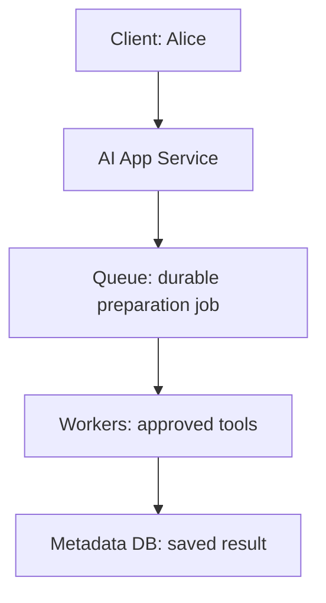
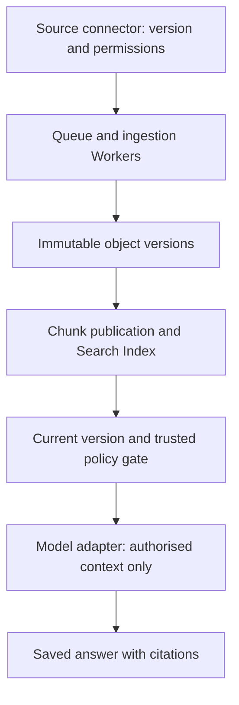

# Stage 3: Enterprise Knowledge

Alice in Tenant A asks, “What confirmation do we need before promising a supplier delivery date?” Stage 1 could draft from supplied text. Stage 2 could prepare a document asynchronously. Neither capability could find a current policy Alice was allowed to read. Add the path from a changing source document to authorised, versioned context before generating an answer.

The procurement customer remains hypothetical. All corpus sizes, timings, and capacity figures are illustrative. The executable uses text fixtures, SQLite FTS5, and current local metadata; no hosted model, embedding API, real document connector, or PDF parser is invoked. Estimated integrated study: six to eight hours; learner mastery is unassessed.

## 1. Understand the Problem

### Inherit the Real System

[Stage 2](../02-distributed-execution/guide.md) added durable acceptance, leased worker ownership, guarded completion, bounded tools, and explicit unknown external outcomes. [Its snapshot](../02-distributed-execution/architecture-after.md) and [ADR-002](../../architecture/decisions/ADR-002-durable-execution.md) are the starting architecture. Retain the short draft API, saved history, trusted scope, Queue, Workers, model adapter, and proposed metadata-only Telemetry.



Before diagram. Work survives safe worker failure, but there is no connector/index/current-document retrieval path. Existing Identity/Policy and model roles are retained even when omitted from this focused drawing.

### The Failure Is an Untrustworthy Context

Imagine an initial shortcut: copy every supplier document into a search index and feed the top results to the model. Three things can now fail. A newer policy may replace the indexed paragraph. A deleted document may remain searchable. A highly relevant restricted pricing note may outrank Alice’s readable policy. Asking the model to hide a restricted paragraph after receiving it is already too late.

Alice needs a cited answer from the current supplier policy, or an honest refusal when no authorised evidence exists. The trusted retrieval path must decide which text may cross the hosted-model boundary. It cannot infer access from a relevant keyword or a model instruction.

| Concrete change | Formal term | Consequence |
| --- | --- | --- |
| Keep the exact bytes from each observed source version | Immutable object/version | Reproduce what was indexed; old bytes need retention/deletion policy |
| Split a policy into passages with source references | Chunking | Retrieval can choose passages; boundaries can lose surrounding meaning |
| Build a lookup structure rather than scan every document | Search index | Faster candidate discovery; publication/freshness becomes an operational boundary |
| Record that a document was deleted, including its newer version | Tombstone | A late older event cannot silently bring it back |
| Attach source, version, and passage to returned text | Provenance/citation | A reader can inspect the evidence; a citation alone does not prove the generated claim follows it |

### Coverage and Outcomes

| Module | Treatment | Assigned depth and stage evidence |
| --- | --- | --- |
| 6.3 Object storage and data lifecycle | Taught at mapped depth | D1: immutable versions, publication pointers, retention and orphan trade-off |
| 8.1 Document ingestion and indexing | Taught at mapped depth | D3: versioned events, extraction/chunks, replay, update/delete and partial failure tests |
| 8.2 Search architecture | Taught at mapped depth | D3: lexical/semantic/hybrid choice, permission-filtered ranking, relevance fixture and context construction |
| 4.2 Messaging and event streams | Revisited from Stage 2 | D3: apply redelivery to idempotent version publication and out-of-order source events |
| 8.3 Enterprise retrieval governance | Context only | Stage 6, D3: baseline trusted filtering now; enterprise policy lifecycle later |
| 14.1 Evaluation architecture | Deferred | Stage 8, D3: a local relevance fixture is not a versioned production evaluation/release platform |

Outcomes: trace a connector event to published chunks; choose a search strategy; prove duplicate/old events do not corrupt the visible version; block restricted or revoked context; and return current citation identifiers. Prerequisites are Stage 2’s durable jobs and Stage 1’s trusted access rules. The [curriculum map](../../progress/curriculum-map.json) controls depth; do not expand D1 object storage into a storage-internals course.

## 2. Learn and Design

### Ingestion Has Two Different Promises

A source connector emits an envelope such as `(tenant A, supplier-policy, version 2, operation upsert, source cursor)`. The source is trusted only through a connector identity and an approved source scope. User-supplied text is untrusted content. Validate content type/size and parser limits before extraction; isolate parser resource use. The fixture accepts already extracted text up to 20,000 characters, not arbitrary uploaded files.

First preserve immutable source bytes under a tenant/document/version identity. Then prepare passages and publish a consistent visible version. In a real object store plus search service these are separate systems. A failure after object storage but before index publication can leave an orphan object; it must not expose a half-built visible document. The local exercise models objects in a blob table, then atomically updates current metadata and FTS passages in a second transaction.

A repeated version with the same body is a no-op. Reusing the same immutable identity for different text is a conflict. An older source event cannot replace a newer published version or tombstone. The exercise uses monotonically increasing integer versions. Real connectors may provide opaque revision IDs/cursors; define a source-specific ordering rule instead of comparing arbitrary revision strings lexicographically.

Keep source permission state distinct from content version. A permission change can revoke Alice without changing document bytes. The local `policy_epoch` changes when readers change. A trusted live read checks that Alice is still allowed before context assembly. If the connector has not observed an upstream revocation, this local store cannot know it happened. State a freshness contract and fail closed for missing/expired policy information; immediate global revocation is not demonstrated.

### Passages, Parsing, and Publication

In production, extract text while preserving page/section offsets, parser version, source version, and chunk IDs. Choose boundaries that keep a supplier rule with its qualifier. Too-small chunks can separate “confirmation required” from the exception; too-large chunks waste context and reduce ranking precision. The teaching fixture splits on blank paragraphs and uses `(document, version, paragraph index)` as provenance. It does not claim those offsets are stable across parser changes.

Publish only after all required passages for the chosen version are ready. A new parser/chunking configuration needs a new index generation or equivalent key so old and new chunk identities cannot mix silently. Record failed extraction as a failed job, rather than indexing an empty document and calling ingestion successful. Retry safe extraction using Stage 2’s job protocol. An embedding call, if later added, is an external dependency with its own ambiguity and cost; durable job state does not remove that boundary.

A delete event publishes a newer tombstone and removes visible search passages. Retain enough version metadata to reject a late upsert. Old object bytes, backups, and search-service replicas require a separate deletion/retention policy; removing a search hit is not a verified physical erase. Object lifecycle governance is introduced at D1 here, not implemented as a production erasure service.

### Choose Search for This Corpus

| Choice | Strength | Cost or failure | Decision |
| --- | --- | --- | --- |
| Lexical full-text search with BM25-style ranking | Exact supplier names, identifiers, and explicit policy language | Misses paraphrases; corpus/tokenisation affect ranking | Choose SQLite FTS5 for this local baseline |
| Dense-vector semantic retrieval | Related meanings can match different wording | Embedding cost, model/index version, approximate search and permission design | Compare conceptually; no fake embeddings in executable |
| Hybrid lexical plus semantic candidates | Combine identifier and paraphrase recall | Fusion tuning, two failure paths, larger evaluation burden | Revisit when measured relevance requires it |
| Scan all source text per question | Very small disposable corpus | Repeated work grows with corpus; policy/version joins still needed | Reject for repeated enterprise retrieval |

A search engine finds candidate passages; an authoritative policy/version check decides whether each is usable. Restrict tenant, current version, deleted state, and allowed readers before choosing the final top-k contexts. Recheck current metadata before model context construction, and load stored text rather than trusting caller-supplied hit bodies. [OWASP’s authorisation guidance](https://cheatsheetseries.owasp.org/cheatsheets/Authorization_Cheat_Sheet.html) supports trusted request/resource checks; prompts cannot replace them.

SQLite FTS5 provides full-text query syntax and a BM25 ranking function; consult its [primary documentation](https://www.sqlite.org/fts5.html) for implementation semantics. Lower FTS5 BM25 scores sort first in this exercise. The code builds quoted word terms itself instead of accepting raw search-operator syntax. It applies scope/current-version/reader predicates in SQL before the result limit, so a set of restricted high-scoring hits cannot fill the entire final context list.

Semantic retrieval is a different representation, not automatic truth. For an implementation example of embedding/chunking version concerns see [Elastic’s semantic text documentation](https://www.elastic.co/docs/reference/elasticsearch/mapping-reference/semantic-text). No Elasticsearch service is required or installed. Choose a semantic system only after an authorised relevance set shows which lexical misses matter.



After diagram. Trusted connector/worker/metadata roles stay inside application control; documents are untrusted content. Only permitted current context crosses the external hosted-model boundary. The local fixture stores objects, metadata, and FTS in one SQLite file, while documenting where a real distributed deployment differs.

### Checkpoint 1: Filter Before the Model

The most relevant passage is a restricted supplier discount. Can we send it to the model with an instruction not to reveal it?

<details><summary>Answer before revealing</summary><p>No. The text has already crossed the access boundary if the model receives it. Exclude unauthorised material in trusted retrieval/context code before generation. Relevance and permission are different decisions, and a prompt is not an access-control mechanism.</p></details>

## 3. Observe and Experiment

### Request Walkthrough

The [offline walkthrough](guide.html#request-walkthrough) follows ingestion through cited context. Choose current authorised text, a source deletion, or a permission revocation. The full static path remains below without scripting.

```mermaid
sequenceDiagram
 participant S as Connector
 participant W as Ingestion worker
 participant D as Metadata and Index
 participant A as AI App Service
 participant M as Model adapter
 S->>W: Durable versioned event via Queue
 W->>D: Preserve immutable source version
 W->>D: Publish chunks plus current pointer
 A->>D: Query with trusted tenant/user
 D-->>A: Ranked permitted current candidates
 A->>D: Recheck version, tombstone and policy
 alt Evidence remains authorised
 A->>M: Construct permitted context with citations
 else Deleted, revoked or stale
 A-->>A: Remove evidence; refuse if none remains
 end
```

Sequence diagram. The final gate is a local current-policy read. A concurrent upstream permission change not yet observed is outside the fixture’s guarantee.

| Step | Responsible input | Output and possible failure |
| --- | --- | --- |
| Observe | Connector has source identity, cursor, version and operation | Valid event enters durable job path; missed source changes require reconciliation |
| Preserve | Ingestion worker receives immutable source bytes | Blob version stored; identity conflict rejects changed bytes |
| Publish | Worker supplies parsed passages and metadata | One visible generation commits; partial preparation stays invisible |
| Retrieve | API supplies trusted scope and bounded query | Ranked authorised current candidates; raw caller operators are not executed |
| Recheck | Context builder reads current version/deletion/readers | Revoked/deleted/stale evidence is removed before context leaves trusted code |
| Cite | Model adapter receives only allowed context | Source/version/chunk references accompany evidence; no evidence means no grounded answer |

### A Worked Supplier-Policy Example

Version 1 says “Supplier delivery date requires written confirmation.” A second paragraph covers overdue deliveries. A separate restricted document mentions secret discounts and is readable only by `manager`; Tenant B has its own agreement. Querying “delivery confirmation” as Alice returns the allowed policy passage, with citation `supplier-policy:v1:c0`.

Version 2 replaces the policy with a portal-confirmation rule. Publication deletes the old passages and changes the current pointer atomically in the local store. A prior version-1 hit is rejected during context assembly. If a tombstone at version 3 arrives, a late version-2 upsert cannot restore search visibility. If Alice is removed from the readers list between search and context assembly, the current recheck removes the hit even though it was previously relevant.

The test fixture verifies retrieval and citation construction, not the factual correctness of a hosted generated answer. The application should separate quoted evidence from instructions, cap context, preserve citation IDs, and refuse unsupported policy claims. Document text may contain hostile instructions; being readable does not make it trusted control-plane input. Tool allowlists and ownership checks still run outside the model.

### Size and Throughput Without Invented Benchmarks

Assume 1,000 documents, 10 chunks/document, and 500 tokens/chunk. That is 10,000 chunks and five million chunk tokens before overlap. If a hypothetical embedding had 768 float32 dimensions, raw vectors alone would use `10,000 × 768 × 4 = 30,720,000 bytes`, about 29.3 MiB. Index overhead, text, metadata, replicas, and old generations add storage; this is not an actual service footprint or a recommended model dimension.

At 200 changed documents/hour, 10 chunks/document yields 2,000 changed chunks/hour. At an assumed 0.5 seconds of embedding-service work/chunk, the batch requires 1,000 worker-seconds/hour. One continuously available worker has 3,600 seconds/hour in the idealised arithmetic, but quotas, parsing, bursts, retries, and batching change real capacity. The lexical fixture makes no embedding calls and proves no embedding throughput.

For a serial text-extraction capacity of 20 seconds/document inherited from Stage 2, 200 changes/hour require 4,000 worker-seconds/hour before indexing. That exceeds one worker’s hour. Three independent workers have nominal headroom only if those external/storage limits permit it. Evaluate the bottleneck of each pipeline stage, not just the final model call.

### Lab: Which Evidence May Leave the Application?

Open the [policy/version experiment](guide.html#lab). Two controls vary identity and evidence condition. The single illustrative candidate is version 2 of the supplier policy; the scenario describes a trusted gate, not a search latency model.

| Case | Identity and event | Context chunks | Citation and decision |
| --- | --- | --- | --- |
| Allowed | Alice, current document | 1 | `supplier-policy:v2:c0`; context allowed |
| Revoked | Unauthorised identity, current document | 0 | No citation; trusted policy blocks |
| Deleted | Alice, tombstone | 0 | No citation; deleted evidence blocked |
| Stale | Alice, old indexed version | 0 | No citation; current-version gate blocks |

“No model call authorised” in this experiment means no call for this grounded-answer path because no evidence remains; it does not disable the separate general drafting API. Real mixed-result retrieval may keep other permitted passages. The model is deterministic, uses one candidate, and has no network or hidden relevance score.

Run the Python tests from the workspace’s parent directory:

```bash
python3 10_AI_System_Design/stages/03-enterprise-knowledge/labs/test_knowledge.py
```

[knowledge.py](labs/knowledge.py) uses a real SQLite FTS5 index and immutable/current metadata tables. Tests cover relevant scoped results, duplicate publication, content replacement, tombstone ordering, revocation between search/context, forged/stale hits, orphan publication failure, immutable-version conflict, and query syntax. A pipeline test also uses Stage 2’s durable job store to claim and complete an ingestion event. Python must include SQLite FTS5 and JSON functions; a missing extension is a prerequisite failure, not permission to silently substitute an untested search engine.

For D3 practice, add an allowed policy paraphrase and an exact supplier code. Measure retrieval hits against a small labelled set before changing ranking. Compute recall@k as relevant retrieved passages divided by all labelled relevant passages for each query, and distinguish it from precision@k. The local test has a tiny relevance expectation; it is not a production quality benchmark. For D1 object lifecycle, explain which blob can be orphaned and why pointer rollback must preserve the previous readable version.

### Checkpoint 2: Delete Versus Late Update

A deletion at version 3 commits, then a delayed version-2 content event arrives. Which state should be visible?

<details><summary>Answer before revealing</summary><p>The newer tombstone remains authoritative. The old content event may leave an orphan immutable blob, but it cannot replace the visible pointer or recreate searchable passages. Replaying an old event is different from an authorised new version that deliberately restores a document.</p></details>

## 4. Think Like a Staff Engineer

### Production Signals and Failure Diagnosis

Measure source-cursor lag, oldest ingestion-job age, parser failures, index publication lag, version mismatches, deletion lag, policy freshness, rejected context, empty authorised results, and per-query relevance. Separate “not ingested,” “not relevant,” and “not allowed” internally while keeping external error messages from revealing restricted document existence. Join source/version, job ID, and request ID in protected metadata traces.

If Alice receives an old policy, inspect the connector cursor, published version, and the final context citation before blaming generation. If the object exists but is not published, inspect the failed ingestion attempt; do not point readers to it manually. If new access rules are unavailable, apply the stated freshness/fail-closed policy. Never use a stale search copy as the sole authority for immediate revocation.

Limit ingestion file size, parse time, context tokens, and query length in the real API adapter. The fixture bounds source characters and final result count but does not implement production upload security, distributed storage, source authentication, or a tokeniser. A real search-service migration needs versioned indexes, alias/pointer cutover, deletion/ACL reconciliation, and rollback that does not revive restricted data. Stage 6 will expand governance rather than retell this retrieval baseline.

### Interview 1: Why Not Start With Vector Search?

**Prompt:** The corpus contains supplier IDs and explicit policy wording. Defend lexical retrieval first.

**Spoken answer:** “Exact identifiers and rule terms are valuable signals here. A lexical index gives us a simple, inspectable baseline with no embedding dependency. I would build an authorised relevance set and inspect paraphrase misses before adding semantic candidates. Hybrid retrieval can help recall, but it adds representation versions, fusion tuning, cost, and another operational path. None of those choices removes tenant or current-policy checks.”

**Trade-off:** Simplicity may miss reworded queries. **Changed constraint:** How would multilingual paraphrases change the evaluation and rollout plan?

### Interview 2: What Is an Ingestion Success?

**Prompt:** Object storage succeeded but chunk publication failed.

**Spoken answer:** “Preserving bytes is not publishing a usable document. I keep the prior visible generation and fail or retry the durable job for safe processing. The orphan object is evidence and can be cleaned under policy later. Publication must establish a coherent chunk set and current pointer. A distributed object/search system needs explicit cutover and reconciliation; the local fixture’s database transaction is not proof of cross-service atomicity.”

**Trade-off:** Consistent visibility delays freshness. **Changed constraint:** When would partial per-page publication be acceptable, and how would the API identify it?

### Interview 3: Where Do Permissions Apply?

**Prompt:** A result was permitted when retrieved but revoked before generation.

**Spoken answer:** “I recheck current trusted policy and version before constructing provider context, loading stored text rather than trusting a supplied hit body. Revoked material is removed. That protects the observed local policy boundary; it cannot guarantee awareness of an upstream revocation the connector has not delivered. I need a source freshness contract and a fail-closed policy for unavailable authority.”

**Trade-off:** Live policy checks add latency/availability dependence. **Changed constraint:** Explain how you would bound revocation delay if the source only supports hourly polling.

### Interview 4: Can Citations Prove Correctness?

**Prompt:** Every generated sentence has a source ID. Is the answer trustworthy?

**Spoken answer:** “Source IDs provide traceability, not entailment. The chosen passage may be irrelevant, stale, incomplete, or misrepresented. I verify version/access before context leaves the app, evaluate retrieval separately from grounded answer quality, and preserve citations that resolve to the exact source generation. A missing authorised passage should produce a refusal rather than a fabricated policy answer.”

**Trade-off:** Conservative refusals reduce coverage. **Changed constraint:** If several readable policies disagree, what metadata and response behaviour would you require?

## 5. Validate and Carry Forward

### Self-Test and Memory Card

1. **What is immutable?** Each tenant/document/version object identity and its content, not the current publication pointer.
2. **What does a tombstone prevent?** Older observed events from reviving visible deleted content.
3. **When is a relevant hit unusable?** Wrong tenant, unreadable policy, deleted or mismatched current version.
4. **Why re-fetch trusted text?** A caller can forge a search-hit body even when it names an existing allowed document.
5. **What does the local fixture not prove?** Real connector freshness, distributed publication, model faithfulness, or physical erasure.

The 60-second card: durable source event; immutable version; coherent publication; rank within trusted scope; recheck before context; cite exact passage; refuse without evidence. Review after about one, seven, and 21 days.

- [ ] Explain ingestion, publication, and answer grounding in two minutes without notes.
- [ ] Draw the durable Queue/Worker path and the trusted context gate.
- [ ] Defend lexical versus semantic/hybrid retrieval under this corpus.
- [ ] Diagnose stale, deleted, revoked, and partially published evidence with a concrete signal.
- [ ] Run/modify the version, relevance, and negative-access tests; learner completion remains unassessed.

### Record the Change and Its Limits

[ADR-003](../../architecture/decisions/ADR-003-versioned-retrieval.md) records the versioned retrieval choice. The [stage snapshot](architecture-after.md), [state](stage-state.json), [validation](validation.md), and [coverage](../../progress/coverage-status.csv) preserve actual evidence. The distribution includes earlier prerequisites and all executable/supporting files, with clean extraction and test checks.

A later Stage 4 may add stateless app replicas and caching when this path faces broader enterprise traffic. It must preserve authoritative version/permission checks and citeable source identities; a cache hit cannot grant access. No advanced governance, embedding deployment, or evaluation platform is added here.

### Primary References

- [SQLite FTS5](https://www.sqlite.org/fts5.html): full-text matching and ranking used by the runnable index.
- [OWASP authorisation guidance](https://cheatsheetseries.owasp.org/cheatsheets/Authorization_Cheat_Sheet.html): trusted per-resource checks, not prompt-based access.
- [Elastic semantic text](https://www.elastic.co/docs/reference/elasticsearch/mapping-reference/semantic-text): an implementation example of embedding/chunking concerns for the alternative, not an installed dependency.

Sources checked 2 November 2026. Numbers and fixture text are authored examples. Execution evidence and untested integrations are in validation.
