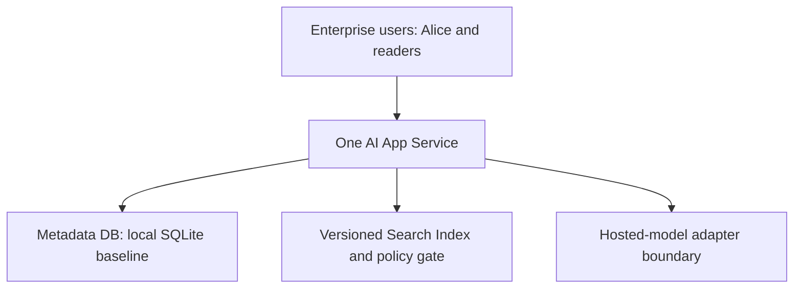
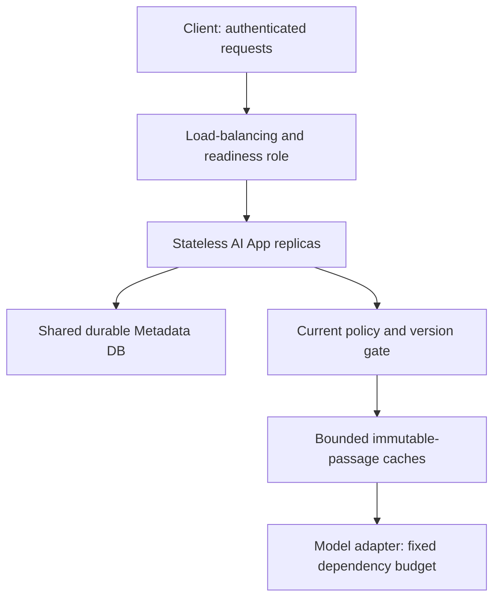

# Stage 4: Scale the Application

Alice’s supplier-policy workflow now serves a hypothetical wider enterprise rollout. The service must handle an illustrative 100 requests/second peak while preserving saved history, durable jobs, and current permission-filtered evidence. Adding app replicas is useful only if those replicas share the right state and the database or provider can carry the resulting demand.

This lesson models capacity and exercises cache/history correctness locally. It does not deploy a load balancer, managed database, cluster, or autoscaler. All service times, query budgets, hit rates, and provider capacities are authored assumptions. Estimated integrated study: six to eight hours; learner mastery remains unassessed.

## 1. Understand the Problem

### Preserve the Retrieval Contract

[Stage 3](../03-enterprise-knowledge/guide.md) established versioned ingestion, current/tombstone metadata, trusted permission checks, and exact passage citations. [Its snapshot](../03-enterprise-knowledge/architecture-after.md) is the actual before-state. Keep the original short draft/history path, Stage 2 durable jobs and worker epochs, connector/index pipeline, model adapter, and metadata-only Telemetry contract.



Before diagram. A single application host owns the local prototype state. The Queue/Workers and source ingestion remain but do not solve interactive app capacity automatically.

### The New Failure and Its Symptoms

Assume requests consume 25 ms of app CPU on average, separate from provider waiting. One core has an idealised maximum of 40 such requests/second before other overhead. A 100 requests/second peak cannot fit one such core. Requests queue, response latency rises, and browser retries can increase load. But copying the whole application plus its local database file onto four hosts would create four separate histories and duplicate-operation domains.

A second shortcut also fails: cache final supplier answers solely by question text. Tenant B can ask the same words as Alice, while permissions or source policy versions differ. A fast wrong or unauthorised answer is not a successful scale-out.

| User-visible need | Formal idea | What it does not promise |
| --- | --- | --- |
| Any healthy app instance can handle the next request | Stateless application replica | Durable history still needs shared authoritative storage |
| Route new work away from an unhealthy instance | Load balancing and readiness | A health probe does not prove every dependency can meet its SLO |
| Reuse exact previously loaded passage bytes | Immutable-content cache | A cache hit cannot establish current access permission |
| Keep spare capacity before the request pile grows | Headroom and autoscaling | Starting replicas takes time and cannot raise a provider quota |
| Find which resource actually limits the pipeline | Bottleneck analysis | A single CPU graph cannot establish end-to-end capacity |

### Coverage and Changed Constraints

| Module | Treatment | Depth and application here |
| --- | --- | --- |
| 6.2 Caching systems | Taught at mapped depth | D2: key scope, immutable version, TTL, bounded LRU eviction, live policy and outage exercise |
| 12.1 Scaling and traffic engineering | Taught at mapped depth | D3: load path, capacity budgets, replicas, health/warmup/drain, autoscaling and failure tests |
| 1.1 Requirements and architecture methodology | Revisited from Stage 1 | D3: change the workload and preserve the saved-answer/security contract |
| 1.2 Estimation and capacity planning | Revisited from Stage 1 | D3: find the minimum app/DB/provider budget rather than repeat the basic units tutorial |
| 2.2 APIs and streaming protocols | Revisited from Stage 1 | D3: preserve key/status/commit semantics across instances and retry paths |
| 7.1 End-to-end AI application design | Revisited from Stage 1 | D3: shared state and provider boundaries across replicas |
| 8.2 Search architecture | Revisited from Stage 3 | D3: cache only what current retrieval authority can safely validate |
| 5.1 Rate limiting and admission control | Context only | Stage 5, D3: identify unserved demand now; design fair rejection next |
| 16.1 Container and orchestration architecture | Deferred | Stage 9, D2: no Kubernetes implementation needed to reason about a replica |

Outcomes: preserve history across app instances; choose cache scope safely; prove warm hits respect changes; calculate the current limiting budget; and plan warmup/draining without inventing measured throughput. Prerequisites are the prior three actual stage contracts. [Mapped coverage](../../progress/curriculum-map.json) and [actual status](../../progress/coverage-status.csv) remain separate from mastery.

## 2. Learn and Design

### Move the Durable State, Not the User Session

Keep identity verification per request and durable requests/jobs/source metadata in a shared relational service. Load-balanced replicas must not rely on an in-memory session or a copied SQLite file to recognise a completed operation. Preserve tenant/user/key uniqueness and the existing API success/error contracts. Sticky routing can improve locality, but cannot be the only way Alice finds her history after a replica disappears.

For the educational migration, choose a separately operated relational database design such as PostgreSQL. This stage’s executable still uses a single SQLite file shared by two local application objects to test the invariant, not to claim SQLite is the production multi-host database. Concurrency/locking SQL must be ported and tested; SQLite `BEGIN IMMEDIATE` does not become PostgreSQL claim semantics by changing a connection string. [PostgreSQL’s locking documentation](https://www.postgresql.org/docs/current/explicit-locking.html) identifies the different transaction/row-lock boundary to review.

Migration plan: inventory requests/jobs/uniqueness and source version keys; prepare the target schema; test duplicate and lease predicates; pause or carefully reconcile writes during cutover; copy and verify counts/checksums; route all writers to one authority; then resume traffic and compare scoped reads. Avoid casual dual writes: conflicting authorities can break job ownership and operation deduplication. Keep rollback aligned with the chosen writer and copied state, not with an older independent file.

### Alternatives for Scaling and Caching

| Option | Where it helps | Cost or failure | Decision |
| --- | --- | --- | --- |
| Larger single app instance | Modest CPU/memory growth, simple operation | One failure domain and a finite vertical ceiling | Baseline alternative, not enough for the modelled peak |
| Stateless app replicas with shared durable state | Independent app CPU and replacement | DB pools, cold starts, load routing, shared dependency limits | Choose for application scaling |
| Per-replica immutable-passage cache | Repeated source bytes with simple local fallback | Duplicated memory, cold misses, does not remove live policy checks | Choose a bounded local cache |
| Distributed cache | Shared hit pool and larger central capacity | Network dependency, key isolation, outage/stampede operation | Defer until measured locality/memory justify it |
| Cache final answers by question alone | Looks fast in an unsafe demo | Cross-tenant leaks, stale policy, user-specific and model-version mismatch | Reject |

A cache stores a reusable value under a key. For exact passage bytes choose `(tenant, document, source version, chunk)`. Do not cache a mutable “latest policy” pointer as if it were immutable. The current policy/version/tombstone check still runs before returning cached text. Changing content creates a new key; deleting or revoking the document makes the old entry unusable even while its bytes remain in memory.

The local cache holds at most two entries for easy inspection and expires each after 30 logical seconds. It uses least recently used (LRU) eviction: a touched entry moves to the recent end and the oldest is removed when capacity is exceeded. Production bounds should include bytes as well as entry count because passage sizes vary. Time-to-live (TTL) bounds reuse/memory freshness, not authorisation; a one-second-old entry can already be forbidden.

Cache only immutable body data in this slice. Do not cache authentication, permission decisions, candidate ranking, or final answers. Another user may share the same permitted immutable bytes after their own live gate, but tenant identity always remains in the content key. If cache service is unavailable, bypass it and use the authoritative store with the same policy check. If authority itself is unavailable, do not turn the cache into an access decision fallback.

The application checks the cache, fetches on a miss, and fills the entry: this is cache-aside. A read-through cache service hides that fetch behind its own interface, adding a service boundary. Write-through updates cache and source together, while write-behind delays the source write; neither should weaken the saved-history commit contract. Immutable body entries need no in-place write propagation because a new content version uses a new key. A negative-result cache would need its own scope/freshness policy and is not implemented here.

HTTP/browser caches are a separate layer from the application content cache. Preserve `Cache-Control: no-store` for the fixture’s sensitive request/history responses. [RFC 9111](https://www.rfc-editor.org/rfc/rfc9111.html) defines HTTP cache behaviour; an application-level passage entry is not automatically governed by those response headers.



After diagram. Each replica retains identity/policy and source-context boundaries. The managed DB/load balancer are proposed deployment roles; local tests exercise multiple objects on one host. Queue/Workers, source ingestion, Search Index, and exact citations are retained outside this focused interactive request path.

### Checkpoint 1: Warm Is Not Authorised

Alice loaded a passage one second ago. Her access is then revoked. Does a 30-second cache TTL allow using it for another 29 seconds?

<details><summary>Answer before revealing</summary><p>No. Current trusted policy is checked on every cache use. TTL is not a grant of access. The entry may remain physically cached, but the gate blocks its return after the revocation is observed by authority.</p></details>

### Scale-Out Is a Control Loop With Delay

Use readiness to keep new replicas out of routing until dependencies/configuration are usable. Liveness detects an irrecoverably stuck process, not every downstream timeout. Warming caches and establishing database pools create extra demand. A cold replica can initially be slower than a warm one; scaling too aggressively can amplify DB misses and connections.

An illustrative trigger is sustained app utilisation above 70% with rising admitted-request latency, while DB and provider budgets have headroom. Scale out gradually, cap replica/connection totals, observe warmup, and use a slower scale-in stabilisation window. On scale-in, remove readiness for new requests, drain bounded in-flight requests, and leave durable jobs recoverable through their lease protocol. Never assume killing a pod cancels a charged provider call.

A controller cannot react before observation, decision, scheduling, and warmup complete. Keep baseline headroom for bursts shorter than that delay. CPU-only autoscaling misses provider-wait saturation; queue age alone can ask for more workers even when the provider is already limiting throughput. [Kubernetes HPA documentation](https://kubernetes.io/docs/concepts/workloads/autoscaling/horizontal-pod-autoscale/) is a primary example of metric-driven scaling, not a requirement to install Kubernetes here. No actual autoscaler is shipped.

## 3. Observe and Experiment

### Request Walkthrough

Use the [offline walkthrough](guide.html#request-walkthrough) to compare a healthy shared-state request, revoked access with a warm cache, and a cold replacement replica. It retains the full static contracts below.

```mermaid
sequenceDiagram
 participant C as Client
 participant L as Load balancer
 participant A as Any ready app replica
 participant D as Shared authority
 participant K as Immutable cache
 C->>L: Scoped request and stable operation key
 L->>A: Route to ready replica
 A->>D: Identity, current policy/version and operation state
 alt Current access allowed
 A->>K: Lookup exact tenant/document/version/chunk
 K-->>A: Cached bytes or authoritative miss fetch
 A->>D: Commit saved result when generating
 A-->>C: Success after durable commit
 else Revoked or deleted
 A-->>C: No restricted content; same refusal contract
 end
```

Sequence diagram. Cache reuse changes byte-fetch cost, not the source of permission or the commit-before-success boundary. Authority may change after a read; this stage does not claim a globally instantaneous revocation barrier.

| Step | Input and owner | Output and possible failure |
| --- | --- | --- |
| Route | Load balancer sees healthy-ready replica set | Request selects a ready instance; failed instances are drained |
| Establish scope | App verifies caller and operation identity | Trusted scope; sticky state is not required for history |
| Read authority | App reads current source/policy and durable operation state | Forbidden/stale evidence rejected even if cached |
| Reuse bytes | Cache looks up immutable scoped passage key | Warm hit or trusted-store miss; outage bypasses cache only |
| Persist | App shares authoritative requests/jobs database | Committed saved result across replicas; no independent local DB fork |
| Respond | App returns saved answer or original scoped refusal/error | Lost response reuses the same key; it is not a new operation |

### Calculate Three Budgets in the Same Units

Assume one app core and 25 ms CPU/request. Raw idealised CPU capacity is `1 / 0.025 = 40 RPS`. At 70% planned utilisation that becomes `28 RPS/replica`. Four replicas provide `112 planned RPS` before DB/provider limits. Serving an illustrative 100 RPS needs at least `ceil(100 / 28) = 4` replicas under those assumptions, without claiming a measured p95.

Now assume two authoritative checks plus four passage body fetches/request. Without caching, 100 RPS demands 600 queries/second in this deliberately simplified query-count model. At an illustrative 500-query/second database budget, the DB permits about `500 / 6 = 83.33 RPS`. Adding app replicas alone cannot remove it.

With an assumed 80% passage hit rate, expected reads/request are `2 + 4 × (1 − 0.8) = 2.8`. Demand becomes 280 queries/second, and the same modelled DB budget allows `500 / 2.8 ≈ 178.57 RPS`. The two trusted checks are never multiplied by hit rate. This model groups database work into equal-cost queries; the actual FTS/policy fixture uses a different query shape and does not validate that performance assumption.

Choose a modelled provider capacity of 120 RPS for the healthy comparison: minimum of app 112, DB 178.57, provider 120 is 112 planned RPS. Lower provider capacity to 60 and the minimum becomes 60 regardless of more app replicas. These provider budgets are new hypothetical inputs for a larger rollout, not verified vendor quotas or an automatic expansion of Stage 1’s illustrative quota.

Request counts also hide token demand. At 1,500 expected tokens/request and 100 RPS, expected demand is 150,000 tokens/second or nine million tokens/minute before retries. Real quotas, cost, variable lengths, and concurrent generation limits must be checked separately. Stage 5 will make admission/fair scheduling explicit rather than treating the provider as an unlimited sink.

A pool of 20 database connections per replica grows to 160 at eight replicas. Include workers, migrations, and spare connections in the server budget. More connections are not inherently more throughput; they can increase contention. Use pool wait/transaction latency and dependency timings to test that diagnosis.

### Lab: Moving the Bottleneck

Open the [capacity experiment](guide.html#lab). Adjust replicas (1–8), passage hit rate (0–100%), offered request rate (20–200 RPS), and provider capacity (30–120 RPS). The model uses fixed 25 ms CPU, 70% app target, and a 500-query/second DB budget. It contains no stochastic arrival distribution, actual autoscaler, or measured service latency.

| Case | Inputs | Planned capacity | Meaning |
| --- | --- | --- | --- |
| Single app | 1 replica, 0% hits, 100 offered, 120 provider | 28 RPS; 72 unserved | App budget limits first |
| More replicas only | 4 replicas, 0% hits, 100 offered, 120 provider | 83.33 RPS; 16.67 unserved | Database becomes the limit |
| Reuse immutable bytes | 4 replicas, 80% hits, 100 offered, 120 provider | 112 RPS; 0 unserved | Modelled demand fits the planned budgets |
| Provider ceiling | 8 replicas, 80% hits, 100 offered, 60 provider | 60 RPS; 40 unserved | More app CPU cannot create provider capacity |

“Unserved offered rate” is `max(0, offered − planned capacity)`. It is a fluid demand shortfall, not a simulated latency percentile or an implemented rejection count. If all excess were queued indefinitely, that rate would grow backlog until a finite limit intervenes. Do not present the model as a production load test.

Run the Python tests:

```bash
python3 10_AI_System_Design/stages/04-application-scaling/labs/test_scaling.py
```

[scaling.py](labs/scaling.py) adds bounded cache behaviour and independent capacity arithmetic. Tests instantiate the actual Stage 1 application against a shared SQLite file to verify cross-replica history and key replay, then use the actual Stage 3 store to test warm policy checks, update/delete/revocation, tenant key separation, TTL/eviction/cache outage, and bottleneck boundaries. These are integration/invariant tests across local objects, not a benchmark or managed-database migration test.

For D3 practice, instrument offered versus completed requests and dependency time under a controlled local load without paid model calls. Predict the limiting budget before the run. Replace a warm replica with a cold one and record misses/DB calls; distinguish a measured result from this worksheet’s assumed capacity. For D2 caching, explain which property comes from the key, the live gate, TTL, and eviction separately.

### Checkpoint 2: Scale What Is Saturated

Eight app replicas are mostly waiting on a provider capped at 60 RPS. Incoming traffic is 100 RPS. Should you double app replicas to recover the missing 40 RPS?

<details><summary>Answer before revealing</summary><p>No. The dependency cap remains 60 RPS. Extra replicas can increase waiting, connections, and retries without increasing completions. Preserve bounded demand now, then use explicit admission and dependency-capacity decisions rather than calling more idle app CPU a fix.</p></details>

## 4. Think Like a Staff Engineer

### Operations and Safe Replacement

Measure offered/admitted/completed rates separately; app CPU, in-flight requests, DB pool waits/query time, cache hit/miss/eviction, source/policy lookup time, provider latency/limits, and startup/drain time. A high hit rate is not a safety metric: also count rejected stale/forbidden cache lookups. Protect per-tenant identifiers in telemetry and never log cached source text or tokens by default.

If p95 rises, locate waiting time rather than immediately scaling. DB pool wait with low CPU suggests connection/contention issues. Provider wait with low CPU suggests dependency capacity. A cache-miss spike immediately after scaling may be a warmup effect. Removing the live authority gate to improve a latency graph would violate the inherited security contract.

Keep cache misses from creating unlimited duplicate fills in production: bounded single-flight, jittered expiry, and a controlled stale-safe body strategy may help, but may never serve forbidden/current-version-mismatched content. The fixture has a bounded LRU and bypass flag; it does not implement distributed single-flight or benchmark a stampede solution. If authoritative storage fails, return the established error/refusal path rather than promote stale cache contents into authority.

Scale-in must stop new routing and drain requests with a deadline. Durable job workers use their existing lease/epoch protocol rather than app-instance memory. Database migration, ingress configuration, session identity, real provider deadlines, load generation, and autoscaler stability are deployment checks still to run. Advanced cluster design remains outside this stage’s assigned modules.

### Interview 1: What Does Stateless Mean?

**Prompt:** A reviewer says the app cannot be stateless because users have saved requests.

**Spoken answer:** “Stateless here means a replica does not own the only copy of session, operation, or history state. Requests and jobs remain durable in shared authority. A new ready instance can reconstruct the request from trusted identity and stored state. It may keep an expendable cache, but losing that cache changes cost or latency rather than correctness.”

**Trade-off:** Shared authority becomes a dependency. **Changed constraint:** If a regional network partition separates app and database, what response preserves the saved-answer contract?

### Interview 2: Why Not Cache the Whole Answer?

**Prompt:** Most users ask similar supplier questions. Why cache solely by query?

**Spoken answer:** “The same words can refer to different tenants, permissions, source versions, or model configurations. I start with immutable passage bytes under tenant/source/version/chunk identity, and recheck live authority before returning them. Final-answer reuse would need a much richer dependency and scope contract. A fast hit that bypasses current access is a regression, not a scaling success.”

**Trade-off:** Narrow caching saves less total computation. **Changed constraint:** If an answer is explicitly public and tied to a frozen corpus/model, describe a safe answer-key scheme.

### Interview 3: Which Replica Count Is Enough?

**Prompt:** Four replicas provide 112 planned RPS. Can you commit to the 100 RPS target?

**Spoken answer:** “Only as an initial model under fixed CPU and 70% planning target. I must check database work, provider and token budgets, burst distribution, warmup, and latency/error SLOs. In the no-cache case the database budget permits about 83.33 RPS, so replicas alone are insufficient. After caching, provider capacity can still become the minimum.”

**Trade-off:** Headroom costs resources without proving tail latency. **Changed constraint:** If passage sizes triple, which hit-rate and query-cost assumptions become unsafe?

### Interview 4: How Do You Migrate the Database?

**Prompt:** Can each new replica start with a copy of the SQLite file?

**Spoken answer:** “That creates independent authorities for history, keys, and worker leases. I preserve the schema and invariants in a shared relational design, test transaction/claim semantics, and use a controlled writer cutover with reconciliation. The local two-object test establishes the desired semantics on one file; it does not prove a production PostgreSQL migration or a network-filesystem deployment is safe.”

**Trade-off:** Controlled cutover may need a write pause. **Changed constraint:** If downtime must be near zero, specify the additional replication/change-capture checks rather than casually adding dual writes.

## 5. Validate and Carry Forward

### Recall and Exit Gates

1. **What can be lost with a replica?** Its expendable cache, not the only operation/history state.
2. **Why retain two authoritative checks in the hit-rate formula?** A content hit does not remove trusted policy/version work.
3. **What is the limiting capacity?** The minimum compatible app, DB, provider, and other binding budgets, using the same units.
4. **Why are TTL and version different?** TTL bounds reuse time; the version identifies content, and live policy controls access.
5. **What is not measured here?** Actual database throughput, managed migration, load balancing, autoscaling, and production p95.

The 60-second card: preserve one durable authority; route only to ready replicas; cache immutable scoped bytes; recheck permission; count DB pools; model the minimum resource; keep burst headroom. Review after about one, seven, and 21 days.

- [ ] Explain replica state, authority, and cache scope without notes in two minutes.
- [ ] Draw retained ingestion/workers plus the new interactive replica path.
- [ ] Defend vertical scaling, replicas, and local/distributed cache choices under changed demand.
- [ ] Diagnose CPU, DB, provider, and warmup limitations with appropriate signals.
- [ ] Run/modify cross-replica/cache/capacity tests and separate assumptions from measurements; learner mastery remains unassessed.

### Decisions and the Next Pressure

[ADR-004](../../architecture/decisions/ADR-004-stateless-scale-and-cache.md) records the explicit shared-state migration and immutable-body cache choice. The [stage snapshot](architecture-after.md), [state](stage-state.json), [validation](validation.md), and [coverage](../../progress/coverage-status.csv) preserve the educational evidence. The complete package includes earlier prerequisites with their relative paths and sequential clean-extraction tests.

A later Stage 5 will address one tenant flooding a fixed model budget. It must preserve scoped history and retrieval, bounded cache safety, durable worker authority, and the fact that a scheduler cannot create provider capacity. This stage does not quietly implement fair admission or distributed quotas.

### Primary References

- [PostgreSQL explicit locking](https://www.postgresql.org/docs/current/explicit-locking.html): transaction/locking semantics that must be reviewed during the proposed migration.
- [Kubernetes horizontal pod autoscaling](https://kubernetes.io/docs/concepts/workloads/autoscaling/horizontal-pod-autoscale/): example of a metric-driven controller, not an installed platform requirement.
- [RFC 9111](https://www.rfc-editor.org/rfc/rfc9111.html): HTTP cache behaviour, distinct from the application passage cache.

Sources checked 2 November 2026. All model budgets are illustrative. Tests and unverified deployment boundaries are reported in validation.
