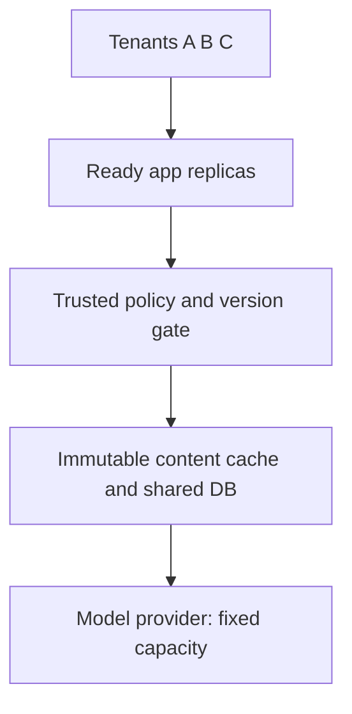
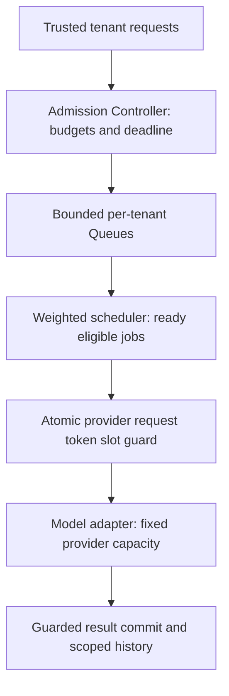

# Stage 5: Handle Overload and Fair Scheduling

Tenant A’s automated supplier workflow floods a model provider shared with Tenants B and C. App replicas are available, but their shared dependency is finite. Keep requests and token work bounded, give tenants explicit service shares, and stop retrying work that cannot finish within its deadline.

The same hypothetical procurement platform now has three hypothetical tenants. Earlier Tenant B fixtures become a broader rollout scenario, not evidence of a real customer launch. Workload rates, weights, quotas, and deadlines remain authored assumptions. The runnable guard uses SQLite and logical time; the scheduler uses equal one-second jobs. Neither deploys a gateway, broker, distributed quota service, or GPU scheduler. Estimated integrated study: seven to nine hours; mastery remains unassessed.

## 1. Understand the Problem

### Inherit the Actual Scale-Out Contract

[Stage 4](../04-application-scaling/guide.md) introduced stateless app/shared-authority design and bounded immutable-body caching with a live policy gate. [Its snapshot](../04-application-scaling/architecture-after.md) and [ADR-004](../../architecture/decisions/ADR-004-stateless-scale-and-cache.md) are the before-state. Preserve short drafting/history, stable operation keys, durable Queue/Workers and epochs, versioned source ingestion, authorised retrieval/citations, cache safety, and the model adapter boundary.



Before diagram. Application scaling and body-cache reuse do not create new model-provider slots or token quota. Existing ingestion and durable jobs remain outside this focused shared-dependency drawing.

### The Failure Is Work Piling Up Faster Than It Leaves

Suppose a shared path can finish six equal-cost jobs/second but receives ten/second. Accepting all work indefinitely grows backlog by four jobs/second in a simplified steady fluid model. Waiting absorbs more memory and connections. Long waits cross client deadlines. Clients retry, creating still more demand. A bigger queue delays the failure without adding service capacity.

At the same time, a single global first-in-first-out queue can let A’s large burst occupy the entire useful waiting window while B and C miss their own deadlines. Overall completion rate alone can look healthy while smaller tenants receive no timely service. Define both safety limits and the intended sharing policy.

| Observable need | Formal mechanism | What it does not do |
| --- | --- | --- |
| Refuse work the service cannot afford now | Admission control | It does not finish rejected work later by magic |
| Bound incoming requests or tokens over time | Rate limit/token bucket | It does not bound how many long requests remain in flight |
| Bound simultaneous provider calls | Concurrency limit | It does not by itself cap requests/minute or tokens/minute |
| Store only a finite amount of waiting work | Bounded queue | It cannot increase downstream throughput |
| Give other tenants turns even while A is busy | Fair scheduling | It allocates existing service, not new provider capacity |
| Tell callers to slow down instead of hiding backlog | Backpressure | It requires callers/ingestion workers to respect the signal |

### Coverage and Outcomes

| Module | Treatment | Depth and evidence |
| --- | --- | --- |
| 5.1 Rate limiting and admission control | Taught at mapped depth | D3: separate request/token/concurrency budgets and atomic guard tests |
| 5.2 Queuing and queueing theory | Taught at mapped depth | D2: backlog growth, stability, bounded wait, Little’s law limitations |
| 5.3 Backpressure and overload management | Taught at mapped depth | D3: finite queues, rejection/deadline/retry policy, failure exercises |
| 5.4 Fair scheduling and workload prioritization | Taught at mapped depth | D2: FIFO, strict priority, RR, WRR, starvation and cost-normalised trade-offs |
| 5.5 AI workload management | Taught at mapped depth | D3: token reservation, provider slots, workload classes and explicit unknown outcomes |
| 4.1 Concurrency fundamentals | Revisited from Stage 2 | D3: apply atomic authority to simultaneous budget reservations |
| 4.2 Messaging and event streams | Revisited from Stage 2 | D3: queue/prefetch/retry limits preserve durable completion and ownership |
| 6.2 Caching systems | Revisited from Stage 4 | D2: hits save body work without bypassing admission or permission |
| 12.1 Scaling and traffic engineering | Revisited from Stage 4 | D3: provider capacity stays binding while app replicas increase |
| 7.2 AI gateway and provider management | Context only | Stage 9, D3: the guard protects a provider boundary; routing/fallback is not retaught here |
| 9.3 Inference performance optimization | Deferred | Stage 9, D1: no kernel, batching-engine, or GPU optimisation implementation |

Outcomes: distinguish the five budgets; enforce a race-safe provider reservation; reproduce noisy-neighbour outcomes; expire waiting work; and explain why retries/extra replicas cannot create capacity. Prerequisites are the first four stage contracts. [Curriculum](../../progress/curriculum-map.json) and [actual coverage](../../progress/coverage-status.csv) remain separate from learner completion.

## 2. Learn and Design

### Put Safety Limits Before the Expensive Boundary

Authenticate and validate the caller, request size, operation identity, estimated input/output budget, and deadline before expensive generation. For a short interactive route, reject if its remaining waiting/execution budget cannot fit. For a durable job route, commit acceptance only into an explicitly bounded waiting policy, then reserve actual provider resources before dispatch. Preserve the difference between durable `202` acceptance and saved-answer completion.

Use a tenant request limit to stop one noisy caller, a global request limit to protect shared endpoints, a token budget for variable model work, and a concurrency cap for simultaneous provider occupancy. The executable guard reserves those last-hop budgets transactionally before a simulated provider call. Only a fresh `accepted` reservation authorises a new call; `duplicate:active`, `duplicate:completed`, and `conflict` do not.

A proposed HTTP facade returns `429` for caller/tenant rate or budget rejection, with a bounded reason and optional `Retry-After` guidance. Global unavailability can use the established `503` contract. Neither response implies acceptance or a later completion. `Retry-After` is guidance, not a promise that capacity is reserved at that instant. [RFC 6585](https://www.rfc-editor.org/rfc/rfc6585.html) defines the `429` status. The local guard returns policy outcomes, not a new implemented HTTP server.

### Token Buckets and Slots Use Different Units

Imagine a bowl that holds up to `b` request credits and refills at `r` credits/second. A request spends one credit; it is rejected when no credit is available. This is a token bucket. It permits a bounded burst and a sustained average rate; fixed windows are simpler but can permit a double burst at adjacent window edges. A sliding window follows recent traffic more closely at greater state/update cost.

Use separate buckets for request counts and model tokens. Reserve known input plus an upper bound on output tokens before generation, not just one credit per request. If a prompt can exceed that bound, reject or reduce it before calling the provider. A real adapter must count/tokenise appropriately and reconcile usage according to actual provider quota rules. The fixture accepts a supplied positive integer estimate, conservatively spends it, and does not implement a tokenizer or refund protocol.

A semaphore-like concurrency budget counts calls that may still be running. Release a slot when termination is known, not when an app stops waiting. Unknown external outcomes retain a reservation in the fixture and require reconciliation; this favours safety over automatic capacity recovery. A stale local timeout does not prove a provider stopped computing or billing.

The guard’s database transaction reads existing operation state, checks concurrency and all bucket balances, then spends credits and records the reservation together. Rejected requests do not partially spend another budget. Production replicas must share a consistent authority/configuration; per-instance counters would multiply the limit as Stage 4 scales out. The SQLite exercise demonstrates serialised local reservations, not a distributed quota algorithm or a vendor’s exact token accounting.

### Queue Bounds, Deadlines, and Backpressure

Choose finite per-tenant queues, not only a global memory cap. Store metadata/references rather than full document bodies in the hot queue. Expire unstarted work whose deadline has passed; dispatching it would consume scarce service for a caller that can no longer use the result. Carry one overall deadline through waiting and execution instead of restarting a full timeout at every hop.

For durable ingestion, reduce the rate of new source-job admission or pause consumption within source cursor/retention constraints when downstream capacity is unavailable. Bound worker prefetch/in-flight claims so a single worker cannot privately hoard all queued jobs. [RabbitMQ consumer prefetch](https://www.rabbitmq.com/docs/consumer-prefetch) is a primary example of limiting outstanding deliveries; it is not the same as a global provider-concurrency guard.

If callers blindly retry rejection, backpressure becomes amplification. Preserve the same operation key, cap attempts, respect remaining deadline, and use backoff with jitter for failures known safe to retry. Retry at a controlled layer, not independently at every nested hop. Never auto-retry the Stage 2 unknown external region. [AWS’s retry guidance](https://aws.amazon.com/builders-library/timeouts-retries-and-backoff-with-jitter/) explains the load and side-effect risks; the fixture uses deterministic logical time instead of claiming to test a production jitter distribution.

[Google SRE’s overload chapter](https://sre.google/sre-book/handling-overload/) motivates explicit resource restrictions and rejection/degradation. Degradation here may reduce optional context/output work while preserving citations and authorisation, or return a clear refusal. It must not bypass current policy/version checks, reveal another tenant’s cached answer, or silently weaken saved-success semantics.

### Choose How to Share Existing Service

| Policy | How it chooses | When it helps | Failure/trade-off |
| --- | --- | --- | --- |
| FIFO | Oldest accepted arrival first | Simple within one workload/class | A large earlier burst can occupy everyone’s waiting window |
| Strict priority | Highest class first, FIFO within class | Explicit urgent/control work | Sustained higher-priority demand can starve lower classes |
| Round-robin (RR) | One eligible job per tenant turn | Equal request-count shares for equal-cost work | Equal job counts are not equal token/compute shares |
| Weighted round-robin (WRR) | Repeated tenant turns according to weight | Contracted relative shares | More policy/configuration; still not cost-fair for variable jobs |

Choose bounded tenant queues and WRR for the equal-cost teaching workload, with weights A:B:C = 2:1:1. When all are continuously backlogged, expected dispatch proportions are 50%, 25%, and 25%. When a tenant is idle, skip its empty queue and let others use service; this is work-conserving. Weights are explicit hypothetical entitlements, not evidence A deserves arbitrary priority because it is noisy.

For unequal token/duration work, request-count fairness can be misleading. A tenant getting one 20,000-token job per turn can consume far more than one getting a 200-token job. Compare estimated-cost credits, deficit round-robin, per-class concurrency, and token reservations before promising token-normalised shares. Deficit scheduling carries unused credit across turns so a larger job can eventually fit. This D2 comparison does not implement a GPU scheduler or prove latency guarantees under arbitrary job sizes.



After diagram. Identity/current-policy gates, cache safety, shared authority, source ingestion and worker epochs are retained. The admission/scheduler are logical trusted roles; the executable has a local reservation store and separate deterministic queue model, not a fully deployed distributed dispatcher.

### Checkpoint 1: A Queue Is Not Capacity

At ten arrivals/second and six completions/second, does increasing a queue from 12 to 1,200 jobs make the system stable?

<details><summary>Answer before revealing</summary><p>No. In the simple sustained model backlog still grows by four jobs/second. A larger queue increases how long overload can hide and often how long callers wait. Reduce admitted work, increase real downstream service, or change the workload; apply a deadline/rejection policy rather than treating stored backlog as throughput.</p></details>

## 3. Observe and Experiment

### Request Walkthrough

Use the [offline walkthrough](guide.html#request-walkthrough) to compare an accepted dispatch, admission rejection, and a started call with uncertain termination. The static lifecycle remains readable without scripting.

```mermaid
sequenceDiagram
 participant C as Tenant client
 participant A as Admission controller
 participant Q as Tenant queue and scheduler
 participant G as Provider budget guard
 participant W as Worker/model adapter
 C->>A: Scope, key, payload, token estimate, deadline
 alt Queue/admission budget unavailable
 A-->>C: Explicit rejection; not accepted
 else Work accepted durably
 A->>Q: Bounded queued operation
 Q->>G: Eligible job under fair turn
 G->>G: Atomic request/token/slot reservation
 G->>W: Fresh grant only; current epoch and policy required
 W->>W: Execute within remaining deadline
 alt Outcome known and result committed
 W->>G: Settle known completion; release slot
 else Remote outcome unknown
 W->>G: Preserve unknown reservation; no blind retry
 end
 end
```

Sequence diagram. The durable job store and quota guard are separate local transactions in the exercise. A crash between reservation and execution can conservatively retain a slot; reconciliation is required. They are not advertised as one distributed transaction.

| Step | Responsible input | Output and possible failure |
| --- | --- | --- |
| Validate | Identity/Policy and API validate scope, key, tokens, deadline | Invalid/expired work stops before provider execution |
| Admit | Controller checks tenant/global queue and request budgets | Bounded acceptance or explicit rejection; never fake 202 |
| Select | Scheduler chooses an eligible tenant turn | Fair dispatch opportunity; expired queued work is dropped |
| Reserve | Guard checks current request/token/concurrency budgets | Fresh atomic grant or no provider call; duplicates are inspection/replay |
| Execute | Worker/model adapter uses remaining deadline and epoch | Known result or explicit external ambiguity |
| Settle | Durable state records outcome and reservation knowledge | Known completion frees slot; unknown retains safety evidence |

### Work the Units and Waiting Budget

Under sustained equal-cost arrivals `λ=10 jobs/s` and capacity `μ=6 jobs/s`, unbounded backlog grows at `λ−μ=4 jobs/s`. Starting empty, a 12-job waiting buffer fills in roughly three seconds in the fluid approximation. Finite queues then force rejection or upstream waiting. A finite burst that ends can drain; do not apply this sustained-growth claim to every burst scenario.

In a stable regime, Little’s law relates average in-system count to throughput and mean time: `L=λW`. At an admitted 4 jobs/s and 1.5 seconds mean time in system, `L≈6 jobs`. It does not prove tail latency, fairness, or stability when offered arrivals exceed departures indefinitely. The intuition is how many items remain present while each spends time in the system; it is not a capacity generator.

If six jobs/s are possible under a request quota, 12 simultaneous calls each taking two seconds also provide only six jobs/s in an idealised occupancy model. A 10,000-token/s quota with 2,000 expected tokens/job further caps average token-feasible throughput near five jobs/s. Variable lengths, burst windows, and reservation rules can reduce it. Check request rate, token rate, concurrency, and remaining deadline independently.

A rough global waiting-time estimate at queue length `Q` is `Q/μ` under the assumed homogeneous service. A tenant with a 25% share of six jobs/s has nominal 1.5 jobs/s while all are backlogged; its own queue of six jobs represents roughly four seconds before additional service-time variation. This is a planning estimate, not a hard WRR latency bound, especially if non-preemptive long calls occupy slots.

Retries at multiple layers multiply rather than merely add. If three nested layers each make three attempts per parent attempt, one original can induce up to `3³=27` downstream attempts. Bound the total attempt budget and preserve stable keys. Backoff spreads timing; it does not make repeated side effects safe.

### Lab: A Noisy Tenant in a Fixed Service Window

Open the [fair-scheduling experiment](guide.html#lab). It varies policy, Tenant A burst (0–60 jobs), provider slots (1–6 one-second jobs), unsafe retry copies (0–2), and a common deadline (1–10 seconds). B and C each offer six jobs. All arrive at time zero in A-then-B-then-C insertion order. FIFO preserves that fixed arrival order. Priority serves B before C before A.

This is a simplified provider-call class, not a replacement for Stage 2’s illustrative 20-second document preparation and 90-second durable-job deadline. Mixed production classes need separate cost/deadline analysis before mapping them to service shares.

Each tenant may queue at most 12 jobs. Excess is rejected before queueing. Every admitted job has the same one-second cost and common absolute deadline; a dispatch at second `t` completes at `t+1`. No work starts after expiry. Queues are sampled after each second’s service and deadline sweep over a ten-second horizon. The weights are fixed at 2:1:1, and empty tenant turns are skipped.

| Policy/case | A/B/C completed by the 4-second deadline | Other default outcomes |
| --- | --- | --- |
| FIFO | 12 / 0 / 0 | 18 rejected; 12 expired; peak queue 24 |
| Strict priority B then C then A | 0 / 6 / 6 | Same total capacity; A misses the finite waiting window |
| RR | 4 / 4 / 4 | Equal request shares, 12 total completions |
| WRR 2:1:1 | 6 / 3 / 3 | Weighted request shares, 12 total completions |
| WRR, two unsafe fresh-key retry copies | 6 / 3 / 3 | 78 rejected instead of 18; no extra service capacity |
| WRR, one-second deadline | 2 / 1 / 0 | Only three completions fit; 21 admitted jobs expire |
| WRR, six fixed slots | 12 / 6 / 6 | 24 completions fit four seconds because physical capacity was changed explicitly |

Default inputs are A=30, B=6, C=6, three slots, no retry copies, four-second deadline. Admitted work is 12+6+6=24. The service window permits at most `3×4=12` completions. Queue history for defaults is `21,18,15,0,0,0,0,0,0,0`; the remaining 12 expire at time four. A scheduling policy changes allocation, not that bound.

“Unsafe retry copies” deliberately represents clients creating new operation identities, multiplying A’s offered work before admission. Correct same-key retries are deduplicated by the actual guard and must not become those copies. The simulator does not model real variable token cost, random arrival/service times, provider cancellation, dynamic weights, or a distributed scheduler. Its queue and deadline counts are exact only under its stated conventions.

### Implement the Guard, Then Break Its Boundaries

Run from the directory containing `10_AI_System_Design/`:

```bash
python3 10_AI_System_Design/stages/05-overload-fairness/labs/test_overload.py
```

[admission.py](labs/admission.py) uses real SQLite transactions for shared fixture reservations, request/token buckets, per-tenant request buckets, and concurrency. [scheduler.py](labs/scheduler.py) independently computes finite-burst queues and service shares. Tests race concurrent reservation callers, separate request and token limits, refill logical buckets, reject conflicting/replayed keys, retain unknown slots, reject expired work, isolate a noisy tenant, compare four policies, exercise deadlines/empty queues/retry amplification, and integrate a grant with Stage 2’s actual durable worker store.

Fixture defaults allow a two-request burst with one request credit/second refill, a 2,000-token burst with 1,000 token credits/second refill, and two simultaneous calls. These are local demonstration configurations, not vendor quotas. All gate instances sharing the store must use the same authoritative configuration and a consistent monotonic clock. Completed reservations release slots but do not refund consumed rate/token credits; unknown states deliberately have no automatic expiry/reconciliation method.

For D3 practice, make a call expire after reservation but before provider start. Explain which durable evidence would safely release its slot. Then inject loss after external start and show why that same release rule is unsafe. Do not “fix” saturation by deleting reservations. For D2 fairness, compare normalised shares with weights and explain why equal request counts do not prove equal compute allocation for mixed lengths.

### Checkpoint 2: Retry Amplification Is Not Recovery

A rejected client creates a new operation key and immediately retries twice. Is it helping recover service for the original request?

<details><summary>Answer before revealing</summary><p>It creates three separately admissible operations rather than one inspected/replayed operation. Under overload this increases offered work and can repeat generation. Preserve the original key, use a bounded retry/deadline policy only where safe, and treat rejection as a demand signal rather than free capacity.</p></details>

## 4. Think Like a Staff Engineer

### Protect Per-Tenant Outcomes and Authority

Track offered/admitted/rejected/expired/completed counts by tenant and workload class, oldest waiting age, per-tenant service share, queue bytes, active/unknown slots, token reservations versus observed use, provider errors, and retry amplification. A global healthy throughput graph can hide B or C receiving zero timely service. Record protected IDs and reservation reasons, not raw source/prompts or credentials.

Interactive grounded queries, long document preparation, and periodic ingestion may need separate classes with different deadlines and minimum shares. Reserve enough interactive headroom without giving strict priority an unlimited starvation path. A batch class can use idle capacity while respecting its queue/storage bounds. When a tenant is idle, borrowing unused capacity improves utilisation, but the policy must still honour entitlements as other queues become backlogged.

When overload appears, inspect the binding resource before changing weights. If token limits bind, reducing approved context/output limits or changing the request mix may help. More app replicas cannot alter the fixed provider quota. A cache hit may save DB reads while still requiring a full generation budget. Never drop tenant checks or use stale permission authority as a degradation strategy.

A production dispatcher must coordinate fair selection, durable claims, budget grants, policy revalidation, deadlines, and settlement/reconciliation. The slice tests these boundaries together for one happy worker path and separately under guard races; it does not implement an atomic distributed dispatch transaction. A crash between claim/grant/start/commit can strand capacity or leave uncertainty. Defaulting to conservative failure is safer than repeating a charged operation, but needs an operational recovery policy.

### Interview 1: Why Limit More Than Requests?

**Prompt:** Every tenant is allowed ten requests/minute. Why are long queries still causing outages?

**Spoken answer:** “Request counts hide token cost and time occupying a provider slot. Ten small queries and ten huge generations can consume very different resources. I separately bound request rate, reserved tokens, simultaneous calls, queued bytes/jobs, and the deadline. A global dependency budget still applies across all tenants and app replicas. The limits need shared authority rather than multiplying per replica.”

**Trade-off:** Conservative reservations can waste capacity. **Changed constraint:** If actual output is much shorter than reserved, design a safe usage-reconciliation rule tied to the provider’s quota model.

### Interview 2: Which Scheduling Policy?

**Prompt:** B and C time out behind A, but overall provider throughput looks good.

**Spoken answer:** “A global FIFO can allocate the useful waiting window to the earlier large burst. I would bound each tenant’s queue and choose explicit shares, using RR for equal request entitlements or WRR for known weights. Strict priority is appropriate only for justified classes with starvation controls. These policies allocate the same provider capacity; they cannot repair sustained total demand beyond it.”

**Trade-off:** Fair shares may reduce the largest tenant’s immediate throughput. **Changed constraint:** With variable token costs, compare dispatch-count fairness against deficit/cost-based credits.

### Interview 3: Do Bigger Queues Improve Reliability?

**Prompt:** Increase the queue 100 times so fewer callers receive rejection.

**Spoken answer:** “It can absorb a bounded burst if the backlog drains within useful deadlines. Under sustained arrivals above service, it stores more waiting and delays visible failure. I would track oldest age and admitted completion, not just rejection count. A finite queue and clear deadline policy protect memory and useful work; callers need honest backpressure.”

**Trade-off:** Early rejection sacrifices some potentially recoverable burst work. **Changed constraint:** Show how you would size a buffer for a measured ten-second burst that is followed by a long idle period.

### Interview 4: When Can You Release an Unknown Slot?

**Prompt:** A worker disappears after starting generation. Its lease has expired, and all concurrency slots are occupied.

**Spoken answer:** “Lease expiry fences our local completion authority but does not establish that the remote model stopped. Releasing every slot immediately can oversubscribe the provider and duplicate work. I preserve the operation and unknown reservation, then reconcile using provider evidence or an explicit policy with a documented uncertainty bound. The conservative local fixture requires that reconciliation; it does not invent an automatic cancellation guarantee.”

**Trade-off:** Safety can temporarily reduce availability. **Changed constraint:** If the provider exposes a reliable terminal-status API, define how job and reservation states converge after a lost response.

## 5. Validate and Carry Forward

### Self-Test and Memory Card

1. **What changes in WRR?** The allocation of existing eligible service, not physical provider throughput.
2. **Why are per-tenant queues bounded?** One caller cannot occupy all waiting storage; deadlines still limit useful backlog.
3. **What makes a token estimate safe?** It must cover the actual allowed input/output envelope under the real provider’s counting rules; the fixture integer is not a tokeniser.
4. **What does an unknown reservation mean?** External termination is not established, so release/retry requires reconciliation.
5. **Why is a finite burst not the same as an unstable steady queue?** A burst may stop and drain; persistent arrivals above departures keep growing backlog absent rejection.

The 60-second card: authenticate first; deduplicate operations; budget requests/tokens/slots separately; bound each queue; schedule entitlements; expire old work; backpressure without blind retries; reconcile unknown effects. Review at about one, seven, and 21 days.

- [ ] Explain rate, concurrency, queueing, and scheduling without notes in two minutes.
- [ ] Draw inherited retrieval/history plus the new admission/scheduler/guard path.
- [ ] Defend FIFO, priority, RR, and WRR with workload and cost assumptions.
- [ ] Diagnose tenant starvation, token saturation, retry storms, and unknown slots with concrete signals.
- [ ] Run/modify the quota, scheduler, and durable-worker integration tests; learner completion remains unassessed.

### Decision and Stopping Point

[ADR-005](../../architecture/decisions/ADR-005-bounded-fair-dispatch.md) accepts bounded fair dispatch under fixed dependency budgets. [Snapshot](architecture-after.md), [state](stage-state.json), [validation](validation.md), and [coverage](../../progress/coverage-status.csv) preserve checked artifacts and limits. The complete ZIP includes prerequisite stages and tests, with clean-extraction link/artifact checks and sequential Python execution.

Stop after Stage 5. A future Stage 6 expands enterprise identity, isolation, audit, private connectivity, and retrieval governance. It inherits the current tenant/policy gates and all execution/overload uncertainty boundaries; it has not been authored here.

### Primary References

- [RFC 6585](https://www.rfc-editor.org/rfc/rfc6585.html): the HTTP `429` response used by the proposed admission facade.
- [RabbitMQ consumer prefetch](https://www.rabbitmq.com/docs/consumer-prefetch): example of limiting outstanding deliveries, separate from global provider slots.
- [Google SRE: handling overload](https://sre.google/sre-book/handling-overload/): resource limits, degradation, and rejection as operating choices.
- [AWS: timeouts, retries, and backoff with jitter](https://aws.amazon.com/builders-library/timeouts-retries-and-backoff-with-jitter/): retry load and side-effect boundaries.

Sources checked 2 November 2026. Workloads and model outputs are illustrative; executed checks and untested production integrations are in validation.
