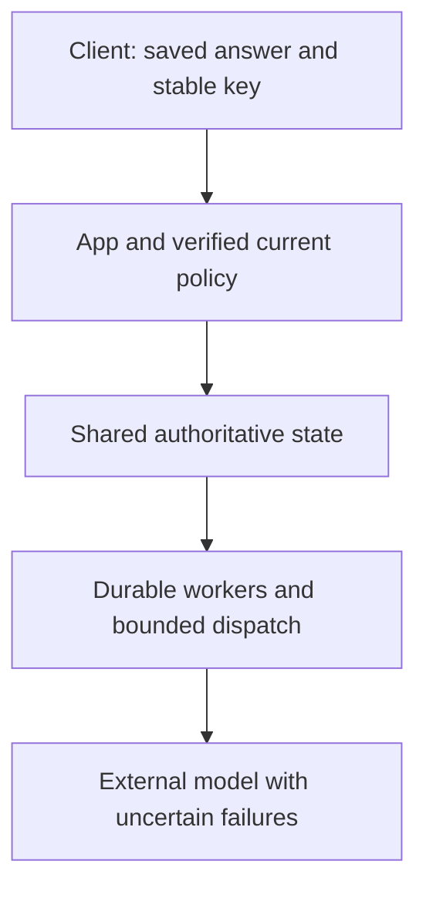
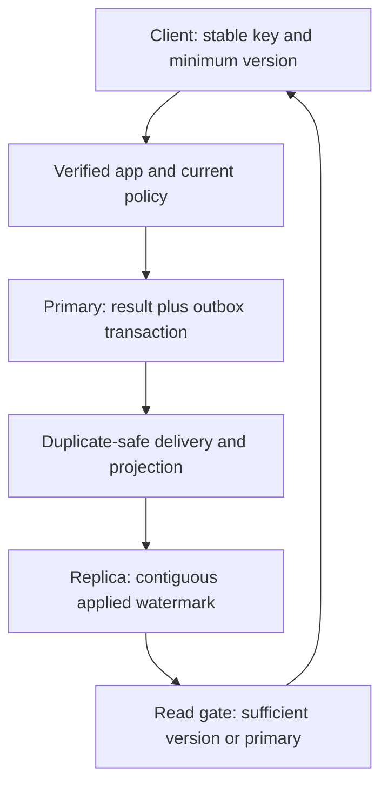
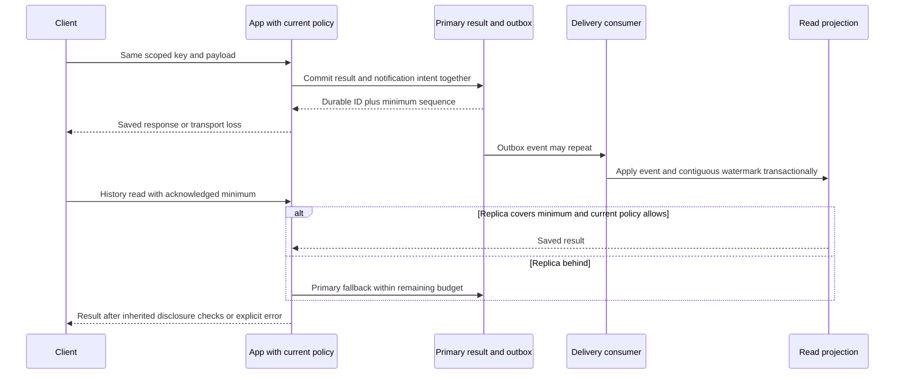

# Stage 7: Reliability and Consistency

Alice receives a saved supplier answer, refreshes the page, and sees no result because the next read reached a lagging replica. The client retries. Meanwhile a provider timeout and a policy-authority outage tempt the application to regenerate blindly or use an old cached permission. Reliability must preserve the meaning of saved success and current authority while recovering useful service.

This continues the same hypothetical platform. The executable uses two SQLite files with explicit event delivery to model a primary and a projection, logical failures, and a local circuit breaker. It is not database replication, consensus, leader election, real failover or a production telemetry deployment. Workloads and timings are illustrative. Estimated integrated study: eight to ten hours; learner mastery remains unassessed.

## 1. Understand the Problem

### Inherit Security and Execution Before Adding Recovery

[Stage 6](../06-enterprise-security/guide.md), [its snapshot](../06-enterprise-security/architecture-after.md) and [ADR-006](../../architecture/decisions/ADR-006-trusted-enterprise-boundaries.md) establish verified scope, current membership/resource policy and mandatory audit-before-disclosure. Keep fair admission/provider budgets, shared history and keys, source versions, safe immutable caches, worker epochs, and explicit unknown remote outcomes.



Before diagram. Shared authority is a logical contract; actual availability, replication and recovery guarantees have not been deployed or measured in earlier stages.

### Walk Through the Incident

The primary commits Alice's answer and acknowledges success. A derived history copy has not received that commit. Reading the copy without a freshness requirement yields “not found,” although the answer is durable. Reissuing generation with a new operation key can charge again. If the original response was lost instead, the client cannot know from the timeout alone whether the commit happened.

Now imagine the failed dependency is policy authority. A stale replica may still say Alice belongs to Tenant A. Serving protected context from it would turn an availability fallback into an access regression. Recovery rules must depend on the data class, not the fact that another server can respond.

| Concrete observation | Term | Consequence |
| --- | --- | --- |
| Two copies temporarily disagree after a commit | Replication lag | A readable replica need not contain the acknowledged write |
| Alice's next read must include her saved result | Read-your-write contract | Carry a trusted minimum version or route to authority |
| The result and its notification must agree | Transactional outbox | Commit intent with local state; delivery can still repeat |
| Stop calling an unhealthy dependency repeatedly | Circuit breaker | Limits attempts; does not repair the dependency or prove remote cancellation |
| Follow one request across services and waits | Distributed trace | Correlated timings explain a path, not every unsampled failure |

### Learning Contract and Coverage

| Module | Treatment | Depth and evidence |
| --- | --- | --- |
| 3.1 Distributed system fundamentals | Taught at mapped depth | D3: lag, partition, leader authority, quorum/availability trade-offs and fault exercise |
| 3.2 Distributed state and transactions | Taught at mapped depth | D3: local atomicity, conditional writes, outbox, duplicate/order handling and external gap |
| 12.2 Resilience and fault tolerance | Taught at mapped depth | D3: deadlines, bounded retries, circuit/probe, bulkheads, failover and recovery boundaries |
| 12.3 Latency and performance | Taught at mapped depth | D3: critical-path budgets, pool/queue/dependency waits and diagnosis |
| 15.2 SRE and production operations | Taught at mapped depth | D3: service indicators, error budget, incident roles, runbook, restore/failover evidence |
| 15.3 Performance and incident diagnosis | Taught at mapped depth | D3: symptom-to-boundary reasoning, traces, hypothesis and recovery checks |
| 2.2 APIs and streaming protocols | Revisited from Stage 1 | D3: lost response and minimum-version read; same operation identity |
| 5.3 Backpressure and overload management | Revisited from Stage 5 | D3: retry/probe limits preserve finite downstream capacity |
| 6.1 Database architecture | Revisited from Stage 1 | D2: transaction/constraint boundaries under injected failure |
| 6.2 Caching systems | Revisited from Stage 4 | D2: immutable body reuse does not become stale authority |
| 8.1 Document ingestion and indexing | Revisited from Stage 3 | D3: derived publication may lag but versions/tombstones remain authoritative |
| 8.3 Enterprise retrieval governance | Revisited from Stage 6 | D3: failover cannot silently widen policy freshness |
| 13.1 Identity and access control | Revisited from Stage 6 | D3: authority outage denies protected access, even when history can be read |
| 15.1 Observability systems | Context only | Stage 8, D3: use diagnostic signals now; version-aware telemetry architecture follows |
| 3.3 Distributed architecture patterns | Deferred | Stage 12, D2: no catalogue of unrelated architectures |
| 16.2 Cloud networking and deployment | Context only | Stage 11, D2: regional recovery needs a later deployment contract |

Outcomes: choose consistency per class; reproduce rollback/lost acknowledgement; reject false projection catch-up; bound recovery attempts; diagnose the latency path and write a verifiable recovery procedure. Prerequisites are the first six stages. [Curriculum](../../progress/curriculum-map.json) governs scope; neither fixture availability nor a labelled SLO proves production reliability.

## 2. Learn and Design

### Choose Consistency by Consequence

| Data class | Required observation | Failure policy |
| --- | --- | --- |
| Membership, permission, current tombstone/version authority | Current authoritative decision within the declared freshness contract | No stale allow fallback during authority outage |
| Provider budgets and worker ownership | Atomic shared reservation/conditional ownership | Do not create a second authority or release unknown effects blindly |
| Just-completed saved history | At least the acknowledged result version | Use primary or a replica proven past the minimum; retain auth/audit checks |
| Search/projections | May be derived asynchronously | Recheck current versions/policy before context; disclose freshness appropriately |
| Immutable passage bodies | Exact named version | Reuse bytes only after the current trusted gate |
| Audit decision | Durable acknowledgement required by Stage 6 | Block disclosure or use a separately designed durable buffer contract |

A primary is the authorised writer, not merely the machine called “primary.” Replication copies committed changes to another node. With asynchronous acknowledgement, a primary loss can strand acknowledged changes not yet replicated. Synchronous replication can wait for a specified durable remote acknowledgement at extra latency/availability cost. [PostgreSQL standby documentation](https://www.postgresql.org/docs/current/warm-standby.html) describes concrete replication choices; this fixture implements none of that transport.

During a network partition, separate sides may be alive but unable to coordinate. If two sides both accept conflicting writes without a reconciliation/ownership protocol, operation keys, quotas and permissions can diverge. For protected current authority, choose to reject when authoritative coordination is unavailable rather than claim both unrestricted availability and the same consistency. “CAP means pick any two all the time” is not a useful operational contract; the relevant conflict occurs under partition with specified consistency/availability meanings.

For three voting nodes a majority is two. Intersecting majorities are useful for leader/commit protocols, but a quorum count alone does not implement linearizability: epochs, ordering, durable acknowledgement and the read protocol matter. Do not build a home-made consensus service for this lesson. Understand which managed authority/protocol your deployment relies on and which failures it actually tolerates.

### Preserve One Operation Across a Lost Response

Keep tenant/user/key uniqueness and immutable request intent. If a result commit succeeds but its response is lost, retrying the same key can return the saved answer without a new result or notification intent. If no durable result exists after an external call, that absence does not prove the call never happened. Preserve the earlier unknown-outcome rule rather than making the API look available by repeating generation.

The fixture saves a computed result and an outbox row in one local transaction. Injecting failure before commit rolls both back. Injecting failure after commit loses the response but leaves both durable. The function does not call a model: replay-safe result persistence is not exactly-once model execution. [AWS's transactional outbox guidance](https://docs.aws.amazon.com/prescriptive-guidance/latest/cloud-design-patterns/transactional-outbox.html) describes the dual-write problem and duplicate-consumer boundary.

A delivery process can publish an outbox event twice after a lost acknowledgement. The consumer records event identity and updates its projection in one transaction. For this ordered fixture, a watermark means every event up to that sequence has been applied, not just the largest sequence observed. Receiving event 2 before event 1 must not declare catch-up to 2. Missing events should be reconciled, not hidden by manually advancing the watermark. Pruning/checkpoint seeding is an additional operational protocol, not implemented here.

Local database transactions protect local invariants; they do not enlist a hosted provider. Conditional updates/uniqueness prevent lost ownership or duplicate local operation identities. Snapshot isolation does not automatically enforce every multi-row business rule: two concurrent decisions can each observe a permissive snapshot. Use the database's documented constraints/locks/isolation and test the actual invariant. Cross-service two-phase commit introduces coordination/blocking costs; a saga needs business-defined compensations. “Undo the email” or “refund a model computation” is not a generic rollback action.

### Alternatives and Recovery Trade-Offs

| Choice | Benefit | Cost or limit | Decision |
| --- | --- | --- | --- |
| Always read protected results from primary | Simple freshness boundary | Primary load and outage dependence | Valid baseline; preserve for unknown minimum-version cases |
| Replica reads with minimum-version fallback | Offload eligible reads while preserving read-your-write | Version tracking and primary fallback load | Demonstrate for saved-history data leg |
| Serve stale authorisation during outage | Apparently higher response rate | Can disclose revoked/foreign resources | Reject |
| Local result plus outbox and duplicate-safe consumer | Atomic local intent, recoverable async propagation | Delivery lag/replay and retention operations | Choose representative slice |
| Blind retry/failover of an uncertain provider call | May produce an answer eventually | Duplicate work/billing/effects | Reject without a documented safe provider contract |

The minimum history version comes from the trusted acknowledged write, not an untrusted client permission claim. A just-completed item lookup without a usable minimum must use authority rather than silently weaken the original saved-answer promise. A stale read leg never bypasses the separate current Stage 6 identity/resource/audit requirements. The simulator isolates the data-read decision; it is not a whole-request authorisation implementation.



After diagram. Add explicit projection/version and recovery policies while retaining every security, quota and external-ambiguity boundary. The two local files represent controlled state copies, not actual failover or independently writable leaders.

### Checkpoint 1: A Large Sequence Can Hide a Gap

A projection has received event 2 but not event 1. May it claim watermark 2 and serve every minimum-version-2 history request?

<details><summary>Answer before revealing</summary><p>No. The watermark must represent a contiguous applied prefix under this protocol. Record the out-of-order event, keep the watermark at zero, and advance it only when the missing predecessor is applied. A maximum observed sequence is not evidence all earlier state is present.</p></details>

### Bound Failure Recovery and Latency

Use one remaining deadline across queue wait, identity/policy, retrieval, provider work and commit/audit. A timeout on each hop that restarts the full budget can exceed the user's overall limit. Reserve time for the final required persistence/audit before dispatch. If no useful allowance remains, reject/expire before a new provider call.

Retry known-safe transient failures only within the shared attempt/deadline budget; use backoff/jitter and preserve operation identity. A circuit breaker stops ordinary attempts after failures, waits a cooldown, then admits bounded probes. The local breaker allows one half-open probe per object and protects that choice with a lock. It is a basic logical-state fixture, not a production SDK handling arbitrary overlapping/late result generations or a distributed breaker shared across replicas. Stage 5 budgets remain authoritative even if a replica's breaker resets.

Bulkheads keep one dependency or tenant from consuming every worker/thread/connection; Stage 5 queue/slot bounds already provide part of that isolation. A fallback must be semantically acceptable: smaller approved context or explicit refusal can fit, while stale permission and blind alternate-provider replay cannot. Cancellation of a local wait is not proof of remote cancellation.

## 3. Observe and Experiment

### Request Walkthrough

The [offline walkthrough](guide.html#request-walkthrough) follows commit, lost-response handling, delayed projection and a freshness-aware read. Branches expose normal catch-up, lag requiring primary, and unavailable current authority.



Sequence diagram. A lost response never grants a new provider attempt automatically. Primary unavailability cannot be solved by substituting a stale policy snapshot.

| Step | Responsible input | Output and possible failure |
| --- | --- | --- |
| Verify authority | App checks identity/current policy/audit prerequisites | Current decision or deny; history replica is not policy authority |
| Commit | Primary receives stable scoped operation and computed result | Result and outbox intent commit together or both roll back |
| Acknowledge | App returns durable ID/minimum sequence | Lost response leaves uncertainty to inspect under the same key |
| Deliver | Consumer receives potentially repeated/out-of-order events | Projection and applied identity commit; gaps cannot fake catch-up |
| Read | Read gate compares required minimum with contiguous watermark | Eligible replica or primary fallback, bounded by remaining time |
| Recover | Operator/controller inspects failures and evidence | Reconcile/restore without deleting unknown effects or widening policy |

### Worked Latency and Reliability Budgets

Assume a serial illustrative path: identity/policy 20 ms, retrieval 80 ms, cache/body work 10 ms, queue wait 500 ms, provider 600 ms, final commit/audit 10 ms. Total is 1,220 ms. Queue wait exceeds retrieval work by more than six times; changing the database index may not address the observed dominant delay. These are modelled span values, not measured service timings.

For independent parallel subtasks, the critical path is closer to the maximum branch duration plus join overhead, not the sum of every overlapping span. Component p95 values also cannot simply be summed into end-to-end p95. Correlate actual per-request spans and inspect the tail population. [OpenTelemetry traces](https://opentelemetry.io/docs/concepts/signals/traces/) describes spans/context propagation; this stage does not deploy a collector.

An illustrative 99.9% successful eligible-request objective allows 1,000 failures in a million eligible requests. A time-based 99.9% objective over 30 days allows 43.2 minutes, but that is a different indicator/population. Define valid requests, dependency errors, timeouts and policy denials explicitly; do not hide overload by excluding all rejected traffic from customer-impact reporting. Maintain separate safety/security and quota-rejection indicators.

If observed error fraction is 1%, a 0.1% error allowance is burning at ten times the sustainable rate for that window. Short windows detect spikes, while longer windows check persistence and avoid reacting to a tiny sample alone. [Google SRE's SLO guidance](https://sre.google/workbook/implementing-slos/) provides the objective/error-budget framework. Alert thresholds and paging policy still need real workload calibration.

For failover, distinguish recovery time objective (how long recovery may take) from recovery point objective (how much committed data may be lost). An async replica can lose unreplicated acknowledged writes on promotion. A claimed zero-loss recovery needs the actual acknowledgement/storage/quorum protocol and tested failure conditions, not merely a standby box. The local projection exercise measures neither objective.

### Lab: Select the Right Read and Remaining Budget

Open the [consistency/deadline experiment](guide.html#lab). Choose saved history versus current authority, replica lag (0–10 logical seconds) and remaining overall time (0–5,000 ms). The model reserves 200 ms for inherited required work. It assumes a reachable primary; outage branches are exercised separately in Python/the walkthrough.

| Case | Inputs | Expected decision |
| --- | --- | --- |
| Caught up history | History, lag 0, remaining 1,000 ms | Replica covers minimum; 800 ms dependency allowance |
| Lagged history | History, lag 5, remaining 1,000 ms | Primary fallback; same 800 ms allowance |
| Authority | Authority, lag 0 or 10, remaining 1,000 ms | Primary current authority only |
| Exhausted | Either class, remaining 200 ms | No new read/generation; zero dependency allowance |

Lag zero stands for a proven minimum version in this toy model, not a real method of measuring replication freshness from wall time alone. The read decision is a data leg; protected disclosure still requires Stage 6's current access and audit gates. A primary authority outage denies protected access even when historical bytes exist elsewhere.

```bash
python3 10_AI_System_Design/stages/07-reliability-consistency/labs/test_reliability.py
```

[reliability.py](labs/reliability.py) creates separate primary/projection files, explicit event delivery and a logical breaker. Twelve tests cover rollback/outbox atomicity, lost acknowledgement/replay, payload conflict/tenant scope, lag fallback, duplicate and out-of-order projection, unavailable authority/fallback, durable object recreation, breaker opening/recovery, failed probe and concurrent probe limits. No hosted model runs. The saved result is a provided fixture, so no test should be described as exactly-once provider generation.

For D3 practice, fail before commit, after commit and between delivery/apply acknowledgement. Preserve the same operation key and inspect result/outbox/projection separately. Introduce a missing sequence and show why manual watermark advancement is unsafe. Then write a deployment experiment for actual database promotion, backup restore and provider reconciliation; those are still missing evidence.

### Checkpoint 2: Availability Without Authority

The membership primary is unavailable, but the replica says Alice was allowed five minutes ago. May the app use that value to keep its success rate high?

<details><summary>Answer before revealing</summary><p>No. This protected path requires current authority within its declared freshness contract. A stale allow cannot replace it. Report the authority failure without restricted disclosure; fix the availability architecture without quietly changing the security guarantee.</p></details>

## 4. Think Like a Staff Engineer

### Diagnose With a Bounded Incident Procedure

Classify the symptom first: missing saved answer, stale source, denied identity, rising queue wait, provider timeout or audit failure. Protect customer data and freeze the suspected risky change. Assign incident coordination, diagnosis and communication roles; retain request/job/reservation/event IDs without copying raw prompts into chat/logs.

For a missing saved answer: inspect primary commit and the same scoped key; compare acknowledged minimum, projection watermark and missing sequences; fall back only where the data-class contract permits. Never regenerate simply because a lagging replica returned empty. For a stuck projection, inspect outbox age, delivery attempts and consumer failures; replay idempotently before considering cursor repair.

For high latency: separate ingress/pool wait, policy, retrieval, tenant queue wait, provider service and commit/audit. Check offered/admitted/completed rates and concurrency/token budgets. A timeout spike with normal provider duration may be queue or connection setup time. A trace sample is not the full population; use counters/histograms and representative tail samples together.

For dependency outage: preserve remaining deadlines, open a bounded breaker, shed excess work and reconcile unknown remote calls. Before primary promotion, fence old writers, establish the authoritative replacement and assess possible lost commits. Verify scoped history, keys, worker epochs, quota reservations and current policy after recovery. A restart is not a complete runbook.

The runbook ends with evidence: restored authority/current version, drained/reconciled outbox, no unexpected duplicate effects, error/latency recovery, and a documented customer-impact window. A post-incident review should identify causal conditions and assign measurable fixes, not merely blame a slow model. Real paging, dashboards, restore drills and failover tests are not implemented by this fixture.

### Interview 1: Which Reads May Lag?

**Prompt:** Read replicas improve availability and latency. Should every read use them?

**Spoken answer:** “No. Current membership, permissions, worker ownership and quota reservations need their authoritative contract. A saved-history read can use a replica only when it covers the acknowledged minimum version, otherwise I use the primary within budget. Derived search can lag behind a current-version gate. An immutable body cache can reuse exact bytes after live permission checks.”

**Trade-off:** Stronger current reads concentrate dependency load. **Changed constraint:** If primary reachability fails, identify which customer-visible operations must stop rather than silently use old authority.

### Interview 2: What Does the Outbox Solve?

**Prompt:** The database result commits, but notification publication fails.

**Spoken answer:** “I commit result and notification intent together locally. A delivery process can later publish the retained intent, and the consumer records event identity with its projection change. Publication may repeat; the outbox does not grant exactly-once external effects. A missing projection should trigger replay/reconciliation, not blind regeneration.”

**Trade-off:** Async delivery introduces lag and retention operations. **Changed constraint:** If messages arrive out of order, explain why maximum observed sequence is not a contiguous applied watermark.

### Interview 3: Is Failover Always Safer Than Failure?

**Prompt:** A provider times out after starting. Immediately retry through another provider?

**Spoken answer:** “The first provider may still be computing or have charged. Another provider is a new external attempt, possibly with different approved data-handling and answer behaviour. I preserve the operation's unknown outcome and budget reservation until the provider/reconciliation contract permits another attempt. Failover is safe only under explicit semantics, not because a second endpoint responds.”

**Trade-off:** Conservative ambiguity handling reduces availability. **Changed constraint:** A provider exposes reliable terminal status and durable idempotency; specify what additional evidence permits retry.

### Interview 4: Where Would You Look First?

**Prompt:** End-to-end latency rises, app CPU remains low, and provider execution time is unchanged.

**Spoken answer:** “I inspect waiting time: admission/tenant queues, DB pool acquisition, identity/audit calls and connection setup. I correlate request traces with offered/admitted/completed counts and dependency histograms. Adding app replicas can worsen pool pressure and cache misses if the bottleneck is shared. I test one hypothesis against the critical path and compare the affected population before changing capacity.”

**Trade-off:** More diagnostics cost telemetry/storage and operator time. **Changed constraint:** If only 1% of traces are sampled, explain what aggregate signals prevent a false diagnosis of the tail.

## 5. Validate and Carry Forward

### Recall and Exit Gates

1. **Why can a saved answer be absent on a replica?** Its commit may not yet be applied there; use the trusted minimum or primary.
2. **What is atomic in the outbox fixture?** Result and local notification intent, not external delivery or model execution.
3. **What does a contiguous watermark exclude?** Missing earlier events despite later observations.
4. **Why retain unknown provider state?** A lost response is not proof of no external work.
5. **Which recovery claims are untested?** Real consensus, replication, database promotion, restore and production error/latency objectives.

The 60-second card: consistency per class; one authoritative writer; minimum-version reads; transactional intent; duplicate-safe contiguous projection; bounded attempts/probes; critical-path diagnosis; recover with evidence. Review at about one, seven and 21 days.

- [ ] Explain lag, local atomicity and external uncertainty without notes in two minutes.
- [ ] Draw primary, outbox, projection and protected-authority read paths.
- [ ] Defend current authority versus eligible replica reads and a recovery alternative.
- [ ] Diagnose rollback, lost response, lag, outage and latency with concrete state/signals.
- [ ] Run/modify the fault and probe tests and write a deployment recovery drill; learner completion remains unassessed.

### Decisions and Next Dependency

[ADR-007](../../architecture/decisions/ADR-007-consistency-and-recovery.md), the [stage snapshot](architecture-after.md), [state](stage-state.json), [validation](validation.md) and [coverage](../../progress/coverage-status.csv) preserve the evidence. The complete archive includes prerequisites and runs clean-extraction links/artifacts/Python checks sequentially.

A future Stage 8 adds versioned quality evaluation and release controls. It inherits these telemetry, transaction and recovery boundaries, and must roll back a model/retrieval change without reviving stale permissions or overwriting durable operation identity.

### Primary References

- [PostgreSQL standby documentation](https://www.postgresql.org/docs/current/warm-standby.html): real replication/acknowledgement choices absent from the fixture.
- [AWS transactional outbox](https://docs.aws.amazon.com/prescriptive-guidance/latest/cloud-design-patterns/transactional-outbox.html): local dual-write intent and duplicate delivery boundaries.
- [OpenTelemetry traces](https://opentelemetry.io/docs/concepts/signals/traces/): span/context vocabulary for the proposed diagnostic path.
- [Google SRE SLO guidance](https://sre.google/workbook/implementing-slos/): objectives and error-budget reasoning, not a claim of measured attainment.

Sources checked 2 November 2026. Timings, populations and fault clocks are authored examples. Validation records actual local checks and remaining deployment gaps.
