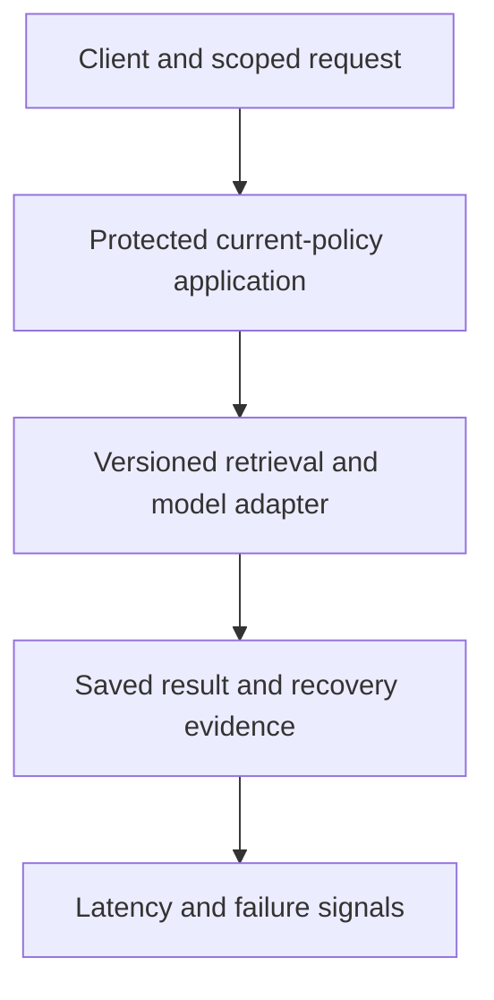
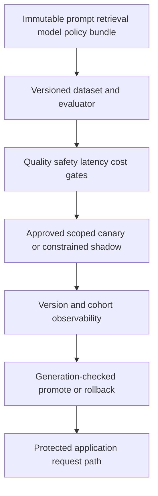

# Stage 8: Production AI Quality and Releases

Alice's supplier-policy answer remains fast and available after a model or retrieval change, but now gives the wrong confirmation rule. Another candidate answers a foreign tenant's question instead of refusing. Infrastructure health alone cannot detect those regressions. Version what changed, evaluate the right slices, and make release/rollback decisions without weakening the platform's existing safety contracts.

This remains the same hypothetical procurement system. The runnable evaluator scores precomputed fixture outputs against eight authored cases. Latency and cost values are synthetic labels, not measured model performance or prices. A passed report permits only the teaching release exercise, never production approval. Estimated integrated study: six to eight hours; learner mastery remains unassessed.

## 1. Understand the Problem

### Inherit a Recoverable, Protected Platform

[Stage 7](../07-reliability-consistency/guide.md), [its snapshot](../07-reliability-consistency/architecture-after.md) and [ADR-007](../../architecture/decisions/ADR-007-consistency-and-recovery.md) establish data-class consistency, result/outbox atomicity, projection freshness, bounded recovery and diagnostic contracts. Retain current identity/policy/audit, approved egress, source citations, immutable-cache safety, worker epochs, stable operation identity and fair provider budgets.



Before diagram. We can diagnose an outage or lost acknowledgement, but have not established a versioned quality-evaluation and release decision path. A successful HTTP response is not evidence the answer follows the current supplier rule.

### Why One Average Score Is Insufficient

The candidate answers five ordinary supplier questions correctly and refuses an unsupported one, but discloses one foreign-tenant case. A high aggregate can hide that known violation. Likewise, an apparently better answer score can come from longer prompts, larger output budgets or a different dataset, making cost and latency comparisons invalid.

| Engineering question | Formal idea | Limit |
| --- | --- | --- |
| Can we reproduce the exact change and its evidence? | Version bundle and evaluation manifest | A model name alone omits prompt, retrieval, source and evaluator versions |
| Which customer cases got worse? | Dataset slices | An overall mean can hide access/refusal or tenant-specific failure |
| Should a candidate receive any customer traffic? | Release gate | A passing small fixture is not proof of general safety |
| Can a small eligible group try the change first? | Canary | Exposure is controlled, not risk-free or necessarily statistically decisive |
| Can we compare without using candidate business actions? | Shadow | Extra inference still costs resources and requires authorised data handling |

### Coverage and Outcomes

| Module | Treatment | Assigned depth and evidence |
| --- | --- | --- |
| 14.1 Evaluation architecture | Taught at mapped depth | D3: versioned cases, rubric/slices, coverage binding, quality/safety/latency/cost gates and tests |
| 14.2 Release management and experimentation | Taught at mapped depth | D3: approved bundles, sticky eligible canaries, shadow contract, CAS promotion and rollback |
| 15.1 Observability systems | Taught at mapped depth | D3: version/cohort telemetry schema, metrics/logs/traces, privacy/cardinality and release diagnosis |
| 3.2 Distributed state and transactions | Revisited from Stage 7 | D3: atomic generation-checked release pointer; rollback preserves durable result identity |
| 7.1 End-to-end AI application design | Revisited from Stage 1 | D3: bind prompt/retrieval/model and source context into one reproducible outcome |
| 7.3 Agentic application system architecture | Revisited from Stage 2 | D3: shadow/evaluation cannot perform live business side effects |
| 13.2 Enterprise AI security | Revisited from Stage 6 | D3: known safety cases gate release separately; logs and shadows retain data boundaries |
| 15.3 Performance and incident diagnosis | Revisited from Stage 7 | D3: compare version/cohort and retrieval/generation failure rather than global health alone |
| 14.3 Model and data lifecycle infrastructure | Context only | Stage 10, D2: use immutable IDs now; broader training/registry lifecycle follows |
| 17.3 Architecture economics | Deferred | Stage 12, D3: no unrelated total-cost platform programme |

Outcomes: execute a reproducible fixture evaluation; inspect slice failures; block known safety/cost/latency regressions; control a release pointer without stale writes; and diagnose/roll back without rewriting saved operations. The [curriculum](../../progress/curriculum-map.json) defines scope. Exit gates assess the learner separately from artifact verification.

## 2. Learn and Design

### Freeze the Bundle and the Dataset

A release bundle identifies prompt template, retrieval configuration, index/corpus generation, model revision, security policy, dataset digest, evaluator version and gate-policy version. Store immutable configuration content behind those identities; a mutable alias such as “latest” is not sufficient evidence. The fixture computes a canonical JSON digest; it does not implement signed artifact attestation or a production registry.

The [eight-case dataset](labs/dataset-v1.json) contains five answer cases, one unsupported-evidence refusal and two security refusals for foreign/revoked access. A structured answer must have the expected decision/citation and a required token. A refusal has no citation and an empty answer field. This deliberately mechanical rubric can catch fixture regressions; it cannot judge arbitrary paraphrases, completeness, answer entailment or real prompt-injection resilience.

Separate development examples used to tune a prompt from held-out evaluation examples. Record who labelled each case, the expected evidence/version and the reason for the label. In deployment, collect representative queries across tenants, document types, refusal/access states, languages, lengths and failure conditions with approved data handling. Do not copy private prompts into a public test set or treat a large collection of near-duplicates as independent coverage.

A real evaluation architecture separates retrieval relevance, grounded answer quality, tool behaviour, policy compliance, latency and usage/cost. Human review needs a clear rubric and disagreement process. A model judge adds its own version, calibration bias, cost and uncertainty; it should not become an unreviewed authority for known access violations. A citation's presence is not proof the cited passage supports the claim.

### Gate Regressions Without Hiding Safety

For the teaching default, require at least 95% case correctness, zero known safety violations, nearest-rank fixture p95 at most 2,000 ms, and mean fixture cost at most three units. Those are authored exercise thresholds, not customer evidence or universal release rules. Missing/duplicate case coverage, mismatched dataset/evaluator or invalid metrics fail closed rather than producing a flattering average.

Version the gate policy before looking at candidate results. The release controller accepts only the default `teaching-gate-v1` report settings. The interactive worksheet can explore different thresholds, but cannot silently change approved release policy. A report evaluated with weaker gates cannot approve the same bundle under the stronger policy. Report and bundle/dataset/evaluator identities must match.

Known access/refusal violations are a separate hard stop even if a relaxed aggregate threshold passes. Conversely, zero observed failures in eight authored fixtures is not a proof of zero production risk. Require a representative sample, calibrated review and agreed uncertainty/exposure limits before a real rollout. The fixture provides no statistical confidence claim.

### Choose Exposure and Promotion Semantics

| Release method | Benefit | Cost or limit | Choice here |
| --- | --- | --- | --- |
| Replace all traffic immediately | Simple routing | Maximum exposure and hard attribution/rollback | Reject as default for an unvalidated change |
| Offline fixed evaluation | Reproducible comparisons without customer effects | Dataset coverage can be narrow/stale | First gate, not sole approval |
| Shadow eligible requests | Compare candidate behaviour without using its business actions | Extra authorised inference/cost; production ground truth may be delayed | Define a no-business-side-effects contract |
| Scoped sticky canary | Limit exposure and compare candidate/control | Cohort bias, sample size and overlapping changes matter | Teaching release pointer supports eligible tenants |
| Human approval and staged promotion | Explicit responsibility for risk and evidence | Slower release, reviewer capacity | Required production process; not automated by fixture success |

Canary assignment should be stable for an explicit experiment unit such as tenant/user, not randomly flip every request. The fixture hashes `(tenant, user)` into a bucket, applies the configured percentage only to eligible Tenant A, and keeps Tenant B on the approved stable bundle. With small cohorts the realised fraction need not equal the requested percentage exactly. Record cohort and bundle with each result so comparisons are attributable.

A shadow call still crosses a provider data boundary and consumes request/token/concurrency budget. It must obey Stage 6 approved egress and current source access, Stage 5 limits and Stage 2 tool restrictions. It cannot send an email, mutate customer state, or return its answer as the live result. A flag saying “shadow” is insufficient unless the execution path enforces no business side effects; this fixture records that policy but does not launch shadow inference.

Promotion changes a durable pointer with an expected generation, using compare-and-swap (CAS). If another operator already changed the pointer, a stale action fails rather than overwriting it. Candidate approval is bound to the evaluated bundle. Withdrawing an active canary keeps the current stable release; rolling back a completed promotion points to the prior approved stable release. These are different states and both are tested.



After diagram. Evaluation/release control is added around the existing runtime. It never replaces current policy/audit, safe operation identity or provider budgets. No real rollout, model call, monitoring service or shadow traffic is deployed by the exercise.

### Checkpoint 1: A Better Average With a Known Leak

A candidate reaches 87.5% overall correctness and a relaxed gate is 80%, but it answers one foreign-tenant case. May it enter the canary?

<details><summary>Answer before revealing</summary><p>No. The known safety violation is independently blocking. The aggregate threshold cannot trade away tenant access boundaries. Also, changing gate settings requires a new approved policy; an interactive worksheet result does not mutate the release controller's accepted gate version.</p></details>

### Observe Versions, Outcomes and Cost Safely

Metrics summarise rates/distributions; logs record bounded events; traces connect a request's retrieval, queue, generation and persistence path. [OpenTelemetry signals](https://opentelemetry.io/docs/concepts/signals/) provides this vocabulary. Here the implementation adds a small redacted event schema; no collector/exporter/dashboard is deployed.

Include trusted bundle/evaluator/index/policy identities, cohort, bounded outcome/reason, latency and numeric token usage where available. Keep request/job IDs in protected trace/log context, not as unbounded metric-label dimensions. Tenant-specific dashboards need access controls and a privacy/cardinality plan; a metric label per document/prompt or arbitrary user text can leak data and overwhelm storage.

Use allowlisted attributes. Do not emit raw source context, bearer tokens, secrets or full prompt/answer bodies by default. Sampling should preserve enough failure/tail evidence without turning sampled traces into the only error counter. Keep security audit separate from diagnostic event retention, with the Stage 6 durable disclosure contract intact.

A production quality metric often arrives later than infrastructure telemetry: user correction, human review or a scheduled judged sample. Refusal rate, citation count or token usage are useful signals but not ground truth for correctness. Compare candidate/control within relevant slices and correlate source freshness, policy outcomes and retrieval hits before deciding the model regressed.

## 3. Observe and Experiment

### Request Walkthrough

The [offline walkthrough](guide.html#request-walkthrough) freezes evidence, evaluates, gates, exposes eligible traffic, observes and safely changes routing. Branches show an eligible candidate, a known safety failure and a canary regression requiring withdrawal.

```mermaid
sequenceDiagram
 participant E as Evaluation control
 participant D as Frozen dataset and bundle
 participant G as Release gates
 participant P as Durable release pointer
 participant A as Runtime with inherited policy
 participant O as Versioned telemetry
 E->>D: Record immutable versions and fixture outputs
 D->>G: Score case/slice coverage and budgets
 alt Gate fails
 G-->>E: Block; retain failure evidence
 else Teaching gate passes
 G->>P: Approve exact bundle/report binding
 P->>A: Sticky eligible canary assignment
 A->>O: Redacted outcome, bundle and cohort
 O->>P: Expected-generation promote or withdrawal
 end
```

Sequence diagram. Evaluation cannot authorise data access or override live budget/identity rules. Runtime saved results keep their original operation/bundle identity when routing changes.

| Step | Responsible input | Output and failure boundary |
| --- | --- | --- |
| Freeze | Evaluation control records bundle/dataset/evaluator/gates | Reproducible inputs; mismatched IDs block |
| Run | Evaluator receives all structured fixture outputs | Per-case/slice scores; missing/duplicate/invalid data is not a pass |
| Gate | Release policy checks quality and separate safety/budgets | Known violation or unacceptable cost/latency blocks |
| Assign | Trusted control chooses approved bundle/eligible units | Sticky canary; unapproved tenants remain stable |
| Observe | Runtime emits redacted version/cohort signals | Comparable evidence; labels alone are not correctness ground truth |
| Decide | Operator/control uses expected pointer generation | Promote/withdraw or reject a stale command |
| Preserve | Result store retains committed answers and operation keys | Rollback changes future routing, not prior facts or unknown effects |

### Work a Reproducible Release Decision

Eight correct fixture outputs yield 100% correctness, zero known safety violations, p95 1,000 ms and mean cost two units. One incorrect normal answer gives `7/8 × 100 = 87.5%` and fails the default 95% gate. One foreign-tenant answer also gives 87.5%, but remains blocked even if quality is relaxed to 80%, because its safety count is one.

One 3,000 ms label among seven 1,000 ms labels has nearest-rank p95 at rank `ceil(0.95×8)=8`, so the reported value is 3,000 ms. This tiny-set maximum is not a production latency SLO. If every label costs five units, the mean is five and fails the three-unit gate. These values are deliberately authored fixtures; evaluation execution does not make their timing or cost empirical model measurements.

For a separate planning example, 100 live requests/second split 5% canary and 95% stable still produce 100 live calls/second. A 10% independent shadow adds about ten more, for 110 total before retries. Under the earlier hypothetical 120-RPS provider budget that leaves little request headroom, and token/concurrency limits may bind first. Shadow experimentation cannot bypass admission merely because the response is not shown to a customer.

[Google SRE's canary guidance](https://sre.google/workbook/canarying-releases/) describes limited exposure and evaluation. Real thresholds need a minimum representative sample and observation window, stable assignment, consistent runtime versions and a rollback owner. A small fixture pass is a reason to continue controlled validation, not evidence to promote globally.

### Lab: Separate the Release Gates

Open the [release experiment](guide.html#lab). Select good, wrong-rule, known-leak, slow or costly fixture output. Vary the quality threshold (80–100%), fixture latency maximum (1,000–4,000 ms) and mean cost maximum (1–8 units). The default policy is 95%, 2,000 ms and three units; the separate known-safety gate cannot be disabled.

| Case | Inputs | Expected result |
| --- | --- | --- |
| Good fixture | Defaults | Eligible for teaching canary; 100%, no known violations |
| Wrong rule | Defaults | Block quality at 87.5% |
| Known leak | Quality threshold 80% | Still blocked by one safety violation |
| Slow label | Defaults | Block p95 3,000 ms above the 2,000 ms maximum |
| Costly labels | Defaults | Block mean five units above the maximum three |

The experiment computes deterministic arithmetic only. It does not query an LLM judge, send traffic, approve a production release or update the actual fixture controller's gate policy. Its outputs remain readable as static cases without JavaScript.

```bash
python3 10_AI_System_Design/stages/08-evaluation-releases/labs/test_releases.py
```

[evaluation.py](labs/evaluation.py) loads the JSON cases, validates coverage/metrics, scores the rubric and binds a report to versions. [releases.py](labs/releases.py) reuses Stage 7's transaction helper for approval and a generation-checked pointer. Fourteen tests cover good/sliced scoring, quality/safety/latency/cost, missing/duplicate/invalid data, dataset/report binding, stale CAS, eligible sticky cohorts, rollback with an actual Stage 7 saved result, shadow policy, telemetry redaction, refusal labels hiding answer text, weakened gate settings and withdrawing a later canary without reverting the current stable bundle.

For D3 practice, add a new labelled refusal or retrieval case and observe the dataset digest change. An old report must not approve the changed bundle. Then stage two conflicting promotion commands and explain which succeeds. Inspect the stored result before/after rollback: it must keep its original ID and answer rather than being regenerated to match the new route.

### Checkpoint 2: Routing Rollback Is Not Data Rollback

A canary answer was already committed under a stable operation key. The release is withdrawn. Should the system erase that result and rerun the operation with the old model?

<details><summary>Answer before revealing</summary><p>No. Routing rollback controls future requests; it does not rewrite prior committed outcomes or authorise duplicate external work. Preserve result provenance and operation identity. Corrective action, customer communication or a deliberate new operation needs its own policy and evidence.</p></details>

## 4. Think Like a Staff Engineer

### Operate the Quality and Release Loop

Separate infrastructure failure, retrieval miss/staleness, unsupported answer, access violation and cost/latency regression. Inspect candidate/control bundle identities and dataset slices first. A changed corpus, evaluator, timeout or refusal population can invalidate an apparent model comparison. Freeze overlapping risky changes when attribution is unclear.

For a suspected leak, stop affected exposure and preserve restricted evidence under incident access controls; do not paste raw prompts into shared diagnostics. For a quality regression with no known safety issue, compare source/citation and rubric failures before changing thresholds. For latency/cost, inspect queue/model/token distributions and shadow overhead rather than only average request duration.

Rollback requires a tested previous approved bundle and a compatible current runtime/source contract. Never roll back tenant membership, audit policy or source tombstones to match an old evaluation snapshot. If an old model is no longer approved for a tenant/provider destination, the safe response may be refusal rather than automatic fallback. Keep Stage 7 unknown effects and Stage 5 reservations reconciled independently of release flags.

Risk management needs owners, evidence and follow-through; [NIST AI RMF](https://www.nist.gov/publications/artificial-intelligence-risk-management-framework-ai-rmf-10) is a primary governance reference, not a certification this fixture attains. The local approval API assumes trusted control-plane callers and authentic evaluation results; production needs control-plane authentication, artifact provenance and calibrated human approval.

### Interview 1: What Exactly Is Evaluated?

**Prompt:** The report says model v2 passed. Is that enough to reproduce the release?

**Spoken answer:** “No. I need the prompt, retrieval settings, source/index generation, model revision, security policy, dataset, evaluator and gate versions. I bind the report to those immutable identities and inspect per-case/slice outcomes. A model name or mutable alias cannot explain which system behaviour passed. Even a reproducible fixture report is only evidence within its coverage.”

**Trade-off:** More version bookkeeping adds release friction. **Changed constraint:** If the source corpus changes hourly, define a valid comparison snapshot and current-policy rule without freezing revocations.

### Interview 2: Can an Aggregate Hide a Critical Regression?

**Prompt:** Most cases improved but one foreign-tenant case now returns text.

**Spoken answer:** “That is independently blocking, regardless of the aggregate score. I keep known access/refusal failures as hard gates and compare relevant slices. Zero observed failures does not prove zero risk, especially with a tiny suite. I would preserve evidence, stop exposure and investigate the runtime boundary rather than relax quality settings after seeing the result.”

**Trade-off:** Conservative gates can slow useful improvements. **Changed constraint:** Explain how you would expand a representative safety set without leaking customer data into an evaluation corpus.

### Interview 3: Why Sticky Canary Assignment?

**Prompt:** Randomly choose the model independently for every retry.

**Spoken answer:** “That can mix versions within one user's experience or operation and complicate attribution. I choose a stable experiment unit and eligible tenant set, retain operation/result identity, and log bundle/cohort safely. Assignment percentages are approximate across small populations. Any shadow/canary call still respects authorisation, egress and provider budgets.”

**Trade-off:** Sticky cohorts may be unrepresentative or correlated. **Changed constraint:** If a few large tenants dominate traffic, what unit and comparison plan would you choose?

### Interview 4: What Does Rollback Change?

**Prompt:** A candidate was promoted, then a new canary fails. Should rollback always return to the oldest release?

**Spoken answer:** “No. Withdrawing an active candidate should retain the current approved stable release. Reverting a completed promotion is a distinct pointer change to its previous approved version. I use a generation check so stale commands cannot overwrite newer decisions. Neither operation rewrites saved answers, revives permissions or retries uncertain provider effects.”

**Trade-off:** Explicit release states require more careful control-plane logic. **Changed constraint:** If the prior stable model is no longer approved for a tenant, specify a safe withdrawal/response path.

## 5. Validate and Carry Forward

### Recall and Exit Gates

1. **What is bound to a report?** The exact bundle, dataset, evaluator and approved gate settings.
2. **Why evaluate slices?** A global score can hide access/refusal or tenant-specific regressions.
3. **What do synthetic cost/latency values prove?** Only that deterministic gate logic handles those labels, not real model performance.
4. **What makes shadow costly or risky?** Extra authorised inference, data handling and possible side effects unless constrained.
5. **What does rollback preserve?** Current safety authority, committed result identity and unknown external evidence.

The 60-second card: freeze versions; validate coverage; score slices; hard-stop known safety failure; bind gates; expose eligible sticky cohorts; observe redacted versions; change routing with CAS; preserve prior outcomes. Review after about one, seven and 21 days.

- [ ] Explain evaluation evidence versus production approval without notes in two minutes.
- [ ] Draw dataset/evaluator/gates, release pointer, runtime and telemetry boundaries.
- [ ] Defend offline, shadow, canary and human approval choices under changed risk.
- [ ] Diagnose quality/safety/cost/latency regressions with versioned evidence.
- [ ] Run/modify the case-binding, release and rollback tests; learner mastery remains unassessed.

### Decision and Next Dependency

[ADR-008](../../architecture/decisions/ADR-008-versioned-quality-releases.md), the [snapshot](architecture-after.md), [state](stage-state.json), [validation](validation.md) and [coverage](../../progress/coverage-status.csv) preserve actual artifacts. Clean extraction verifies the full package and executes included Python suites sequentially.

A future Stage 9 compares hosted and self-hosted inference under explicit performance, policy and cost assumptions. It must use approved versioned routes, current data/tenant policy, bounded provider budgets and the inherited unknown-outcome rules, rather than treating a cheaper endpoint as an automatic fallback.

### Primary References

- [Google SRE canarying releases](https://sre.google/workbook/canarying-releases/): controlled partial exposure and evaluation.
- [OpenTelemetry signals](https://opentelemetry.io/docs/concepts/signals/): metrics/logs/traces used by the proposed version-aware diagnostic design.
- [NIST AI RMF](https://www.nist.gov/publications/artificial-intelligence-risk-management-framework-ai-rmf-10): governance context, not claimed compliance.

Sources checked 2 November 2026. Cases, output strings, latencies, costs and thresholds are authored fixtures. Validation separates executed scoring/control tests from untested model/deployment behaviour.
