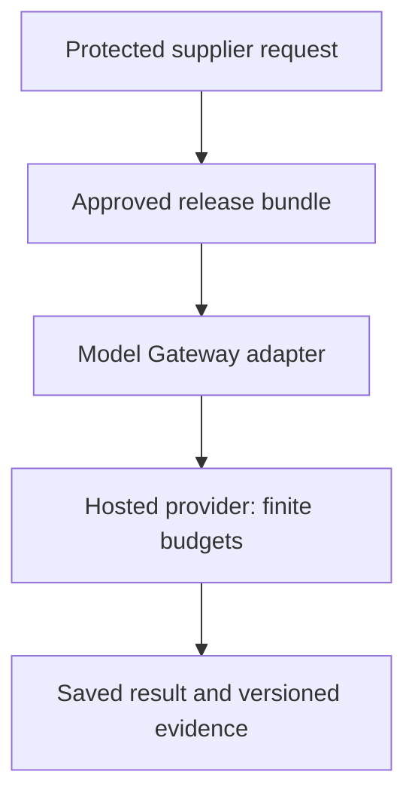
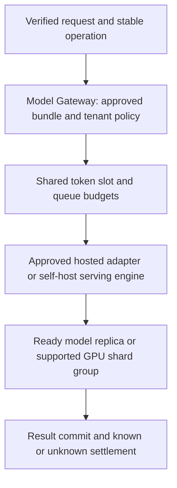

# Stage 9: Inference and GPU Infrastructure

Alice's supplier workflow now has an approved behaviour/release process, but hosted generation cost, queueing and data-path constraints motivate a comparison with self-hosted inference. Keep the Model Gateway responsible for approved routes and stable operations. Do not replace an uncertain hosted call with an automatic second call merely because another GPU or endpoint is available.

This is the same hypothetical platform. The gateway executes injected fixture transport while composing actual Stage 5 budget, Stage 6 security and Stage 8 release code. The GPU worksheet performs memory arithmetic only. No model, GPU, tokeniser, container cluster or real provider runs. All architecture sizes, utilisation and costs are assumptions, not benchmarks or current prices. Estimated integrated study: six to eight hours; mastery remains unassessed.

## 1. Understand the Problem

### Inherit the Approved Runtime

[Stage 8](../08-evaluation-releases/guide.md), [its snapshot](../08-evaluation-releases/architecture-after.md) and [ADR-008](../../architecture/decisions/ADR-008-versioned-quality-releases.md) bind behaviour to evaluated bundles and controlled release pointers. Retain current identity/resource policy, audit/egress, durable saved result identity, read consistency, unknown remote outcomes, fair queues/quotas, versioned retrieval and safe immutable caches.



Before diagram. A hosted dependency exists as a logical boundary; no real provider performance has been established by earlier fixtures. Approval and current data policy remain separate decisions.

### Identify the Real Pressure

An enterprise may require a particular network/data-handling path or a reproducible model revision. A busy period may increase time to first token while average request rate remains unchanged. A self-hosted model may fit its weights on a GPU but fail when several long contexts fill the remaining memory. These are different reasons to change architecture and need different evidence.

| Concrete observation | Term | What it does not prove |
| --- | --- | --- |
| Read the input once before generating | Prefill | It is not the whole request duration |
| Produce the next token using prior attention state | Decode | Equal token counts do not imply identical latency on every workload |
| Keep attention key/value state for active tokens | KV cache | This is inference state, not an authorisation/content cache |
| Wait until visible generation starts | Time to first token (TTFT) | Good first-token timing does not prove total completion or saved success |
| Time between generated tokens | Inter-token latency (ITL) | High aggregate throughput can coexist with poor per-user token latency |
| Split or replicate a serving model | Inference parallelism | More devices do not guarantee proportional speed or automatic safe memory sharding |

### Coverage by Required Depth

| Module | Treatment | Assigned depth and scope |
| --- | --- | --- |
| 7.2 AI gateway and provider management | Taught at mapped depth | D3: approved route policy, envelopes, budgets, durable replay and unknown/commit-failure tests |
| 9.1 LLM execution and inference fundamentals | Taught at mapped depth | D2: prefill/decode, tokens, TTFT/ITL and peak context/memory exercise |
| 9.2 Model serving architecture | Taught at mapped depth | D2: gateway/engine separation, readiness, batching and deployment alternatives |
| 9.3 Inference performance optimization | Taught at mapped depth | D1: quantisation/batching/prefix-cache implications and profiling boundary, not kernel tuning |
| 10.1 GPU architecture fundamentals | Taught at mapped depth | D1: VRAM versus bandwidth/compute and practical memory accounting |
| 10.2 Distributed GPU execution | Taught at mapped depth | D1: replicas versus tensor/pipeline sharding and communication cost |
| 10.3 GPU infrastructure and scheduling | Taught at mapped depth | D1: placement, memory reservations, sharing/isolation and finite capacity |
| 16.1 Container and orchestration architecture | Taught at mapped depth | D2: image/model identity, startup/readiness/drain, device resources and lifecycle exercise |
| 1.2 Estimation and capacity planning | Revisited from Stage 1 | D3: inference memory, tokens, utilisation and conditional economics |
| 2.3 Gateway and service communication | Revisited from Stage 6 | D3: provider/private-route constraints remain trusted policy |
| 4.1 Concurrency fundamentals | Revisited from Stage 2 | D3: active sequences and remote calls are bounded independently of app replicas |
| 5.1 Admission; 5.2 queueing; 5.3 backpressure; 5.4 fair scheduling; 5.5 AI workload management | Revisited from Stage 5 | D3/D2/D3/D2/D3: apply token/slot/queue/share budgets to inference; do not repeat those tutorials |
| 8.2 Search architecture | Revisited from Stage 3 | D3: retrieved context changes token/memory demand while access and provenance remain mandatory |
| 12.3 Latency and performance | Revisited from Stage 7 | D3: separate queue, prefill, decode and final persistence in the critical path |
| 14.2 Release management and experimentation | Revisited from Stage 8 | D3: only approved bundles enter eligible routes; preserve saved operations on change |
| 15.1 Observability systems | Revisited from Stage 8 | D3: correlate model/engine/bundle, token phases and redacted outcomes |
| 11.1 Fine-tuning fundamentals | Deferred | Stage 10, D2: no training, adapters or optimisation research added here |

Outcomes: defend a hosted/self-hosted boundary; build/debug an approved gateway slice; estimate peak memory without claiming speed; explain deployment and parallelism trade-offs at the assigned depth. The [curriculum map](../../progress/curriculum-map.json) is authoritative. D1 topics need working boundary knowledge, not a GPU-internals course.

## 2. Learn and Design

### Keep Gateway Policy Separate From the Serving Engine

The gateway binds trusted principal, operation key, current source policy, approved bundle and provider profile. The serving engine runs generation for a specific model revision. A production profile must identify supported context/output bounds, model/engine versions, readiness, approved network/data path, credential reference and quota scope. An unregistered or unapproved route must not become a destination from user/model-supplied text.

For Tenant A the fixture requires a private-approved profile as trusted configuration, not a request flag the caller can downgrade. The boolean tests policy composition only; it does not prove any network endpoint is private. The same current Stage 6 retrieval/audit gate runs before new disclosure, and secret references/provider allowlists remain scoped. The gateway accepts a supplied token estimate to demonstrate budgeting; real adapters must count/tokenise under the actual model/provider rules.

Validate input plus requested output against model context, and requested output against the profile's output maximum. Reserve shared request/token/concurrency budgets before transport. App replicas, ready GPU processes and an approved model do not eliminate those budgets. Only a fresh grant permits a new provider attempt; a duplicate grant is inspection/replay, not permission to call again.

For a completed same-key operation, return the original saved result and bundle after checking its original source references under current access. Do not select a new model just because the release pointer changed. The fixture refuses replay if the original evidence is now forbidden; this is an explicit protected-grounded-result choice, not a new rule for the separate general drafting endpoint. Conflicting input/output parameters require a deliberate new operation identity.

If a transport outcome is unknown, persist uncertainty and retain the conservative reservation rather than auto-fallback. A final write failure cannot return completed success. Claim/grant/dispatch/result/settlement are still separate boundaries: an incomplete `prepared`/`dispatching` record requires inspection, and can strand capacity until reconciliation. The fixture's typed unknown response is handled explicitly; other transport/storage failures propagate with durable incomplete evidence, never an automatic second route.

### Choose Hosted Versus Self-Hosted for a Reason

| Design | Benefit | Operational cost or failure | Decision criterion |
| --- | --- | --- | --- |
| Approved hosted model | Managed engine/hardware operations, quick capacity access | Provider quotas, data/network constraints, usage price and opaque performance changes | Retain when approved policy and measured service meet needs |
| Self-hosted approved model | Control model/engine/placement and potentially data path | GPU idle cost, capacity/availability, warmup, patching, model quality and on-call burden | Add only with quality, policy and utilisation evidence |
| Multiple approved providers | Dependency diversity and workload routing options | Semantic/version differences, duplicated budgets and uncertainty on fallback | Select before dispatch under explicit policy; no blind retry after unknown effects |
| One replica per model on a single GPU | Simpler serving when peak memory fits | One failure domain and finite active context | Useful baseline to profile, not a throughput guarantee |
| Model sharded over several GPUs | Fit larger models or change execution profile | Communication/topology, rollout and failure coordination | Use only after model/engine support and profiling justify it |

A lower per-token price is not enough to justify migration. Include quality/refusal behaviour, source handling, tenant policy, burst headroom, staff operations and actual utilisation. A self-hosted route is a new evaluated bundle, not a drop-in endpoint alias. Stage 8 gates still apply, and an older hosted result remains its original operation.

### Understand Execution Without Studying Kernels

Prefill consumes the supplied input tokens and establishes attention state. Decode generates tokens incrementally and reuses key/value state. A long retrieved context can increase prefill work and KV memory; long output grows cached sequence length and occupies a slot longer. The model's context window is an upper interface bound, not a performance promise at that limit.

TTFT includes queue/scheduling and prefill before the first output; ITL describes subsequent token timing. Total user latency also includes verification/retrieval, queueing, generation and final save/audit. Streaming can improve perceived progress while leaving commit-before-saved-success unchanged. A disconnected stream still needs stable operation inspection; it does not prove generation stopped.

Batching combines eligible work for engine efficiency. Static batches can make short requests wait for long ones; continuous batching can admit/remove sequences as others finish, but engine policy and memory constraints matter. Larger batches may improve throughput while worsening user latency. Prefix/KV reuse requires compatible model/tokenisation/engine state and an approved isolation policy; it is not Stage 4's immutable-body cache and never grants document access. [vLLM's paged-attention design](https://docs.vllm.ai/en/latest/design/paged_attention/) is a primary implementation reference, not an installed dependency.

At D1 optimisation depth, know the decision boundaries: weight quantisation may reduce weight memory while changing quality and hardware compatibility; KV quantisation is a separate choice; cache management/batching can reduce waste but cannot create physical bandwidth or unlimited active context. [Transformers optimisation guidance](https://huggingface.co/docs/transformers/main/en/llm_optims) gives implementation examples. Profile the approved model/dtype/engine/workload instead of copying a speed claim from another setup.

### GPU Memory, Parallelism and Placement

VRAM holds weights, KV state, activations/workspaces and runtime allocations. Memory capacity determines whether a configuration may fit; memory bandwidth, compute, scheduling and communication affect speed. A capacity calculation cannot establish achieved FLOPS, tokens/second, TTFT or p95. Keep decimal bytes versus binary GiB explicit.

A data-parallel serving replica usually loads another copy of the model to serve independent work. Tensor parallelism splits selected tensor computation/storage across devices and adds communication; pipeline parallelism places layer stages on different devices and adds stage/queue coordination. Actual KV partitioning depends on model attention layout and engine implementation. Do not divide every memory component by GPU count automatically. [vLLM parallelism/scaling documentation](https://docs.vllm.ai/en/latest/serving/parallelism_scaling/) describes concrete serving choices.

Placement must account for model/dtype compatibility, peak memory, interconnect/topology when sharded, ready warm capacity and tenant/workload isolation. Time-sharing or a shared process is not automatically strong isolation. Hardware partitioning/virtualisation may offer different boundaries depending on the platform; neither is demonstrated here. Stage 5 admission/fair queues still limit active work and service shares before device scheduling.



After diagram. Self-hosting is a proposed serving option behind existing protected gates, not a new permission authority. The executable replaces both hosted/self-host transport with a fixture and performs no GPU allocation.

### Checkpoint 1: Weight Fit Is Not Request Fit

The raw FP16 weights fit in an assumed 24 GiB allocation. Can you admit any number of 8,192-token active sequences?

<details><summary>Answer before revealing</summary><p>No. KV state grows with total cached tokens and active sequences, and workspaces/runtime also need memory. Bound the context/output envelope and concurrency using the actual model/engine layout, then profile. Weight fit alone proves neither full-request memory fit nor useful latency.</p></details>

### Container and Serving Lifecycle at D2

Package the tested engine/runtime and pin model artifact identity; do not fetch an arbitrary mutable model revision at startup. Resolve secrets through runtime identity, restrict artifact/egress access and validate driver/runtime compatibility. Container resource declarations must match schedulable devices and placement constraints. [Kubernetes GPU scheduling documentation](https://kubernetes.io/docs/tasks/manage-gpus/scheduling-gpus/) is an orchestration example, not a requirement or a deployment made here.

Startup is not readiness. Weights may be loading, kernels/cache warming or dependencies unavailable after a process starts. A readiness check should reflect the intended model revision and supported request envelope before the gateway routes work; liveness should not repeatedly kill a healthy but slow model load. Use a startup budget and admission headroom for cold replicas.

On replacement/scale-in, stop new routing, drain bounded active requests and preserve unknown external outcomes. A new warm replica needs its own capacity and cached-state assumptions. Multi-device groups require compatible versions and coordinated readiness; one missing shard can make the logical model unavailable. The deployment exercise is to specify image/model IDs, device limits, startup/readiness/drain conditions, network/secret policy and a canary plan, not to run an unreviewed cluster manifest.

## 3. Observe and Experiment

### Request Walkthrough

The [offline walkthrough](guide.html#request-walkthrough) compares an approved dispatch, a forbidden/unready route and a lost provider response. Read the static boundary table before advancing the interactive steps.

```mermaid
sequenceDiagram
 participant C as Client
 participant G as Model Gateway
 participant S as Current security and release policy
 participant B as Shared budget guard
 participant E as Fixture serving adapter
 participant D as Durable operation store
 C->>G: Stable scoped key and generation envelope
 G->>S: Verify current source access and approved route
 G->>D: Inspect replay or reserve new operation identity
 G->>B: Fresh token/request/slot grant
 alt Policy envelope or budget rejects
 G-->>C: Explicit refusal or blocked state; no transport
 else Grant and ready route
 G->>E: Approved context and bounded generation request
 alt Known result and successful commit
 G->>D: Save answer with original bundle
 G->>B: Settle known completion
 else Unknown response or failed final save
 G->>D: Preserve incomplete/unknown evidence
 end
 end
```

Sequence diagram. No branch creates a second provider call after an uncertain outcome. Identity, route approval, budget reservation and result commit remain distinct evidence boundaries.

| Step | Owner and input | Output and possible failure |
| --- | --- | --- |
| Authorise | Gateway/current security receives identity and original/current source refs | Permitted evidence/audit or denial; a route cannot bypass access |
| Select | Release pointer and trusted profile registry | Approved compatible private/ready route; unknown profile rejects |
| Bound | Adapter validates input plus output and capability limits | Valid generation envelope; caller cannot downgrade tenant network policy |
| Reserve | Operation store and shared budget guard | One durable operation/fresh grant; duplicates never dispatch again |
| Execute | Approved hosted/self-host adapter | Fixture result or typed unknown outcome; no hardware/model runs |
| Persist | Operation store plus reservation settlement | Commit saved answer before success, or preserve uncertainty without automatic fallback |

### Work the Peak Memory Example

Assume a hypothetical dense decoder with 8 billion parameters, 32 layers, 8 KV heads, head dimension 128 and FP16 KV elements. These are authored architecture inputs, not a named model recommendation. Let cached tokens mean the total retained input plus generated tokens at the evaluated instant.

Raw FP16 weights require `8,000,000,000 × 2 = 16,000,000,000 bytes`, about 14.90 GiB. For this KV layout, bytes per cached token per sequence are `2 (K and V) × 32 layers × 8 KV heads × 128 dimensions × 2 bytes = 131,072 bytes`, or 128 KiB.

At 4,096 cached tokens and eight active sequences, KV memory is `131,072 × 4,096 × 8 = 4 GiB`. Add an assumed four-GiB runtime/workspace reserve: total is about `14.90 + 4 + 4 = 22.90 GiB`. That is within an assumed 24-GiB budget with little unmodelled headroom. This reserve is not measured and does not guarantee an allocation will succeed.

At 8,192 cached tokens and the same eight active sequences, KV becomes eight GiB and total about 26.90 GiB, exceeding 24. Raw four-bit weights would be about 3.73 GiB, but the worksheet leaves KV in FP16. Total then becomes about 11.73 GiB at the original 4,096/eight setting. Actual quantisation metadata, workspaces, padding, allocator fragmentation and engine overhead can differ; changing weight bits does not automatically quantise KV or preserve answer quality.

For a latency worksheet, if queue/verification/retrieval total an assumed 300 ms, prefill 200 ms, and decode 300 tokens at an assumed 30 ms/token, total before final persistence is about 9.5 seconds. A first token near 500 ms does not establish a five-second saved-answer SLO. These are arithmetic assumptions, not a throughput benchmark or a prediction for the memory example's hardware.

### Lab: Change Memory Assumptions Without Claiming Speed

Open the [single-device memory experiment](guide.html#lab). Four controls vary total cached tokens/sequence, active sequences, raw weight bits (16 or 4) and assumed VRAM. KV stays FP16 and the runtime reserve stays four GiB. No GPU, kernel, scheduling engine or real model is invoked.

| Case | Assumptions | Arithmetic result |
| --- | --- | --- |
| Baseline | 4,096 tokens, 8 active, 16-bit weights, 24 GiB VRAM | Weights 14.90, KV 4, total 22.90 GiB; within assumed budget |
| Longer contexts | 8,192 tokens, otherwise baseline | KV 8, total 26.90 GiB; exceeds assumed budget |
| Four-bit weights only | Baseline context/active, 4-bit weights | Weights 3.73, KV still 4, total 11.73 GiB |
| Smaller memory | Baseline with 16 GiB VRAM | Exceeds assumed budget |
| One active sequence | 4,096 tokens, 1 active, 16-bit, 24 GiB | KV 0.5, total 19.40 GiB |

A “within” decision means only that this arithmetic sum is below the entered capacity. It is not ready-for-production status, a token-rate prediction, a quality check or proof of memory isolation. The static table remains useful without JavaScript.

```bash
python3 10_AI_System_Design/stages/09-inference-gpu/labs/test_inference.py
```

[inference.py](labs/inference.py) independently computes memory. [gateway.py](labs/gateway.py) composes actual prior Security, Gate and Releases fixtures plus a durable operation table. Twelve tests check approved dispatch, readiness/private constraints, registry/provider denial, context/output bounds, quota before transport, unknown replay without retry, original bundle preservation across release changes, current revocation on saved replay, input conflicts, memory arithmetic, final-write failure without completed acknowledgement or a second call, and partial revocation of original multi-source evidence.

For D3 gateway practice, fail transport after a fresh grant, change the release pointer, and retry the same key. The result must remain unknown/original rather than silently invoke a new model. Fail the final result update after fixture generation: replay must expose incomplete `dispatching` evidence, not a completed answer. For D2 serving/orchestration practice, write a deployment/readiness/drain checklist and a representative load-test plan. D1 GPU topics stop at explaining memory, placement and the relevant trade-off.

### Compare Economics With Explicit Variables

For hosted inference, expected request cost is input tokens times the input price plus output tokens times the output price, using the provider's units and actual usage. For self-hosting, allocate GPU/runtime cost, idle/reserved headroom, storage/network, maintenance and operator effort across successfully served approved requests. Include quality/refusal and reliability differences rather than counting every generated token as useful work.

As a deliberately dimensionless example, an all-in serving replica costing `C=10` units/hour with an assumed busy-capacity `q=20` successful requests/second and effective utilisation `u=0.5` has infrastructure allocation `C/(3,600qu) ≈ 0.000278` units/request, before any costs omitted from C. Neither C nor q is a current price or measured throughput here. If traffic is bursty and effective utilisation drops, self-hosted idle cost per success rises. Do not make a purchase decision from this worksheet.

### Checkpoint 2: A Cheaper Fallback Can Still Be Wrong

A permitted hosted request times out after dispatch. An available self-hosted route has spare memory. May the gateway automatically retry there with a new operation identity?

<details><summary>Answer before revealing</summary><p>No. Memory fit does not establish that the first provider stopped or that a new route is policy/quality approved for this tenant. Preserve the stable operation and unknown outcome, then use a documented reconciliation/safe retry contract. Another endpoint is not evidence the original call had no effect.</p></details>

## 4. Think Like a Staff Engineer

### Observe the Phase and Protect the Tenant

Record approved bundle/model/engine identity, route type, queue wait, input/output tokens, TTFT, ITL, total completion, memory occupancy/eviction and bounded error reasons. Correlate with policy/audit, provider grants and durable result state. Keep raw context and credentials out of routine telemetry. GPU utilisation without queue/token/phase context is not a serving SLO.

When TTFT rises, distinguish admission wait, cold loading, prefill and network setup. When token streaming stalls, inspect decode scheduling, active sequences, memory pressure and communication rather than only app CPU. When memory errors occur after weights load, compare peak retained tokens/concurrency and actual overhead. A paging/eviction policy can protect memory while harming latency; measure both.

Quality and safety evaluation remain required for dtype, quantisation, engine, prompt or model changes. Continuous batching, prefix reuse and sharding can alter timing/reproducibility and operational isolation. Roll them out as versioned changes through Stage 8 rather than untracked “performance-only” flags. Reject or degrade within approved policy when the supported envelope cannot fit.

A production test matrix needs the actual approved model/engine/hardware, context/output distributions, concurrent tenants/classes, startup/drain, failure/cancellation, token budgets, privacy/egress and recovery. No local memory calculator or fixture transport validates that matrix. The serving option is concrete enough to evaluate, but not secretly deployed by this lesson.

### Interview 1: Why a Model Gateway?

**Prompt:** Every app replica could call whichever endpoint looks cheapest. Why centralise the logical policy?

**Spoken answer:** “The gateway binds approved model/release identity, tenant data path, current access, context/output limits and shared budgets before dispatch. It normalises provider outcomes while preserving stable operation identity. That logical role may be implemented with replicated processes, but its authority must not become independent per-app quotas or user-selected destinations. Cheap routing does not justify bypassing policy or retrying unknown effects.”

**Trade-off:** A shared control boundary adds configuration and dependency management. **Changed constraint:** If different tenants approve different model/network routes, explain a trusted registry and rollout policy.

### Interview 2: Does the Model Fit?

**Prompt:** Raw weights consume 14.9 GiB and the device budget is 24 GiB. Is deployment ready?

**Spoken answer:** “Not yet. I need peak KV for total cached input/output tokens and active sequences, plus real runtime/workspace/allocator overhead. In our hypothetical layout, eight 4,096-token sequences add four GiB of FP16 KV, and the assumed reserve brings total near 22.9. That arithmetic fit has little margin and proves no latency or throughput. I would profile the exact approved engine and workload.”

**Trade-off:** Conservative memory bounds reduce concurrency. **Changed constraint:** Doubling context length makes the example exceed 24 GiB; compare bounded context, active sequences, dtype and sharding without promising equal quality/speed.

### Interview 3: More GPUs or More Replicas?

**Prompt:** Two devices are available. Should the model always use tensor parallelism?

**Spoken answer:** “No. If a full model and peak request state fit one device, independent replicas may better serve separate work. Sharding can enable a larger model or another execution profile, but introduces communication/topology and coordinated failure/readiness. Actual weight and KV partitioning depends on model and engine support. I would decide from fit and measured workload, not divide all memory and latency by two.”

**Trade-off:** Memory fit versus communication/operations. **Changed constraint:** If the devices are on different hosts with a slow link, what additional evidence would you require?

### Interview 4: What Survives a Route Change?

**Prompt:** A request completed on the old model, then the candidate becomes stable. What should same-key replay return?

**Spoken answer:** “The original committed result and bundle, after the required current access checks on its original evidence. A release pointer changes future operations, not prior facts or duplicate identity. If the original source access is revoked under this grounded-history policy, deny replay rather than substitute unrelated allowed evidence. An incomplete operation remains inspectable; it is not permission to call the new route again.”

**Trade-off:** Conservative replay/access policy can withhold previously visible text. **Changed constraint:** If product requirements allow immutable historical access, define that separate auditable policy rather than weakening current source checks accidentally.

## 5. Validate and Carry Forward

### Recall and Depth-Specific Exit Gates

1. **What does KV memory depend on here?** K/V count, layers, KV heads, head dimension, bytes, total cached tokens and active sequences.
2. **Why is weight quantisation separate from KV?** Reducing weight bits does not automatically change cached activation representation.
3. **What must be ready before routing?** The approved model/engine and its supported envelope, not merely a running container.
4. **When is another provider safe after timeout?** Only under explicit approved data/behaviour and known-outcome/reconciliation semantics.
5. **What remains untested?** Actual inference/GPU performance, deployment, tokenisation, network privacy and production cost.

The 60-second card: approved route; current access; stable operation; bound context/output; budget tokens/slots; separate prefill/decode; count weights/KV/runtime; profile before claiming speed; drain without erasing uncertainty. Review after about one, seven and 21 days.

- [ ] Explain the serving path and memory terms without notes in two minutes.
- [ ] Draw protected Gateway, budget guard, engine/replica, device and result boundaries.
- [ ] Defend hosted/self-hosted, one-device replica and sharding alternatives at their assigned depths.
- [ ] Diagnose queue, prefill, decode, memory and unknown-outcome failures using concrete signals.
- [ ] For D3 Gateway, run/modify the prior-stage integration and final-write tests. For D2, complete the memory/deployment design exercise. For D1 topics, explain purpose/boundary/trade-off and stop; learner completion remains unassessed.

### Decision and Stopping Point

[ADR-009](../../architecture/decisions/ADR-009-approved-inference-boundaries.md), the [snapshot](architecture-after.md), [state](stage-state.json), [validation](validation.md) and [coverage](../../progress/coverage-status.csv) preserve actual evidence. The full package includes prerequisite source/labs and clean-extraction checks with sequential Python execution.

Stop after Stage 9. A future Stage 10 considers fine-tuning/customisation only when behaviour requirements justify it, retaining approved data, release and serving boundaries. No training, GPU provisioning or production endpoint has been performed here.

### Primary References

- [vLLM paged-attention design](https://docs.vllm.ai/en/latest/design/paged_attention/): one concrete KV-management implementation, not a benchmark used by this model.
- [vLLM parallelism/scaling](https://docs.vllm.ai/en/latest/serving/parallelism_scaling/): serving-replica and sharding choices.
- [Transformers inference optimisation](https://huggingface.co/docs/transformers/main/en/llm_optims): implementation examples of cache/compilation/optimisation concerns; current main documentation is not a pinned runtime here.
- [Kubernetes GPU scheduling](https://kubernetes.io/docs/tasks/manage-gpus/scheduling-gpus/): device resources and placement vocabulary, not a deployed cluster.

Sources checked 2 November 2026. All hardware shapes, timings and costs in the worked examples are explicit assumptions. Validation distinguishes memory/control arithmetic from real hardware/inference measurements.
