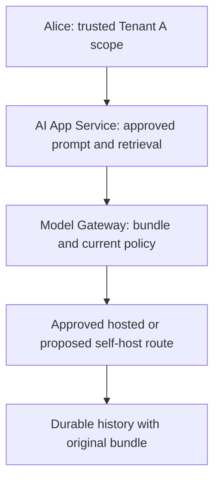
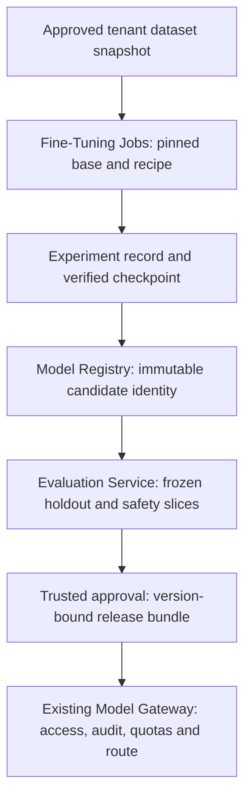

# Stage 10: Fine-Tuning and Model Customization

Alice in Tenant A needs supplier drafts with predictable fields and escalation language. The current approved model sometimes produces valid facts in the wrong structure. A new model must improve that behaviour without absorbing restricted supplier documents or bypassing the existing serving gate.

All workloads, costs, and acceptance counts below are illustrative. The local exercise checks lifecycle metadata and approvals. It never trains or runs a model. Estimated integrated study: four to six hours. Learner mastery remains unassessed.

## 1. Understand the Problem

### Inherit the Actual Runtime

[Stage 9](../09-inference-gpu/guide.md), [its state](../09-inference-gpu/stage-state.json), and [ADR-009](../../architecture/decisions/ADR-009-approved-inference-boundaries.md) already separate the Model Gateway from a proposed serving engine. Current resource access, mandatory audit, private-approved routes, versioned retrieval/cache, fair request/token/concurrency budgets, and durable operation identity remain mandatory. Short drafting and grounded supplier-policy answering remain distinct routes. An unknown provider result still requires reconciliation; a new adapter cannot justify regeneration under the old key.



Before diagram. The accepted architecture supports an approved model identity, not governed creation of a tenant-specific model. The local inference fixture uses injected transport.

### Define the Behaviour Requirement

Keep the supplier case throughout. Assume 10,000 approved training examples, 1,000 validation examples used during development, and 200 test examples frozen before experiments. The target response has `supplier_id`, `requested_action`, and `escalation_reason`. Schema-valid JSON alone does not establish correct escalation or permitted disclosure. Require at least 196/200 schema passes, zero known safety violations, and separate human review of critical escalation cases before any production approval.

First compare the approved prompt, schema-constrained generation where the route supports it, and prompt examples. Keep retrieval for changing supplier policy and citations. Only trial fine-tuning if repeated behaviour misses survive those cheaper interventions. A lower training loss cannot establish the customer acceptance gate.

| Module | Treatment | Depth, evidence, and boundary |
| --- | --- | --- |
| 4.3 Background execution systems | Revisited from [Stage 2](../02-distributed-execution/guide.md) | D3: training intent/checkpoint recovery differs from unknown provider outcomes |
| 6.3 Object storage and data lifecycle | Revisited from [Stage 3](../03-enterprise-knowledge/guide.md) | D1: training snapshots and derived artifacts need retention and deletion lineage |
| 10.1 GPU architecture fundamentals | Revisited from [Stage 9](../09-inference-gpu/guide.md) | D1: training memory includes gradients, activations and optimiser state |
| 10.2 Distributed GPU execution | Revisited from [Stage 9](../09-inference-gpu/guide.md) | D1: replicated versus sharded state is contextual, not a distributed trainer |
| 10.3 GPU infrastructure and scheduling | Revisited from [Stage 9](../09-inference-gpu/guide.md) | D1: reserve a bounded training pool without consuming serving headroom |
| 11.1 Fine-tuning fundamentals | Taught at mapped depth | D2: behaviour versus knowledge, prompt/retrieval/adapter alternatives, holdout design and acceptance exercise |
| 11.2 Fine-tuning platform architecture | Taught at mapped depth | D1: job, tracking, checkpoint, registry and approval boundaries; no trainer service |
| 11.3 Distributed training infrastructure | Context only; D0 deferred specialisation | D0: six-sentence orientation only; distributed optimiser implementation deferred |
| 14.1 Evaluation architecture | Revisited from [Stage 8](../08-evaluation-releases/guide.md) | D3: supplier holdout and safety slices now bind the adapter identity |
| 14.2 Release management and experimentation | Revisited from [Stage 8](../08-evaluation-releases/guide.md) | D3: new custom models still use approved immutable release bundles |
| 14.3 Model and data lifecycle infrastructure | Taught at mapped depth | D2: immutable lineage, retirement, deletion and promotion checks |
| 16.1 Container and orchestration architecture | Revisited from [Stage 9](../09-inference-gpu/guide.md) | D2: pin training image/recipe and drain or restart at verified checkpoints |

Outcomes: choose a justified customisation path, explain dataset-to-release lineage, evaluate a frozen holdout, and block a candidate with unsafe or mismatched evidence. Revisited topics apply to new model artifacts rather than repeat their original tutorials.

## 2. Learn and Design

### Teach Behaviour Without Making Weights an Access System

Changing examples in a request can change formatting immediately. This is prompting: the base model remains unchanged, but examples consume context and may behave inconsistently. Retrieval supplies authorised current text at request time; it has source and access boundaries and can fail through stale indexing or poor ranking. Use it for the current supplier rule, even after customisation.

Fine-tuning adjusts model parameters using examples. Supervised fine-tuning teaches input/output behaviour by comparing generated predictions with target tokens during training. Training loss measures fit to the training objective; held-out task success measures whether the required behaviour transfers. Overfitting occurs when the candidate memorises training patterns and fails on new suppliers. Validation data guides experiment choices; test data must remain outside that loop.

An adapter stores a smaller learned update associated with a pinned base model. Low-rank adaptation (LoRA) learns low-rank parameter updates rather than changing every base parameter. That can reduce trainable state, but does not eliminate base weights, activations, data handling, or serving compatibility checks. The [PEFT conceptual guide](https://huggingface.co/docs/peft/main/en/conceptual_guides/lora) describes that mechanism. This lesson specifies no library version or GPU sizing promise.

| Option | When it wins | Cost and failure | Decision for this trial |
| --- | --- | --- | --- |
| Prompt plus structured output validation | Behaviour can be expressed with instructions and a few examples | More input tokens; unsupported constraints or semantic mistakes still need checking | Baseline and first experiment |
| Retrieval plus prompt | Facts change or answers need document-level permission and citation | Index freshness, authorised ranking and context budget | Retain for supplier policy |
| Base model plus tenant adapter | Repeated stable behaviour misses remain with sufficient licensed approved examples | Training, evaluation, adapter/base compatibility and extra model lifecycle | Bounded challenger experiment only |
| Full parameter fine-tuning | Measured adapter limits justify broader changes and available compute | More trainable state, longer iteration and larger artifact lifecycle | Defer pending evidence |

Choose a bounded adapter trial, conditional on documented baseline failures. ADR-010 accepts the governance path, not an unsupported quality gain. Do not place confidential current supplier facts into the training corpus merely because the original user could retrieve them. Training approval is a separate purpose and scope. Model weights cannot implement per-document revocation.

### Design the Artifact Chain

A dataset version is an immutable manifest of example IDs, supplier groups, split, content checksums, consent/purpose, provenance, and retention class. Group all examples from the same supplier/thread into one split before freezing it. Otherwise near-duplicates can inflate held-out scores. Deduplicate before splitting, inspect representative labels, scrub secrets and personal data, and document who can approve reuse. The three-row local fixture only demonstrates split checks; it is not the assumed training corpus.

A training job pins dataset digest, base model digest, training image, recipe, seed, hyperparameters, tokeniser, and budget. Experiment tracking records those inputs plus metrics, duration, resource use, and output identities. A checkpoint saves recoverable progress; production resume also needs compatible optimiser/scheduler/random state and a verified input position. A finished model artifact becomes a candidate in the Model Registry, where versions and lineage are durable records. A mutable friendly alias is a pointer, not immutable evidence; [MLflow documents this distinction](https://mlflow.org/docs/latest/ml/model-registry/workflow).



After diagram. Training data, checkpoints, logs, and adapters stay inside the tenant-approved boundary. Evaluation is a gate before runtime selection. The registry does not grant access to documents or deployment destinations.

For a production `POST /v1/fine-tuning/jobs`, propose a maximum 16 KiB metadata body and a 128-character operation key, not uploaded raw training text. Require a verified training-operator capability and server-derived tenant/user scope. Validate allowlisted base/recipe IDs, approved immutable dataset reference, region, and maximum compute budget. Scope uniqueness to tenant, subject, endpoint, and key; hash canonical immutable request parameters. Commit durable queued intent before `202 {job_id,state,dataset_digest}`. Same key and payload returns the existing job; changed payload returns `409`. Invalid shape is `400`, denied permission `403`, absent or invisible resource `404`, bounded admission `429`, and unavailable authority `503`. Retry with the same key after inspecting status. `202` promises persisted intent, never training or approval. The Python library models only trusted tenant/job scope; it has no HTTP facade, user authentication, queue, durable store, or actual budget enforcement.

A proposed job moves queued, training, evaluating, candidate, approved, deployed, or failed/cancelled. Approval and deployment are separate. Cancellation stops new work; it cannot prove every remote accelerator stopped. Keep last verified checkpoint and reconcile remote state before submitting another billed run.

### Checkpoint 1: A Better Mean Score

The candidate passes 199/200 schema checks but exposes one restricted supplier name. Can an approver promote it?

<details>
<summary>Reveal after answering</summary>

No. The known safety violation blocks the gate independently of aggregate quality. Quarantine the candidate and trace whether the training data, retrieval, or output handling caused the disclosure. Increasing the schema threshold does not repair tenant isolation.

</details>

### Distributed Training at D0

A larger training job may need more than one accelerator. Data parallel training processes different examples on replicas and synchronises updates. Sharded training distributes selected parameter, gradient, or optimiser state, depending on the framework. Communication and checkpoint coordination can erase the expected gain. These choices require measured memory, throughput, topology, and recovery evidence. At D0, identify that specialist boundary and request a training-infrastructure review; do not implement distributed optimisers in this course.

## 3. Observe and Experiment

### Request Walkthrough

The [offline walkthrough](guide.html#request-walkthrough) traces the approved candidate path and blocked safety/report paths. Each step is a design boundary; the lab implements metadata checks rather than external execution.

```mermaid
sequenceDiagram
 participant O as Training operator
 participant J as Fine-Tuning Jobs
 participant T as Training worker
 participant E as Evaluation Service
 participant R as Registry and approver
 O->>J: Approved dataset, base, recipe, stable key
 J-->>O: Persisted queued intent: proposed 202
 J->>T: Claim bounded job and verify inputs
 T->>J: Verified checkpoint and candidate digest
 J->>E: Candidate plus frozen holdout identity
 alt Safety and behaviour evidence pass
 E->>R: Bound report and trusted approval request
 R->>R: Compare generation and set future release candidate
 else Mismatch or safety failure
 E-->>O: Block candidate; retain previous live release
 end
```

Sequence diagram. No training completion implicitly changes the live Model Gateway route. A production release still passes Stage 8 and Stage 9 gates.

| Step | Responsible component and input | Output and possible failure |
| --- | --- | --- |
| Submit | Jobs receives trusted scope and immutable references | Queued identity; unknown dataset or key conflict rejects |
| Verify | Worker resolves manifest, base and recipe | Pinned inputs; missing consent or mixed supplier split blocks |
| Checkpoint | Worker records step and checksum | Monotonic recovery record; corrupt/incompatible state cannot resume |
| Register | Model Registry receives finished artifact digest | Candidate only; no deployment side effect |
| Evaluate | Evaluation Service receives bound candidate/test/evaluator identities | Passing report or explicit block; training loss is insufficient |
| Approve | Trusted approver compares release generation | Future release candidate or stale-update rejection; existing results stay unchanged |

### Calculate the Trial Budget

Assume each training example contains 700 input and 100 target tokens. Then 10,000 × 800 = 8 million tokens per epoch; three epochs process 24 million tokens. At an assumed effective 2,000 training tokens/second, that is 12,000 seconds, or 3.33 hours, excluding setup, checkpoint, evaluation, retries, and failed runs. This assumed rate is not measured inference throughput. At an invented planning rate of $4/device-hour, one-device training time costs $13.33 before those extras. The rate is a scenario input, not a provider quote.

Serving an adapter adds model/base compatibility, load time, memory, and tenant routing work. A smaller adapter file does not show end-to-end savings. If custom behaviour saves 100 input tokens per request across 50,000 requests/day, it saves 5 million input tokens/day under that assumption; compare actual token pricing, quality, serving overhead, and staff time before approving a cost case.

Training memory includes activations, gradients, and optimiser state as well as weights. Stage 9's inference KV worksheet cannot size a trainer. Reserve training separately from latency-sensitive GPU Pool capacity, enforce tenant budgets, and checkpoint before planned eviction where supported. Pin image/device requirements and verify readiness and artifact integrity before scheduling. Full GPU scheduling and hardware isolation remain proposed.

### Lab: Does the Candidate Pass the Frozen Gate?

Open the [offline lab](guide.html#lab). Change schema passes (0–200 cases), safety failures (0–5 cases), and whether the report matches the candidate identity. The deterministic gate accepts at least 196 schema passes, exactly zero known safety failures, and matching identity. It does not simulate training improvement, statistical confidence, or a real safety evaluator.

| Preset | Inputs | Expected decision |
| --- | --- | --- |
| Baseline | 198 passes, zero safety failures, matching report | Eligible for trusted approval |
| Safety regression | 198 passes, one safety failure, matching report | Blocked |
| Wrong artifact | 198 passes, zero safety failures, mismatched report | Blocked |
| Weak behaviour | 195 passes, zero safety failures, matching report | Blocked |

Run from the repository root with Python 3.10+ and Node:

```sh
python3 10_AI_System_Design/stages/10-fine-tuning/labs/test_lifecycle.py
node 10_AI_System_Design/tools/test_simulator.cjs 10_AI_System_Design/stages/10-fine-tuning
```

The executable slice freezes example metadata, rejects supplier-group split leakage, scopes job keys, records monotonically increasing checkpoints, binds trusted reports, and checks role and release generation. It uses in-memory records and supplied counts. It does not call the Stage 8 release controller or Stage 9 gateway; those contracts are retained as production integration requirements, not tested composition.

Inject a safety failure, then attempt approval. Expect a false gate result, a `quality gate blocked` error, and an unchanged live pointer. Inject a report for another artifact and expect `report identity mismatch` before approval. A trainer role cannot approve. A stale generation cannot overwrite a newer pointer. In production, alert on blocked promotion count, orphan checkpoint age, spend against budget, invalid lineage, and job queue age; separate configuration errors from genuine model regressions.

### Checkpoint 2: Resume After Worker Loss

A worker reports step 200 locally but only step 100 has a verified checkpoint. What may recovery claim?

<details>
<summary>Reveal after answering</summary>

Recovery may start from compatible verified step 100 and may repeat work after that point. Local logs do not prove durable step 200. A remote run with unknown status requires inspection before another billed job. The local metadata fixture records checkpoints; it does not restore optimiser or random state.

</details>

## 4. Think Like a Staff Engineer

### Operate and Retire the Model

Use tenant-scoped storage credentials for datasets, checkpoints, outputs, and tracking metadata. Access to training artifacts is separate from document read access. Record approver, purpose, budget, and lineage without raw training examples in metrics. Freeze evaluator and gate identities alongside each report. Any changed base, recipe, tokeniser, data, or serving configuration invalidates assumed compatibility and requires new evidence.

A deletion request must traverse snapshots, examples, checkpoints, registry versions, serving copies, caches, and retained backups according to approved policy. Deleting a row does not erase learned parameters. Quarantine affected descendants, stop future serving where required, and plan retraining from an approved clean snapshot. Physical erasure, legal retention choices, and machine unlearning are outside this fixture. Do not promise selective forgetting.

### Interview 1: Why Tune This Workflow?

Prompt: Alice requests fine-tuning because the current output schema sometimes fails.

Spoken answer: “I would first classify the failures. A stale supplier rule needs current authorised retrieval. Formatting may improve with a clearer prompt, examples, schema constraints, and validation. If stable behaviour still fails, I would run a bounded adapter challenger against the frozen baseline. I would compare behaviour and safety by slice, and include training, serving, and operating cost. Approval would select a versioned candidate without weakening current access.”

Trade-off: more custom control creates a longer lifecycle. Follow-up: if the supplier rule changes daily, keep it in retrieval rather than retraining daily.

### Interview 2: What Makes an Experiment Reproducible?

Prompt: Two teams report different quality for the same friendly model name.

Spoken answer: “I would resolve the name to immutable base, adapter, tokeniser, dataset, recipe, and serving identities. I would also pin the evaluator and frozen test population. A seed helps but does not prove identical floating-point execution across hardware. I need traceable inputs and comparable evaluation evidence, plus checkpoint compatibility for recovery. The model alias is an operational pointer; it cannot stand in for that record.”

Trade-off: detailed provenance costs storage and review time. Follow-up: a changed serving quantisation requires a new evaluated bundle.

### Interview 3: How Do You Recover Training?

Prompt: A worker disappears halfway through a paid run.

Spoken answer: “I would inspect remote run state and the last verified checkpoint before creating another run. Recovery needs compatible training code, input position, optimiser and scheduler state, and random state. A newer log line is insufficient. I would bound retries and remaining budget, preserve lineage from the parent attempt, and keep training capacity separate from interactive serving. The course fixture checks checkpoint ordering only; real resume needs a trainer integration test.”

Trade-off: frequent checkpoints reduce recomputation but consume I/O and storage. Follow-up: if remote status is unknown, reconcile before retrying.

### Interview 4: How Does a Dataset Deletion Affect Serving?

Prompt: Tenant A revokes permission to use a supplier corpus after training.

Spoken answer: “I would locate every derived model and checkpoint through dataset lineage and apply the approved retention and serving policy. Row deletion cannot remove information already learned in weights. I would block affected candidates, assess deployed versions, and retrain from an approved snapshot where required. Document retrieval would still check current permission separately. I would avoid promising selective forgetting or treating an older model rollback as an authorisation rollback.”

Trade-off: retirement can reduce availability while clean candidates are prepared. Follow-up: if backups must remain, restrict access and document expiry separately.

## 5. Validate and Carry Forward

### Recall and Exit Gates

1. What changes first for a factual supplier-policy error? Current authorised retrieval and source freshness, not automatically model parameters.
2. Why split by supplier/thread? Near-duplicate examples across splits can inflate reported generalisation.
3. Is a checkpoint a deployable release? No. Recoverable training state and approved serving artifacts have different contracts.
4. Can 99% schema success override one known safety failure? No. Safety gates remain independent.
5. What stays unchanged after a release rollback? Saved operation identity, current access policy, audit requirements, and uncertain external outcomes.

60-second card: classify behaviour versus facts; try the smallest intervention; freeze approved data and splits; pin base/recipe; verify checkpoints; bind evaluation; approve independently; deploy through existing gateway gates; retire descendants through lineage.

### Evidence and Carry Forward

Read the [stage plan](stage-plan.md), [architecture snapshot](architecture-after.md), [decision](../../architecture/decisions/ADR-010-governed-model-customisation.md), [state](stage-state.json), [validation](validation.md), and [actual coverage](../../progress/coverage-status.csv). The [curriculum map](../../progress/curriculum-map.json) records targets. Local content verification and learner completion are separate. Stage 11 inherits approved candidate lineage and the unchanged runtime, then adds regional boundaries. No actual model training or deployment has occurred.

Review after about one, seven, and 21 days. Stop when you can explain the change in two minutes, draw it within the inherited platform, defend two alternatives, and diagnose a fault from an observable signal. For D3 modules also build, test, and debug the representative slice. These learner gates remain unassessed. Production integrations and deployment controls described here are proposals unless the validation report explicitly records an executed check.
