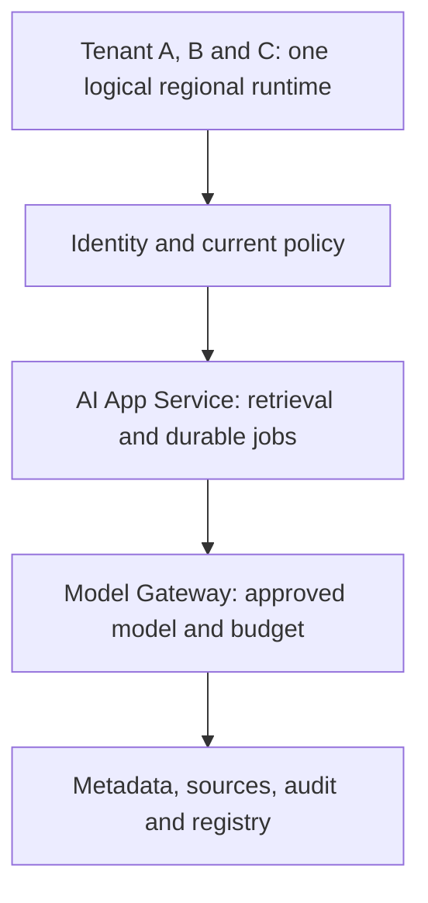
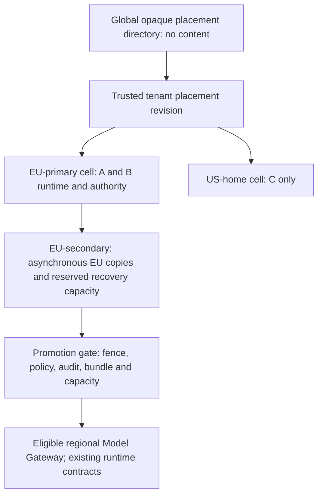

# Stage 11: Global Multi-Region Platform

Alice in Tenant A now needs supplier content to stay within approved EU regions. A regional outage must not send her documents to the nearest healthy US endpoint. Tenant B has the same residency constraint. Tenant C has a separate US home. Recovery needs authorised data, current policy, a fenced writer, and ready model capacity in the allowed geography.

These are hypothetical customer requirements, not legal advice or cloud guarantees. Every time, rate, and dollar amount is a planning assumption. The local lab computes recovery eligibility, capacity, and usage economics; no regional services run. Estimated integrated study: six to eight hours.

## 1. Understand the Problem

### Carry Forward Model and Data Lineage

Read [Stage 10](../10-fine-tuning/guide.md), [its state](../10-fine-tuning/stage-state.json), and [its snapshot](../10-fine-tuning/architecture-after.md) before designing the change. Dataset versions, training jobs, checkpoints, candidate registry, evaluation, and approval now exist as architecture roles. The executable lifecycle fixture checks metadata only. Stage 9's runtime still requires current source access, mandatory audit, approved model/route, finite budgets, and commit-before-saved-success. Durable jobs, tombstones, immutable caches, and unknown external outcomes remain intact.



Before diagram. One logical region has no demonstrated cross-region recovery. Its internal availability and previous local SQLite tests do not prove survival of a regional loss.

### Walk the Failure Before Adding Regions

Suppose EU-primary stops responding after accepting Alice's operation. A global load balancer selects US because it is healthy. The request may violate placement policy, lack the exact approved adapter, read stale permission, or generate a second answer for an already charged operation. A health check cannot decide those questions.

Data residency means an approved placement constraint on specified data classes and processing. Here A/B content, source bodies, embeddings/indexes, prompts, outputs, training snapshots, adapters, and protected logs/backups stay in EU-primary or EU-secondary. A global directory contains opaque tenant handles and placement revisions only; authentication and access checks remain regional. Even directory identifiers need a separately reviewed classification. Location of an HTTP endpoint does not establish the location of provider processing, logs, backups, or support access.

Define recovery point objective (RPO) as the maximum acceptable data-loss window and recovery time objective (RTO) as the maximum acceptable restoration interval. Assume result/source asynchronous replication targets RPO ≤60 seconds and regional recovery targets RTO ≤600 seconds. These targets can fail. An unknown replication watermark or unavailable current authorisation blocks promotion, even if that misses RTO. [AWS's recovery guidance](https://docs.aws.amazon.com/whitepapers/latest/disaster-recovery-workloads-on-aws/disaster-recovery-options-in-the-cloud.html) describes recovery strategy trade-offs; our timings are independent illustrative budgets.

| Module | Treatment | Depth, evidence, and boundary |
| --- | --- | --- |
| 1.2 Estimation and capacity planning | Revisited from [Stage 1](../01-mvp/guide.md) | D3: separate RPS, tokens/minute, concurrency, and recovery timing |
| 2.1 Networking fundamentals | Revisited from [Stage 1](../01-mvp/guide.md) | D2: DNS caching, ingress reachability, TLS and private endpoint boundaries |
| 3.1 Distributed system fundamentals | Revisited from [Stage 7](../07-reliability-consistency/guide.md) | D3: single writer per tenant and fencing before failover |
| 5.1 Rate limiting and admission control | Revisited from [Stage 5](../05-overload-fairness/guide.md) | D3: admission follows the surviving regional dependency budget |
| 5.4 Fair scheduling and workload prioritization | Revisited from [Stage 5](../05-overload-fairness/guide.md) | D2: retain tenant shares under degraded capacity |
| 5.5 AI workload management | Revisited from [Stage 5](../05-overload-fairness/guide.md) | D3: reserve token and slot capacity, not just app replicas |
| 7.2 AI gateway and provider management | Revisited from [Stage 9](../09-inference-gpu/guide.md) | D3: route only to eligible regional provider profiles before dispatch |
| 8.1 Document ingestion and indexing | Revisited from [Stage 3](../03-enterprise-knowledge/guide.md) | D3: rebuild indexes from replicated source versions and tombstones |
| 8.3 Enterprise retrieval governance | Revisited from [Stage 6](../06-enterprise-security/guide.md) | D3: current policy authority remains required during recovery |
| 9.1 LLM execution and inference fundamentals | Revisited from [Stage 9](../09-inference-gpu/guide.md) | D2: token phases and context mix affect regional slots |
| 9.2 Model serving architecture | Revisited from [Stage 9](../09-inference-gpu/guide.md) | D2: warm model readiness differs from a running VM |
| 9.3 Inference performance optimization | Revisited from [Stage 9](../09-inference-gpu/guide.md) | D1: optimisation changes require measured local evidence |
| 10.3 GPU infrastructure and scheduling | Revisited from [Stage 9](../09-inference-gpu/guide.md) | D1: reserve accelerator availability within allowed geography |
| 12.1 Scaling and traffic engineering | Revisited from [Stage 4](../04-application-scaling/guide.md) | D3: app headroom cannot hide provider bottlenecks |
| 12.2 Resilience and fault tolerance | Revisited from [Stage 7](../07-reliability-consistency/guide.md) | D3: RPO/RTO runbook and explicit fail-closed cases |
| 13.2 Enterprise AI security | Revisited from [Stage 6](../06-enterprise-security/guide.md) | D3: datasets, models, telemetry and egress follow residency policy |
| 13.3 Multi-tenant platform design | Revisited from [Stage 6](../06-enterprise-security/guide.md) | D3: trusted per-tenant home/allowed-region policy |
| 15.2 SRE and production operations | Revisited from [Stage 7](../07-reliability-consistency/guide.md) | D3: incident roles, promotion evidence and failback |
| 15.3 Performance and incident diagnosis | Revisited from [Stage 7](../07-reliability-consistency/guide.md) | D3: separate route, authority, replica and model readiness failures |
| 16.1 Container and orchestration architecture | Revisited from [Stage 9](../09-inference-gpu/guide.md) | D2: regional image/artifact pinning, readiness and drain |
| 16.2 Cloud networking and deployment | Taught at mapped depth | D2: regional ingress, service/private routes, region-contained data and deployment exercise |
| 17.1 AI unit economics | Taught at mapped depth | D3: cost per successful workflow with retries, failed spend, idle reserve and duplicate-safe usage evidence |
| 17.2 Infrastructure capacity planning | Taught at mapped depth | D2: regional peak and recovery capacity by app, tokens and slots; headroom exercise |

Outcomes: choose a regional boundary, quantify recovery and cost, diagnose an ineligible failover, and reconcile usage without equating retries to new customer value.

## 2. Learn and Design

### Compare Placement and Recovery Options

| Option | Benefit | Cost or failure | Fit for this requirement |
| --- | --- | --- | --- |
| One region plus backups | Lowest live duplication | Restore and capacity acquisition may miss recovery target | Baseline if customers accept longer outage |
| Tenant home region with same-geography warm secondary | Local writes and policy boundary; recovery capacity partly running | Replication lag, reserved capacity and promotion runbook | Choose for EU A/B |
| Every region writes every tenant | Local writes in more locations | Conflict resolution, global identity/budgets, residency and split-writer risk | Reject without a demonstrated requirement |
| Synchronous cross-region authority | Can reduce acknowledged-state loss when quorum survives | Write latency, partition availability and permitted-region constraints | Consider for stronger result durability; do not infer from replicas |

A cell is a regional failure boundary containing enough application and data services to serve its assigned tenants. Tenant home placement chooses one writer region for that tenant. Different tenants can be active in different cells; that is not concurrent global writing of Alice's operation. Add EU-secondary as a warm recovery target with verified artifact and quota reservations. Tenant C continues in US-home. There is no permitted US failover for A/B under this scenario.



After diagram. EU replication and processing stay in the approved EU boundary. The US cell is a sibling destination for C, never an extra replica of A/B content. Directory configuration cannot substitute for actual private networking or provider processing policy.

### Specify the Network and Control Boundaries

Regional ingress terminates transport security under a verified certificate, strips caller identity headers, and resolves trusted tenant placement after authentication. DNS directs clients to ingress but cached DNS answers can outlive a traffic switch. Do not put confidential request bodies in redirects, URLs, or unauthorised edge logs. A wrong-region ingress rejects without forwarding content; discovery and residency checks must occur before body upload where the protocol permits. Production admission also verifies current placement at the destination.

Within a cell, app, identity, database, object store, search, audit, worker, registry mirror, and Model Gateway use authenticated service paths and scoped credentials. Private endpoints, firewall rules, private DNS, routing tables, and controlled outbound paths must agree. Private connectivity reduces exposure but does not authorise a resource. Check provider processing/storage geography and model-profile approval before dispatch. Deployment pins images/model digests and tests readiness, connections, secret availability, and rollout/drain in each cell. A machine accepting TCP is insufficient evidence of a loaded adapter.

The global control plane publishes placement and approved templates; it should not be on every prompt's critical path. A signed, bounded-age regional snapshot can serve placement discovery, but does not grant current document access. Freeze placement changes on control-plane loss. Continue existing authorised reads/writes only while regional authority, freshness, audit, and budgets are available. A stale replica is not immediate revocation authority.

### Assign Consistency by Data Class

| Data class | Replication and recovery choice | Unsafe shortcut |
| --- | --- | --- |
| Policy, membership, writer ownership and budget grants | Authoritative current/fenced service required; promotion needs independently verified authority | Trusting a lagging copy for immediate revocation or quota |
| Committed result/history and operation keys | Async ordered log plus watermarks; RPO applies; inspect ambiguous operations | Treating missing post-failover row as proof no remote work happened |
| Immutable source bodies, datasets, adapters and checkpoints | Copy by digest within geography; verify complete manifest before readiness | Loading a registry alias whose artifact is absent |
| Index and immutable caches | Rebuild from authorised current versions; retain tombstones and live gates | Serving old search hits to bypass unavailable authority |
| Usage and audit | Protected regional durable evidence, duplicate-safe reconciliation; classification-aware aggregates | Counting client retries twice or dropping failed-attempt spend |

Because async replication can lose acknowledged operation records within RPO, automatic redispatch after failover is unsafe for the uncertain interval. Keep a recovery hold on affected operations and reconcile provider/external status using original identities. A stronger zero-loss operation journal would require its own synchronous durability design and latency cost. This stage does not claim to implement that journal or consensus.

### Checkpoint 1: Healthy Destination, Stale Permission

EU-secondary has the model and result copies, but cannot reach authoritative current policy. May it answer Alice's grounded supplier request to meet RTO?

<details>
<summary>Reveal after answering</summary>

No. Block protected disclosure and report authority unavailability. A copied result, search index, or dataset cannot establish current access. Restore trusted authority and audit first, even if the recovery target is missed. The separate public drafting path still requires its own approved policy and egress checks.

</details>

## 3. Observe and Experiment

### Request Walkthrough

The [offline walkthrough](guide.html#request-walkthrough) follows outage detection through recovery, with wrong-geography and unfenced-writer failure branches.

```mermaid
sequenceDiagram
 participant C as Client
 participant I as Incident controller
 participant W as Writer authority
 participant S as EU-secondary
 participant G as Regional Model Gateway
 C->>I: EU-primary unavailable; retain original operation key
 I->>W: Verify old writer fenced and promotion epoch
 alt Fence, geography or current policy unavailable
 I-->>C: Unavailable; preserve uncertainty; no US redirect
 else Verified allowed destination
 I->>S: Restore copies and verify watermarks/artifacts/audit
 S->>S: Admit only within reserved app/token/slot capacity
 S->>G: Inspect stable operation and approved regional route
 G-->>C: Saved permitted replay or explicit recovery hold
 end
```

Sequence diagram. The new writer must reject stale epochs through the actual authority/storage path. A boolean in the lab represents evidence; it does not fence a real host.

| Step | Responsible component and input | Output and possible failure |
| --- | --- | --- |
| Detect | Incident controller receives health and error evidence | Incident start and recovery clock; false positive needs corroboration |
| Fence | Writer authority checks epoch/old writer reachability | Confirmed exclusive writer or blocked promotion |
| Place | Trusted placement policy evaluates destination | EU-secondary for A/B; US is rejected |
| Restore | Regional recovery checks lag, policy, audit and model digests | Ready cell or explicit missing prerequisite |
| Admit | Scheduler checks app, provider tokens, active slots and tenant shares | Bounded service; overload rejects or expires work |
| Reconcile | Operation store and usage ledger inspect original IDs | Saved replay or recovery hold; no blind uncertain dispatch |

### Calculate Recovery and Capacity

Assume detection 60 seconds, fencing 30, restore/scale/artifact checks 180, route convergence 30, and validation 60. Sequential budget =360 seconds, leaving 240 seconds against the assumed 600-second RTO. Overlap can reduce elapsed time only if demonstrated safely. If a model takes 600 seconds to load rather than the assumed restore budget, the target fails. Measure incident start through validated customer success, not DNS update time alone.

A verified copy lag of 20 seconds fits the 60-second RPO, but still admits possible loss. If measured lag is 61 seconds, the lab refuses promotion under the stated policy; it does not relabel the loss window. An operator may escalate to customer-approved degraded recovery with explicitly revised objectives, but must not claim the original objective passed.

Assume A/B combined failover peak is 60 requests/second, each using 1,000 total budgeted tokens and a two-second active serving slot. An app replica rated at an assumed 20 RPS planned at 70% supports 14 RPS: ceil(60/14)=5 replicas. Provider budget must cover 60 ×1,000×60=3.6 million tokens/minute, plus the applicable request quota. Little's-law steady-state concurrency estimate is 60×2=120 active slots, excluding queued work and tail headroom. These independent budgets must all fit. App scaling cannot repair a 2-million-token/minute provider quota.

For a 100 RPS recovery burst, app demand is ceil(100/14)=8 replicas, tokens become 6 million/minute, and average active slots become 200. Keep A/B shares under the surviving budget and reject excess rather than building an unbounded recovery queue. Warm GPU readiness, available device types, context distribution, cold caches, index reconstruction, provider approval, and network routes may bind first. Memory fit and optimisation sketches from Stage 9 do not establish regional throughput.

### Build Unit Economics From Successful Work

Assume 1 million accepted workflows/month, 800,000 successful completions, and $5,000 variable execution spend including failed work and retries. Assume primary fixed infrastructure $6,000, EU reserve $3,000, regional networking $500, and allocated support/on-call labour $8,000/month. Total planning cost is $22,500/month; cost per successful workflow is $22,500/800,000=$0.028125. Dividing by accepted requests yields $0.0225 and hides completion failure. Unknown remote usage remains a liability until reconciled; record bounded estimates separately from actual invoices.

Measure input/output tokens by model and tenant, device-hours including idle reserve, stored GB-months, transferred GB, failed attempts, support time, and successful workflow IDs. Region-local usage records should bind original operation, attempt, unit, rate version, and evidence source. Reconcile with provider billing; do not deduplicate distinct charged attempts merely because they share one workflow. The small local Ledger stores one final aggregate per original operation, rejects conflicting revisions, and keeps failed spend. A real ledger needs append-only attempt adjustments, price versions, currency, tax policy, and invoice reconciliation.

### Lab: When Is Recovery Eligible?

Open the [offline lab](guide.html#lab). Controls change copy lag (0–120 seconds), destination (EU-secondary or US-home), and confirmed fencing. Other readiness prerequisites are assumed true in the visual worksheet. It reports eligibility, fixed 360-second planned recovery, and possible loss. These are computed assumptions, not elapsed measurements.

| Preset | Inputs | Expected |
| --- | --- | --- |
| Baseline | EU-secondary, fenced, 20-second lag | Eligible; 360-second plan; possible loss 20 seconds |
| Replica behind | EU-secondary, fenced, 61-second lag | Blocked by RPO |
| Wrong geography | US-home, fenced, 20-second lag | Blocked by residency |
| Split writer risk | EU-secondary, not fenced, 20-second lag | Blocked by ownership |

Run with Python 3.10+ and Node from repository root:

```sh
python3 10_AI_System_Design/stages/11-multi-region/labs/test_regions.py
node 10_AI_System_Design/tools/test_simulator.cjs 10_AI_System_Design/stages/11-multi-region
```

Inject stale policy, missing audit, absent bundle, or a 61-second copy lag in `Recovery`. Expect eligibility false and a named blocking reason. No real routing changes occur. The executable capacity calculation validates units, and Ledger demonstrates idempotent usage aggregation, conflicting evidence, failed spend, and undefined unit cost at zero successes. These are independent design slices; they do not compose earlier runtime fixtures into a deployed multi-region service.

### Checkpoint 2: Failover Lost the Operation Row

Alice's operation is absent on the promoted async replica. Is a new provider call safe under the same key?

<details>
<summary>Reveal after answering</summary>

Absence after possible replication loss does not prove no call occurred. Hold the uncertain interval and reconcile original operation/provider evidence. A local duplicate guard can only recognise records that survived. Retrying under a new key makes the uncertainty worse.

</details>

## 4. Think Like a Staff Engineer

### Own the Outage and Failback

The incident commander owns promotion authority, the database owner proves fencing and watermarks, security verifies current policy/audit, model operations verifies approved artifact and quota readiness, and the application owner checks customer outcomes. Observe regional success, authority failures, placement denials, route convergence, copy lag, current applied watermark, unknown operations, token exhaustion, and per-success cost. Redact content and avoid tenant IDs in unrestricted metric labels.

Before failback, rebuild the old region from the new authority, reconcile source versions/tombstones and operation/usage evidence, test readiness, fence the current writer, and switch ownership once. Do not reverse DNS while both regions accept writes. Test quarterly under the hypothetical operating plan and after changes to replication, policy, networking, or model startup. A tabletop pass does not establish RTO; a timed integrated exercise is still required.

### Interview 1: Why Not Global Active-Active?

Prompt: A/B need recovery and C needs a US home.

Spoken answer: “I would place each tenant in an approved home cell and use a same-geography recovery target. Different tenants can be active in different regions without making each tenant multi-writer. Global concurrent writes would add conflict resolution, policy freshness, shared quota, and operation deduplication problems. I would only accept that cost for a measured local-write requirement, with clear data residency and ownership semantics.”

Trade-off: a home cell gives simpler ownership but adds recovery delay. Follow-up: global users alone do not justify global writable copies of restricted data.

### Interview 2: What Does a Six-Minute Recovery Promise Mean?

Prompt: The route switches in thirty seconds but the model loads for ten minutes.

Spoken answer: “I would measure recovery through validated customer success, including detection, exclusive writer ownership, data recovery, policy and audit availability, loaded model artifacts, quota, and route convergence. A fast traffic switch is one substep. If the model takes ten minutes, a six-minute target fails unless compatible warm capacity already exists. I would report the failed target and reserve or redesign the binding resource.”

Trade-off: warm readiness costs idle capacity. Follow-up: smaller fallback models still require approved behaviour and data-path evidence.

### Interview 3: What Is the Cost Denominator?

Prompt: Finance reports cost per API request while customer completion falls.

Spoken answer: “I would retain request and token costs for diagnosis, but use successful customer workflows for the business denominator. The numerator includes failed work, charged retries, idle recovery reserve, networking, storage, and allocated operations. I would bind usage to original operations and separate actual invoices from estimates. At zero completions, unit cost is undefined, not zero. I would investigate quality and retry amplification before buying more capacity.”

Trade-off: workflow attribution is more complex than counting HTTP requests. Follow-up: delayed provider invoices require reconciled adjustments, not silent replacement.

### Interview 4: How Do You Keep EU Content in EU?

Prompt: The primary region fails and a healthy US endpoint exists.

Spoken answer: “I would enforce allowed processing and storage regions through trusted placement, regional ingress, scoped data paths, and approved provider profiles. That includes model artifacts, training data, audit, backups, and telemetry. Health alone cannot override the tenant contract. If no eligible EU cell has current policy, fenced ownership, and ready capacity, I would return unavailable and escalate recovery. The course model evaluates those gates; deployment evidence must test the actual routes and provider handling.”

Trade-off: strict residency can lower availability. Follow-up: any emergency exception needs an explicit revised customer policy, never an automatic nearest-region fallback.

## 5. Validate and Carry Forward

### Recall and Exit Gates

1. What does RPO 60 seconds allow? Up to that verified loss window under the stated failure and replication assumptions; it is not zero loss.
2. What must precede writer promotion? Verified fencing/ownership, allowed placement, current authority, audit, complete artifacts, and capacity checks.
3. What limits a 60 RPS workload besides app replicas? Request/token quotas, 120 assumed active slots, database/search, network, and model readiness.
4. Can history replication supply current permissions? No. Data classes have different consistency contracts.
5. Why count failed execution spend? It consumes resources even when no workflow completes.

60-second card: place by trusted tenant policy; classify every data copy; keep one writer; measure RPO and end-to-end RTO; reserve allowed-region capacity; inspect ambiguous operations; count all spend per successful workflow; fail back with one ownership switch.

### Evidence and Carry Forward

Read the [stage plan](stage-plan.md), [architecture snapshot](architecture-after.md), [decision](../../architecture/decisions/ADR-011-residency-aware-regional-cells.md), [state](stage-state.json), [validation](validation.md), and [actual coverage](../../progress/coverage-status.csv). The [curriculum map](../../progress/curriculum-map.json) records targets. Local content verification and learner completion are separate. Stage 12 inherits these regional cells, model lineage, recovery gates, and explicit deployment gaps to define shared platform contracts and migration.

Review after about one, seven, and 21 days. Stop when you can explain the change in two minutes, draw it within the inherited platform, defend two alternatives, and diagnose a fault from an observable signal. For D3 modules also build, test, and debug the representative slice. These learner gates remain unassessed. Production integrations and deployment controls described here are proposals unless the validation report explicitly records an executed check.
