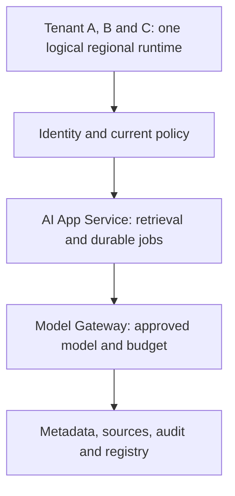
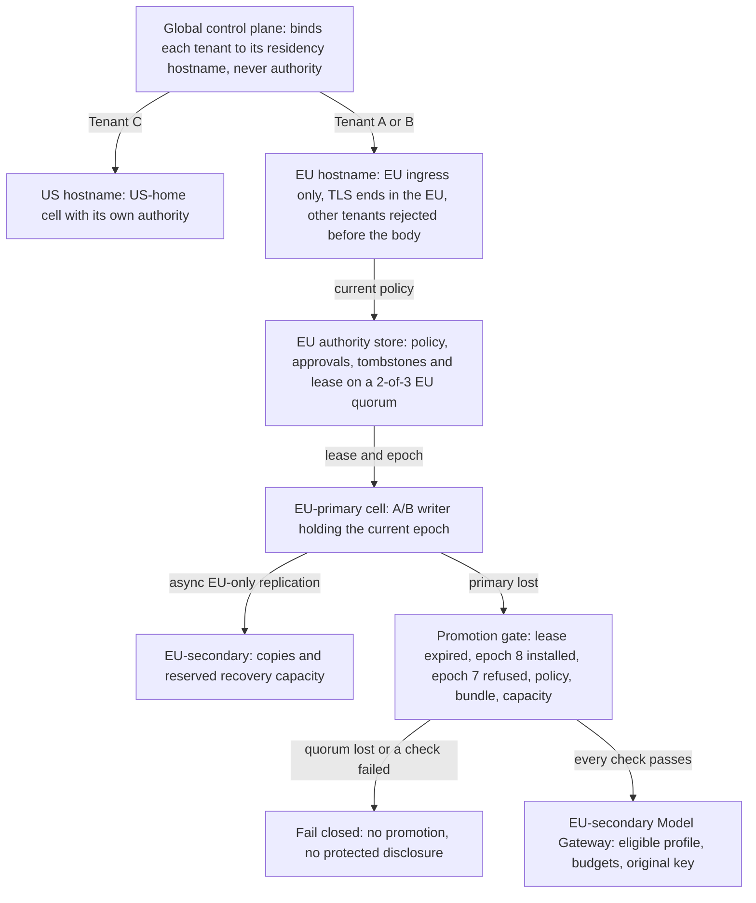

# Stage 11: Global Multi-Region Platform

Alice in Tenant A now needs supplier content to stay within approved EU regions. A regional outage must not send her documents to the nearest healthy US endpoint. Tenant B has the same residency constraint. Tenant C has a separate US home. Recovery needs authorised data, current policy, one proven writer, and ready model capacity in the allowed geography.

These are hypothetical customer requirements, not legal advice or cloud guarantees. Every time, rate, and dollar amount is a planning assumption. The local lab computes recovery eligibility, capacity, and usage economics; no regional services run. Estimated integrated study: six to eight hours.

## 1. Understand the Problem

### Carry Forward Model and Data Lineage

Read [Stage 10](../10-fine-tuning/guide.md), [its state](../10-fine-tuning/stage-state.json), and [its snapshot](../10-fine-tuning/architecture-after.md) before designing the change. Dataset versions, training jobs, checkpoints, candidate registry, evaluation, and approval now exist as architecture roles. The executable lifecycle fixture checks metadata only. Stage 9's runtime still requires current source access, mandatory audit, approved model/route, finite budgets, and commit-before-saved-success. Durable jobs, tombstones, immutable caches, and unknown external outcomes remain intact.



Before diagram. One logical region has no demonstrated cross-region recovery. Its internal availability and previous local SQLite tests do not prove survival of a regional loss.

### Walk the Failure Before Adding Regions

Suppose EU-primary stops responding after accepting Alice's operation. A global load balancer selects US because it is healthy. The request may violate placement policy, lack the exact approved adapter, read stale permission, or generate a second answer for an already charged operation. A health check cannot decide those questions.

Data residency means an approved placement constraint on specified data classes and processing. Here A/B content, source bodies, embeddings/indexes, prompts, outputs, training snapshots, adapters, and protected logs/backups stay in EU-primary or EU-secondary. A global directory contains opaque tenant handles and placement revisions only; authentication and access checks remain regional. Location of an HTTP endpoint does not establish the location of provider processing, logs, backups, or support access.

Two questions decide every recovery. How much recently saved work may Alice lose, and how long may she wait? As in [Stage 7](../07-reliability-consistency/guide.md#worked-latency-and-reliability-budgets), the recovery point objective (RPO) bounds the first: the maximum acceptable data-loss window. The recovery time objective (RTO) bounds the second: the maximum time from incident start to validated customer success. Disaster recovery (DR) is the plan that meets both after a regional loss. Assume asynchronous result/source replication targets RPO ≤60 seconds and the RTO is 600 seconds. [AWS's recovery guidance](https://docs.aws.amazon.com/whitepapers/latest/disaster-recovery-workloads-on-aws/disaster-recovery-options-in-the-cloud.html) describes DR strategy trade-offs; our timings are independent illustrative budgets.

| Module | Treatment | Depth, evidence, and boundary |
| --- | --- | --- |
| 1.2 Estimation and capacity planning | Revisited from [Stage 1](../01-mvp/guide.md) | D3: separate RPS, tokens/minute, concurrency, and recovery timing |
| 2.1 Networking fundamentals | Revisited from [Stage 1](../01-mvp/guide.md) | D2: DNS caching, ingress reachability, TLS and private endpoint boundaries |
| 3.1 Distributed system fundamentals | Revisited from [Stage 7](../07-reliability-consistency/guide.md) | D3: one writer per tenant through a quorum lease and epoch fencing |
| 5.1 Rate limiting and admission control | Revisited from [Stage 5](../05-overload-fairness/guide.md) | D3: admission follows the surviving regional dependency budget |
| 5.4 Fair scheduling and workload prioritization | Revisited from [Stage 5](../05-overload-fairness/guide.md) | D2: retain tenant shares under degraded capacity |
| 5.5 AI workload management | Revisited from [Stage 5](../05-overload-fairness/guide.md) | D3: reserve token and slot capacity, not just app replicas |
| 7.2 AI gateway and provider management | Revisited from [Stage 9](../09-inference-gpu/guide.md) | D3: route only to eligible regional provider profiles before dispatch |
| 8.1 Document ingestion and indexing | Revisited from [Stage 3](../03-enterprise-knowledge/guide.md) | D3: rebuild indexes from source copies checked against quorum-held versions and tombstones |
| 8.3 Enterprise retrieval governance | Revisited from [Stage 6](../06-enterprise-security/guide.md) | D3: current policy authority remains required during recovery |
| 9.1 LLM execution and inference fundamentals | Revisited from [Stage 9](../09-inference-gpu/guide.md) | D2: token phases and context mix affect regional slots |
| 9.2 Model serving architecture | Revisited from [Stage 9](../09-inference-gpu/guide.md) | D2: warm model readiness differs from a running VM |
| 9.3 Inference performance optimization | Revisited from [Stage 9](../09-inference-gpu/guide.md) | D1: optimisation changes require measured local evidence |
| 10.3 GPU infrastructure and scheduling | Revisited from [Stage 9](../09-inference-gpu/guide.md) | D1: reserve accelerator availability within allowed geography |
| 12.1 Scaling and traffic engineering | Revisited from [Stage 4](../04-application-scaling/guide.md) | D3: app headroom cannot hide provider bottlenecks |
| 12.2 Resilience and fault tolerance | Revisited from [Stage 7](../07-reliability-consistency/guide.md) | D3: RPO/RTO runbook and explicit fail-closed cases |
| 13.2 Enterprise AI security | Revisited from [Stage 6](../06-enterprise-security/guide.md) | D3: datasets, models, telemetry and egress follow residency policy |
| 13.3 Multi-tenant platform design | Revisited from [Stage 6](../06-enterprise-security/guide.md) | D3: trusted per-tenant home/allowed-region policy |
| 15.2 SRE and production operations | Revisited from [Stage 7](../07-reliability-consistency/guide.md) | D3: incident roles, promotion evidence and failback |
| 15.3 Performance and incident diagnosis | Revisited from [Stage 7](../07-reliability-consistency/guide.md) | D3: separate route, authority, replica and model readiness failures |
| 16.1 Container and orchestration architecture | Revisited from [Stage 9](../09-inference-gpu/guide.md) | D2: regional image/artifact pinning, readiness and drain |
| 16.2 Cloud networking and deployment | Taught at mapped depth | D2: residency hostnames, regional ingress, private routes, entry and deployment alternatives, and a request-trace design task |
| 17.1 AI unit economics | Taught at mapped depth | D3: cost per successful workflow derived from attempts, tokens and rate, before and after a failover retry, with an attempt-keyed usage ledger |
| 17.2 Infrastructure capacity planning | Taught at mapped depth | D2: regional peak and recovery capacity by app, tokens and slots; sizing alternatives and a quota sizing task |

Outcomes: choose a regional boundary, quantify recovery and cost, diagnose an ineligible failover, and reconcile usage without equating retries to new customer value.

## 2. Learn and Design

### Compare Placement and Recovery Options

| Option | Benefit | Cost or failure | Fit for this requirement |
| --- | --- | --- | --- |
| One region plus backups | Lowest live duplication | Restore and capacity acquisition may miss recovery target | Baseline if customers accept longer outage |
| Tenant home region with same-geography warm secondary | Local writes and policy boundary; recovery capacity partly running | Replication lag, reserved capacity and promotion runbook | Choose for EU A/B |
| Every region writes every tenant | Local writes in more locations | Conflict resolution, global identity/budgets, residency and split-writer risk | Reject without a demonstrated requirement |
| Synchronous cross-region replication of tenant data | Less acknowledged-state loss when a quorum survives | Write latency on every request, partition availability and permitted-region constraints | Reject for bulk data; apply only to the small authority class below |

A cell is a regional failure boundary containing enough application and data services to serve its assigned tenants. Tenant home placement chooses one writer region for that tenant. Different tenants can be active in different cells; that is not concurrent global writing of Alice's operation. Add EU-secondary as a warm recovery target with verified artifact and quota reservations. Tenant C continues in US-home. There is no permitted US failover for A/B under this scenario.

### Place Writer Authority Where It Survives

Suppose EU-primary is cut off but still running. If EU-secondary also starts accepting Alice's writes, two regions change the same tenant's records and charge for the same operation. Recovery must prove that the old writer can no longer change anything before the new one starts. That proof is called fencing. Three tools from [Stage 2](../02-distributed-execution/guide.md#claim-lease-and-completion) and [Stage 7](../07-reliability-consistency/guide.md#choose-consistency-by-consequence) make it concrete:

- A lease is time-limited writer ownership. The writer renews it every 5 seconds here and loses it 20 seconds after the last renewal.
- An epoch is a number that increases with every new lease. It is the fencing token: each write carries it, and a store rejects any write whose epoch is older than the newest it has seen.
- A quorum is a majority of voters, here 2 of 3. Any two majorities share a voter, so two live leases cannot be granted at once.

[ADR-013](../../architecture/decisions/ADR-013-regional-authority-and-route-generations.md) amends ADR-011's cell design to place this authority. Tenant A/B policy, membership, model approval, deletion tombstone, source-version and writer-ownership records sit in an EU-only authority store. It is consensus-replicated across EU-primary, EU-secondary and a small EU witness location that holds votes, not content. Losing EU-primary leaves 2 of 3 voters in the EU. Tenant C has the equivalent store in its US-home cell. No authority record leaves its tenant's region. The global control plane holds only opaque placement and is never authority.

Promotion runs four steps in order. A clock-drift margin is the allowance for two machines' clocks disagreeing about when 20 seconds have passed.

1. Wait until epoch 7's lease has expired plus the drift margin. A correct old writer stops acknowledging writes at its own lease expiry.
2. The quorum grants EU-secondary a new lease, epoch 8.
3. EU-secondary installs epoch 8 as the minimum accepted epoch in every store it will use: its database, object store, job workers and the Model Gateway's billable-usage write path. Each must then refuse a probe write carrying epoch 7. A store cannot reject epoch 7 until it has seen epoch 8, so the install comes first.
4. EU-primary's own stores cannot be reached, so they are not probed. They are quarantined: nothing they accept after isolation becomes authority, and failback rebuilds them from the new authority. Provider calls the old writer sends after lease expiry rely on its self-stop and on unknown-outcome reconciliation, not on epoch rejection.

An unreachable writer is not a fenced writer, so network reachability or a health check never counts as fencing.

If the quorum itself is lost, the design fails closed. EU-secondary does not promote, makes no protected disclosure, and reports that authority is unavailable, even when that misses the RTO. Treating the async copy as authority is the unsafe shortcut.



After diagram. Placement binds Tenant C to the US hostname and A/B to the EU hostname, whose TLS ends only in EU ingress. EU-primary replicates asynchronously to EU-secondary inside the EU. On primary loss, the promotion gate either passes every check or fails closed. The US cell is a sibling destination for C, never a replica of A/B content. Directory configuration cannot substitute for actual private networking or provider processing policy.

### Specify the Network and Control Boundaries

Alice's request crosses several network edges before a model sees it. Each edge can leak content or deliver it to the wrong region. Five terms name those edges; TLS and mutual TLS return from [Stage 1](../01-mvp/guide.md#networking-on-this-path) and [Stage 6](../06-enterprise-security/guide.md#protect-the-model-and-network-boundary):

- Ingress is the regional entry point that accepts client traffic. Egress is any outbound path, such as a call to a model provider.
- Transport Layer Security (TLS) encrypts a connection and proves the server's identity with a certificate. Mutual TLS also proves the client's identity.
- A private endpoint exposes a service only on the cloud provider's internal network, with no public address.

Follow the request in order:

1. After sign-in, the trusted placement directory binds Tenant A to the EU hostname. That host resolves only to EU ingress, and its TLS key exists only there, so Alice reaches the EU wherever she is. The Domain Name System (DNS) then chooses only between EU-primary and EU-secondary ingress. Resolvers cache that answer for its time to live (TTL), so a switch reaches some clients late.
2. EU ingress terminates TLS and strips caller-supplied identity headers.
3. Ingress authenticates from the headers and resolves trusted placement before reading the body. A tenant not placed at this ingress is rejected. No body goes into redirects, URLs or edge logs.
4. Inside the cell, services call each other over authenticated paths with scoped credentials. Private endpoints, firewall rules, private DNS, routes and controlled egress must agree. Private connectivity reduces exposure; it does not authorise a resource.
5. Before dispatch, the Model Gateway checks the provider profile's processing and storage geography and the model's approval.

Deployment pins image and model digests, then tests readiness, connections, secrets and drain (stopping new work to an instance while its in-flight work finishes) in each cell. A machine accepting TCP connections is not evidence that an adapter is loaded.

The global control plane publishes placement and approved templates. It stays off each prompt's critical path and never holds authority. A signed, bounded-age regional snapshot can serve placement discovery but grants no document access. On control-plane loss, freeze placement changes. Existing authorised work continues only while the regional authority quorum, audit and budgets are available.

### Choose Regional Entry and Deployment

| Decision | Option | When it wins | Cost or failure |
| --- | --- | --- | --- |
| Regional entry | Residency hostnames: the EU host resolves only to EU ingress; DNS chooses within the EU | The endpoint enforces residency: the EU key exists only in EU ingress, wherever the user is | Clients must use their host; cached answers delay an EU-primary to EU-secondary switch by up to the TTL |
| Regional entry | DNS geo-routing on one shared hostname | Lowest latency for users near their home region | Picks by the resolver's location, not the tenant: an A/B user resolving from the US reaches US ingress, where TLS ends. Nothing at entry enforces residency |
| Regional entry | Anycast load balancer (one address announced from many edges; the network picks a nearby one) with EU-only edges for the EU host | One fixed address per residency and a switch without DNS caching | The provider's edge set and key placement enforce residency, so both need continuous audit; global configuration is a shared failure point |
| Service exposure | Private endpoints for the Model Gateway, stores and provider | Default for cell-internal and provider paths | Private DNS and routes in every cell; harder to debug |
| Service exposure | Public endpoint with mutual TLS | A partner that cannot join the private network | Internet-reachable; certificate rotation and allow-lists become the boundary |
| Regional deployment | Rolling update within a cell | Small, backward-compatible changes | Old and new versions serve together; rollback is gradual |
| Regional deployment | Blue/green within a cell | Model Gateway or adapter changes that need a clean cut-over | Double capacity during the switch; the recovery reserve must cover both |

Choose residency hostnames, private endpoints, and blue/green for Model Gateway changes, one cell at a time. Anycast with EU-only edges also enforces residency and wins when a customer needs one fixed address; it loses here because residency would rest on a provider's edge configuration. Geo-routing on a shared hostname is rejected, because user location would decide where A/B content is decrypted.

**Design task.** Trace Alice's request from the EU hostname to the EU-secondary Model Gateway after failover. Mark where content may be logged and where a request at the wrong ingress is rejected. Choose a DNS TTL against the 30-second route-convergence budget, assuming the record update itself takes 5 seconds. Then choose how to ship a Model Gateway image change to EU-secondary.

<details>
<summary>Reveal after answering</summary>

The EU hostname now resolves to EU-secondary ingress; it never resolves outside the EU. TLS ends there, and edge logs hold metadata only. Authentication and placement run on the headers. A Tenant C user at this ingress, or an A/B client misconfigured to call the US host, is rejected at that ingress before the body is read. The app service calls the Model Gateway over a private endpoint, which dispatches to an EU provider profile. Content is written only to the protected EU operation and audit stores.

For the TTL, 5 seconds of update plus a 20-second TTL leaves 5 seconds of margin inside 30 seconds; a 60-second TTL misses the budget. A 20-second TTL triples DNS lookups compared with 60, and some resolvers ignore it, so measure convergence from client success. Ship the image blue/green inside EU-secondary, keeping the old version until readiness and approval checks pass.

</details>

### Assign Consistency by Data Class

| Data class | Replication and recovery choice | Unsafe shortcut |
| --- | --- | --- |
| Policy, membership, writer lease and epoch, budget grants, model approval/withdrawal, release-bundle generation, alias-to-digest bindings, deletion tombstones and current source versions | EU authority store on the 2-of-3 EU quorum; promotion needs a new lease and a refused old epoch | Trusting a lagging copy for revocation, deletion, quota or a withdrawn adapter |
| Committed result/history and operation keys | Async ordered log; loss bounded at isolation by last renewal + lease − watermark; inspect ambiguous operations | Treating missing post-failover row as proof no remote work happened |
| Immutable source bodies, datasets, adapters and checkpoints | Copy by digest within geography; verify complete manifest before readiness | Loading a registry alias whose artifact is absent |
| Index and immutable caches | Rebuild from source copies checked against the quorum's current versions and tombstones; keep live gates | Serving old search hits to bypass unavailable authority |
| Usage and audit | Protected regional evidence keyed by tenant, operation and attempt; classification-aware aggregates | Counting a redelivered attempt twice or dropping failed-attempt spend |

Stage 10's approval and alias records are mutable trusted state, so they sit in the authority row. An adapter copied by digest may have been withdrawn after the copy. Restore therefore verifies the current approved generation from the authority store, not only the artifact digest. Tombstones and current versions sit there too, as [Stage 7](../07-reliability-consistency/guide.md#choose-consistency-by-consequence) required, so a deletion acknowledged inside the lag window survives promotion. Every delete pays quorum latency.

Because async replication can lose acknowledged operation records within RPO, automatic redispatch after failover is unsafe for the uncertain interval. Keep a recovery hold on affected operations and reconcile provider/external status using original identities. A stronger zero-loss operation journal would need its own synchronous durability design and latency cost. This stage does not claim to implement that journal or the consensus protocol behind the authority store.

### Checkpoint 1: Authority Quorum Lost

EU-primary is down, and EU-secondary cannot reach the EU witness either, so it sees 1 of 3 authority voters. It has the model and result copies. May it promote itself and answer Alice's grounded supplier request to meet the RTO?

<details>
<summary>Reveal after answering</summary>

No. With 1 of 3 votes it cannot obtain a lease or read current policy. From EU-secondary, a dead primary and a live primary that still holds a majority with the witness look the same. Do not promote, make no protected disclosure, and report that authority is unavailable. A copied result, search index, or dataset cannot establish current access. Restore a quorum first, even if the RTO is missed.

</details>

## 3. Observe and Experiment

### Request Walkthrough

The [offline walkthrough](guide.html#request-walkthrough) follows promotion on the control plane, then Alice's request on the data plane, with wrong-geography, unfenced-writer and lost-quorum branches.

```mermaid
sequenceDiagram
 participant C as Client
 participant N as EU regional ingress
 participant Q as EU authority quorum
 participant I as Incident controller
 participant S as EU-secondary
 participant G as Regional Model Gateway
 Note over I,S: Control plane: promotion
 I->>Q: Check EU-secondary is allowed and not failed; request lease
 alt Quorum lost or destination not allowed
 Q-->>I: No lease; stay fail closed; authority unavailable
 else 2 of 3 voters grant epoch 8
 Q-->>I: Lease epoch 8 after epoch 7 expiry plus drift margin
 I->>S: Install epoch 8 in every store it will use, then probe epoch 7
 S-->>I: Epoch 7 refused, or the store that accepted it
 Note over I,S: EU-primary stores quarantined, not probed
 I->>S: Verify loss bound, approval, audit, bundle
 S-->>I: Cell ready, or the missing prerequisite
 end
 Note over C,G: Data plane: Alice's request
 C->>N: Request to the EU hostname with original operation key
 N->>Q: Authenticate from headers; tenant scope, placement, current policy
 alt Not promoted, tenant not placed here or no current policy
 N-->>C: Unavailable; key kept; no US redirect
 else EU-secondary holds epoch 8
 N->>S: Forward to the epoch 8 writer
 S->>G: Inspect operation; dispatch only if admitted
 G-->>C: Saved replay or recovery hold
 end
```

Sequence diagram. The incident controller never talks to the client: promotion is control plane, and Alice's request is data plane. Ingress authenticates, scopes the tenant, and checks placement and current policy on every request, before reading the body. A value in the lab represents fencing evidence; it does not fence a real host.

| Step | Responsible component and input | Output and possible failure |
| --- | --- | --- |
| Detect | Incident controller receives health, error and probe evidence | Incident start and recovery clock; a false positive must not start a second writer |
| Place | Trusted placement policy evaluates the proposed destination | EU-secondary for A/B; US-home or the failed EU-primary is rejected |
| Fence | EU authority quorum grants epoch 8 after epoch 7's lease and drift margin; EU-secondary installs epoch 8 in its stores, then probes epoch 7 | Epoch 7 refused and EU-primary's stores quarantined, or blocked promotion |
| Restore | Regional recovery checks the loss bound at isolation, approval generation, audit and model digests | Ready cell or explicit missing prerequisite |
| Route | EU ingress, reached through the EU hostname, authenticates Alice, scopes Tenant A and checks current policy | Forward to the epoch 8 writer, or unavailable with no US redirect |
| Admit | Scheduler checks app, provider tokens, active slots and tenant shares | Bounded service; overload rejects or expires work |
| Reconcile | Operation store and usage ledger inspect original operation and attempt IDs | Saved replay or recovery hold; no blind uncertain dispatch |

### Calculate Recovery and Capacity

Assume detection 60 seconds, fencing 30, restore/scale/artifact checks 180, route convergence 30, and validation 60. The planned sequential recovery is 360 seconds. The lease runs from the last renewal, before the incident started, so it has normally expired by the end of detection; the 30-second fencing budget conservatively covers the drift margin, epoch install and probes. The RTO stays 600 seconds; the 240-second gap is margin, not a second target. If a model takes 600 seconds to load, the plan becomes 780 seconds and misses the RTO. Overlap can reduce elapsed time only if demonstrated safely. Measure incident start through validated customer success, not DNS update time alone.

Copy loss needs a bound that still works while EU-primary is down. "Now minus last applied" grows during detection and passes 60 seconds by the end of the 60-second detection step. Bound it at isolation instead. Each lease renewal, every 5 seconds, is recorded in the authority quorum. EU-secondary's watermark is the point up to which every record has been applied ([Stage 7](../07-reliability-consistency/guide.md#checkpoint-1-a-large-sequence-can-hide-a-gap)). A partitioned EU-primary that is still running keeps acknowledging writes until its lease expires, 20 seconds after its last renewal. The loss bound is therefore last renewal + lease duration − watermark.

For example, the last renewal is at 10:00:40 and the watermark is 10:00:25: 40 + 20 − 25 = 35 seconds, inside the 60-second RPO. Adding one 5-second renewal interval instead fits only a crashed primary: a 45-second gap would pass at 50 seconds while a live writer could lose 65. The bound is frozen at isolation, so detection time does not change it. It bounds the loss; it does not measure what was lost. An operator may escalate to customer-approved degraded recovery with explicitly revised objectives, but must not claim the original objective passed.

Assume A/B combined failover peak is 60 requests/second, each using 1,000 total budgeted tokens and a two-second active serving slot. An app replica rated at an assumed 20 RPS planned at 70% supports 14 RPS: ceil(60/14)=5 replicas. Provider budget must cover 60 ×1,000×60=3.6 million tokens/minute, plus the applicable request quota. Little's law, from [Stage 1](../01-mvp/guide.md#9-work-the-numbers-before-buying-capacity), says average work in progress equals arrival rate times time in the system (L = λW). Here 60×2=120 active slots, excluding queued work and tail headroom. These independent budgets must all fit. App scaling cannot repair a 2-million-token/minute provider quota.

For a 100 RPS recovery burst, app demand is ceil(100/14)=8 replicas, tokens become 6 million/minute, and average active slots become 200. Keep A/B shares under the surviving budget and reject excess rather than building an unbounded recovery queue. Warm GPU readiness, available device types, context distribution, cold caches, index reconstruction, provider approval, and network routes may bind first.

### Size Recovery Capacity Under a Quota

Assume EU-secondary's reserved provider quota is 2 million tokens/minute, below the 3.6 million the peak needs. Three sizing choices remain:

| Sizing choice | Recovery behaviour | Cost | When it wins |
| --- | --- | --- | --- |
| Warm secondary at full peak | Serves 60 RPS immediately | Idle reserve for 3.6 million tokens/minute, 5 replicas and 120 slots | Strict RTO and no acceptable shedding |
| Partial warm capacity with shedding | Serves what the quota admits; rejects the rest by tenant share | Lower reserve; customers see rejections | This stage's assumptions |
| Scale on failover | Starts small and acquires capacity during the incident | Lowest idle cost; acquisition and model load may exceed the RTO | Longer RTO or spare regional supply |

**Sizing task.** With the 2-million-token quota and 1,000 tokens per request, what request rate can EU-secondary admit? How many replicas and active slots does that need? How would you split it if Tenant A's contract share is 60% and Tenant B's is 40%?

<details>
<summary>Reveal after answering</summary>

2,000,000 ÷ 1,000 ÷ 60 ≈ 33.3 requests/second. Admit 33 RPS: ceil(33/14) = 3 replicas and 33 × 2 = 66 active slots, both inside the reserve. Split about 20 RPS for A and 13 RPS for B under the illustrative shares. Reject the other 27 RPS of the 60 RPS peak at admission with a retry-after signal; do not queue it without bound. More app replicas would not help, because the token quota binds first.

</details>

### Build Unit Economics From Successful Work

Finance wants one number: what does a completed supplier workflow cost? Derive it from charged attempts, not accepted requests. All inputs are illustrative:

- 1,000,000 accepted workflows/month, of which 800,000 complete successfully.
- 1,250,000 charged attempts: one first attempt per workflow plus 250,000 retries.
- 1,000 tokens per attempt at an assumed blended $4 per million tokens, so $0.004 per attempt.
- Fixed monthly cost: primary infrastructure $6,000, EU reserve $3,000, regional networking $500 and allocated support/on-call labour $8,000, so $17,500.

| Month | Variable spend | Total | Cost per success |
| --- | --- | --- | --- |
| No failover | 1,250,000 × $0.004 = $5,000 | $22,500 | $22,500 ÷ 800,000 = $0.028125 |
| One failover with 20,000 retried attempts | 1,270,000 × $0.004 = $5,080 | $22,580 | $22,580 ÷ 800,000 = $0.028225 |

The failover month assumes 20,000 workflows whose EU-primary attempt was charged, reconciled as failed, and retried once in EU-secondary. Successes stay at 800,000: the retries recover workflows and add no new customer value. Dividing by the 1,000,000 accepted requests gives $0.0225 and hides completion failure. Unknown remote usage remains a liability until reconciled; record bounded estimates separately from actual invoices.

**Predict.** A worse month keeps 1,000,000 accepted workflows but completes only 700,000, with 300,000 retries. What is the cost per success, and how much did it rise?

<details>
<summary>Reveal after answering</summary>

1,300,000 attempts × $0.004 = $5,200, so the month costs $22,700. Divided by 700,000 successes that is about $0.0324, up about 15% from $0.028125. Retries add spend, and fewer successes share the fixed cost.

</details>

Measure input/output tokens by model and tenant, device-hours including idle reserve, stored GB-months, transferred GB, failed attempts, support time, and successful workflow IDs. Key each usage record by tenant, operation and attempt. Usage delivery is at-least-once, so the same attempt can arrive twice; it counts once. A retry in another region is a distinct attempt and is extra spend. A record that changes an existing attempt's cost, region or outcome is a conflict, not a correction, and is rejected for investigation. The local `Ledger` applies these rules and counts one success per operation. It has no epoch field: rejecting usage writes that carry an older epoch is a production control this lab does not implement. A real ledger needs append-only adjustments, price versions, currency, tax policy, and invoice reconciliation.

### Lab: When Is Recovery Eligible?

Open the [offline lab](guide.html#lab). Four controls change the gap at isolation (last renewal minus watermark, 0–120 seconds; the lab adds the 20-second lease), destination (EU-secondary, US-home or the failed EU-primary), writer authority evidence, and restore and model load time (60–720 seconds). Policy, approval, audit and bundle gates are assumed true in the visual worksheet; the Python tests exercise them. Safety gates decide whether promotion is safe. The RTO column is separate: a safe but late plan still proceeds in a real incident, reports the missed objective, and goes back for rehearsal or redesign. Results are computed assumptions, not elapsed measurements.

| Preset | Inputs | Safe to promote | Blocking reasons | Planned recovery (seconds) | Meets 600-second RTO | Loss bound (seconds) |
| --- | --- | --- | --- | --- | --- | --- |
| Baseline | EU-secondary, old epoch refused, 15-second gap, 180-second restore | yes under assumptions | none | 360 | yes | 35 |
| Replica behind | Baseline with 41-second gap | no | RPO exceeded | 360 | yes | 61 |
| Wrong geography | Baseline with US-home | no | residency | 360 | yes | 35 |
| Failed region as target | Baseline with EU-primary | no | failed region is not a recovery target | 360 | yes | 35 |
| Split writer risk | Baseline with old epoch not proven rejected | no | writer not fenced | 360 | yes | 35 |
| Quorum lost | Baseline with EU authority quorum lost | no | authority unavailable | 360 | yes | 35 |
| Slow model load | Baseline with 600-second restore | yes under assumptions | none | 780 | no: rehearse or redesign | 35 |

Run with Python 3.10+ and Node from repository root:

```sh
python3 10_AI_System_Design/stages/11-multi-region/labs/test_regions.py
node 10_AI_System_Design/tools/test_simulator.cjs 10_AI_System_Design/stages/11-multi-region
```

Fault task: in `labs/regions.py`, set a withdrawn approval, missing audit, lost quorum, the failed region as destination, or a 41-second gap in `Recovery`, and expect one named blocking reason. A 600-second restore gives no blocking reason, only `meets_rto` false. No real routing changes occur. These are independent design slices; they do not compose earlier runtime fixtures into a deployed multi-region service.

### Checkpoint 2: Failover Lost the Operation Row

Alice's operation is absent on the promoted async replica. Is a new provider call safe under the same key?

<details>
<summary>Reveal after answering</summary>

Absence after possible replication loss does not prove no call occurred. Hold the uncertain interval and reconcile original operation/provider evidence. A local duplicate guard can only recognise records that survived. Only after reconciliation shows the first attempt failed may a new attempt run under the same operation key, and it is billed as a second attempt. Retrying under a new operation key makes the uncertainty worse.

</details>

## 4. Think Like a Staff Engineer

### Own the Outage and Failback

The incident commander owns promotion authority. The authority owner proves the new lease and the rejected old epoch. The database owner proves the loss bound at isolation. Security verifies current policy and audit, model operations verifies the approved generation and quota readiness, and the application owner checks customer outcomes. Observe regional success, authority quorum health, placement denials, route convergence, the loss bound at isolation, unknown operations, token exhaustion, and per-success cost. Redact content and avoid tenant IDs in unrestricted metric labels.

Before failback, discard or reconcile EU-primary's quarantined post-isolation writes, rebuild its stores, indexes and caches from the new authority's versions and tombstones, reconcile operation/usage evidence, test readiness, and move the lease once through the quorum. Do not reverse DNS while both regions accept writes. Test quarterly under the hypothetical operating plan and after changes to replication, policy, networking, or model startup. A tabletop pass does not establish RTO; a timed integrated exercise is still required.

### Interview 1: Why Not Global Active-Active?

Prompt: A/B need recovery and C needs a US home.

Spoken answer: “I would place each tenant in an approved home cell with a same-geography recovery target: EU-primary and EU-secondary for A and B, US-home for C. Different tenants are active in different regions, but each tenant has one writer at a time. A lease and epoch from an EU-only 2-of-3 quorum enforce that. Global concurrent writes for one tenant would add conflict resolution, global policy freshness, shared quota and operation deduplication, and would copy A/B content outside the EU. My design costs recovery delay plus an idle EU reserve of $3,000 a month in our assumptions. I would accept multi-writer only for a measured local-write requirement with clear residency and ownership rules.”

Trade-off: one writer per tenant makes ownership provable but adds recovery delay and latency for distant users.

Follow-up: If Tenant A opens an office in Singapore and its users complain about latency, what changes? Not the writer, and not the endpoint. Singapore users still call the EU hostname, whose TLS ends only in EU ingress, so their location never decides where content is decrypted. Faster service needs a new placement policy agreed with Tenant A. A read cache outside the EU would still be a copy of restricted content.

### Interview 2: What Does a 600-Second Recovery Objective Mean?

Prompt: The route switches in thirty seconds but the model loads for ten minutes.

Spoken answer: “The RTO runs from incident start to validated customer success, not to the DNS change. Our plan is 60 seconds of detection, 30 of fencing, 180 of restore and model load, 30 of route convergence and 60 of validation. That is 360 seconds against a 600-second objective. The 30-second route switch is one substep. If the model takes ten minutes, the plan becomes 780 seconds and misses the RTO before traffic moves. I would report the missed objective, not relabel it. Then I would fix the binding resource: keep the approved adapter warm in EU-secondary, or agree a longer RTO with the customer. Safety gates still decide promotion, because a late but safe recovery beats a fast one with two writers.”

Trade-off: warm readiness costs idle capacity, which sits in the reserve line of the cost per success.

Follow-up: If the customer offers a smaller fallback model that loads in 60 seconds, what changes? The plan fits at 240 seconds. The fallback still needs its own approval, evaluation evidence and EU provider profile; it is a different release, not a faster copy.

### Interview 3: What Is the Cost Denominator?

Prompt: Finance reports cost per API request while customer completion falls.

Spoken answer: “I would keep request and token costs for diagnosis, but the business denominator is successful customer workflows. Here 1,250,000 charged attempts at $0.004 cost $5,000. Add $17,500 of fixed infrastructure, reserve, networking and support, and 800,000 successes cost about $0.028 each. Dividing by the 1,000,000 accepted requests shows $0.0225 and hides that one in five failed. A failover month with 20,000 retried attempts adds $80 and no new successes. The ledger keys usage by tenant, operation and attempt, so a redelivered record counts once and a cross-region retry counts as extra spend. At zero successes, unit cost is undefined, not zero. I would investigate quality and retry amplification before buying more capacity.”

Trade-off: workflow attribution needs operation and attempt IDs on every usage record, which is more work than counting HTTP requests.

Follow-up: If the provider invoice arrives 30 days late and differs from the ledger, what changes? Record an adjustment against the original attempts with the invoice as evidence. Never silently replace the earlier figure, because the difference may reveal a duplicate or missing attempt.

### Interview 4: How Do You Keep EU Content in EU?

Prompt: The primary region fails and a healthy US endpoint exists.

Spoken answer: “I would enforce allowed processing and storage regions in trusted services: a residency hostname whose TLS ends only in EU ingress, a placement check that rejects other tenants before reading the body, scoped data paths, and approved EU provider profiles at the Model Gateway. Authority records stay in the EU too, on a quorum of EU-primary, EU-secondary and an EU witness. A healthy US endpoint is not a valid target for A or B, and neither is the failed EU-primary. If EU-secondary cannot get a lease from 2 of 3 voters or read current policy, I return unavailable and escalate, even if that misses the 600-second RTO.”

Trade-off: strict residency lowers availability during a wide EU outage.

Follow-up: The customer wants one global address for all its users. What changes? A shared name with DNS geo-routing lets user location pick the ingress, so a traveller's request could be decrypted at US ingress; decline it. Offer anycast with EU-only edges for the EU host: one fixed address per residency, at the cost of auditing the provider's edge set and key placement. One address for EU and US tenants together would decrypt before placement is known.

### Interview 5: How Much Recovery Capacity Do You Reserve?

Prompt: EU-secondary's provider quota is 2 million tokens/minute, and the A/B peak is 60 RPS at 1,000 tokens per request.

Spoken answer: “I would size each budget separately. The peak needs 3.6 million tokens a minute, five app replicas at 14 RPS each, and about 120 active slots by Little's law. A 2-million quota admits only about 33 RPS, so app replicas are not the bottleneck. I would choose partial warm capacity with shedding: admit 33 RPS split by contract share, roughly 20 for A and 13 for B. The other 27 RPS is rejected with a retry-after signal instead of queued. If customers need the full 60 RPS during recovery, I would raise the reserved quota, pay for it in the fixed reserve line, and rerun the cost per success. Scaling on failover is cheapest, but acquisition and model load can exceed the 600-second RTO.”

Trade-off: shedding keeps the reserve cost down but turns an outage into partial rejection for both tenants.

Follow-up: If Tenant B's contract guarantees full service during recovery, what changes? Reserve B's full share first, 24 RPS (40% of the 60 RPS peak), and give A the remaining 9 RPS of the 33 RPS, or buy more quota. The contract changes the split, not the quota.

## 5. Validate and Carry Forward

### Recall and Exit Gates

1. What does RPO 60 seconds allow, and how is the loss bound computed?
2. What must precede writer promotion, in order?
3. What limits a 60 RPS workload besides app replicas?
4. Why does the EU hostname, not the user's location, keep A/B content in the EU, and what does a 20-second DNS TTL buy?
5. The usage record for attempt 2 arrives twice, then a third record changes its cost. What does the ledger do?

<details>
<summary>Reveal after answering</summary>

1: Up to 60 seconds of acknowledged writes may be lost; it is not zero loss. The bound is last renewal + 20-second lease − watermark, frozen at isolation, because a partitioned primary can acknowledge until its lease expires.

2: Lease expiry plus drift margin, a new quorum lease (epoch 8), epoch 8 installed in every store the new writer will use with each refusing an epoch 7 probe, and EU-primary's stores quarantined. Then an allowed destination that is not the failed region, current policy and approval generation, audit, complete artifacts and capacity.

3: The 3.6 million tokens/minute and request quotas, 120 assumed active slots, database/search, network, and model readiness.

4: Geo-routing picks by the resolver's location, so a user in the US could reach US ingress, where TLS ends. The EU hostname resolves only to EU ingress, and its key exists only there. A 20-second TTL plus 5 seconds of update fits the 30-second budget for moving between EU ingress points, for clients that honour it.

5: It counts the attempt once and rejects the changed record as conflicting evidence for investigation.

</details>

60-second card: bind each tenant to its residency hostname; keep authority and tombstones on a 2-of-3 EU quorum; promote after lease expiry, epoch 8 installed and epoch 7 refused; fail closed without quorum; bound loss as last renewal + lease − watermark; measure end-to-end RTO; reserve allowed-region tokens and slots; hold ambiguous operations; count every attempt per successful workflow; fail back with one lease move.

Exit gates for this stage:

1. Explain, in two minutes without notes, why a healthy US endpoint is ineligible for Tenant A and why 1 of 3 EU voters blocks promotion.
2. Draw the after-architecture: residency hostnames, the US-home sibling, the EU authority quorum with its witness, async EU replication, the promotion gate and the fail-closed branch.
3. Defend two alternatives with this stage's numbers: residency hostnames against an anycast load balancer with EU-only edges (16.2), and partial warm capacity against a full-peak reserve under the 2 million tokens/minute quota (17.2).
4. Diagnose a failed promotion from an observable signal (an accepted epoch 7 probe, a loss bound over 60 seconds, or an approval generation mismatch) and name the mitigation.
5. Build and debug the 17.1 slice (D3): run `labs/test_regions.py`, then add a test that asserts your 700,000-success prediction with `unit_cost`. Add `Ledger.adjust`, which appends a late-invoice adjustment against an existing attempt without changing its record and raises for an unknown attempt. Test that +500 micro-USD on attempt 2 keeps the original record and raises the total by 500. Explain each ledger result.

### Evidence and Carry Forward

Read the [stage plan](stage-plan.md), [architecture snapshot](architecture-after.md), [decisions](../../architecture/decisions/ADR-011-residency-aware-regional-cells.md) and [ADR-013](../../architecture/decisions/ADR-013-regional-authority-and-route-generations.md), [state](stage-state.json), [validation](validation.md), and [actual coverage](../../progress/coverage-status.csv). The [curriculum map](../../progress/curriculum-map.json) records targets. Local content verification and learner completion are separate. ADR-013 amends ADR-011 with authority placement, endpoint residency and fencing order; ADR-011's text is otherwise unchanged. Stage 12 inherits these regional cells, the EU authority quorum, model lineage, recovery gates, and explicit deployment gaps to define shared platform contracts and migration.

Review after about one, seven, and 21 days. Stop when the five gates pass. These learner gates remain unassessed. Production integrations and deployment controls described here are proposals unless the validation report explicitly records an executed check.
