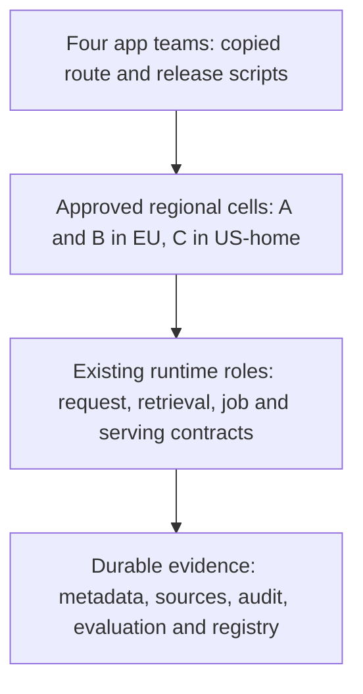
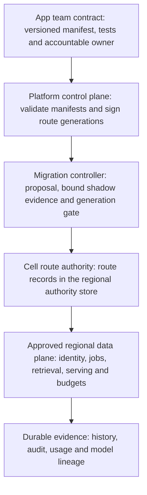

# Stage 12: Staff-Level Platform Architecture

Four internal teams now copy Alice's supplier workflow, each with its own route configuration and rollout scripts. One copy omits the EU placement pre-check. Stage 11's destination admission still rejects its requests at runtime, so no data leaves the EU, but the team debugs at runtime a failure that a shared deploy-time check would have caught. Another copy changes the model alias without binding evaluation evidence. The platform team needs shared contracts and a migration path that keeps tenant guarantees while application teams keep control of supplier behaviour.

The team counts, hours, costs, thresholds and schedules are illustrative design inputs. This capstone builds on the authored Stages 1–11 and their local test boundaries. It does not turn those fixtures into a deployed platform. Estimated integrated study: eight to ten hours. Learner mastery remains unassessed.

## 1. Understand the Problem

### Start From the Actual Stage 11 System

Read [Stage 11](../11-multi-region/guide.md), [its state](../11-multi-region/stage-state.json) and [snapshot](../11-multi-region/architecture-after.md). Alice and Tenant B use approved EU cells; Tenant C uses its US-home cell. Home-cell ownership, fenced promotion, current policy and audit, approved model artifacts, finite capacity and uncertain-operation recovery govern regional service. The regional worksheet is not a network deployment.

Carry these guarantees forward unchanged:

- **Request path:** authenticated API roles, bounded fair admission, approved egress, and gateway and model envelopes.
- **Data:** durable results and history, authorised ingestion and search, current version and tombstone checks, immutable caches, and consistency chosen per data class.
- **Execution and release:** durable jobs with worker epochs, evaluation and release bundles, and dataset-to-model lineage.
- **Regional:** home-cell ownership, fenced promotion, each region's authority store, and cost per successful workflow.

Keep short drafting distinct from grounded policy answering. Centralising the platform cannot make prompt text enforce access or repair an unknown provider result.



Before diagram. The existing capabilities remain useful. Their ownership and integration contracts are duplicated; no evidence justifies replacing every component with a new service.

### Turn the Incident Into Requirements

Assume each of four teams spends 30 engineering hours a month maintaining duplicated infrastructure logic. An adoption candidate is a tenant-scoped application with a named owner, approved cell, evaluated bundle, request budget, retention policy and observable outcome. Success means a new supplier app can follow a supported workflow without editing shared runtime code, and an emergency rollback cannot restore a forbidden model or the wrong region.

Acceptance criteria. These are design and test criteria, not production measurements:

- every onboarded app has an accountable owner and a versioned manifest;
- every seeded cross-tenant, residency or approval violation rejects;
- a lost cutover acknowledgement leaves inspectable state;
- an injected pre-commit failure changes neither route nor generation;
- a pilot reconciles per-success cost and shadow outcomes before rollout.

A one-day onboarding objective would need a later measured pilot.

| Module | Treatment | Depth, evidence, and boundary |
| --- | --- | --- |
| 1.1 Requirements and architecture methodology | Revisited from [Stage 1](../01-mvp/guide.md) | D3: translate supplier and tenant constraints into platform acceptance criteria |
| 1.3 Design documentation and communication | Taught at mapped depth | D3: one-page decision record with evidence ledger and change record, plus a memo section for a named reader |
| 3.3 Distributed architecture patterns | Taught at mapped depth | D2: modular service, cell, event, and control-plane versus data-plane patterns with failure boundaries |
| 11.1 Fine-tuning fundamentals | Revisited from [Stage 10](../10-fine-tuning/guide.md) | D2: an adapter stays conditional on behaviour evidence |
| 11.2 Fine-tuning platform architecture | Revisited from [Stage 10](../10-fine-tuning/guide.md) | D1: model creation is a separate governed workflow behind the platform contract |
| 11.3 Distributed training infrastructure | Revisited from [Stage 10](../10-fine-tuning/guide.md) | D0: reminder only; training specialisation remains deferred |
| 14.1 Evaluation architecture | Revisited from [Stage 8](../08-evaluation-releases/guide.md) | D3: contract and outcome gates accompany migration comparisons |
| 14.3 Model and data lifecycle infrastructure | Revisited from [Stage 10](../10-fine-tuning/guide.md) | D2: the manifest pins model and data lineage; retirement follows descendants |
| 15.2 Site reliability engineering (SRE) and production operations | Revisited from [Stage 7](../07-reliability-consistency/guide.md) | D3: regional service level objective (SLO) and runbook ownership continue after centralisation |
| 16.2 Cloud networking and deployment | Revisited from [Stage 11](../11-multi-region/guide.md) | D2: deployment targets respect Stage 11 cell and network boundaries |
| 16.3 Internal AI developer platforms | Taught at mapped depth | D3: versioned app contract, paved workflow, per-cell route authority and a durable migration-controller slice |
| 17.1 AI unit economics | Revisited from [Stage 11](../11-multi-region/guide.md) | D3: per-success cost persists in showback and platform adoption |
| 17.2 Infrastructure capacity planning | Revisited from [Stage 11](../11-multi-region/guide.md) | D2: cell capacity is planned independently of developer onboarding |
| 17.3 Architecture economics | Taught at mapped depth | D3: three-year total cost of ownership (TCO) with dual-run overlap, break-even and sensitivity; opportunity value stays qualitative |
| 18.1 Architecture decision-making | Taught at mapped depth | D3: weighted options, hard-constraint veto, architecture decision record (ADR) and reversal triggers |
| 18.2 Platform evolution and migration | Taught at mapped depth | D3: inventory, bound shadow evidence, single-writer cutover, rollback with history, and retirement, with fault tests |
| 18.3 Technical leadership through system design | Taught at mapped depth | D3: ownership, review, incident authority, disagreement resolution and a scored capstone defence |

Outcomes: write and defend a decision record, defend platform boundaries, test a migration controller, compare TCO with uncertainty, and lead an adoption review using evidence rather than technology preference.

## 2. Learn and Design

### Choose Abstractions That Preserve Guarantees

A shared application contract describes what a team supplies and what the platform promises. An internal developer platform provides that contract through supported templates, APIs, documentation, validation, deployment and operational support. The first useful version can be a command and a manifest; a portal does not make deployment safe.

Separate a control plane, which validates desired configuration and records decisions, from data planes, which serve regional customer requests. Do not send prompts through a new global platform controller merely to centralise ownership. What happens when the control plane fails is set out in [Place Route Authority in Each Cell](#place-route-authority-in-each-cell).

| Architecture option | Benefit | Cost and failure | Decision |
| --- | --- | --- | --- |
| Shared library plus templates | Fast adoption; low service overhead | Version drift, uneven rollout, policy copied into apps | Use for the software development kit (SDK) and schema, not as sole policy enforcement |
| Regional platform services plus versioned contracts | Central enforcement per cell; independent app workflows | Platform dependency, compatibility and on-call burden | Choose as logical target; reuse current services |
| One global request service | Fewer centrally managed endpoints | Global blast radius, residency coupling, control-plane dependency | Reject for A and B placement and cell isolation |
| Rewrite every role as a microservice | Independent scaling and team releases where needed | New network and transaction boundaries, more operations and migration risk | Extract only when measured ownership or scale requires it |

A modular monolith keeps logical roles in one deployable unit and reduces network contracts; service extraction can separate operational ownership and bottlenecks later. A cell limits a failure domain; it does not demand one microservice per box. Events suit async ingestion and usage aggregation with idempotent consumers. A command that needs an authoritative policy or generation check cannot take its decision from an eventual event consumer. An outbox connects a committed state change to eventual event delivery; it does not make external model calls exactly once.

Score options against weighted criteria, but apply hard constraints first. Score template-only, regional contracts and global rewrite on delivery speed, isolation, operability and evolvability, weighted 0.2, 0.3, 0.3 and 0.2. With assumed scores of 5, 2, 2, 2; 3, 5, 4, 4; and 1, 1, 2, 3, the weighted totals are 2.6, 4.1 and 1.7. Residency and current access are hard constraints: an option that violates one is removed before ranking, and no score rescues it. Here the vetoed global rewrite also ranks last, so the veto changes nothing. The [decision exercise](#decision-exercise-veto-the-top-score-and-write-the-adr) changes a constraint so that it removes the winner.

### Make the Developer Workflow Concrete

A production manifest holds schema version, trusted application ID, tenant mapping, owner and on-call, allowed cell, evaluated release bundle, source connector references, purpose and retention, quota and deadline envelopes, secret references and outcome instrumentation. Separate desired application configuration from centrally enforced tenant policy. A manifest may request a region or model; server policy decides eligibility. Never accept provider credentials, raw datasets or an arbitrary destination URL in that interface.

Developer steps:

1. Create an app from the minimal supplier template and declare its manifest.
2. Run contract checks and the frozen task evaluation.
3. Request sandbox deployment in the approved cell, then inspect validation and reconciliation status.
4. Shadow eligible read-only work. A shadow comparison sends a copy of authorised requests to the new route, compares its answers with the current route's, and discards them, so no customer sees or acts on them.
5. Request pilot promotion and observe outcomes.
6. Widen the cohort with a reversible change checked against the route generation. A generation is a counter that rises by one on every route change, so a writer holding an old value cannot overwrite a newer one.

Tenant-specific behaviour lives in prompts, tools, retrieval configuration and approved adapters, not in forks of the policy service.



After diagram. New platform abstractions wrap existing regional contracts. They do not replace resource authority, result persistence, model release approval or regional promotion fencing.

Propose `POST /v1/apps/{app}/changes` with a 16 KiB manifest limit and an operation key of up to 128 characters. Bind the verified app owner or delegated operator to a trusted tenant and app scope. Validate schema, ownership, approved region and bundle, secret references and bounded budget against current server policy. Key uniqueness is scoped to tenant, app, subject, endpoint and key. A same-key retry returns the persisted change rather than submitting another migration, even if approval was revoked after it was recorded.

| Status | Meaning |
| --- | --- |
| `202 {change_id, state, generation}` | Proposed change committed. Success means recorded intent, not deployed service |
| `400` | Invalid manifest or key |
| `403` | Forbidden region, bundle or owner |
| `404` | App not visible to this caller |
| `409` | Same key with a different canonical payload |
| `429` | Controller admission is full |
| `503` | Policy authority unavailable |

Status reads return the current generation and named blockers. The runnable SQLite slice reduces the manifest to tenant, app, owner, region, bundle and budget, scopes keys by tenant, app and key, and assumes a trusted caller. It has no HTTP, real identity, rollout, region or budget enforcement, or remote fencing.

### Place Route Authority in Each Cell

Each cell's route records live in its region's authority store, never in one global table. [Stage 11](../11-multi-region/guide.md) gave each tenant region a consensus-replicated authority store for policy, membership and writer ownership: an EU store for Tenants A and B, and Tenant C's equivalent in its US-home cell. Stage 12 adds one record type to it: each app's current route generation and the previous one.

The global control plane validates manifests and publishes signed, versioned route generations under opaque tenant and app IDs. It holds no prompts, documents or answers. Each cell pulls new generations, verifies the signature, and rejects any generation that is unsigned or older than its current one. It applies a generation with a compare-and-set (CAS) on its current generation number, so a request is served under generation N or N+1, never a mix. The cell keeps the last verified generation as last-known-good, with an illustrative staleness bound of 15 minutes before it alerts.

Changes to the platform itself (validators, templates, contract versions) are releases too. They roll out one cell at a time, starting with a canary cell, behind the same evaluation and rollback gates as an app change.

| Condition | Cell behaviour | Observable signal |
| --- | --- | --- |
| Control plane unreachable | Keep serving last-known-good; freeze new cutovers | Config age past the staleness bound; failed pulls |
| Unsigned or older generation arrives | Reject it; keep the current generation | Signature and ordering rejections |
| Cell lags the published generation | Serve its current generation; the control plane waits before the next cohort | Applied versus published generation per cell |
| Emergency rollback during an outage | Local CAS to the recorded previous generation in the cell's authority store, with actor, reason and audit; current eligibility still required | Rollback audit row and post-incident review |
| Platform release breaks the canary cell | Stop the rollout; other cells keep the old release | Canary contract tests and error budget |

### Checkpoint 1: A Portal That Bypasses Runtime Policy

A team can self-serve a deployment but its manifest supplies the final provider URL. Has onboarding become safe?

<details>
<summary>Reveal after answering</summary>

No. Resolve an allowlisted profile from current tenant policy, and reject arbitrary destinations. A convenient control plane cannot replace the regional runtime's current source, audit, release, route and budget checks. Record a denied onboarding attempt without exposing secrets or content.

</details>

## 3. Observe and Experiment

### Request Walkthrough

The [offline walkthrough](guide.html#request-walkthrough) traces migration intent through a controlled route change, including mismatch, revoked-previous-route and control-plane-outage branches.

```mermaid
sequenceDiagram
 participant A as App owner
 participant P as Platform control plane
 participant S as Shadow comparison
 participant D as Cell route authority in the regional authority store
 participant R as Regional runtime
 A->>P: Scoped manifest and stable change key
 P->>P: Validate and record the proposed change
 P->>S: Authorised read-only comparison, no business effects
 S-->>P: Evidence bound to baseline route and generation
 alt Current eligibility and pilot evidence pass
 P->>P: Sign and publish route generation N+1
 D->>P: Pull, verify signature, reject older generations
 D->>D: CAS current generation N to N+1; append history
 D-->>A: Inspectable committed generation
 R->>D: Serve under one generation; enforce access and operation identity
 opt Canary fails and the previous route is still eligible
 D->>D: Local CAS to the previous generation with actor and reason
 end
 else Failed evidence or revoked target
 P-->>A: Block; retain current route
 end
```

Sequence diagram. CAS changes a pointer only if its expected generation still matches. It prevents stale metadata updates; it does not stop an unfenced old region from writing.

| Step | Responsible component and input | Output and possible failure |
| --- | --- | --- |
| Propose | Control plane receives manifest and key | Durable proposed record; invalid scope, region or bundle rejects |
| Compare | Shadow runner receives eligible read-only examples | Evidence appended with its baseline route and generation; side-effectful work is forbidden |
| Review | App and platform owners inspect evidence and current eligibility | Pilot decision; low sample, any mismatch or stale evidence blocks |
| Cut over | Cell route authority receives the signed generation and expected generation | CAS to the new generation with a history row; stale generation rejects |
| Observe | Regional runtime serves existing stable operations | Customer outcome evidence; old uncertain calls are not replayed |
| Roll back | Operator verifies the previous route is still eligible | Local CAS with actor and reason, or an explicit block |

### Migrate in Phases With Reversal Evidence

| Phase and illustrative timebox | Owner | Gate | Reversal or stop |
| --- | --- | --- | --- |
| Week 1: inventory contracts and copied behaviour | Staff engineer plus app leads | Every operation, data class, owner and caller identified | Stop if current guarantees are unknown |
| Week 2: validate manifests and generate plans | Platform team | Invalid scope, region, model and quota requests reject | Keep existing runtime authoritative |
| Week 3: shadow eligible read-only supplier flows | App owner plus security | Bounded test population, no business effects, critical slices match | Stop shadow and keep the evidence |
| Week 4: one app pilot in one approved cell | Release owner and SRE | Current eligibility, capacity and rollback rehearsal | CAS the route back if eligible |
| Months 2 to 6: expand cohorts while old paths stay live | App leads and platform owner | Outcome and cost agreement, no unresolved unknown effects | Pause adoption; keep original IDs and data |
| After the last cohort: retire duplicated paths | Platform owner | No traffic on old scripts for one reversal window | Keep retired scripts restorable until the window ends |

Use a strangler migration: route selected new work through the new contract while the old path serves unconverted work. Keep one authoritative writer and stable operation IDs. Avoid dual writes to independent result stores; an outbox plus a replayable projection is safer where eventual views suffice. Schema changes add compatible fields first, migrate readers and writers, verify backfill, then remove old fields after the reversal window. A route rollback cannot undo a destructive schema migration, erase a tombstone or revoke a remote side effect.

Production shadow evidence binds manifest, release bundle, population, evaluator, source policy, time window, and the baseline route and generation it was compared against. It must not send protected content to an unapproved route, consume unbounded quota or invoke business tools twice. Evidence is append-only: a later clean report cannot erase a recorded mismatch. If the route changes after the comparison, the evidence is stale and the change needs fresh comparison. The local gate needs 100 matched examples. Zero mismatches in 100 independent, representative samples bounds the true mismatch rate below about 3% at 95% confidence (the rule of three, 3/100). It is a demonstration gate, not proof of safety.

### Calculate Total Cost of Ownership

TCO adds operating cost, migration, support, the overlap while old and new paths both run, and expected change effort over an explicit horizon. It differs from Stage 11's per-success cost because it compares organisational choices. It counts labour cost and keeps opportunity cost qualitative. Count shared costs the same way in both options, and do not claim savings from costs that remain.

Assume a three-year horizon without discounting, common serving spend of $20,000 a month in both options, and a loaded planning labour rate of $100 an hour. Four teams spend 30 hours a month each on duplicated platform work: 120 × $100 = $12,000 a month. A shared platform needs 50 hours a month of operations plus 20 of adoption support, $7,000, plus $1,000 of control-plane infrastructure: $8,000 a month. Once the old paths are retired, the saving is $12,000 − $8,000 = $4,000 a month. Migration takes 600 one-time hours, $60,000.

If the old paths stopped on day one, break-even would be $60,000 ÷ $4,000 = 15 months and the three-year saving $84,000. The strangler migration says otherwise. While cohorts move, the old duplicated work and the new platform both run. Call those months the dual-run overlap. Assume six.

### Checkpoint 2: Predict the Overlap's Effect

With a six-month overlap and the inputs above, predict the break-even month and the three-year saving before you open the lab.

<details>
<summary>Reveal after answering</summary>

Each overlap month pays the platform's $8,000 without removing the $12,000 of duplicated work. Up-front cost is $60,000 + 6 × $8,000 = $108,000. After month 6, the platform saves $4,000 a month, so it repays $108,000 in 27 more months: break-even at month 33. Three-year totals: independent 36 × $32,000 = $1,152,000; shared $60,000 + 6 × $40,000 + 30 × $28,000 = $1,140,000. The saving falls from $84,000 to $12,000.

</details>

### Test the Cost Case's Sensitivity

At these inputs, break-even month = 15 + 3 × overlap months, and each overlap month cuts the three-year saving by $12,000. A seven-month overlap erases it. If migration doubles to 1,200 hours, break-even moves to month 48 and the platform costs $48,000 more over three years. If support rises from 20 to 60 hours a month, the monthly saving falls to zero and break-even never arrives. Shortening the overlap, by setting retirement dates per cohort, is the strongest lever. A team that ships customer work sooner has opportunity value, but do not invent a revenue figure; add measured adoption, incident load and delivery evidence before claiming it. These assumptions exclude tax, discounts, financing and revenue. Ask finance which costs are avoidable and which only move between teams.

[ADR-012](../../architecture/decisions/ADR-012-versioned-regional-platform-contracts.md) records the no-overlap figures of 15 months and $84,000. Accepted ADRs are immutable, so [ADR-013](../../architecture/decisions/ADR-013-regional-authority-and-route-generations.md) records the dual-run figures and ADR-012 carries only an amendment note.

### Lab: Is Migration Economically Reversible?

Open the [offline lab](guide.html#lab). Change migration effort (0–1,200 hours), shared operations and support (30–150 hours a month), dual-run overlap (0–12 months) and planning horizon (12–60 months). Fixed assumptions: 120 baseline hours a month, $100 an hour, $1,000 a month of control infrastructure and $20,000 a month of common serving. Outputs: monthly saving after the overlap, up-front cost, break-even month, both horizon TCOs and their difference. Zero or negative savings report no break-even rather than dividing by zero.

| Preset | Inputs | Expected |
| --- | --- | --- |
| Baseline | 600 migration hours, 70 shared hours a month, 6 overlap months, 36 months | $4,000 monthly saving; $108,000 up front; break-even month 33; $12,000 saved |
| No overlap | 600 hours, 70 hours a month, 0 overlap months, 36 months | $60,000 up front; break-even month 15; $84,000 saved |
| Costly migration | 1,200 hours, 70 hours a month, 6 overlap months, 36 months | $168,000 up front; break-even month 48; $48,000 extra cost |
| Support burden | 600 hours, 110 hours a month, 6 overlap months, 36 months | Zero monthly saving; no break-even; $132,000 extra cost |
| Negative savings | 600 hours, 150 hours a month, 6 overlap months, 12 months | −$4,000 monthly saving; no break-even; $180,000 extra cost |

Run from repository root with Python 3.10+ and Node:

```sh
python3 10_AI_System_Design/stages/12-staff-platform/labs/test_platform.py
node 10_AI_System_Design/tools/test_simulator.cjs 10_AI_System_Design/stages/12-staff-platform
```

The SQLite controller stands in for the control plane's change records and one cell's route record. It has no signatures, pull loop or staleness timer. It persists proposal identity and appends shadow reports bound to the route and generation they were compared against. It rejects side-effectful comparison, applies a fixed sample and mismatch floor, and changes route plus generation atomically with a history row. Rollback records actor and reason, clears the previous pointer, and so cannot be rolled back itself; going forward again needs a fresh, gated change. Thirteen tests cover durable restart, lost acknowledgement, stale generation, stale evidence, mismatch retention, history, inspection after revocation, policy blockers, cross-tenant lookup, rollback eligibility and injected pre-commit failure. Eligibility booleans stand in for trusted evaluation. The controller never migrates a result row or executes a customer request.

Inject `fail_before_commit=True` at cutover. Expect `injected pre-commit failure`, with route, generation and history unchanged after reopening the database, and a later valid cutover to succeed. After a committed cutover with a lost acknowledgement, call `inspect()` or repeat the same-key proposal; both return the persisted state, even after the bundle is revoked. Do not run another cutover with the old generation. Observe stale-update and stale-evidence counts, blocked proposals, shadow mismatch by bounded slice, time in each phase, pilot outcomes, incident burden and cost reconciliation.

### Checkpoint 3: The Previous Route Is Now Forbidden

A canary fails, but the old model's data approval has been revoked. Should rollback ignore current eligibility to restore availability?

<details>
<summary>Reveal after answering</summary>

No. A historical approved pointer is not present permission. Block that rollback, keep unsafe work unavailable, and choose another currently approved route or repair the release. Neither the migration controller nor an incident commander may silently restore a revoked data purpose or wrong-region handling.

</details>

## 4. Think Like a Staff Engineer

### Apply Earlier Decisions to the Platform

**1.1 Requirements** ([Stage 1](../01-mvp/guide.md)). Stage 1 turned Alice's need into measurable acceptance criteria before choosing components. Here the customers are four app teams and three tenants, so the criteria name onboarding, rejected violations and rollback evidence, not only latency.

**11.1 Fine-tuning fundamentals** ([Stage 10](../10-fine-tuning/guide.md)). Stage 10 ran an adapter challenger only after prompting, retrieval and schema fixes failed on measured behaviour. The platform keeps that order: a manifest may reference an approved adapter, but the template does not offer tuning as a default step.

**14.1 Evaluation architecture** ([Stage 8](../08-evaluation-releases/guide.md)). Stage 8 froze the bundle and dataset that a release gate judged. Shadow evidence applies the same rule to routes: it binds to a baseline generation, and a changed bundle needs fresh evidence.

**14.3 Model and data lifecycle** ([Stage 10](../10-fine-tuning/guide.md)). Stage 10 traced each model to its dataset version and recipe. Because manifests pin the bundle, withdrawing a dataset now names every app route that must move before its descendant model retires.

**15.2 SRE and production operations** ([Stage 7](../07-reliability-consistency/guide.md)). Stage 7 set latency and reliability budgets and a bounded incident procedure. Centralising contracts does not move regional on-call to the platform team: the platform owns contract and control-plane availability, and each cell's SRE owner still owns recovery.

**16.2 Cloud networking and deployment** ([Stage 11](../11-multi-region/guide.md)). Stage 11 kept private endpoints and controlled egress inside each cell. Platform templates deploy only into those approved network boundaries, and a manifest cannot add an endpoint outside them.

**17.1 AI unit economics** ([Stage 11](../11-multi-region/guide.md)). Stage 11 priced cost per successful workflow, not per request. Platform showback keeps that denominator, so retries and failed calls stay visible in each team's cost.

**17.2 Capacity planning** ([Stage 11](../11-multi-region/guide.md)). Stage 11 sized each cell's request, token and slot capacity. Onboarding an app adds demand, not capacity, so the pilot review checks the target cell's headroom before cutover.

### Define Ownership and Review Authority

| Boundary | Accountable owner | What the owner proves |
| --- | --- | --- |
| Customer task, prompt and tool behaviour, and outcome | App team | Supplier acceptance cases, safe business effects, support escalation |
| Identity, data purpose, policy and exception rules | Security and data owner | Current resource access, retention, approved provider and region constraints |
| Shared API, gateway, fair budgets and manifest compatibility | Platform team | Contract versions, rollout compatibility, operational limits |
| Model datasets, candidate lineage and evaluations | Model operations with app reviewer | Approved examples, reproducible evidence, retirement descendants |
| Regional data durability, promotion and restoration | Database and SRE owner | Writer fencing, watermarks, restore exercises and capacity |
| Architecture decision and migration gates | Named decision owner | Alternatives, dissent, hard constraints, evidence and reversal trigger |

The app owner accepts customer behaviour, the platform owner accepts contract and capacity changes, the security and data owner accepts purpose and isolation, and the incident commander coordinates an outage. Keep one named accountable owner per decision rather than a committee. In this hypothetical operating model, hold a weekly pilot review and a monthly cost and capacity review. Emergency changes still record identity, current eligibility, generation, reason and post-incident follow-up.

An SLO needs a specified population, window and valid outcome. App completion and quality, platform request availability, policy and audit freshness, and recovery exercises have different owners and indicators. An exhausted error budget pauses risky rollout under an agreed policy; it never disables authorisation. Agree escalation and support handoffs before an app leaves the pilot.

An ownership failure, illustrated. In the week-4 pilot the canary cell's error rate rises. The app team assumes the platform team will roll back; the platform team waits for the app owner's outcome call. Nobody acts for 40 minutes. The signal is an open incident with no named commander and a rollback request with no approver in the audit log. The fix is a runbook line: during a pilot the release owner alone decides rollback, and the incident commander takes over once an incident is declared.

### Decision Exercise: Veto the Top Score and Write the ADR

Changed constraint: Tenant B's regulator now requires that no record controlling B's processing (manifests, route generations, approvals or signing keys) is stored or operated outside the EU. The global control plane runs in the US. Use the same weights as before: delivery 0.2, isolation 0.3, operability 0.3, evolvability 0.2.

| Option | Delivery | Isolation | Operability | Evolvability |
| --- | --- | --- | --- | --- |
| Shared library plus templates | 5 | 2 | 2 | 2 |
| Regional contracts, one global control plane | 3 | 5 | 4 | 4 |
| Regional contracts, separate EU control plane for EU tenants | 2 | 5 | 3 | 3 |

1. Check each option against the hard constraints (residency including the new rule, and current access in trusted runtime) before computing any score.
2. Compute weighted totals for the options that survive.
3. Write a one-page ADR: context, options, decision, consequences and reversal criteria. Add an evidence ledger that marks each number measured, assumed or proposed, and a change record naming what it supersedes.
4. Write a memo section of at most 150 words for Tenant B's data protection officer.

Rubric. Pass only when every line is observably true:

- The new residency rule is named as the veto and removes the global-control-plane option before ranking.
- The weighted arithmetic is shown and the scores are labelled as assumptions.
- The decision names one accountable owner.
- Consequences include one new cost and one new failure mode.
- Each reversal criterion is an observable event or threshold.
- The evidence ledger separates measured, assumed and proposed items and claims no measurement that does not exist.
- The change record supersedes ADR-012 in part without editing it.
- The memo answers the reader's question first, uses no unexplained acronym and stays under 150 words.

<details>
<summary>Model ADR and memo, reveal after writing yours</summary>

<p><strong>Model exercise ADR (unnumbered, not an accepted decision): EU control plane for EU tenants.</strong> Status: proposed. Change record: supersedes ADR-012 in part, for control-plane placement of Tenants A and B only.</p>

<p><strong>Context.</strong> Tenant B's regulator forbids storing or operating B's control records outside the EU. ADR-012 placed one global control plane in the US.</p>

<p><strong>Options.</strong> Templates only: 0.2×5 + 0.3×2 + 0.3×2 + 0.2×2 = 2.6. One global control plane: 4.1, but vetoed by the new rule before ranking. Separate EU control plane: 0.2×2 + 0.3×5 + 0.3×3 + 0.2×3 = 3.4. The veto changes the winner from 4.1 to 3.4.</p>

<p><strong>Decision.</strong> Run a second control-plane instance in the EU, with EU-held signing keys, for Tenants A and B. Tenant C stays on the US instance. Cells, runtime checks and migration gates do not change. Owner: the platform owner, with approval from the security and data owner.</p>

<p><strong>Consequences.</strong> Two control planes to operate and keep on one contract version; platform releases now pass two canary cells. A new failure mode: the two instances drift to different validator versions. An EU control-plane outage freezes EU changes only.</p>

<p><strong>Reversal criteria.</strong> Revisit if the regulator accepts EU-held keys on a shared control plane, or if version drift between the instances blocks a release twice in one quarter.</p>

<p><strong>Evidence ledger.</strong> Measured: none yet. Assumed: scores, weights and the current control plane's US location. Proposed: the EU instance, EU keys and two-canary rollout. Needed before approval: the regulator's written confirmation and a pilot of contract-version sync.</p>

<p><strong>Memo section for Tenant B's data protection officer.</strong> Your processing records will stay in the EU. Today the configuration that decides where your requests run is approved in a US system. From the pilot onward, an EU-only system will hold it, with signing keys kept in the EU. Customer content was never in that system, and that does not change. We need your written confirmation that this meets the regulator's rule before the pilot starts.</p>

</details>

A full design memo uses the same structure at greater length: incident and requirements, scope and assumptions, before and after diagrams, options, budgets and TCO, failure and security boundaries, owners, migration gates, reversal criteria and evidence gaps. A product leader needs customer effect and staged cost; an SRE needs failure and recovery; a security reviewer needs every data copy and authority boundary. Keep one factual core and change only the emphasis, never the diagrams.

| Decision portfolio | Still accepted constraint | Trigger for a new decision |
| --- | --- | --- |
| [ADR-001](../../architecture/decisions/ADR-001-synchronous-mvp.md), [ADR-002](../../architecture/decisions/ADR-002-durable-execution.md) | Commit saved success; durable jobs and unknown-effect recovery | Changed persistence or execution guarantees |
| [ADR-003](../../architecture/decisions/ADR-003-versioned-retrieval.md), [ADR-004](../../architecture/decisions/ADR-004-stateless-scale-and-cache.md) | Current authorised source versions; immutable caches; shared authority | Measured retrieval or persistence bottleneck |
| [ADR-005](../../architecture/decisions/ADR-005-bounded-fair-dispatch.md), [ADR-006](../../architecture/decisions/ADR-006-trusted-enterprise-boundaries.md) | Finite fair budgets and trusted audited disclosure | New isolation or workload policy |
| [ADR-007](../../architecture/decisions/ADR-007-consistency-and-recovery.md), [ADR-008](../../architecture/decisions/ADR-008-versioned-quality-releases.md) | Data-class consistency and version-bound quality releases | Stronger recovery or changed gate evidence |
| [ADR-009](../../architecture/decisions/ADR-009-approved-inference-boundaries.md), [ADR-010](../../architecture/decisions/ADR-010-governed-model-customisation.md) | Approved inference route and governed model lineage | Measured serving or training requirement change |
| [ADR-011](../../architecture/decisions/ADR-011-residency-aware-regional-cells.md), [ADR-012](../../architecture/decisions/ADR-012-versioned-regional-platform-contracts.md) | Eligible regional cells and controlled platform adoption | Zero-loss or global-write requirement, control-record residency rule, or failed adoption economics |

Accepted ADRs stay immutable apart from supersession metadata. A new decision records changed assumptions and references the old one. Do not rewrite history to make the current design look inevitable.

### Interview 1: Defend the Platform Boundary

Prompt: Why centralise configuration but keep request handling regional?

Spoken answer: “The recurring incident is inconsistent enforcement across copied app integrations. I would centralise validation and supported contracts while customer data and execution stay inside approved regional cells. Route records live in each cell's authority store; the control plane only signs and publishes generations. Current policy, audit, budgets and saved operation identity remain runtime checks. A control-plane outage freezes new cutovers. It does not stop authorised regional work, because cells keep their last-known-good generation.”

Trade-off: contract compatibility and platform on-call replace some duplicated app work.

Follow-up: the control plane is down for two hours during an incident. Can you still roll back? Yes, if the previous route is currently eligible. The cell does a local CAS to its recorded previous generation and writes actor and reason to its audit. New cutovers wait for the control plane.

### Interview 2: Defend the Migration Against Dual Writes

Prompt: A reviewer proposes writing every answer to old and new databases for safety.

Spoken answer: “I would ask which store is authoritative and what happens when only one write commits. Independent dual writes can fork saved answers and operation keys. I would prefer one writer, additive schema changes, and replayable projections where eventual views suffice. The pilot changes routing with an expected generation and records the old route and a history row atomically. A rollback changes future eligible work. It does not erase uncertain external calls or undo incompatible data migrations.”

Trade-off: phased compatibility takes longer than a one-time rewrite.

Follow-up: the new schema drops a column the old path still reads. Can you roll back? Not by routing. Stop before cutover and make the change additive, or design an explicit forward-repair path, because a route rollback cannot restore deleted data.

### Interview 3: Defend the Cost Case

Prompt: Finance asks when the platform pays back.

Spoken answer: “I would show the inputs separately: 120 duplicated hours a month, 70 shared hours, $100 an hour, $1,000 of infrastructure and 600 migration hours. Common serving spend cancels in the comparison but stays in total cost. After migration the platform saves $4,000 a month. The overlap matters most: while cohorts move, duplicated work and platform cost both run. With six overlap months, up-front cost is $108,000, break-even is month 33 and the three-year saving is $12,000. I would validate pilot effort and claim no revenue gain from hypothetical faster delivery.”

Trade-off: centralisation may improve policy consistency even when labour savings are weak.

Follow-up: finance expects a ten-month overlap. Does the case survive? Not on labour alone. Break-even moves to month 45 and the platform costs $36,000 more over three years. I would shorten the overlap with per-cohort retirement dates, or argue from measured reductions in policy incidents, not from an invented return on investment (ROI).

### Interview 4: Lead a Disagreement

Prompt: One senior engineer wants microservices everywhere; another wants only a shared library.

Spoken answer: “I would agree hard constraints first: EU data handling, current access, durable operations and bounded model capacity. Then I would compare each option on delivery, ownership, failure isolation, compatibility and cost. The library helps adoption but cannot be our sole runtime authority. Separate services help only where independent operation has value. I would choose a reversible pilot, record dissent and rejection reasons, name the decision owner and set a measurable revisit trigger.”

Trade-off: time-boxed alignment still leaves one responsible owner making the decision.

Follow-up: the pilot misses its gate by one mismatch, and the microservice advocate asks to relax the gate. What do you do? Pause the rollout and investigate the mismatch. Gates are agreed before the result; changing one afterwards needs a new recorded decision with its owner.

### Interview 5: Walk Me Through the Whole Platform

Prompt: Defend the complete design, Stages 1 to 12, in about 90 seconds.

Spoken answer: “Alice in Tenant A submits a supplier request. An authenticated API calls the model and commits the answer before reporting success. Long work runs as durable jobs with idempotent operation keys, and retrieval returns only current, authorised source versions. Stateless replicas and immutable caches scale reads; bounded fair admission protects each tenant, because a scheduler does not create capacity. Identity, isolation, audit and approved egress live in trusted services, never in the prompt. Consistency is chosen per data class, and unknown outcomes are reconciled, not blindly retried. Releases pass frozen evaluation and canaries; inference routes, GPU capacity and any adapter are approved with lineage. Stage 11 placed A and B in EU cells and C in a US cell, with one fenced writer per tenant. Stage 12 adds versioned manifests and a control plane that signs route generations, while each cell keeps its own route authority. The migration is a strangler with bound shadow evidence, one named owner per decision, and a 33-month break-even under illustrative inputs.”

Trade-off: every layer keeps its own guarantee, so the design has more owners and contracts than a single service, and each one must be staffed.

Follow-up: Tenant B's regulator now forbids any B control record outside the EU. What changes? Only control-plane placement for EU tenants: run an EU instance with EU-held signing keys, as in the decision exercise. Cells, runtime checks and migration gates stay, at the cost of a second control plane to operate.

### Capstone Defence and Verified Coverage

Run a 45-minute review: five minutes for requirements, ten for architecture and request flow, ten for outage, deletion and unknown-outcome challenges, ten for migration and economics, and ten for critique. The reviewer changes one constraint: zero data loss, lost policy authority, revoked old adapter, or double support demand. Record the changed decision, evidence needed, accountable owner and next verification step.

Solo path, when no reviewer is available: record a two-minute answer for each changed constraint, wait a day, score each recording against the rubric, then compare with the model answers.

Capstone rubric. Pass with at least four of five, and the fifth is mandatory:

1. States which guarantee the changed constraint affects within the first 30 seconds.
2. Names one accountable owner for the new decision, not a group.
3. Names the evidence needed and how it would be observed.
4. Names what stops or reverses the change, and what that reversal cannot undo.
5. Never trades residency or current access for availability.

<details>
<summary>Model answers for the four changed constraints</summary>

<p><strong>Zero data loss.</strong> Stage 11's asynchronous copies allow loss within the recovery point objective (RPO). Zero loss for acknowledged answers needs a synchronous commit to a second EU location before success, which adds cross-site latency to every write and lowers availability during a partition. Owner: the database and SRE owner. Evidence: measured commit latency and a failover test with no lost acknowledged write. The route platform does not change; it cannot create durability.</p>

<p><strong>Lost policy authority.</strong> If the region's authority store loses its quorum, no current access decision is possible. The cell fails closed for work that needs one, and cutovers and rollbacks freeze because eligibility cannot be checked. Owner: the security and data owner, with the incident commander. Signal: quorum loss and policy freshness age. Restore quorum; never fall back to a stale replica for revocation.</p>

<p><strong>Revoked old adapter.</strong> Rollback to any route that uses it is blocked, as in Checkpoint 3. Stage 10 lineage lists every manifest pinned to that adapter. Choose another currently approved route or repair forward. Owner: model operations with each app owner. Evidence: the revocation record and the list of affected routes.</p>

<p><strong>Double support demand.</strong> Support rises from 20 to 40 hours a month, so the platform costs $10,000 a month and saves $2,000. With a six-month overlap, break-even moves to month 66 and the platform costs $60,000 more over three years. ADR-012's revisit trigger fires. Owner: the platform owner with finance. Options: cut support load with self-service documentation, slow adoption, or justify the platform on measured policy-incident reduction.</p>

</details>

The source map contains 56 modules across 18 domains and 12 stages. [Actual coverage](../../progress/coverage-status.csv) records authored and checked content, not personal mastery. Stages 10 and 11 add seven first-taught modules, including D0 distributed-training context; Stage 12 adds seven. A map row or a green local fixture cannot establish a production deployment or distributed-systems implementation.

Remaining gaps are concrete: real identity and private routing, a deployed authority store and distributed fencing, signed route distribution, crash, power-loss and backup tests, real brokers and reconciliation, representative model evaluations, real training and checkpoint restore, provider and GPU capacity and invoices, end-to-end regional recovery, load and SLO evidence, external security review, screen-reader assessment and learner assessment. GPU kernels, distributed optimiser implementation, pretraining and machine-unlearning research remain deferred specialisations. Prioritise the first pilot's real integration risks before that optional research track.

## 5. Validate and Carry Forward

### Recall and Exit Gates

1. Why can an eventual event consumer not decide whether a cutover is allowed? It may act on stale policy or a stale generation. A cutover needs the authoritative current value through a CAS and a current eligibility check; events suit ingestion and usage aggregation.
2. The top-scoring option breaks a residency rule. What happens to its score? Nothing; the option is removed before ranking. A score cannot buy back a hard constraint.
3. What must a one-page ADR contain, and what changes for a non-technical reader? Context, options, decision, consequences, reversal criteria, and evidence marked measured, assumed or proposed. For a data protection officer, lead with what stays where and what they must approve; keep the same facts.
4. A pilot canary degrades and nobody rolls back for 40 minutes. What shows the ownership gap, and what fixes it? An incident with no commander and a rollback request with no approver. Name the release owner as the pilot's single rollback decider in the runbook.
5. At the baseline inputs, what does each overlap month do to break-even? It adds three months: one month of delay, plus $8,000 of extra cost that takes two months of $4,000 savings to repay.

60-second card: start from the incident; preserve runtime guarantees; choose versioned contracts and cells; keep route authority in each cell and sign generations centrally; freeze changes, not service, on control-plane loss; veto on hard constraints before scoring; bind shadow evidence to its baseline; pilot with one writer; recheck rollback eligibility; count migration, overlap and support; name owners and revisit triggers.

Exit gates for this stage:

1. **Explain.** Give the Interview 5 whole-platform defence in two minutes without notes.
2. **Draw.** From memory, draw the after architecture with the cell route authority, the signed-generation flow and the control-plane outage path.
3. **Defend.** Write the decision-exercise ADR and memo section and pass its rubric. Then compute by hand the break-even for 900 migration hours, 80 shared hours a month and a four-month overlap, and check it in the lab (month 46; $30,000 more than staying independent over 36 months).
4. **Diagnose.** For "cutover rejected: stale evidence" and for "a cell's applied generation trails the published one past the staleness bound", name the cause, the safe action and the owner.
5. **Build (D3).** Add `retire(tenant, app, actor, reason)` to `labs/migration.py`. It succeeds only when the latest history row is a cutover at the current generation, and appends its own history row. Write one passing and one failing test. Then run the fault-injection and lost-acknowledgement tests and explain the persisted state in each.

Review schedule: on day 1, redo Checkpoints 2 and 3 and the recall list without notes. On day 7, rewrite the ADR for a different changed constraint, such as double support demand, and rescore it. On day 21, run the full capstone, solo path if needed, and give Interview 5 aloud. These learner gates remain unassessed.

### Evidence and Carry Forward

Read the [stage plan](stage-plan.md), [architecture snapshot](architecture-after.md), [decision](../../architecture/decisions/ADR-012-versioned-regional-platform-contracts.md), [state](stage-state.json), [validation](validation.md) and [actual coverage](../../progress/coverage-status.csv). The [curriculum map](../../progress/curriculum-map.json) records targets. Local content verification and learner completion are separate. This is the final stage. The next action is the capstone defence and an evidence-led pilot, not a Stage 13. Production integrations and deployment controls described here are proposals unless the validation report records an executed check.
