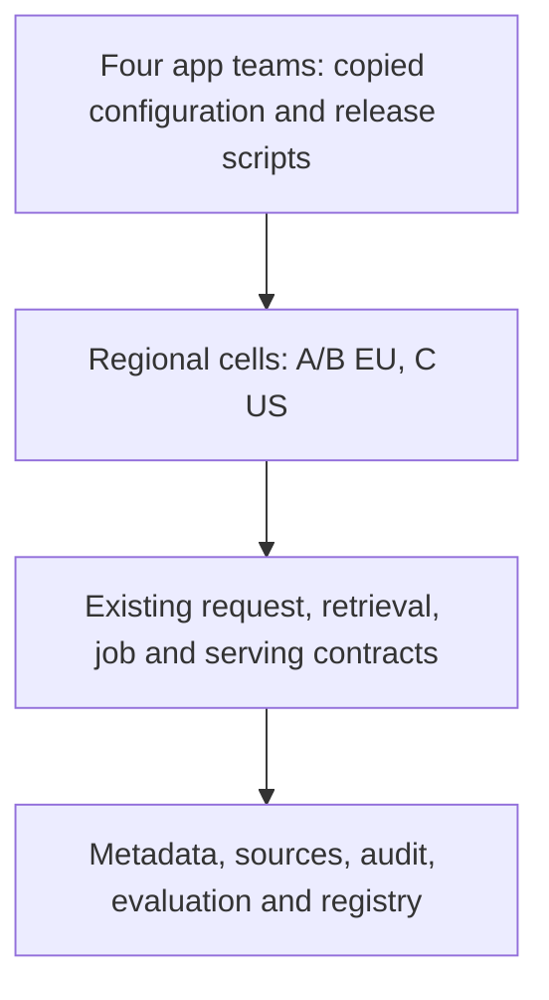
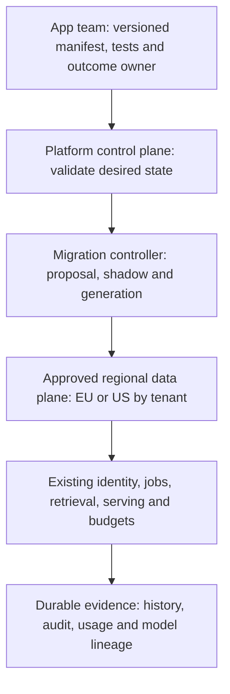

# Stage 12: Staff-Level Platform Architecture

Four internal teams now copy Alice's supplier workflow, each with its own route configuration and rollout scripts. One copy misses the EU placement check. Another changes the model alias without binding evaluation evidence. The platform team needs shared contracts and a migration path that preserves tenant guarantees while application teams keep control of supplier behaviour.

The team counts, hours, costs, thresholds, and schedules are illustrative design inputs. This capstone synthesises actual authored Stages 1–11 and their local test boundaries. It does not turn those fixtures into a deployed platform. Estimated integrated study: eight to ten hours; learner mastery remains unassessed.

## 1. Understand the Problem

### Start From the Actual Stage 11 System

Read [Stage 11](../11-multi-region/guide.md), [its state](../11-multi-region/stage-state.json), and [snapshot](../11-multi-region/architecture-after.md). Alice and Tenant B use approved EU cells; Tenant C uses US-home. Home-cell ownership, fenced promotion, current policy/audit, approved model artifacts, finite capacity, and uncertain-operation recovery govern regional service. The regional worksheet is not an actual network deployment.

Carry forward authenticated API roles, durable result/history, jobs and epochs, authorised ingestion/search, current version/tombstone checks, immutable caches, bounded fair admission, approved egress, data-class consistency, evaluation/release bundles, gateway/model envelopes, dataset-to-model lineage, and regional cost evidence. Keep short drafting distinct from grounded policy answering. Centralising the platform cannot make prompt text enforce access or repair an unknown provider result automatically.



Before diagram. Existing architectural capabilities remain useful. Their ownership and integration contracts are duplicated; no evidence justifies replacing every component with a new service.

### Turn the Incident Into Requirements

Assume each of four teams spends 30 engineering hours/month maintaining duplicated infrastructure logic. An adoption candidate is a tenant-scoped application with a named owner, approved cell, evaluated bundle, request budget, retention policy, and observable outcome. Success means a new supplier app can follow a documented supported workflow without editing shared runtime code. It also means an emergency rollback cannot restore a forbidden model or wrong region.

Propose measurable acceptance criteria: every onboarded app has an accountable owner and versioned manifest; all seeded cross-tenant/residency/approval contract violations reject; one lost cutover acknowledgement preserves inspectable state; an injected pre-commit failure changes neither route nor generation; a pilot reconciles per-success cost and shadow outcomes before rollout. These are design/test criteria, not claimed production measurements. A one-day onboarding objective requires a later measured pilot.

| Module | Treatment | Depth, evidence, and boundary |
| --- | --- | --- |
| 1.1 Requirements and architecture methodology | Revisited from [Stage 1](../01-mvp/guide.md) | D3: translate supplier/customer constraints into platform acceptance criteria |
| 1.3 Design documentation and communication | Taught at mapped depth | D3: reviewable design memo, evidence ledger, audience-specific defence and change record |
| 3.3 Distributed architecture patterns | Taught at mapped depth | D2: modular service, cell, event and control/data-plane patterns with failure boundaries |
| 11.1 Fine-tuning fundamentals | Revisited from [Stage 10](../10-fine-tuning/guide.md) | D2: adapter remains conditional on behaviour evidence |
| 11.2 Fine-tuning platform architecture | Revisited from [Stage 10](../10-fine-tuning/guide.md) | D1: model creation is a separate governed workflow behind the platform contract |
| 11.3 Distributed training infrastructure | Revisited from [Stage 10](../10-fine-tuning/guide.md) | D0: D0 reminder only; training specialisation remains deferred |
| 14.1 Evaluation architecture | Revisited from [Stage 8](../08-evaluation-releases/guide.md) | D3: contract and outcome gates accompany migration comparisons |
| 14.3 Model and data lifecycle infrastructure | Revisited from [Stage 10](../10-fine-tuning/guide.md) | D2: manifest pins model/data lineage; retirement follows descendants |
| 15.2 SRE and production operations | Revisited from [Stage 7](../07-reliability-consistency/guide.md) | D3: regional SLO/runbook ownership continues after centralisation |
| 16.2 Cloud networking and deployment | Revisited from [Stage 11](../11-multi-region/guide.md) | D2: deployment targets must respect Stage 11 cell/network boundaries |
| 16.3 Internal AI developer platforms | Taught at mapped depth | D3: versioned app contract, paved workflow and durable migration-controller slice |
| 17.1 AI unit economics | Revisited from [Stage 11](../11-multi-region/guide.md) | D3: per-success cost persists in showback and platform adoption |
| 17.2 Infrastructure capacity planning | Revisited from [Stage 11](../11-multi-region/guide.md) | D2: cell capacity is planned independently of developer onboarding |
| 17.3 Architecture economics | Taught at mapped depth | D3: three-year TCO, break-even, sensitivity and opportunity-cost exercise |
| 18.1 Architecture decision-making | Taught at mapped depth | D3: weighted options, hard constraints, ADR portfolio and reversal triggers |
| 18.2 Platform evolution and migration | Taught at mapped depth | D3: inventory, shadow, single-writer cutover, rollback and retirement with fault tests |
| 18.3 Technical leadership through system design | Taught at mapped depth | D3: ownership, review, incident authority, disagreement resolution and capstone defence |

Outcomes: write a reviewable design decision, defend platform boundaries, test a migration controller, compare TCO with uncertainty, and lead an adoption review using evidence rather than technology preference.

## 2. Learn and Design

### Choose Abstractions That Preserve Guarantees

A shared application contract describes what a team supplies and what the platform promises. An internal developer platform provides that contract through supported templates, APIs, documentation, validation, deployment, and operational support. The first useful version can be a command and a manifest; a portal does not establish safe deployment.

Separate a control plane, which validates desired configuration and records decisions, from data planes, which serve regional customer requests. A control-plane outage freezes configuration changes; existing regional runtime can continue only while its independent policy/audit/budget authorities remain healthy and current. Do not send prompts through a new global platform controller merely to centralise ownership.

| Architecture option | Benefit | Cost and failure | Decision |
| --- | --- | --- | --- |
| Shared library plus templates | Fast adoption; low service overhead | Version drift, uneven rollout, policy copied into apps | Use for SDK/schema, not sole policy enforcement |
| Regional platform services plus versioned contracts | Central enforcement per cell; independent app workflows | Platform dependency, compatibility and on-call burden | Choose as logical target; reuse current services |
| One global request service | Fewer centrally managed endpoints | Global blast radius, residency coupling, control-plane dependency | Reject for A/B placement and cell isolation |
| Rewrite every role as a microservice | Independent scaling and team releases where needed | Network/transaction boundaries, more operations and migration risk | Extract only when measured ownership/scale requires it |

A modular monolith keeps logical roles in one deployable unit and reduces network contracts; service extraction can separate operational ownership and bottlenecks later. A cell limits a failure domain; it does not demand one microservice per box. Events work well for async ingestion and usage aggregation with idempotent consumers. Commands needing immediate authoritative policy or generation checks cannot rely on an eventual event consumer for their decision. An outbox connects a committed state change to eventual event delivery; it does not make external model calls exactly once.

For a decision exercise, score template-only, regional contracts, and global rewrite on delivery speed, isolation, operability, and evolvability, with weights 0.2, 0.3, 0.3, and 0.2. Assume scores 5/2/2/2, 3/5/4/4, and 1/1/2/3 respectively. Weighted totals are 2.6, 4.1, and 1.7. These scores expose assumptions; they do not prove the answer. Treat residency and current access as hard constraints before ranking options. If the global rewrite violates a hard constraint, a higher weighted score would not rescue it.

### Make the Developer Workflow Concrete

A production manifest should include schema version, trusted application ID, tenant mapping, owner/on-call, allowed cell, evaluated release bundle, source connector references, purpose/retention, quota/deadline envelopes, secret references, and outcome instrumentation. Separate desired application configuration from centrally enforced tenant policy. A manifest may request a region or model; server policy decides eligibility. Never accept provider credentials, raw datasets, or an arbitrary destination URL in that interface.

Developer steps: create an app from a minimal supplier template; declare the manifest; run contract checks and frozen task evaluation; request sandbox deployment in the approved cell; inspect validation/reconciliation status; shadow eligible read-only work under authorised data/egress/budgets; request pilot promotion; observe outcomes; increase the cohort under a reversible generation-checked change. Tenant-specific behaviour lives in prompts, tools, retrieval configuration, and approved adapters rather than forks of the policy service.



After diagram. New platform abstractions wrap existing regional contracts. They do not replace resource authority, result persistence, model release approval, or regional promotion fencing.

Propose `POST /v1/apps/{app}/changes` with a 16 KiB manifest limit and an operation key up to 128 characters. Bind verified app-owner or delegated operator identity to trusted tenant/app scope. Validate schema, ownership, approved region/bundle, secret references, and bounded budget against current server policy. Scope key uniqueness to tenant, app, subject, endpoint, and key; conflicting canonical payload is `409`. Commit a proposed change before `202 {change_id,state,generation}`. Invalid manifest is `400`, forbidden change `403`, invisible app `404`, bounded controller admission `429`, and unavailable authority `503`. Same-key retries inspect the persisted change, rather than submit another migration. Status reads return current generation and named blockers; success at proposal time means recorded intent, not deployed service.

The runnable SQLite slice deliberately reduces the schema to tenant/app/owner/region/bundle/budget. It scopes durable keys by tenant/app/key and assumes a trusted caller. It has no HTTP, real identity, actual rollout, region enforcement, request budget enforcement, or remote fencing. Production ownership/subject checks and full manifest fields remain integration requirements.

### Checkpoint 1: A Portal That Bypasses Runtime Policy

A team can self-serve a deployment but its manifest supplies the final provider URL. Has onboarding become safe?

<details>
<summary>Reveal after answering</summary>

No. Resolve an allowlisted profile from current tenant policy, and reject arbitrary destinations. A convenient control plane cannot replace the regional runtime's current source, audit, release, route, and budget checks. Record a denied onboarding attempt without exposing secrets or content.

</details>

## 3. Observe and Experiment

### Request Walkthrough

The [offline walkthrough](guide.html#request-walkthrough) traces migration intent through a controlled route change, including mismatch and revoked-old-route branches.

```mermaid
sequenceDiagram
 participant A as App owner
 participant P as Platform controller
 participant S as Shadow comparison
 participant D as Durable route authority
 participant R as Regional runtime
 A->>P: Scoped manifest and stable change key
 P->>D: Commit proposed immutable request identity
 P->>S: Authorised read-only comparison, no business effects
 S-->>P: Bound sample and mismatch evidence
 alt Current eligibility and pilot evidence pass
 P->>D: CAS generation; store previous route and new route atomically
 D-->>A: Inspectable committed generation
 R->>R: Existing runtime enforces current access and operation identity
 else Failed evidence or revoked target
 P-->>A: Block; retain current route
 end
```

Sequence diagram. Compare-and-swap (CAS) changes a pointer only if its expected generation still matches. It prevents stale local metadata updates, not an unfenced old region from writing.

| Step | Responsible component and input | Output and possible failure |
| --- | --- | --- |
| Propose | App owner/controller receives manifest and key | Durable proposed record; invalid scope/region/bundle rejects |
| Compare | Shadow runner receives eligible read-only examples | Matched/mismatched counts; side-effectful work is forbidden |
| Review | App and platform owners inspect evidence and current eligibility | Pilot decision; low sample or mismatch blocks |
| Cut over | Route authority receives expected generation | Atomic old/new pointer and generation; stale generation rejects |
| Observe | Regional runtime serves existing stable operations | Customer outcome evidence; old uncertain calls are not replayed |
| Roll back | Operator verifies previous route remains currently eligible | Another generation-checked switch or explicit block |

### Migrate in Phases With Reversal Evidence

| Phase and illustrative timebox | Owner | Gate | Reversal or stop |
| --- | --- | --- | --- |
| Week 1: inventory contracts and copied behaviour | Staff engineer plus app leads | Every operation, data class, owner and caller identified | Stop if current guarantees are unknown |
| Week 2: validate manifests and generate plans | Platform team | Invalid scope, region, model and quota requests reject | Keep existing runtime authoritative |
| Week 3: shadow eligible read-only supplier flows | App owner plus security | Bound test population, no business effects, critical slices match | Stop shadow and retain evidence |
| Week 4: one app pilot in one approved cell | Release owner and SRE | Current eligibility, capacity and rollback rehearsal | Compare-and-swap route back if eligible |
| Later: expand cohorts and retire duplicated paths | App leads and platform owner | Outcome/cost agreement, no unresolved unknown effects | Pause adoption; retain original IDs and data |

Use a strangler migration: route selected new work through the new contract while the old path remains for unconverted work. Keep one authoritative writer and stable operation IDs. Avoid dual writes to independent result stores; an outbox plus replayable projection is safer where eventual views suffice. Schema changes should add compatible fields first, migrate readers/writers, verify backfill, then remove old fields after the reversal window. A route rollback cannot undo a destructive schema migration, erase a tombstone, or revoke a remote side effect.

Production shadow comparison must bind manifest, release bundle, population, evaluator, source policy, and time window. It must not send protected content to an unapproved route, consume unbounded quota, or invoke business tools twice. The local fixture accepts trusted comparison counts; 100 zero-mismatch examples are a deterministic demonstration gate, not statistical proof of safety. Changed bundles or policy require fresh evidence and eligibility checks.

### Calculate Total Cost of Ownership

Total cost of ownership (TCO) adds operating cost, migration, support, and expected change effort over an explicit horizon. It differs from Stage 11's per-success cost because it compares organisational architecture choices, including engineering opportunity cost. Count shared costs consistently across options and avoid claiming savings from costs that remain.

Assume a three-year horizon without discounting, common serving spend of $20,000/month in both options, and a loaded planning labour rate of $100/hour. Four independent teams spend 30 hours/month each on duplicated platform work: 120×$100=$12,000/month. A shared platform spends 50 hours/month on operations plus 20 hours/month on adoption/support: $7,000/month. It also adds $1,000/month control-plane infrastructure. Net savings are $12,000−$8,000=$4,000/month. Assume 600 one-time migration hours=$60,000.

Independent three-year TCO is 36×($20,000+$12,000)=$1,152,000. Shared TCO is $60,000+36×($20,000+$8,000)=$1,068,000. Difference is $84,000, with break-even after $60,000/$4,000=15 months. These assumptions exclude tax, discounts, financing, and revenue impact. Keep them labelled, and ask finance which costs are avoidable and which merely move between teams.

If migration doubles to 1,200 hours, break-even moves to 30 months and three-year savings fall to $24,000. If support rises from 20 to 60 hours/month, monthly operating savings fall to zero and break-even never occurs within the model. A team able to ship important customer work sooner has opportunity value, but do not invent a dollar revenue benefit. Add measured adoption, incident load, and delivery evidence before making that claim.

### Lab: Is Migration Economically Reversible?

Open the [offline lab](guide.html#lab). Change migration effort (0–1,200 hours), monthly shared operations/support (30–150 hours), and planning horizon (12–60 months). Fixed assumptions are 120 baseline hours/month, $100/hour labour, $1,000/month incremental control infrastructure, and common $20,000/month serving. Outputs separate net monthly savings, break-even, and horizon TCO. Negative savings remain negative; zero savings never produces a divide-by-zero or a zero-month payback.

| Preset | Inputs | Expected |
| --- | --- | --- |
| Baseline | 600 migration hours, 70 shared hours/month, 36 months | $4,000 monthly savings; 15-month break-even; $84,000 horizon savings |
| Costly migration | 1,200 hours, 70 hours/month, 36 months | 30-month break-even; $24,000 savings |
| Support burden | 600 hours, 110 hours/month, 36 months | Zero monthly savings; no break-even; $60,000 extra cost |

Run from repository root with Python 3.10+ and Node:

```sh
python3 10_AI_System_Design/stages/12-staff-platform/labs/test_platform.py
node 10_AI_System_Design/tools/test_simulator.cjs 10_AI_System_Design/stages/12-staff-platform
```

The SQLite controller persists proposal identity, records trusted shadow counts, rejects side-effectful comparison, checks a fixed sample/mismatch floor, and atomically changes route plus generation. It tests durable restart, lost acknowledgement inspection, stale updates, policy blockers, cross-tenant lookup, rollback eligibility, and injected pre-commit failure. Current eligibility booleans stand in for trusted evaluation; actual service composition and artifact attestation remain unchecked. The controller never migrates a result row or executes a customer request.

Inject `fail_before_commit=True` at cutover. Expect `injected pre-commit failure`, original route and generation unchanged after reopening the database, and a later valid cutover to succeed. After a committed cutover with a lost acknowledgement, inspect the same proposal and route generation; do not run another cutover with the old generation. Observe stale-update count, blocked proposals, shadow mismatch by bounded slice, time spent in each phase, pilot customer outcomes, incident burden, and cost reconciliation.

### Checkpoint 2: The Previous Route Is Now Forbidden

A canary fails, but the old model's data approval has been revoked. Should rollback ignore current eligibility to restore availability?

<details>
<summary>Reveal after answering</summary>

No. A historical approved pointer is not present permission. Block that rollback, keep unsafe work unavailable, and choose another currently approved route or repair the release. Neither the migration controller nor an incident commander may silently restore revoked data purpose or wrong-region handling.

</details>

## 4. Think Like a Staff Engineer

### Define Ownership and Review Authority

| Boundary | Accountable owner | What the owner proves |
| --- | --- | --- |
| Customer task, prompt/tool behaviour and outcome | App team | Supplier acceptance cases, safe business effects, support escalation |
| Identity, data purpose, policy and exception rules | Security/data owner | Current resource access, retention, approved provider/region constraints |
| Shared API, gateway, fair budgets and manifest compatibility | Platform team | Contract versions, rollout compatibility, operational limits |
| Model datasets, candidate lineage and evaluations | Model operations with app reviewer | Approved examples, reproducible evidence, retirement descendants |
| Regional data durability, promotion and restoration | Database/SRE owner | Writer fencing, watermarks, restore exercises and capacity |
| Architecture decision and migration gates | Named decision owner | Alternatives, dissent, hard constraints, evidence and reversal trigger |

The app owner accepts customer behaviour; the platform owner accepts contract and capacity changes; the data/security owner accepts purpose and isolation; the incident commander coordinates during an outage. Keep one named accountable owner per decision rather than a committee owning everything. Use a weekly pilot review and monthly cost/capacity review in this hypothetical operating model. Emergency changes still record identity, current eligibility, generation, reason, and post-incident follow-up.

SLOs (service level objectives) need a specified population, window, and valid outcome. App completion/quality, platform request availability, policy/audit freshness, and recovery exercises have different owners and indicators. Exhausted error budget pauses risky rollout according to an agreed policy; it does not disable authorisation. Agree incident escalation and support handoffs before an app leaves the pilot.

### Write the Design Memo and Decision Portfolio

A reviewable memo starts with the supplier incident and requirements, names scope and assumptions, shows before/after and request sequence, compares credible options, quantifies budgets/TCO, identifies failure and security boundaries, and ends with owners, migration gates, reversal criteria, and evidence gaps. A product leader needs customer effect and staged cost; an SRE needs failure and recovery; a security reviewer needs every data copy and authority boundary. Use one factual core with audience-specific emphasis, rather than contradictory diagrams.

| Decision portfolio | Still accepted constraint | Trigger for a new decision |
| --- | --- | --- |
| [ADR-001](../../architecture/decisions/ADR-001-synchronous-mvp.md), [ADR-002](../../architecture/decisions/ADR-002-durable-execution.md) | Commit saved success; durable jobs and unknown-effect recovery | Changed persistence or execution guarantees |
| [ADR-003](../../architecture/decisions/ADR-003-versioned-retrieval.md), [ADR-004](../../architecture/decisions/ADR-004-stateless-scale-and-cache.md) | Current authorised source versions; immutable caches; shared authority | Measured retrieval or persistence bottleneck |
| [ADR-005](../../architecture/decisions/ADR-005-bounded-fair-dispatch.md), [ADR-006](../../architecture/decisions/ADR-006-trusted-enterprise-boundaries.md) | Finite fair budgets and trusted audited disclosure | New isolation or workload policy |
| [ADR-007](../../architecture/decisions/ADR-007-consistency-and-recovery.md), [ADR-008](../../architecture/decisions/ADR-008-versioned-quality-releases.md) | Data-class consistency and version-bound quality releases | Stronger recovery or changed gate evidence |
| [ADR-009](../../architecture/decisions/ADR-009-approved-inference-boundaries.md), [ADR-010](../../architecture/decisions/ADR-010-governed-model-customisation.md) | Approved inference route and governed model lineage | Measured serving/training requirement change |
| [ADR-011](../../architecture/decisions/ADR-011-residency-aware-regional-cells.md), [ADR-012](../../architecture/decisions/ADR-012-versioned-regional-platform-contracts.md) | Eligible regional cells and controlled platform adoption | Zero-loss/global-write requirement or failed adoption economics |

Keep accepted ADRs immutable apart from supersession metadata. A new decision records changed assumptions and references the old one. Do not rewrite history to make the current design look inevitable.

### Interview 1: Defend the Platform Boundary

Prompt: Why centralise configuration but retain regional request handling?

Spoken answer: “The recurring incident is inconsistent enforcement across copied app integrations. I would centralise validation and supported contracts while keeping customer data and execution inside approved regional cells. Current policy, audit, budgets, and saved operation identity remain runtime checks. I would reuse existing logical services and extract deployment units only where ownership or measured bottlenecks justify it. A global control outage should freeze configuration, rather than stop otherwise authorised regional work.”

Trade-off: contract compatibility and platform on-call replace some duplicated app work. Follow-up: a new region must demonstrate its own data, provider, capacity, and recovery eligibility.

### Interview 2: Defend the Migration Against Dual Writes

Prompt: A reviewer proposes writing every answer to old and new databases for safety.

Spoken answer: “I would ask which store is authoritative and what happens when only one write commits. Independent dual writes can fork saved answers and operation keys. I would prefer one writer, additive schema changes, and replayable projections where eventual views suffice. The pilot changes routing with an expected generation and records the old route atomically. A rollback changes future eligible work; it does not erase uncertain external calls or undo incompatible data migrations.”

Trade-off: phased compatibility takes longer than a one-time rewrite. Follow-up: if the schema cannot be reversed, stop before cutover and design an explicit forward-repair path.

### Interview 3: Defend the Cost Case

Prompt: Finance challenges the $84,000 three-year savings.

Spoken answer: “I would show the inputs separately: 120 duplicated hours/month, 70 shared hours, $100/hour, $1,000 incremental infrastructure, and 600 migration hours. Common serving spend cancels in the comparison but stays in total cost. At those assumptions the monthly saving is $4,000 and break-even is 15 months. If support grows by 40 hours/month, savings disappear. I would validate pilot effort and avoid claiming revenue gains from hypothetical faster delivery.”

Trade-off: centralisation may improve policy consistency even when labour savings are weak. Follow-up: compare that benefit against measured incidents and customer obligations rather than fabricated ROI.

### Interview 4: Lead a Disagreement

Prompt: One senior engineer wants microservices everywhere; another wants only a shared library.

Spoken answer: “I would agree hard constraints first: EU data handling, current access, durable operations, and bounded model capacity. Then I would compare each option on delivery, ownership, failure isolation, compatibility, and cost. The library helps adoption but cannot be our sole runtime authority. Separate services help only where independent operation has value. I would choose a reversible pilot, record dissent and rejection reasons, name the decision owner, and set a measurable revisit trigger.”

Trade-off: time-boxed alignment still leaves a responsible owner making a decision. Follow-up: a missed pilot gate pauses rollout instead of changing the acceptance criteria after the result.

### Capstone Defence and Verified Coverage

Run a 45-minute review: five minutes for requirements, ten for architecture and request flow, ten for outage/deletion/unknown-outcome challenges, ten for migration/economics, and ten for critique. Ask the reviewer to change one constraint: zero data loss, lost policy authority, revoked old adapter, or double support demand. Record the changed decision, evidence needed, accountable owner, and next verification step.

The source map contains 56 modules across 18 domains and 12 stages. [Actual coverage](../../progress/coverage-status.csv) records authored and checked content, not personal mastery. Stages 10 and 11 add seven first-taught modules, including D0 distributed-training context; Stage 12 adds seven. A map row or green local fixture cannot establish a production deployment or distributed-systems implementation.

Remaining gaps are concrete: actual identity/private routing, deployed relational authority and distributed fencing, crash/power-loss/backup tests, real brokers and reconciliation, representative model evaluations, real training/checkpoint restore, provider/GPU capacity and invoices, end-to-end regional recovery, load/SLO evidence, external security review, screen-reader assessment, and learner assessment. GPU kernels, distributed optimiser implementation, pretraining, and machine-unlearning research remain deferred specialisations. Prioritise the first pilot's real integration risks before expanding that optional research track.

## 5. Validate and Carry Forward

### Recall and Exit Gates

1. What does the platform own? Shared contracts, enforcement integration and supported operation; the app team still owns supplier behaviour and outcomes.
2. What does generation checking prevent? Stale metadata pointer updates; it does not fence remote writers.
3. Why can rollback be blocked? The previous route may violate current policy, model approval, geography, or readiness.
4. When does the baseline platform pay back? After 15 months under the declared assumptions, with no discounting.
5. What distinguishes coverage from mastery? Authored/checked lessons provide evidence to study; only learner demonstrations assess the exit gates.

60-second card: start from the incident; preserve runtime guarantees; choose versioned contracts and cells; separate control from execution; compare hard constraints before scores; pilot with one writer; inspect uncertain outcomes; recheck rollback eligibility; count migration/support cost; name owners and revisit triggers.

### Evidence and Carry Forward

Read the [stage plan](stage-plan.md), [architecture snapshot](architecture-after.md), [decision](../../architecture/decisions/ADR-012-versioned-regional-platform-contracts.md), [state](stage-state.json), [validation](validation.md), and [actual coverage](../../progress/coverage-status.csv). The [curriculum map](../../progress/curriculum-map.json) records targets. Local content verification and learner completion are separate. This is the requested final stage. The next action is the capstone defence and an evidence-led pilot, not an unrequested Stage 13.

Review after about one, seven, and 21 days. Stop when you can explain the change in two minutes, draw it within the inherited platform, defend two alternatives, and diagnose a fault from an observable signal. For D3 modules also build, test, and debug the representative slice. These learner gates remain unassessed. Production integrations and deployment controls described here are proposals unless the validation report explicitly records an executed check.
