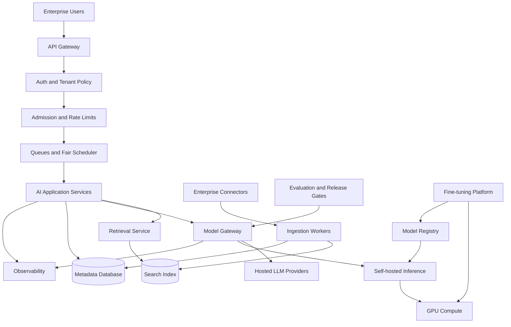
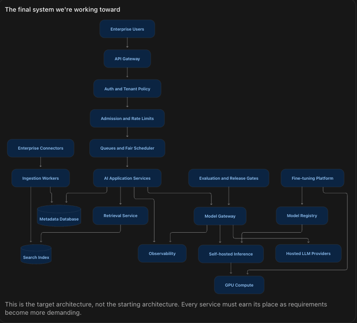

Yes. In fact, I recommend restructuring the entire roadmap around one evolving, production-grade AI system, rather than teaching 56 modules independently.

This would make the learning much more practical. Readers would understand not just what Redis, Kafka, rate limiting, GPU scheduling, or distributed consistency do, but why they are needed, how they connect, and what breaks when they're missing.

I would call this approach Architecture-Driven Learning.

# 1. The central idea: Build one complex AI system from zero to production

I recommend using a single flagship case study throughout the entire curriculum.

## Flagship project: Enterprise AI Platform

Imagine you are the Staff FDE at an AI company. A large enterprise customer wants an AI platform that can:

- Serve thousands of employees across multiple departments.
- Connect to SharePoint, Google Drive, databases, and internal APIs.
- Provide an AI-powered knowledge assistant with enterprise search.
- Support different LLM providers and custom fine-tuned models.
- Process large document collections asynchronously.
- Maintain user identity, permissions, and tenant isolation.
- Handle thousands of concurrent requests with low latency.
- Provide centralized evaluation, observability, security, and cost management.
- Eventually support private deployments and self-hosted inference.

We'll evolve this architecture from a simple MVP into a sophisticated multi-tenant AI platform.

The final system we're working toward:





This is the target architecture, not the starting architecture. Every service must earn its place as requirements become more demanding.

# 2. The new roadmap: 12 connected architectural stages

Each stage starts with a real customer requirement or production problem. That problem introduces several related system-design concepts.

| Stage                           | What we're building or solving                           | Main concepts introduced                                              |
| ------------------------------- | -------------------------------------------------------- | --------------------------------------------------------------------- |
| 1. The MVP                      | Build a basic enterprise AI application                  | API design, backend architecture, databases, request lifecycle        |
| 2. Distributed execution        | Handle long-running operations and background processing | Async, queues, workers, idempotency, distributed state                |
| 3. Enterprise knowledge         | Connect and search millions of documents                 | Ingestion, CDC, indexing, vector/keyword search, ACLs                 |
| 4. Scale the application        | Support thousands of concurrent users                    | Load balancing, caching, autoscaling, capacity estimation             |
| 5. Handle overload              | Prevent traffic spikes from crashing the platform        | Backpressure, bounded queues, rate limiting, fair scheduling          |
| 6. Enterprise security          | Support multiple companies and enforce their policies    | OAuth, RBAC/ABAC, isolation, identity propagation, private networking |
| 7. Reliability and consistency  | Survive crashes, stale reads, and provider outages       | Replication, consistency models, circuit breakers, retries, failover  |
| 8. Production AI quality        | Safely upgrade models and measure correctness            | Evaluation, golden datasets, observability, canaries, release gates   |
| 9. Model-serving infrastructure | Introduce provider routing and self-hosted models        | Inference, batching, GPU allocation, model serving                    |
| 10. Customization at scale      | Allow customers to fine-tune their own models            | Fine-tuning, data/version management, training jobs, model registry   |
| 11. Multi-region platform       | Support global enterprise customers                      | Regional routing, data residency, disaster recovery, cloud networking |
| 12. Staff-level architecture    | Evolve the MVP into a reusable, cost-efficient platform  | Platform abstractions, FinOps, trade-offs, migration, leadership      |

Each stage would use the concepts from the original roadmap, so we preserve coverage while changing how the material is taught.

# 3. How one stage would actually work

Consider Stage 5: Handle Overload and Fair Scheduling.

We begin with the architecture built in Stages 1–4, then introduce a new problem.

CUSTOMER SCENARIO

Your enterprise AI platform is running in production.

Three customers share the same AI service. Customer A suddenly sends 700 requests per second. Customers B and C send 150 requests per second each.

The shared downstream model provider can sustain only 600 requests per second for this assumed workload.

# 700

Tenant A · RPS

# 150

Tenant B · RPS

# 150

Tenant C · RPS

Incoming traffic

# 1,000 RPS

Available capacity

# 600 RPS

The challenge: How do you protect Customers B and C, meet latency targets, and prevent unbounded queue growth?

Instead of giving the learner a disconnected list of scheduling algorithms, we'd teach them in a problem-solving sequence:

1. First, understand the failure.

   Explain arrival rate vs service rate, queue depth, and why a FIFO queue can grow without bound. Show what happens without any protection.
2. Introduce bounded queues and backpressure.

   Explain how rejecting or slowing incoming work protects the platform. Add admission control to the existing architecture.
3. Introduce tenant fairness.

   Show why a shared FIFO queue can give Tenant A disproportionate access. Compare Round Robin, priority, and Weighted Round Robin with an interactive scheduling experiment.
4. Add production constraints.

   What happens when requests have different token counts? What if the premium tenant pays more? What if the provider returns HTTP 429?
5. Update the architecture.

   Add tenant-aware queues, a fair scheduler, concurrency limits, request deadlines, and monitoring. Explain the role of every component.
6. Conduct the Staff interview.

   Challenge the learner with a sudden 10× traffic increase, premium-customer SLOs, and a failed provider. Require architectural justifications.

The learner finishes the stage understanding how queuing, fairness, backpressure, admission control, provider capacity, and observability work together.

# 4. Every chapter should follow the same learning structure

I would modify the existing content-generation skill to enforce this format.

1. Previously built architecture: A short recap of the existing system, showing only relevant components.
2. New requirement or failure: A realistic customer request, production incident, or scale constraint.
3. What breaks and why: Explain the problem before introducing a solution.
4. Concepts introduced: Simple theory, intuitive analogies where useful, and relevant equations.
5. Design alternatives: Compare 2–3 legitimate approaches, including when each is appropriate.
6. Architecture evolution: Show a before-and-after diagram and the end-to-end request or data flow.
7. Visual lab: Interactive simulation, step-through diagram, or small executable exercise when it materially helps.
8. Production considerations: Reliability, security, scalability, observability, and cost.
9. Staff interview: Questions, concise model answers, and follow-up challenges.
10. Knowledge checkpoint: Completion criteria, revision card, and what to carry into the next stage.

## 5. How we avoid excessive depth and poor retention

The new roadmap should preserve your D0–D3 depth system.

| Depth                   | Treatment in the integrated course                                               |
| ----------------------- | -------------------------------------------------------------------------------- |
| D3 — Master            | Explain, design, integrate, debug, quantify, and defend; include a practical lab |
| D2 — Design            | Explain, compare, diagram, identify failure modes; small exercises only          |
| D1 — Working knowledge | Short conceptual explanation linked to the system; no implementation requirement |
| D0 — Defer             | Mention only as an extension or specialization                                   |

For example, when Stage 9 introduces GPUs, we should learn enough about GPU memory, batching, throughput, and serving architecture to make good infrastructure decisions. We should not interrupt the course with several days of CUDA programming.

That keeps the entire learning journey focused on Staff FDE and Applied AI engineering rather than becoming an infrastructure research curriculum.

## 6. The key change: One evolving architecture repository

I also recommend making the curriculum work like a real engineering project.

Suggested learning repository

```
enterprise-ai-platform/
├── roadmap.md
├── architecture/
│   ├── current-system.md
│   ├── decisions/
│   └── diagrams/
├── stages/
│   ├── 01-mvp/
│   │   ├── guide.md
│   │   ├── guide.html
│   │   └── labs/
│   ├── 02-distributed-execution/
│   ├── 03-enterprise-retrieval/
│   ├── 04-scaling/
│   ├── 05-traffic-scheduling/
│   └── ...
├── system-design-interviews/
├── revision-cards/
└── capstone/
```

The Markdown and HTML versions would contain matching theory, architecture diagrams, and examples. HTML would additionally provide interactive labs, step-through animations, and optional checkpoints.

The important part is that every chapter updates the same system rather than drawing unrelated examples.

## 7. A further improvement: Architecture decisions become part of the lesson

At the end of every stage, the reader records decisions such as:

- Why we selected asynchronous processing over synchronous execution.
- Why we introduced Redis caching only after measuring repeated reads.
- Why a bounded tenant queue is safer than an unlimited shared FIFO queue.
- Why authorization must be enforced on the server rather than relying on the model.
- Why hosted inference is initially preferable to maintaining a GPU fleet.

Later chapters can revisit those decisions as scale and requirements change.

This teaches an important Staff-level skill: an architecture is not a collection of best practices; it is a set of decisions made under constraints.

## 8. How I would roll this into the existing roadmap

I recommend keeping the 18 domains and 56 modules as a reference syllabus, but making the 12-stage system-design journey the primary learning path.

That gives you two complementary views:

- Learning path: Follow the evolving enterprise AI platform from MVP to production. This is how you study.
- Knowledge map: Browse any domain or module independently before interviews. This is how you revise.

Every topic gets a link to the stage where it is first taught, and to any later stage where it is applied again.

For example, consistency models might first appear when handling distributed job state in Stage 2, then reappear when discussing replica reads in Stage 7, and again in multi-region design in Stage 11.

This deliberate repetition improves retention without repeating the same lecture three times.

My recommendation: Use this integrated architecture-driven approach as the main curriculum, while keeping the standalone topic guides as short reference materials. It should produce a much better understanding of real systems, stronger Staff-level interview answers, and less fragmented memorization.

The next concrete deliverable should be a Master Curriculum Blueprint that maps all 56 modules to the 12 stages, defines the system state before and after each stage, and specifies which diagrams, labs, and interview exercises each chapter should contain.
