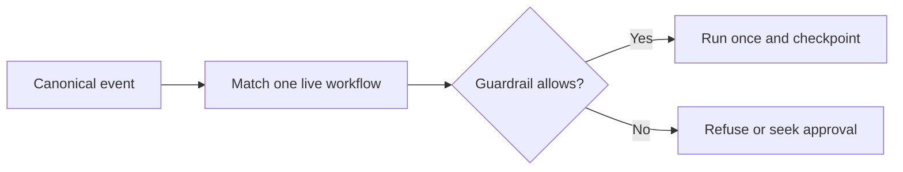

# Agent Platform for Non-Technical Users: Introduction

## Overview

A business wants support leads and other non-technical staff to build workflows across channels such as email and Slack that reply, tag, escalate or issue a refund, without writing code. The hard part is trust. A real action such as a refund must be authorised, executed once, and recoverable after a crash without paying twice.

The design turns each channel message into one canonical event carrying a tenant ID, matches it to one live workflow, and takes an entity lock so two workflows cannot collide. Workflows are versioned, declarative specs, and a model may fill only typed values. Every step checkpoints, idempotency is keyed on the run and step and checked before authorisation, and a guardrail denies in a fixed order, so a $500 refund against a $50 cap is refused, never clamped. A workflow earns autonomy one stage at a time, from draft through testing, shadow and live, and its author can never approve it alone.

The whiteboard anchor shares its engine with the Cascade Robotics project, which works the $500 refund through conflicting workflows and a runnable demo and names the implementation gaps.

## The core idea

A workflow acts only after deterministic code allows it, and each real action runs once.

## Who it is for

Engineers preparing for Forward Deployed, solutions or applied-AI engineering interviews, especially a round that asks you to design an agent or workflow-automation platform.

## Objectives

After this case you can:

- explain the system end to end at interview depth, starting from its dangerous constraint: a real action such as a refund must be authorised, executed once and recoverable after a crash;
- answer follow-up questions on authoring specs, routing and locks, the execution loop, idempotency, guardrail order, promotion gates and production gaps.

## What it assumes

Comfort with LLM agents and tool calling, idempotency, workflow state machines and basic multi-tenant cloud architecture. The related reviews at the foot of each section cover each one.

## How to use it

1. Read the three mandatory sections in order: Interview Guide, Technical Deep Dive, Quick Review.
2. Mark each part as read when you finish it. The case counts as done in your progress when every part is read.
3. Open the Full Design when you need a worked number, a source or the reasoning behind a step.
4. Come back to the Quick Review the night before the interview.

## The sections

| Section | What it is for | Interview prep |
|---|---|---|
| [Interview Guide](#main) | The answer you would talk through in the interview, from the questions to ask and the requirements to the architecture, the decisions an interviewer will probe, rollout and honest gaps, and a two-minute answer. Start here: it stands on its own. | Mandatory |
| [Technical Deep Dive](#deep-dive) | The detail behind each component, from the contract between authoring and runtime to routing and concurrency, one execution loop with action-level idempotency, guardrail order and the $500 story, and promotion evidence and production gaps. Read it after the Interview Guide, to answer follow-up questions. | Mandatory |
| [Quick Review](#cheat-sheet) | The whole case on one page: the questions to ask first, the whiteboard path, five rules and the failure story, for recall before the interview. | Mandatory |
| [Full Design](#full-pack) (4 parts) | The complete, referenced write-up the other sections were drawn from: the $500 refund anchor, routing, typed control flow, checkpoints, idempotency, deny order, the autonomy gates, the Cascade Robotics example, a sixty-minute delivery plan, stopping runaway automations and the sources. | Optional |
