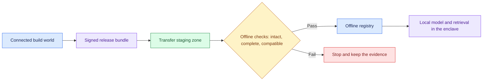

# AI System for an Air-Gapped Environment: Introduction

## Overview

A customer runs an enclave with no route to the outside world and wants AI inside it, kept running by their own people. Analysts need answers from documents that can never leave the enclave, and every model, index and package has to arrive through an approved transfer.

The hard constraint is the boundary. Nothing crosses the enclave's network, artifact, identity or audit boundaries at runtime, so the system cannot fetch a model, a package or a telemetry endpoint when it needs one. A release that is missing one dependency has to fail before it is installed, not once it is live.

The design splits into a connected build world and an offline runtime. Signing and a transfer staging zone are the only bridge between them, an offline registry is the one system of record for what can be deployed, and each release ships as a signed manifest that lists every artifact hash.

## The core idea

Build outside, prove the bundle offline, then deploy inside. Nothing at runtime reaches out.

## Who it is for

Engineers preparing for Forward Deployed, solutions or applied-AI engineering interviews, especially a round set in a regulated, defence or on-premises setting, where the customer controls the hardware and nothing may call out.

## Objectives

After this case you can:

- explain the design end to end at interview depth, starting from its outcome line: maintainable AI that runs locally and never crosses the enclave's boundaries;
- answer follow-up questions on GPU sizing against a fixed pool, signed releases and dependency checks, failure policies, local-only observability and rolling out across the air gap.

## What it assumes

Comfort with retrieval-augmented generation, serving a model on your own GPUs, and basic release engineering: artifact registries, signing and rollback.

## How to use it

1. Read the Tutorial, one part at a time. It is the full lesson, from the customer problem to the interview walkthrough.
2. Answer the Practice Worksheet without looking back at the Tutorial.
3. Compare your answers with the Model Answer, then reread the Tutorial parts where yours fell short.
4. Mark each part as read when you finish it. The case counts as done in your progress when every part is read.
5. Come back to the level calibration in the Tutorial's last part the night before the interview.

## The sections

| Section | What it is for | Interview prep |
|---|---|---|
| [Tutorial](#tutorial-v2) (8 parts) | The full lesson: discovery, requirements, sizing, the architecture, data model and code, failure handling, delivery and the interview walkthrough, then the key takeaways and level calibration. | Mandatory |
| [Practice Worksheet](#worksheet) | The case as a blank interview prompt to answer yourself, from the customer problem to a rollout plan and a scorecard. | Mandatory |
| [Model Answer](#answer-key) | What a strong answer covers, with weak, average and strong versions, the interviewer's scorecard and a two-minute spoken answer. | Mandatory |

## Practise it

The Practice Worksheet on this page is read-only. To save your answers as you write them, use the interactive [AI System for an Air-Gapped Environment worksheet](/practice/ai-system-for-an-air-gapped-environment).
