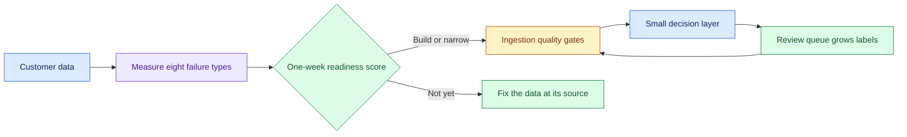

# Build When the Customer’s Data Is Poor: Introduction

## Overview

A customer wants value from AI this quarter, and its data is poor: missing fields, inconsistent labels, duplicates and gaps. The worked example is a warranty process. The tempting answers are to pick a model anyway or to refuse until the data is fixed.

The hard constraint is that the data can only prove what it contains. Poor data changes what gets built first, but it is no reason to refuse the work, and "not yet" is the right answer only when a measured defect blocks every route.

- The answer splits "poor" into eight failure types, each with its own measurement and remedy, and scores readiness in one week.
- The design is a data-repair pipeline with a small decision layer on top: quality gates quarantine bad records at ingestion, the review queue grows labels, and a small, trusted eval set exists before the labels are clean.
- Data fixes ship as phases of value.

## The core idea

Measure what is wrong with the data first, then build what it can already support.

## Who it is for

Engineers preparing for Forward Deployed, solutions or applied-AI engineering interviews, especially a customer scenario or decomposition round where the data is messy, sparse or untrusted.

## Objectives

After this case you can:

- explain the approach end to end at interview depth, from measuring data defects to a phased build;
- answer follow-up questions on readiness scoring, what to build anyway, ingestion gates, growing labels, building an eval set early, telling the customer their data is poor and the cost pivot.

## What it assumes

Comfort with data pipelines, labelling and model evaluation. It builds on the [Scoping to Deployed Agent](/design/scoping-to-deployed-agent) and [Evaluation and Release Gating](/design/evaluation-and-release-gating) cases, which it links rather than repeats.

## How to use it

1. Read the Interview Guide, one part at a time. It stands on its own.
2. Before you read section 3, list the ways the warranty data could be poor and how you would measure each.
3. Rehearse the 45-minute delivery plan in the guide's last part aloud, with a timer.
4. Mark each part as read when you finish it. The case counts as done in your progress when every part is read.
5. Come back to the level calibration and key takeaways in the guide's last part the night before the interview.

## The sections

| Section | What it is for | Interview prep |
|---|---|---|
| [Interview Guide](#guide) (3 parts) | The whole answer on one worked warranty example: the questions to ask, eight failure types, the one-week readiness score, what to build anyway, requirements, the architecture, ingestion gates, labels, the eval set, telling the customer, phasing, failure modes, a 45-minute delivery plan and the cost pivot. | Mandatory |
