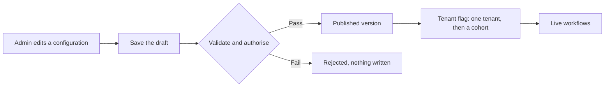

# Configurable Platform for Customer-Specific Workflows: Introduction

## Overview

Ten customers want the same workflow product, each with its own fields, approvals, branding and integrations. The room agrees on "one platform for similar workflows" and on little else, and the risk is ending up with ten forks of the codebase that nobody can upgrade.

The hard constraint is that customisation must be safe, versioned and supportable. No change may skip authorisation or switch on behaviour nobody reviewed, every tenant can see which definition is live, and support can trace a fault and roll a bad configuration back. Customer admins, not engineers, write much of the configuration.

The design splits a control plane, where configurations are written, validated, versioned and promoted, from the data plane that runs live workflows. Published versions never change, a tenant flag switches a version on for one tenant and then a cohort, and an append-only deployment ledger records which version is live, so a rollback is a new event rather than an edit.

## The core idea

Each configuration becomes a version that never changes; a per-tenant flag decides which version runs, and a rollback flips it back.

## Who it is for

Engineers preparing for Forward Deployed, solutions or applied-AI engineering interviews, especially a round on multi-tenant SaaS, low-code or workflow products, or any customer asking for "configuration" that could turn into a fork.

## Objectives

After this case you can:

- explain the platform end to end at interview depth, starting from its outcome: one stable product core, with customisation that is safe, versioned and supportable;
- answer follow-up questions on peak deployment load, validation at publish, idempotent deployment calls, sandboxed extensions, approval loops and tenant isolation.

## What it assumes

Comfort with multi-tenant SaaS, API design and idempotency, and basic release practice such as feature flags and rollback.

## How to use it

1. Read the Tutorial, one part at a time. It is the full lesson, from the customer problem to the interview walkthrough.
2. Answer the Practice Worksheet without looking back at the Tutorial.
3. Compare your answers with the Model Answer, then reread the Tutorial parts where yours fell short.
4. Mark each part as read when you finish it. The case counts as done in your progress when every part is read.
5. Come back to the level calibration in the Tutorial's last part the night before the interview.

## The sections

| Section | What it is for | Interview prep |
|---|---|---|
| [Tutorial](#tutorial-v2) (7 parts) | The full lesson: discovery, requirements, sizing, the architecture, data model and code, failure handling, delivery and the interview walkthrough, then the key takeaways and level calibration. | Mandatory |
| [Practice Worksheet](#worksheet) | The case as a blank interview prompt to answer yourself, from the customer problem to a rollout plan and a scorecard. | Mandatory |
| [Model Answer](#answer-key) | What a strong answer covers, with weak, average and strong versions, the interviewer's scorecard and a two-minute spoken answer. | Mandatory |

## Practise it

The Practice Worksheet on this page is read-only. To save your answers as you write them, use the interactive [Configurable Platform for Customer-Specific Workflows worksheet](/practice/configurable-platform-customer-specific-workflows).
