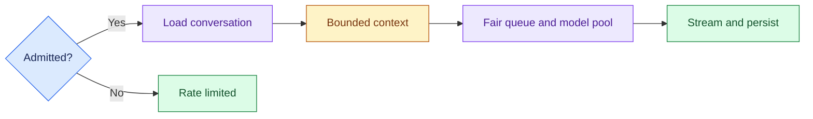

# Consumer-Scale Chat Service: Introduction

## Overview

- The prompt is to design a consumer chat assistant: many people, many turns, tokens streamed back, each conversation remembered, and a GPU bill that stays under control.
- The hard part is that the model is stateless while the product is not.
- The service must hold every conversation and send the model a bounded context.
- Every scale figure in the case is a whiteboard assumption, not a measured service fact.

- The design admits each request through a regional gateway with authentication, quotas and input moderation, loads the conversation, and sends only a summary, recent turns and relevant memory.
- A tier and task router places the turn on a fair queue in front of a continuously batched model pool, which streams the answer through output moderation and persists partial answers.
- A disconnect cancels model and tool work, and a stable prompt prefix on a warm replica saves prefill cost.

The variant that asks you to design the Claude chat service uses the same architecture, with more emphasis on batching, GPU capacity, queues and failover.

## The core idea

Store every turn, send the model only what this turn needs, and stream the answer back.

## Who it is for

Engineers preparing for Forward Deployed, solutions or applied-AI engineering interviews, especially a round that asks you to design a consumer chat product at scale.

## Objectives

After this case you can:

- explain the system end to end at interview depth, starting from its dangerous constraint: the model is stateless but the product is not, so every turn must be stored, scoped to its user and served within a GPU budget;
- answer follow-up questions on sizing, conversation state and context, streaming and cancellation, model routing, quotas and fair queues, moderation, regions and release gates.

## What it assumes

Comfort with LLM serving basics (tokens, batching and streaming), caching, rate limiting and basic cloud architecture. The related reviews at the foot of each section cover them.

## How to use it

1. Read the three mandatory sections in order: Interview Guide, Technical Deep Dive, Quick Review.
2. Mark each part as read when you finish it. The case counts as done in your progress when every part is read.
3. Open the Full Design when you need a worked number, a source or the reasoning behind a step.
4. Come back to the Quick Review the night before the interview.

## The sections

| Section | What it is for | Interview prep |
|---|---|---|
| [Interview Guide](#main) | The answer you would talk through in the interview, from the questions to ask and the requirements to the architecture, key trade-offs and failure modes, evaluation and rollout, and a two-minute answer. Start here: it stands on its own. | Mandatory |
| [Technical Deep Dive](#deep-dive) | The detail behind each component, from turning users into open streams to durable state with bounded context, streaming, cache and model routing, quotas, safety and regions, and release gates. Read it after the Interview Guide, to answer follow-up questions. | Mandatory |
| [Quick Review](#cheat-sheet) | The whole case on one page: the questions to ask first, the whiteboard path, the assumed sizing and five lines to remember, for recall before the interview. | Mandatory |
| [Full Design](#full-pack) (3 parts) | The complete, referenced write-up the other sections were drawn from: sizing from daily users down to GPUs, streaming and cancellation, tier routing, fair queues, two-way moderation, prefix caching, multi-region failover, release gates, a sixty-minute delivery plan, the cost pivot and the sources. | Optional |
