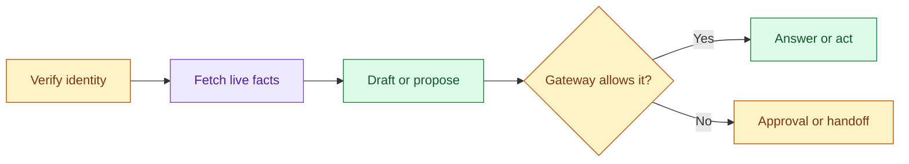

# Customer Support Automation: Introduction

## Overview

A company wants an assistant to answer, act on or hand off support requests from chat, email and voice, cutting handling time without more incorrect or harmful resolutions. A double-charge ticket shows the difficulty: the system must verify the customer, check live billing, apply the refund policy, avoid a duplicate refund and hand off cleanly when anything is uncertain.

- The design is a routed decision pipeline. It verifies identity before any account tool, fetches approved policy and live facts, and lets the model draft a reply or propose an action.
- A deterministic policy gateway then decides: safe answers go out, money waits for a human, and unclear cases reach an agent with a full handoff pack.
- Every write is idempotent.

This is the anchor case for support automation. The multi-tenant SaaS assistant, the ticket automation agent and the large-scale support assistant reuse the same pipeline and change which boundary dominates.

## The core idea

The model suggests, the policy gateway decides, and risky or uncertain work reaches a human with context.

## Who it is for

Engineers preparing for Forward Deployed, solutions or applied-AI engineering interviews, especially a round that asks you to design a support agent that can take actions on customer accounts.

## Objectives

After this case you can:

- explain the system end to end at interview depth, starting from its dangerous constraint: no refund or account change may happen on model confidence alone, only after verified identity and a policy gateway allow it;
- answer follow-up questions on identity, source authority, action safety, handoff, failure modes, evaluation, rollout and cost.

## What it assumes

Comfort with retrieval, LLM agents and tool calling, idempotent APIs and basic cloud architecture. The related reviews at the foot of each section cover each one.

## How to use it

1. Read the three mandatory sections in order: Interview Guide, Technical Deep Dive, Quick Review.
2. Mark each part as read when you finish it. The case counts as done in your progress when every part is read.
3. Open the Full Design when you need a worked number, a source or the reasoning behind a step.
4. Come back to the Quick Review the night before the interview.

## The sections

| Section | What it is for | Interview prep |
|---|---|---|
| [Interview Guide](#main) (2 parts) | The answer you would talk through in the interview, from opening with the risk to the decision table, actions and handoffs, failures, rollout and delivery. Start here: it stands on its own. | Mandatory |
| [Technical Deep Dive](#deep-dive) | The detail behind each component, from source authority and the state model to trust boundaries, budgets, incident drills and the release gate. Read it after the Interview Guide, to answer follow-up questions. | Mandatory |
| [Quick Review](#cheat-sheet) | The whole case on one page: the flow, five rules, the action table, the handoff payload and interview triggers, for recall before the interview. | Mandatory |
| [Full Design](#full-pack) (5 parts) | The complete, referenced write-up the other sections were drawn from: the deterministic gateway, safe degradation, the release gate, the variants, the cost pivot and the sources. | Optional |

## Practise it

When you have read the mandatory sections, try the [Customer Support Automation worksheet](/practice/ai-customer-support-automation). It asks you to produce the same design from a blank page, which shows what you can explain without the guide open.
