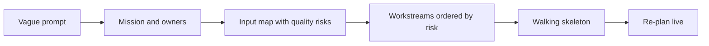

# Decomposition Classics: 911, Bank Fraud, Medication Errors: Introduction

## Overview

Three open prompts: cut 911 response times, unify fraud detection at a bank, and reduce medication errors in a hospital. None has a hidden right architecture. Each tests whether you pin down the mission before drawing anything.

The hard constraint is the clock. You have to commit to a plan early enough to show progress, and late enough that the mission, not the model, has chosen it. The round fails answers that start with architecture and answers that hand-wave evaluation.

The page teaches one six-step method on a sixty-minute clock, then runs it on all three prompts. Define the mission, name the owners, map every input with its owner and quality risk, order workstreams by the unknown most likely to kill the project, build a walking skeleton, and re-plan live. In all three the riskiest unknown is the data, and the language model is never the core.

## The core idea

Define the mission and map the inputs before any model, and let the riskiest unknown set the order of work.

## Who it is for

Engineers preparing for Forward Deployed, solutions or applied-AI engineering interviews, especially a problem decomposition or case study round with an open, non-technical prompt.

## Objectives

After this case you can:

- run the six-step method on any open prompt within a sixty-minute clock;
- decompose the 911, bank fraud and medication error cases, open each in two minutes, and answer the follow-up probes and the cost pivot.

## What it assumes

No deep technical background. It builds on the [Scoping to Deployed Agent](/design/scoping-to-deployed-agent) and [Logistics Exception Handling](/design/logistics-exception-handling) cases, which it names rather than repeats.

## How to use it

1. Read the first part for the method.
2. Before each case section, run the six steps on its prompt yourself, then compare.
3. Practise the two-minute openers in the last part aloud, with a timer.
4. Mark each part as read when you finish it. The case counts as done in your progress when every part is read.
5. Come back to the level calibration and key takeaways in the guide's last part the night before the interview.

## The sections

| Section | What it is for | Interview prep |
|---|---|---|
| [Interview Guide](#guide) (3 parts) | The method, then the three cases: what the round scores, the six steps, the input map, ordering workstreams, the 911 case, the bank fraud case, the medication error case, a side-by-side comparison, the follow-up probes, two-minute openers and the cost pivot. | Mandatory |
