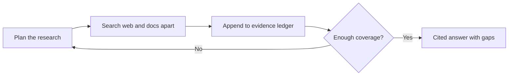

# Deep Research Agent: Introduction

## Overview

A consumer product wants a research agent that takes a question, searches the public web and the user's own documents, and returns a cited brief. The scale in the case is about 100,000 daily users and 40,000 research runs a day, with a p95 under 90 seconds, a first signal under 3 seconds and a cost of about $0.20 a run. The hard constraint is honesty under failure. When a source times out or the evidence is thin, the answer must say so, and private documents must never leak through the web branch or the rendered answer.

The design is a bounded, read-only multi-agent workflow. A planner splits the question; public-web workers and a separate user-scoped document worker search in parallel, and the web worker never holds private-document credentials. Findings go into a typed evidence ledger with an append reducer, and a coverage check can trigger a capped replan. A stronger model writes only from the ledger, a verifier checks every citation, and an egress sanitizer strips images and unapproved links. Hop, time and spend caps stop the loop, and a failed branch becomes a named gap.

## The core idea

Every run plans, searches in isolation, then either cites the evidence or shows the hole, and stops within its caps.

## Who it is for

Engineers preparing for Forward Deployed, solutions or applied-AI engineering interviews, especially a round that asks you to design a multi-agent research system or an agent that works over untrusted web content.

## Objectives

After this case you can:

- explain the system end to end at interview depth, starting from its dangerous constraint: a failed or thin branch must produce a visible gap, never fabricated certainty, and private documents must stay isolated from the web branch;
- answer follow-up questions on agent state and reducers, permission isolation, termination caps, latency and cost budgets, evaluation and rollout.

## What it assumes

Comfort with LLM agents and tool calling, retrieval with citations, and prompt injection from untrusted content. The related reviews at the foot of each section cover each one.

## How to use it

1. Read the three mandatory sections in order: Interview Guide, Technical Deep Dive, Quick Review.
2. Mark each part as read when you finish it. The case counts as done in your progress when every part is read.
3. Open the Full Design when you need a worked number, a source or the reasoning behind a step.
4. Come back to the Quick Review the night before the interview.

## The sections

| Section | What it is for | Interview prep |
|---|---|---|
| [Interview Guide](#main) | The answer you would talk through in the interview, from the questions to ask to the architecture, key choices and failure modes, and a two-minute answer. Start here: it stands on its own. | Mandatory |
| [Technical Deep Dive](#deep-dive) | The detail behind each component: permission and trust topology, agent state reducers, the latency and cost budget, quality checks and variants. Read it after the Interview Guide, to answer follow-up questions. | Mandatory |
| [Quick Review](#cheat-sheet) | The whole case on one page: the whiteboard path, numbers and limits, how to fail safely and what to evaluate, for recall before the interview. | Mandatory |
| [Full Design](#full-pack) (3 parts) | The complete, referenced write-up the other sections were drawn from: branch-safe state, sub-agent isolation, the trifecta analysis, bounding the loop, the supervisor-and-workers build, the cost-per-report pivot and the sources. | Optional |
