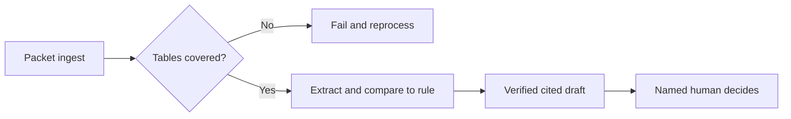

# Document Review Copilot: Introduction

## Overview

A team reviews document packets against a rule: a clinician checks a prior authorisation request against the payer's policy, a compliance reviewer checks a filing against an obligation, a lawyer checks a contract against the playbook. Reading is cheap; signing off is expensive. The hard constraint is that a draft must never claim more than the evidence says. A correct answer with the wrong citation, or an approval drafted from a table the parser never read, is a serious failure.

The design is a bounded review copilot. Ingestion stops any packet whose critical pages or tables were not extracted. For each case the copilot retrieves the rule version in force on the relevant date, a small model extracts typed fields with their spans, a deterministic check finds gaps, and a strong LLM drafts only flagged cases. A verifier checks each cited span, and a named human approves or rejects. Version one never submits anything on its own.

Prior authorisation is the anchor. Financial compliance, legal contract and claims-processing variants reuse the same spine and swap the schema, the governing rule and the approver.

## The core idea

The copilot extracts and drafts, while exact evidence and a named human decide what can be trusted or sent.

## Who it is for

Engineers preparing for Forward Deployed, solutions or applied-AI engineering interviews, especially a round that asks you to design a document extraction, compliance review or human-in-the-loop copilot.

## Objectives

After this case you can:

- explain the system end to end at interview depth, starting from its dangerous constraint: no draft may claim what its cited span does not support, and a human makes every material decision;
- answer follow-up questions on ingestion gates, rule versioning, extraction schemas, citation verification, sensitive data, evaluation, cost and rollout.

## What it assumes

Comfort with document parsing and OCR, retrieval with citations, structured extraction with LLMs and access control for sensitive records. The related reviews at the foot of each section cover each one.

## How to use it

1. Read the three mandatory sections in order: Interview Guide, Technical Deep Dive, Quick Review.
2. Mark each part as read when you finish it. The case counts as done in your progress when every part is read.
3. Open the Full Design when you need a worked number, a source or the reasoning behind a step.
4. Come back to the Quick Review the night before the interview.

## The sections

| Section | What it is for | Interview prep |
|---|---|---|
| [Interview Guide](#main) | The answer you would talk through in the interview, from the questions to ask and the architecture to the controls worth defending, the failure and cost playbook and an answer to rehearse. Start here: it stands on its own. | Mandatory |
| [Technical Deep Dive](#deep-dive) | The detail behind each component, from one spine with three schemas and the ingestion, permission and version seams to two incident drills: a right answer citing the wrong clause, and a PDF table never indexed. Read it after the Interview Guide, to answer follow-up questions. | Mandatory |
| [Quick Review](#cheat-sheet) | The whole case on one page: the flow, six rules, source examples, two incidents and the cost and rollout answer, for recall before the interview. | Mandatory |
| [Full Design](#full-pack) (4 parts) | The complete, referenced write-up the other sections were drawn from: the extraction schema, citation verification, the release gate, shadow rollout, the red-team round, the cost pivot and the sources. | Optional |
