# Enterprise Chatbot Platform: Introduction

## Overview

A company of 40,000 employees asks for its own ChatGPT, grounded in internal data and wrapped in enterprise controls. The real driver is an egress report showing 6,400 staff already pasting company data into consumer AI tools. The result owed is moving that use onto a governed platform, and the chatbot is only the feature.

The hard constraint is two bars that pull against each other. Governance means nothing leaves the company except under an agreement it holds, and every answer respects the asker's live permissions. Adoption means the first token arrives about as fast as the free tool on everyone's phone, or staff go back to it.

The design buys the model and builds orchestration, connectors and governance around it. It centres on the context assembler, where permissions, cost, safety and quality meet: each turn is re-authorised, retrieval is filtered against the asker's live permissions, streamed output is scanned for secrets, and every turn writes an audit record.

## The core idea

Every turn is checked against the asker's live permissions before the model sees any context, and audited afterwards.

```mermaid
flowchart LR
  A[Employee message] --> B[Re-authorise the conversation]
  B --> C[Retrieve, filtered by live permissions]
  C --> D[Context assembler]
  D --> E[Model streams the answer]
  E --> F[Output scanned for secrets]
  F --> G[Reply and audit record]

    %% Casebook colours: entry, reasoning, results, controls, and stopped paths.
    classDef cbInput fill:#dbeafe,stroke:#2563eb,color:#172554
    class A cbInput
    classDef cbPolicy fill:#fef3c7,stroke:#b45309,color:#78350f
    class B,C,D cbPolicy
    classDef cbReason fill:#ede9fe,stroke:#7c3aed,color:#4c1d95
    class E cbReason
    classDef cbAction fill:#dcfce7,stroke:#15803d,color:#14532d
    class F,G cbAction
```

## Who it is for

Engineers preparing for Forward Deployed, solutions or applied-AI engineering interviews, especially a round where a customer asks for an internal assistant, an enterprise copilot or "our own ChatGPT".

## Objectives

After this case you can:

- explain the platform end to end at interview depth, starting from its two bars: governance and adoption;
- answer follow-up questions on build versus buy, sizing on open streams and token quotas, permission-aware retrieval, output scanning, prompt injection and provider failover.

## What it assumes

Comfort with retrieval-augmented generation, streaming LLM responses, and access control through single sign-on and role-based permissions.

## How to use it

1. Read the Tutorial, one part at a time. It is the full lesson, from the customer problem to the interview walkthrough.
2. Answer the Practice Worksheet without looking back at the Tutorial.
3. Compare your answers with the Model Answer, then reread the Tutorial parts where yours fell short.
4. Mark each part as read when you finish it. The case counts as done in your progress when every part is read.
5. Come back to the level calibration in the Tutorial's last part the night before the interview.

## The sections

| Section | What it is for | Interview prep |
|---|---|---|
| [Tutorial](#tutorial-v2) (5 parts) | The full lesson: discovery, requirements, sizing, the architecture, data model and code, failure handling, delivery and the interview walkthrough, then the key takeaways and level calibration. | Mandatory |
| [Practice Worksheet](#worksheet) | The case as a blank interview prompt to answer yourself, from the customer problem to a rollout plan and a scorecard. | Mandatory |
| [Model Answer](#answer-key) | What a strong answer covers, with weak, average and strong versions, the interviewer's scorecard and a two-minute spoken answer. | Mandatory |

## Practise it

The Practice Worksheet on this page is read-only. To save your answers as you write them, use the interactive [Enterprise Chatbot Platform worksheet](/practice/enterprise-chatbot-platform).
