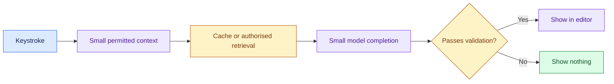

# Enterprise Coding Assistant: Introduction

## Overview

- A company wants an AI coding assistant inside its developers' IDEs: inline completions as they type, plus slower help to explain, test or fix code on request.
- Two constraints pull against each other.
- A completion must arrive before the developer's next keystroke, inside a 300 ms budget, and it must respect private repository permissions: a suggestion built from a repo the developer cannot clone is a leak.

- The design starts from the latency budget and a context funnel. It takes a small context (cursor, file, imports), checks a scoped cache, and on a miss retrieves only snippets the developer may read.
- A small model streams a short completion, and a validation gate drops invented APIs, secrets and licence conflicts.
- If the backend is slow or a validator is down, the assistant shows nothing.
- Explain and refactor requests go to a larger model on a separate, slower lane.

The case adds an enterprise private-repository variant to the fast completion path: incremental indexing, repository access control, licensing and proof of productivity.

## The core idea

Use a tiny permitted context, suggest fast, and validate or stay silent.

## Who it is for

Engineers preparing for Forward Deployed, solutions or applied-AI engineering interviews, especially a round that asks you to design a low-latency AI product or a developer tool over private code.

## Objectives

After this case you can:

- explain the system end to end at interview depth, starting from its dangerous constraint: no cached or retrieved snippet may cross a repository access boundary, while every completion still fits the 300 ms budget;
- answer follow-up questions on context and index design, cache correctness, model routing, validation, latency arithmetic, security, evaluation and rollout.

## What it assumes

Comfort with retrieval (embeddings and code indexing), caching, LLM serving and latency budgets, and basic cloud architecture. The related reviews at the foot of each section cover each one.

## How to use it

1. Read the three mandatory sections in order: Interview Guide, Technical Deep Dive, Quick Review.
2. Mark each part as read when you finish it. The case counts as done in your progress when every part is read.
3. Open the Full Design when you need a worked number, a source or the reasoning behind a step.
4. Come back to the Quick Review the night before the interview.

## The sections

| Section | What it is for | Interview prep |
|---|---|---|
| [Interview Guide](#main) | The answer you would talk through in the interview, from the questions to ask to the architecture, context and model routing, failure and cost, evaluation and rollout. Start here: it stands on its own. | Mandatory |
| [Technical Deep Dive](#deep-dive) | The detail behind each component, from index design and cache invalidation to task routing, budget arithmetic, security and the cost pivot. Read it after the Interview Guide, to answer follow-up questions. | Mandatory |
| [Quick Review](#cheat-sheet) | The whole case on one page: questions to ask, the flow, the latency numbers, five rules and the failure card, for recall before the interview. | Mandatory |
| [Full Design](#full-pack) (4 parts) | The complete, referenced write-up the other sections were drawn from: the latency budget, the context funnel, keeping source code private, the release gate, per-repository rollout, the latency pivot and the sources. | Optional |
