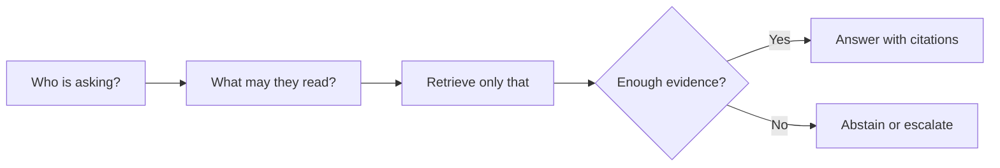

# Enterprise Knowledge Assistant: Introduction

## Overview

A company wants its employees to ask internal questions about policies, runbooks and product docs, and get an answer that cites its sources. The hard part is permissions. A Tier-1 support agent and a VP can ask the same question and must get different answers, because each may read only what their access allows.

The design is a permission-aware retrieval pipeline. It identifies the user, retrieves only the documents that user may open, writes the answer from those documents with citations, and abstains when the evidence is thin. It also has to act on lost access: when someone leaves a group, the change must reach the search index and the answer cache, not only the source system.

This is the anchor case for enterprise RAG. Support assistants, legal search and low-latency enterprise search reuse the same core and change which constraint dominates.

## The core idea

Every request takes the same path, and authorisation comes before retrieval, never after it.

## Who it is for

Engineers preparing for Forward Deployed, solutions or applied-AI engineering interviews, especially a round that asks you to design a RAG system or a knowledge assistant.

## Objectives

After this case you can:

- explain the system end to end at interview depth, starting from its dangerous constraint: the model must never see a document the user may not open;
- answer follow-up questions on ingestion, authorisation, retrieval, caching, evaluation, failure modes and rollout.

## What it assumes

Comfort with retrieval (keyword search, embeddings and reranking), LLM agents and basic cloud architecture. The related reviews at the foot of each section cover each one.

## How to use it

1. Read the three mandatory sections in order: Interview Guide, Technical Deep Dive, Quick Review.
2. Mark each part as read when you finish it. The case counts as done in your progress when every part is read.
3. Open the Full Design when you need a worked number, a source or the reasoning behind a step.
4. Come back to the Quick Review the night before the interview.

## The sections

| Section | What it is for | Interview prep |
|---|---|---|
| [Interview Guide](#main) (2 parts) | The answer you would talk through in the interview, from the opening framing to the 60-minute delivery plan. Start here: it stands on its own. | Mandatory |
| [Technical Deep Dive](#deep-dive) | The detail behind each component, from ACL normalisation and the two authorisation layers to cache safety, cost and the failure playbook. Read it after the Interview Guide, to answer follow-up questions. | Mandatory |
| [Quick Review](#cheat-sheet) | The whole case on one page: the architecture, five rules, scale numbers and interview triggers, for recall before the interview. | Mandatory |
| [Full Design](#full-pack) (5 parts) | The complete, referenced write-up the other sections were drawn from: sizing, rollout, the release gate, the cost pivot, incident drills and the sources. | Optional |

## Practise it

When you have read the mandatory sections, try the [Enterprise Knowledge Assistant with RAG worksheet](/practice/enterprise-knowledge-assistant-rag). It asks you to produce the same design from a blank page, which shows what you can explain without the guide open.
