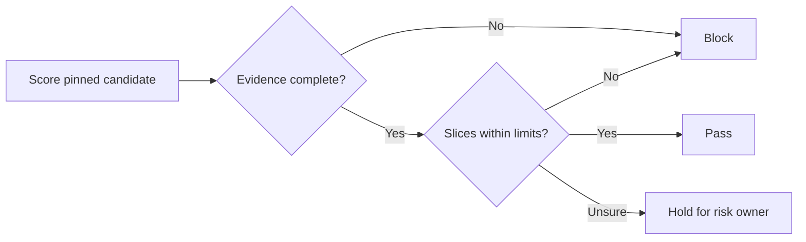

# Evaluation and Release Gating: Introduction

## Overview

A company runs about 30 AI applications and keeps changing their prompts and models. It needs one shared platform that decides whether each change may pass, block or hold. The hard part is trusting that decision. An aggregate score can hide a failing slice: in the source's incident, a sales copilot passed 96.7% of 120 cases while its six regulated-claim cases passed at 83.3%.

The design pins the candidate and the production baseline, runs versioned suites in sandboxed workers, and scores them with deterministic checks and a calibrated LLM grader. A policy engine compares quality, safety, latency and cost separately, and each critical slice must pass on its own. Missing evidence blocks, thin evidence holds, and only an authorised owner can override.

The same gate answers two neighbouring prompts: a model that got worse after an upgrade, and a team with no evaluation strategy.

## The core idea

The grader scores, while policy and authorised people decide, and a candidate ships only when complete evidence clears every slice.

## Who it is for

Engineers preparing for Forward Deployed, solutions or applied-AI engineering interviews, especially a round that asks you to design an evaluation platform or a release process for prompt and model changes.

## Objectives

After this case you can:

- explain the gate end to end at interview depth, starting from its dangerous constraint: a strong aggregate score must never release a change that fails a critical slice or the safety floor;
- answer follow-up questions on load sizing, grader calibration, slice coverage, failure policy, rollout and evaluation cost.

## What it assumes

Comfort with LLM evaluation (golden sets, rubrics and LLM-as-judge), basic statistics such as confidence bounds, and CI release pipelines. The related reviews at the foot of each section cover each one.

## How to use it

1. Read the three mandatory sections in order: Interview Guide, Technical Deep Dive, Quick Review.
2. Mark each part as read when you finish it. The case counts as done in your progress when every part is read.
3. Open the Full Design when you need a worked number, a source or the reasoning behind a step.
4. Come back to the Quick Review the night before the interview.

## The sections

| Section | What it is for | Interview prep |
|---|---|---|
| [Interview Guide](#main) | The answer you would talk through in the interview, from the clarifying questions and scale to the gate logic, the incident, grader trust, rollout and a two-minute answer. Start here: it stands on its own. | Mandatory |
| [Technical Deep Dive](#deep-dive) | The detail behind each component, from the decision contract and data model to evaluation design, the trust boundary around runners and rollout economics. Read it after the Interview Guide, to answer follow-up questions. | Mandatory |
| [Quick Review](#cheat-sheet) | The whole case on one page: the first questions, the whiteboard path, load numbers, gate rules and the incident, for recall before the interview. | Mandatory |
| [Full Design](#full-pack) (5 parts) | The complete, referenced write-up the other sections were drawn from: sizing the gate, calibrating the grader, gating on slices, the regression the suite missed, rollout on one application and cutting the evaluation bill. | Optional |

## Practise it

When you have read the mandatory sections, try the [LLM Evaluation and Release-Gating Platform worksheet](/practice/llm-evaluation-and-release-gating-platform). It asks you to produce the same design from a blank page, which shows what you can explain without the guide open.
