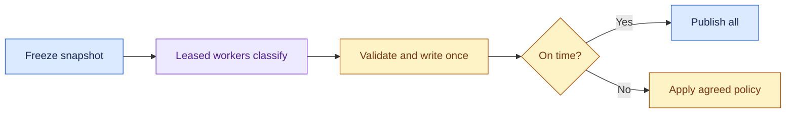

# High-Volume Batch Inference Pipeline: Introduction

## Overview

A catalogue team must classify 100 million records overnight and publish by 6 a.m., inside a six-hour window. The hard part is recovery. Workers crash, the provider throttles, some output is malformed, and at 4 a.m. the job may be behind. The customer must decide in advance whether a labelled partial result may be published or everything is held.

- The design freezes the input and the model, prompt and schema versions in a snapshot, then workers pull partitions under durable leases behind a shared rate coordinator.
- Each output passes typed validation, is written once with an idempotency key on job, record and model version, and is checkpointed only after the write succeeds.
- Transient errors retry and permanent ones go to quarantine. A live ETA and a pre-agreed publish policy decide what happens when the window is at risk.

The same spine extends to a bank that extracts structured data from millions of documents, which adds OCR, schema-constrained extraction, human review and reprocessing by model version.

## The core idea

Freeze the job, process it in replayable pieces, and let a pre-agreed policy decide what gets published.

## Who it is for

Engineers preparing for Forward Deployed, solutions or applied-AI engineering interviews, especially a round that asks you to design a batch inference or document-processing pipeline.

## Objectives

After this case you can:

- explain the system end to end at interview depth, starting from its dangerous constraint: the 6 a.m. deadline must be met or handled by policy, and retries and crashes must never produce duplicate results or a silently partial dataset;
- answer follow-up questions on capacity arithmetic, idempotency and replay, retry and quarantine policy, the 4 a.m. runbook, cost and rollout.

## What it assumes

Comfort with queues and worker pools, idempotent writes, rate limits and calling a model through an API. The related reviews at the foot of each section cover each one.

## How to use it

1. Read the three mandatory sections in order: Interview Guide, Technical Deep Dive, Quick Review.
2. Mark each part as read when you finish it. The case counts as done in your progress when every part is read.
3. Open the Full Design when you need a worked number, a source or the reasoning behind a step.
4. Come back to the Quick Review the night before the interview.

## The sections

| Section | What it is for | Interview prep |
|---|---|---|
| [Interview Guide](#main) | The answer you would talk through in the interview, from the questions to ask and the requirements to the architecture, the 4 a.m. failure, evaluation and a two-minute answer. Start here: it stands on its own. | Mandatory |
| [Technical Deep Dive](#deep-dive) | The detail behind each part, from the contract before the machinery to capacity arithmetic, state and replay, operations, trade-offs and the evidence to collect. Read it after the Interview Guide, to answer follow-up questions. | Mandatory |
| [Quick Review](#cheat-sheet) | The whole case on one page: the opening question, the whiteboard path, the throughput and token numbers, the failure answer and five anchors, for recall before the interview. | Mandatory |
| [Full Design](#full-pack) (5 parts) | The complete, referenced write-up the other sections were drawn from: sizing from the deadline and the tail, harmless duplicates, the failure policy, a load-test ladder, the bank document variant, a fifty-minute delivery plan, the cost pivots and the sources. | Optional |

## Practise it

When you have read the mandatory sections, try the [High-Volume Batch Inference Pipeline worksheet](/practice/high-volume-batch-inference-system). It asks you to produce the same design from a blank page, which shows what you can explain without the guide open.
