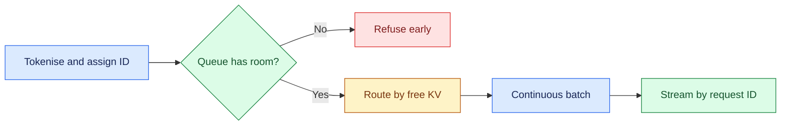

# LLM Inference Serving: Introduction

## Overview

- The prompt asks for end-to-end batching of LLM requests, including which GPU has capacity and what happens when one fails.
- The hard part is that each GPU is a stateful server with a limited KV-memory budget.
- Prefill drives time to first token, decode drives per-token speed, and output lengths vary.
- The case's capacity figures are constructed examples, not measurements of a real engine.

- The design tokenises each request and gives it an ID at the gateway, admits work through a token-weighted bounded queue, and routes it to a healthy replica with free KV memory.
- Each replica batches continuously, releasing finished sequences instead of waiting for the longest output, and results stream back by request ID.
- Health checks evict sick GPUs, a disconnect frees KV memory, unstreamed requests retry under a budget, and streamed ones need explicit continuation or partial-error semantics.

Related prompts reuse the same foundation: one GPU batching up to 100 synchronous inputs, a service at 100,000 requests per second, a review of a junior engineer's design, and a diagnosis of high inference latency.

## The core idea

Admit work before it reaches a GPU, place it by free KV memory, and batch continuously.

## Who it is for

Engineers preparing for Forward Deployed, solutions or applied-AI engineering interviews, especially a round that asks you to design LLM serving, request batching or GPU capacity.

## Objectives

After this case you can:

- explain the system end to end at interview depth, starting from its dangerous constraint: KV memory, not request count, decides where a request can run, and a GPU can fail mid-stream;
- answer follow-up questions on prefill and decode capacity, continuous batching, KV budgeting, routing and failover, backpressure, latency diagnosis and cost.

## What it assumes

Comfort with how transformer models generate tokens, GPU memory basics, queueing and Little's law, and load balancing. The related reviews at the foot of each section cover each one.

## How to use it

1. Read the three mandatory sections in order: Interview Guide, Technical Deep Dive, Quick Review.
2. Mark each part as read when you finish it. The case counts as done in your progress when every part is read.
3. Open the Full Design when you need a worked number, a source or the reasoning behind a step.
4. Come back to the Quick Review the night before the interview.

## The sections

| Section | What it is for | Interview prep |
|---|---|---|
| [Interview Guide](#main) | The answer you would talk through in the interview, from the questions to ask and the requirements to the architecture, choices and failure modes, variants and evaluation, and a two-minute answer. Start here: it stands on its own. | Mandatory |
| [Technical Deep Dive](#deep-dive) | The detail behind each component, from the two phases and their two capacity checks to continuous batching and KV memory, routing, failure and backpressure, the variants and latency economics. Read it after the Interview Guide, to answer follow-up questions. | Mandatory |
| [Quick Review](#cheat-sheet) | The whole case on one page: the questions to ask first, the whiteboard path, the assumed anchor arithmetic, five rules and the variants, for recall before the interview. | Mandatory |
| [Full Design](#full-pack) (3 parts) | The complete, referenced write-up the other sections were drawn from: sizing by tokens per second and Little's law, continuous batching, KV budgeting, routing, failover, admission, cancellation, the variants, the latency stack, a forty-five-minute delivery plan, the cost pivot and the sources. | Optional |
