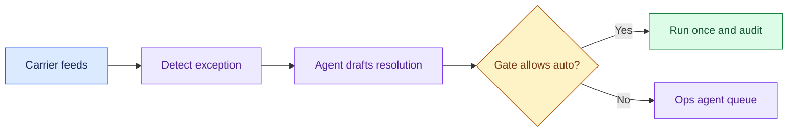

# Logistics Exception Handling: Introduction

## Overview

- A logistics operator wants help with shipments that should have moved and did not: customs holds, missed scans and weather delays.
- About 150 ops agents decide what to tell the customer or the carrier.
- Users are few and stakes are high. The hard constraint is that customs and regulatory holds always go to a human, and no automated carrier action may run twice or without an audit row.
- EU shipment data must stay in the EU.

- The design turns carrier webhooks and batch files into one normalised event stream per region.
- Cheap detection finds the exception, and the agent drafts a resolution: the next scan, a customer message, a proposed carrier call.
- An independent, customs-first policy gate decides.
- Only a non-customs case under the value limit with confidence above the threshold may auto-resolve, through an executor with an idempotency key and a circuit breaker that falls back to a human.
- Everything else goes to the ops queue, and every action is audited in its region.

A related shipment-rerouting case reuses the same pattern. SAP becomes source and target, weather adds a predictive signal and 500 regional managers widen the approval surface; the gate does not get looser.

## The core idea

The agent proposes and the gate decides, and customs never reaches the automatic path.

## Who it is for

Engineers preparing for Forward Deployed, solutions or applied-AI engineering interviews, especially a round that asks you to design an event-driven agent that takes real actions under a policy gate.

## Objectives

After this case you can:

- explain the system end to end at interview depth, starting from its dangerous constraint: customs holds always go to a human, and no carrier action runs twice or unaudited;
- answer follow-up questions on event ingestion and sizing, the policy gate, idempotent execution, regional data residency, evaluation and rollout.

## What it assumes

Comfort with event streaming and batch ingestion, LLM agents with tool calls, and idempotent writes to external systems. The related reviews at the foot of each section cover each one.

## How to use it

1. Read the three mandatory sections in order: Interview Guide, Technical Deep Dive, Quick Review.
2. Mark each part as read when you finish it. The case counts as done in your progress when every part is read.
3. Open the Full Design when you need a worked number, a source or the reasoning behind a step.
4. Come back to the Quick Review the night before the interview.

## The sections

| Section | What it is for | Interview prep |
|---|---|---|
| [Interview Guide](#main) | The answer you would talk through in the interview, from the questions to ask to the architecture, decisions, failures and evaluation, and a two-minute answer. Start here: it stands on its own. | Mandatory |
| [Technical Deep Dive](#deep-dive) | The detail behind each component: event and exception rates, feed freshness, the gate and execution, residency, and evaluation and rollout. Read it after the Interview Guide, to answer follow-up questions. | Mandatory |
| [Quick Review](#cheat-sheet) | The whole case on one page: what to ask, the whiteboard path, the numbers and rules, and failure and proof, for recall before the interview. | Mandatory |
| [Full Design](#full-pack) (3 parts) | The complete, referenced write-up the other sections were drawn from: sizing by event throughput, the customs-first gate, regional data isolation, safe retries, auditing, the rerouting stakeholder surface, the cost pivot and the sources. | Optional |
