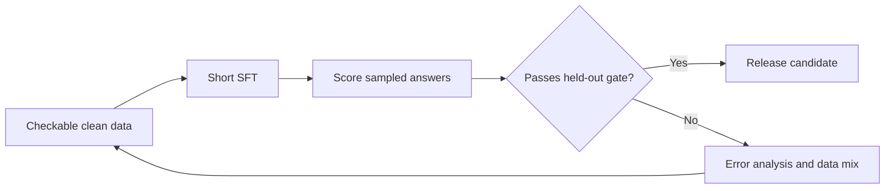

# Model Development and Post-Training: Introduction

## Overview

A team wants a model that solves maths problems, and the interview walks from data through supervised fine-tuning (SFT), post-training and evaluation. The hard part is evaluation integrity. Leaked or near-duplicate test problems inflate scores: in the source's example, duplicated traces gave a 94% offline score against roughly 78% in production.

The design collects answer-checkable problems, removes duplicates and evaluation overlap, and uses a short SFT run to teach the format. It then scores the model's own sampled answers with a verifier, step grader or preference labels and updates with drift control. Each checkpoint must pass a held-out gate for maths, general ability and safety; a failure loops back to the data mix.

Three neighbouring prompts change one constraint in the same pipeline: a fixed compute budget, a harmless but useful model, and a polite model that fits on a phone.

## The core idea

SFT teaches the format, scored attempts teach correctness, and only a checkpoint that passes a clean held-out gate moves forward.

## Who it is for

Engineers preparing for Forward Deployed, solutions or applied-AI engineering interviews, especially a model or post-training round that asks you to design how a model is trained, evaluated and released.

## Objectives

After this case you can:

- explain the pipeline end to end at interview depth, starting from its dangerous constraint: a checkpoint advances only through a decontaminated held-out gate, and the model never approves its own release;
- answer follow-up questions on data quality, SFT versus post-training, reward hacking, compute arithmetic and the three variants.

## What it assumes

Comfort with LLM fine-tuning (adapters such as LoRA, optimiser state and FLOPs estimates) and with model evaluation on held-out data. The related reviews at the foot of each section cover each one.

## How to use it

1. Read the three mandatory sections in order: Interview Guide, Technical Deep Dive, Quick Review.
2. Mark each part as read when you finish it. The case counts as done in your progress when every part is read.
3. Open the Full Design when you need a worked number, a source or the reasoning behind a step.
4. Come back to the Quick Review the night before the interview.

## The sections

| Section | What it is for | Interview prep |
|---|---|---|
| [Interview Guide](#main) | The answer you would talk through in the interview, from the variants and clarifying questions to the architecture, the choices to defend and a two-minute answer. Start here: it stands on its own. | Mandatory |
| [Technical Deep Dive](#deep-dive) | The detail behind each stage, from split integrity, SFT and scoring to compute arithmetic, alternate objectives and when weights are the right surface. Read it after the Interview Guide, to answer follow-up questions. | Mandatory |
| [Quick Review](#cheat-sheet) | The whole case on one page: the first questions, the whiteboard path, the numbers and the gate with its pivots, for recall before the interview. | Mandatory |
| [Full Design](#full-pack) (3 parts) | The complete, referenced write-up the other sections were drawn from: sizing the run, checkable data, rewarding correct answers, unseen-problem evaluation, fixed-budget scaling, harm against helpfulness, shrinking the model and the compute pivot. | Optional |
