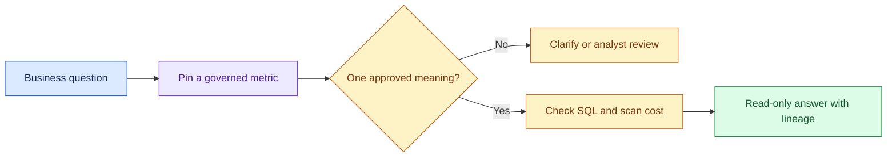

# Natural Language over Governed Data: Introduction

## Overview

- Executives and analysts want to ask a business question in plain words, such as "What's Q3 revenue?", and get a number they can put on a slide.
- The hard part is meaning. "Revenue" can mean booked, recognised or collected revenue, and a model can write valid SQL that answers the wrong one.
- The model cannot choose that definition on the business's behalf.

- The design anchors every question to a versioned, owner-approved metric before it exposes any physical schema.
- When a term fits more than one approved meaning, the system asks or sends the question to an analyst.
- The LLM proposes SQL; a parser checks the query tree against policy and a scan budget, and a read-only gateway runs it under the warehouse's row and column security.
- The answer carries the SQL, lineage and freshness, the prose is checked against the numbers, and every run is audited for replay.

This case anchors an executive dashboard assistant, a retail demand forecast explainer and an insurer's governed data assistant. They reuse the same query path and change the explanation and review workflow.

## The core idea

The metric registry defines the business answer, and the LLM only translates the question and explains a validated, read-only result.

## Who it is for

Engineers preparing for Forward Deployed, solutions or applied-AI engineering interviews, especially a round that asks you to design a natural-language-to-SQL or analytics assistant.

## Objectives

After this case you can:

- explain the system end to end at interview depth, starting from its dangerous constraint: valid SQL must never answer the wrong business question;
- answer follow-up questions on metric ownership, ambiguity handling, SQL validation, read-only execution, evaluation, cost and rollout.

## What it assumes

Comfort with SQL and data warehouses, row and column access control, and LLM prompting and evaluation. The related reviews at the foot of each section cover each one.

## How to use it

1. Read the three mandatory sections in order: Interview Guide, Technical Deep Dive, Quick Review.
2. Mark each part as read when you finish it. The case counts as done in your progress when every part is read.
3. Open the Full Design when you need a worked number, a source or the reasoning behind a step.
4. Come back to the Quick Review the night before the interview.

## The sections

| Section | What it is for | Interview prep |
|---|---|---|
| [Interview Guide](#main) | The answer you would talk through in the interview, from the questions to ask and the architecture to the three decisions to defend, the failure playbook and an answer to rehearse. Start here: it stands on its own. | Mandatory |
| [Technical Deep Dive](#deep-dive) | The detail behind each component: metric authority and versions, ambiguity, SQL as an untrusted proposal, failure drills, evaluation and cost. Read it after the Interview Guide, to answer follow-up questions. | Mandatory |
| [Quick Review](#cheat-sheet) | The whole case on one page: the flow, five rules, case numbers, failures and the cost answer, for recall before the interview. | Mandatory |
| [Full Design](#full-pack) (5 parts) | The complete, referenced write-up the other sections were drawn from: SQL validation, the release gate, rolling out ten metrics at a time, the cost pivot and the sources. | Optional |

## Practise it

When you have read the mandatory sections, try the [Natural-Language-to-SQL Analytics Assistant worksheet](/practice/natural-language-to-sql-analytics-assistant). It asks you to produce the same design from a blank page, which shows what you can explain without the guide open.
