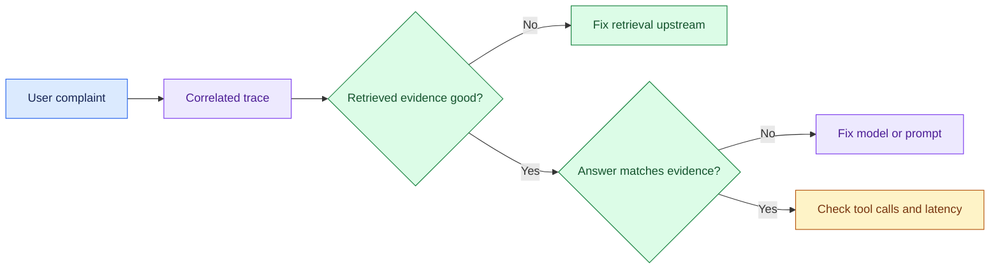

# Observability and Production Diagnosis: Introduction

## Overview

Users say a customer-facing AI application is slow and sometimes wrong, and the team needs to trace each complaint to the hop that caused it. The hard part is privacy. Telemetry must not become a second copy of customer data, so full prompts, raw documents and secrets stay out by default, and support staff see only their own tenant.

The design gives every request a correlation ID and structured spans through retrieval, model and tools. Spans export asynchronously, are redacted before storage, and are sampled to keep errors and slow traces. Authorised support gets tenant-scoped views. Diagnosis runs from the complaint down: user outcome, then the slow or failing span, then retrieved evidence against the answer.

The same traces answer the related prompts on latency spikes, cost spikes and poor RAG quality.

## The core idea

Every request carries one correlation ID, and diagnosis walks down from what the user felt to the span that caused it.

## Who it is for

Engineers preparing for Forward Deployed, solutions or applied-AI engineering interviews, especially a production operations round that asks you to debug a live LLM application or handle a latency or cost incident.

## Objectives

After this case you can:

- explain the system end to end at interview depth, starting from its dangerous constraint: telemetry must never store raw prompts, documents or secrets, or let support read another tenant's data;
- answer follow-up questions on redaction, sampling, root-cause method, failure policy, the incidents and rollout.

## What it assumes

Comfort with distributed tracing and spans, percentile latency, RAG pipelines and multi-tenant access control. The related reviews at the foot of each section cover each one.

## How to use it

1. Read the three mandatory sections in order: Interview Guide, Technical Deep Dive, Quick Review.
2. Mark each part as read when you finish it. The case counts as done in your progress when every part is read.
3. Open the Full Design when you need a worked number, a source or the reasoning behind a step.
4. Come back to the Quick Review the night before the interview.

## The sections

| Section | What it is for | Interview prep |
|---|---|---|
| [Interview Guide](#main) | The answer you would talk through in the interview, from the clarifying questions to the architecture, diagnosis with the latency and cost incidents, rollout and a two-minute answer. Start here: it stands on its own. | Mandatory |
| [Technical Deep Dive](#deep-dive) | The detail behind each component, from collection policy and data mechanics to the missing-evidence drill, root-cause method and the failure matrix. Read it after the Interview Guide, to answer follow-up questions. | Mandatory |
| [Quick Review](#cheat-sheet) | The whole case on one page: the first questions, the whiteboard path, four rules, the incidents and diagnosis shortcuts, for recall before the interview. | Mandatory |
| [Full Design](#full-pack) (5 parts) | The complete, referenced write-up the other sections were drawn from: deciding what not to collect, sizing telemetry, sampling toward failures, triage, the latency and cost spikes, a four-phase rollout and ten pivot cards. | Optional |

## Practise it

When you have read the mandatory sections, try the [Observability for a Customer-Facing AI Application worksheet](/practice/observability-customer-facing-ai-application). It asks you to produce the same design from a blank page, which shows what you can explain without the guide open.
