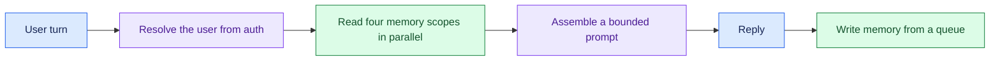

# Personal Assistant That Remembers You: Introduction

## Overview

A real-time personal assistant has to remember a user across weeks: their preferences, what they asked last week, the trip they are planning. It has to read what it needs within a 300 ms budget and keep each user's memory private to that user.

The hard constraint is remembering enough to feel personal while forgetting enough to stay fast, correct and private. A bigger context window does not solve it. The prompt has to stay flat as history grows, no user may ever read another's memory, and deleting a fact has to remove it everywhere.

- The design splits memory into four scopes (thread, session, semantic and episodic), each with its own key and write rule.
- Each turn reads the scopes in parallel, assembles a bounded prompt from a running summary and recent turns, replies, and then writes from a queue off the critical path.
- The user's identity always comes from authentication, never from the model.

## The core idea

Read memory in parallel inside the budget, keep the prompt bounded, and write after the reply.

## Who it is for

Engineers preparing for Forward Deployed, solutions or applied-AI engineering interviews, especially a round on assistants, copilots or agents that must remember users over time.

## Objectives

After this case you can:

- explain the design end to end at interview depth, starting from the four scopes of memory and their keys;
- answer follow-up questions on the read budget, write rules, pruning old episodes, index search, isolation between users, measuring recall and the cost pivot.

## What it assumes

Comfort with LLM context windows, key-value stores and vector search, and with basic latency budgeting.

## How to use it

1. Read the Interview Guide, one part at a time. It stands on its own.
2. Score your own answer against the rubric in section 14, in the second part.
3. Rehearse the 45-minute delivery plan in the guide's last part aloud, with a timer.
4. Mark each part as read when you finish it. The case counts as done in your progress when every part is read.
5. Come back to the level calibration and key takeaways in the guide's last part the night before the interview.

## The sections

| Section | What it is for | Interview prep |
|---|---|---|
| [Interview Guide](#guide) (3 parts) | The whole design: what "remembers you" means, requirements, sizing, the architecture, the four scopes, prompt bounds, write and prune rules, search, the latency budget, isolation, measuring recall, failure modes, a self-score against the rubric, a 45-minute delivery plan and the cost pivot. | Mandatory |
