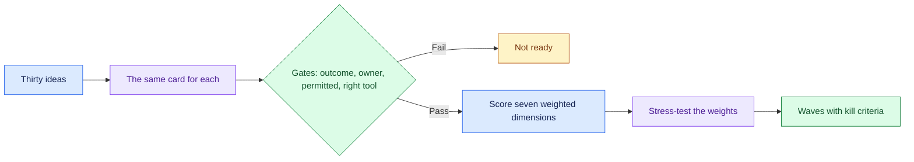

# Prioritise AI Use Cases for a Large Enterprise: Introduction

## Overview

A large enterprise has thirty enthusiastic one-line AI ideas and asks which to build. The executive's favourite is usually the most impressive demo, and the one least likely to survive contact with the data, the regulator and the users.

The hard constraint is that nothing gets drawn until the list has been cut. The answer is a repeatable method rather than a pick. A ranking has to hold up when its weights change, and an idea with a fatal flaw cannot buy its way back with a high value score.

- The method turns every idea into the same card, applies pass-or-fail gates before any scoring, scores seven dimensions with stated weights, and stress-tests the result.
- The survivors become a funded sequence of waves with kill criteria written before each pilot, and the architecture appears only as the shared platform that makes later items cheaper.
- A worked insurer portfolio runs through the whole method.

## The core idea

Cut the list with gates before you score it, and fund the shared platform with the first wave.

## Who it is for

Engineers preparing for Forward Deployed, solutions or applied-AI engineering interviews, especially a case or decomposition round that asks where to start, or a customer conversation about an AI roadmap.

## Objectives

After this case you can:

- run the method end to end at interview depth, from idea cards and gates to a funded, sequenced portfolio;
- answer follow-up questions on estimating value, stress-testing a weighted score, funding the platform, kill criteria, saying no to an executive's pet project and the cost pivot.

## What it assumes

No deep technical background. It helps to know what makes an AI use case hard to deliver: data quality, evaluation, regulation and adoption.

## How to use it

1. Read the Interview Guide, one part at a time. It stands on its own.
2. Before you read section 8, score a few of the insurer's ideas yourself and compare.
3. Rehearse the 45-minute delivery plan in the guide's last part aloud, with a timer.
4. Mark each part as read when you finish it. The case counts as done in your progress when every part is read.
5. Come back to the level calibration and key takeaways in the guide's last part the night before the interview.

## The sections

| Section | What it is for | Interview prep |
|---|---|---|
| [Interview Guide](#guide) (3 parts) | The whole method on one worked portfolio: what "prioritise" decides, idea cards, gates, weighted scoring, value estimates, stress tests, the scored portfolio, the shared platform, waves, kill criteria, handling the executive, failure modes, a 45-minute delivery plan and the cost pivot. | Mandatory |
