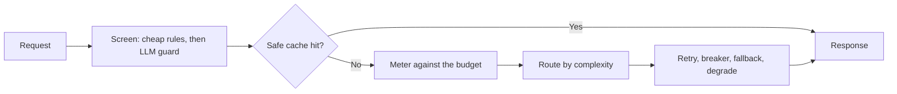

# Production LLM Gateway: Introduction

## Overview

A team needs a gateway in front of every model call its customer-facing agent makes. The prompt sounds like one box on a diagram, but it is graded as four constraints that fight each other: uptime, safety, a $500 daily budget and a three-second latency ceiling.

The hard constraint is that every safety check and every fallback spends part of the same three seconds, and every dollar saved hands the answer to a cheaper model. Screening, retries and failover all have to fit inside the latency ceiling without breaking the budget.

The design makes the gateway the one place where every call is screened, metered, routed and recovered. Cheap rule-based guards run first and an LLM guard only on what survives, the cache key must prove a hit is safe, cost is checked before the call, and retry, circuit breaker, fallback and degradation are chained so that each handles a different failure.

## The core idea

Screen, meter, route, then recover, and trace every step.

## Who it is for

Engineers preparing for Forward Deployed, solutions or applied-AI engineering interviews, especially a round on LLM platforms, production operations, or cost and reliability trade-offs.

## Objectives

After this case you can:

- explain the gateway end to end at interview depth, starting from its four competing constraints;
- answer follow-up questions on pricing the $500 day, guardrails in both directions, safe caching, routing, failover inside the three-second budget, logging for replay, data residency and the cost pivot.

## What it assumes

Comfort with LLM APIs and token pricing, API gateways, and reliability patterns such as retries and circuit breakers.

## How to use it

1. Read the Interview Guide, one part at a time. It stands on its own.
2. Before you read section 3, try pricing the $500 day yourself.
3. Score your own answer against the source rubric in section 13, in the last part.
4. Rehearse the 45-minute delivery plan aloud, with a timer.
5. Mark each part as read when you finish it. The case counts as done in your progress when every part is read.
6. Come back to the level calibration and key takeaways in the guide's last part the night before the interview.

## The sections

| Section | What it is for | Interview prep |
|---|---|---|
| [Interview Guide](#guide) (4 parts) | The whole design: which side of the agent the gateway guards, requirements, pricing the day, the architecture, guardrails, caching, routing and metering, the failover chain, the latency budget, logging, data residency, what still breaks, a self-score against the source rubric, a 45-minute delivery plan and the cost pivot. | Mandatory |
