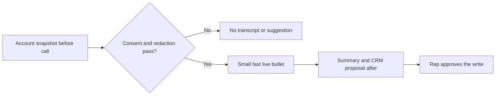

# Real-Time Call Assistant: Introduction

## Overview

A sales or service team wants help during live calls: a short suggestion for the rep while the customer is talking, then a summary, action items and CRM updates after the call. The hard constraint is time. A useful bullet must appear within about three seconds of the customer finishing a question, and slower work must never sit on that path. Without recording consent nothing is transcribed, and a failed redaction stops storage and the model call.

The design splits one call into three clocks. Before the call, the system prepares a permission-scoped account snapshot. During the call, streaming speech recognition feeds a redaction step, and a small prompt with the snapshot goes to a fast model that streams short bullets; on timeout the panel stays silent. After the call, a larger model drafts a cited summary, actions and a CRM proposal, and the rep approves any write.

The case shares its snapshot and approval pattern with the Sales Copilot case. A sub-3-second sales drill uses the same call context and focuses on precompute and streaming.

## The core idea

Prepare context before the call, keep the live suggestion tiny, and do the careful work after the call with a human on every write.

## Who it is for

Engineers preparing for Forward Deployed, solutions or applied-AI engineering interviews, especially a round that asks you to design a real-time or latency-bound LLM system with streaming input.

## Objectives

After this case you can:

- explain the system end to end at interview depth, starting from its dangerous constraint: the live suggestion must fit in about three seconds without breaking consent, redaction or the human approval on CRM writes;
- answer follow-up questions on the latency budget, precompute, streaming, privacy and permissions, summary evaluation, failure handling and rollout.

## What it assumes

Comfort with streaming speech recognition, LLM latency and model choice, and handling personal data under consent rules. The related reviews at the foot of each section cover each one.

## How to use it

1. Read the three mandatory sections in order: Interview Guide, Technical Deep Dive, Quick Review.
2. Mark each part as read when you finish it. The case counts as done in your progress when every part is read.
3. Open the Full Design when you need a worked number, a source or the reasoning behind a step.
4. Come back to the Quick Review the night before the interview.

## The sections

| Section | What it is for | Interview prep |
|---|---|---|
| [Interview Guide](#main) | The answer you would talk through in the interview, from one call with three clocks and the questions to ask to the architecture, failure and trust boundaries, evaluation and a two-minute answer. Start here: it stands on its own. | Mandatory |
| [Technical Deep Dive](#deep-dive) | The detail behind each component: the three lanes and their budget, privacy and consent, evaluating summaries without one correct answer, and the failure matrix and rollout. Read it after the Interview Guide, to answer follow-up questions. | Mandatory |
| [Quick Review](#cheat-sheet) | The whole case on one page: what to ask, the three clocks, the boundaries and the numbers to evaluate, for recall before the interview. | Mandatory |
| [Full Design](#full-pack) (4 parts) | The complete, referenced write-up the other sections were drawn from: precomputing context, redacting before storage, proposing CRM updates, the rollout to live suggestions, the sub-3-second pivot and the sources. | Optional |
