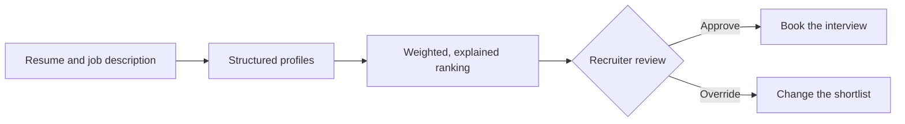

# AI-Powered Recruiting Platform: Introduction

## Overview

A hiring team wants AI at every step of recruiting: reading resumes, matching people to open roles, drafting interview questions, scoring candidates and booking interviews. A posting can bring in thousands of resumes, so the platform has to rank them fast and keep the recruiter's queue short.

The hard constraint is that a person makes every hiring decision. Hiring outcomes carry legal weight under GDPR and EEOC rules, so every ranking must explain itself, every suggestion is logged, and a recruiter can always overrule the system.

The design turns resumes and job descriptions into structured profiles, ranks candidates on explicit weighted signals, and sends every shortlist to a recruiter before anything is booked. Fairness monitoring runs across the whole path, not once at launch.

## The core idea

The AI ranks and explains; a recruiter approves or overrides before anything happens to a candidate.

## Who it is for

Engineers preparing for Forward Deployed, solutions or applied-AI engineering interviews, especially a round that asks for a matching or ranking system, or any design where an AI recommendation affects a person.

## Objectives

After this case you can:

- explain the platform end to end at interview depth, starting from its hard constraint: the AI recommends, and a recruiter decides;
- answer follow-up questions on extraction, matching, explainable ranking, the AI judge, scale, fairness and compliance.

## What it assumes

Comfort with embeddings and similarity search, LLM evaluation with a rubric, and basic cloud architecture. The Classic AI designs lesson on the recruiting platform in Learn covers the same problem in a shorter form.

## How to use it

1. Read the Interview Casebook. It is the answer you would give in the interview, and it stands on its own.
2. Mark each part as read when you finish it. The case counts as done in your progress when every part is read.
3. Open the Reference Design when you need the component list, the AI-specific design choices or the sources.
4. Come back to the Casebook's level calibration the night before the interview.

## The sections

| Section | What it is for | Interview prep |
|---|---|---|
| [Interview Casebook](#casebook) | The case as you would present it: the prompt, clarifying questions, the architecture, explainable ranking, scale, fairness, trade-offs, follow-ups and level calibration. | Mandatory |
| [Reference Design](#full-design) | The long-form design behind the Casebook: the request flow step by step, each major component, AI-specific design choices, scalability, security and fairness, and the sources. | Optional |
