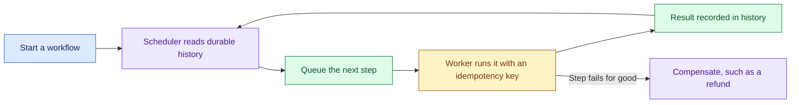

# Reliable Workflow Orchestration System: Introduction

## Overview

A customer needs one process to drive a document sign-off, a payment, an email and updates to three in-house systems. Any step can break, and the approval can sit idle for days. The business wants every case to finish, operations wants retries and a clear view of each case, and the auditor wants proof of each approval.

The hard constraint is the payment. It cannot be reversed, so whatever else fails or retries, the system must never charge twice. Every business effect has to happen exactly once, the state of each run has to stay visible, and a failed step has to be undone by an explicit compensation.

The design splits a control plane (registry, scheduler, timers, signals, compensation and an operations UI) from a data plane of queues and workers. Only the durable history store owns a run's progress, every side effect carries its own idempotency key, and the week-long approval is a durable timer rather than a sleeping worker.

## The core idea

Durable history decides what has happened; workers only carry out steps, each under its own idempotency key.

## Who it is for

Engineers preparing for Forward Deployed, solutions or applied-AI engineering interviews, especially a round on payments, approvals, back-office automation or any long-running process that touches systems you do not control.

## Objectives

After this case you can:

- explain the design end to end at interview depth, starting from its goal: apply each business effect exactly once, keep every run's state visible, and compensate when a step fails;
- answer follow-up questions on sizing for 10 million active workflows, idempotency keys, retry versus compensation, durable timers, tenant isolation and versioning workflows already running.

## What it assumes

Comfort with queues, retries and idempotency, and basic distributed-systems ideas such as at-least-once delivery.

## How to use it

1. Read the Tutorial, one part at a time. It is the full lesson, from the customer problem to the interview walkthrough.
2. Answer the Practice Worksheet without looking back at the Tutorial.
3. Compare your answers with the Model Answer, then reread the Tutorial parts where yours fell short.
4. Mark each part as read when you finish it. The case counts as done in your progress when every part is read.
5. Come back to the level calibration in the Tutorial's last part the night before the interview.

## The sections

| Section | What it is for | Interview prep |
|---|---|---|
| [Tutorial](#tutorial-v2) (9 parts) | The full lesson: discovery, requirements, sizing, the architecture, data model and code, failure handling, delivery and the interview walkthrough, then the key takeaways and level calibration. | Mandatory |
| [Practice Worksheet](#worksheet) | The case as a blank interview prompt to answer yourself, from the customer problem to a rollout plan and a scorecard. | Mandatory |
| [Model Answer](#answer-key) | What a strong answer covers, with weak, average and strong versions, the interviewer's scorecard and a two-minute spoken answer. | Mandatory |

## Practise it

The Practice Worksheet on this page is read-only. To save your answers as you write them, use the interactive [Reliable Workflow Orchestration System worksheet](/practice/reliable-workflow-orchestration-system).
