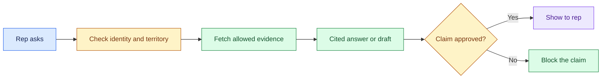

# Sales Copilot: Introduction

## Overview

A sales team wants a copilot that prepares an account executive for a meeting: an account summary, opportunity risks, discovery questions, an email draft and suggested CRM updates. The time saved is worthless if the draft invents a certification, makes an unapproved pricing claim, or shows the rep a record from a peer's territory.

- The design runs in three lanes. Before the meeting, it builds the account brief as the rep and caches it by permission.
- When the rep asks, it routes the question to the brief, a reviewed CRM lookup, a search over notes or a short bounded agent, and rechecks access before the model writes from cited evidence.
- A claim verifier blocks anything not on the approved playbook, and any CRM change needs a field-level preview and the rep's approval before a gateway writes it once.

The related variants keep this design and shift the weight to broader integration, latency or claim-level release gates.

## The core idea

Prepare the brief as the rep, prove every fact from data they may see, and write nothing to the CRM until they approve it.

## Who it is for

Engineers preparing for Forward Deployed, solutions or applied-AI engineering interviews, especially a round that asks you to design a copilot over CRM data for a business team.

## Objectives

After this case you can:

- explain the system end to end at interview depth, starting from its dangerous constraint: the rep must never see a record they may not access, and no unapproved claim or unapproved CRM write may leave the system;
- answer follow-up questions on source authority, permission fidelity, routing, claims, write-back, failure modes, latency, evaluation and rollout.

## What it assumes

Comfort with retrieval (keyword search, embeddings and hybrid search), CRM permission models, LLM agents and basic cloud architecture. The related reviews at the foot of each section cover each one.

## How to use it

1. Read the three mandatory sections in order: Interview Guide, Technical Deep Dive, Quick Review.
2. Mark each part as read when you finish it. The case counts as done in your progress when every part is read.
3. Open the Full Design when you need a worked number, a source or the reasoning behind a step.
4. Come back to the Quick Review the night before the interview.

## The sections

| Section | What it is for | Interview prep |
|---|---|---|
| [Interview Guide](#main) | The answer you would talk through in the interview, from the workflow and risk boundary to permissions, routing, claims and write-back, failure, the regression drill and delivery. Start here: it stands on its own. | Mandatory |
| [Technical Deep Dive](#deep-dive) | The detail behind each component, from the CRM sharing mirror and the snapshot to routing, claim and write boundaries and the model regression incident. Read it after the Interview Guide, to answer follow-up questions. | Mandatory |
| [Quick Review](#cheat-sheet) | The whole case on one page: outputs by risk, the three lanes, the rules, source targets, the failure card and the latency answer, for recall before the interview. | Mandatory |
| [Full Design](#full-pack) (4 parts) | The complete, referenced write-up the other sections were drawn from: source permission models, the precomputed snapshot, approved claims, the release gate, the latency pivot and the sources. | Optional |

## Practise it

When you have read the mandatory sections, try the [Sales Copilot for Account Executives worksheet](/practice/sales-copilot). It asks you to produce the same design from a blank page, which shows what you can explain without the guide open.
