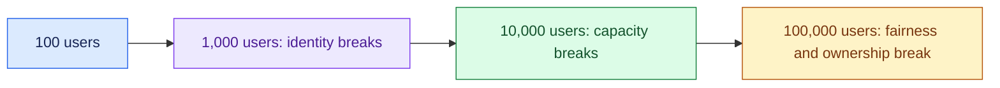

# Scale a Prototype from 100 to 100,000 Users: Introduction

## Overview

An AI prototype works for a hundred forgiving volunteers, and the business wants it rolled out to a hundred thousand users who did not ask for it. Scaling a thousandfold produces a different system that happens to share a prompt.

The hard constraint is that the prototype proved usefulness and nothing else. It says nothing about cost, tail latency, permissions, fairness between departments or adoption, and the model provider's uptime caps what the system can promise.

- The answer sizes the jump from licensed users down to tokens and dollars, then walks it in tenfold steps and names what breaks at each.
- The design puts one gateway in front of every model call for identity, per-user limits, a fair queue, metering, routing and safe caching.
- It rebuilds the eval set from production traffic and rolls out by cohort, with a rollback that is a pointer flip.

## The core idea

Walk the thousandfold jump in tenfold steps, and fix what breaks at each before taking the next.

## Who it is for

Engineers preparing for Forward Deployed, solutions or applied-AI engineering interviews, especially a round that asks what changes between a demo and production, or how to roll an AI tool out across a large company.

## Objectives

After this case you can:

- explain the jump end to end at interview depth, from what the prototype hid to a cohort rollout;
- answer follow-up questions on turning users into tokens and dollars, the gateway, provider failover, rebuilding the eval set, rollback, ownership, measuring adoption and the cost pivot.

## What it assumes

Comfort with LLM APIs and token pricing, retrieval with permissions, and basic reliability and rollout practice.

## How to use it

1. Read the Interview Guide, one part at a time. It stands on its own.
2. Before you read section 5, list what you expect to break at each tenfold step.
3. Rehearse the 45-minute delivery plan in the guide's last part aloud, with a timer.
4. Mark each part as read when you finish it. The case counts as done in your progress when every part is read.
5. Come back to the level calibration and key takeaways in the guide's last part the night before the interview.

## The sections

| Section | What it is for | Interview prep |
|---|---|---|
| [Interview Guide](#guide) (3 parts) | The whole answer: what "successful" meant, what the prototype hid, requirements, sizing, the tenfold steps, the architecture, the gateway, failover, the eval set, cohort rollout, owners, adoption, a check against all seventeen items the question lists, a 45-minute delivery plan and the cost pivot. | Mandatory |
