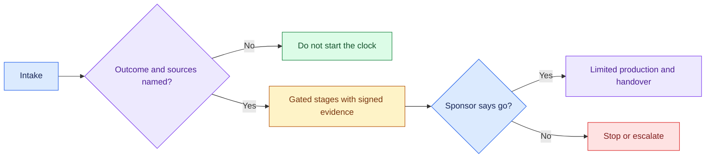

# Scoping to Deployed Agent: Introduction

## Overview

- A customer wants an AI agent and expects something real in two weeks.
- The worked example is Northwind's support triage, where success means a first response under five minutes.
- The hard part is governance on a fixed calendar. Every stage needs evidence signed by the right person, and a failed gate stops or escalates the engagement instead of becoming a quiet exception.

- The design has two systems. The first is a deterministic delivery state machine with seven gated stages, from security review to the sponsor's go/no-go and handover.
- The second is the agent it delivers: a Zendesk ticket is redacted, classified, enriched with read-only context, drafted by an LLM, checked for grounding and escalation, and sent under a human approval policy.
- Speed comes from reuse: Northwind builds only its escalation policy and takes five of six components from the accelerator library.

## The core idea

The engagement clock starts only when the outcome, the expert and the data sources are real, and each gate advances only on signed evidence.

## Who it is for

Engineers preparing for Forward Deployed, solutions or applied-AI engineering interviews, especially a delivery round that asks how you would take a customer from a scoping document to a deployed agent.

## Objectives

After this case you can:

- explain the delivery pipeline end to end at interview depth, starting from its dangerous constraint: no stage advances without evidence signed by the right owner, and a failed gate stops the engagement;
- answer follow-up questions on intake, gate enforcement, accelerator reuse, the agent runtime, evaluation, rollback, cost and handover.

## What it assumes

Comfort with LLM agents, grounded drafting from retrieved context, golden-set evaluation and staged rollouts such as shadow mode. The related reviews at the foot of each section cover each one.

## How to use it

1. Read the three mandatory sections in order: Interview Guide, Technical Deep Dive, Quick Review.
2. Mark each part as read when you finish it. The case counts as done in your progress when every part is read.
3. Open the Full Design when you need a worked number, a source or the reasoning behind a step.
4. Come back to the Quick Review the night before the interview.

## The sections

| Section | What it is for | Interview prep |
|---|---|---|
| [Interview Guide](#main) | The answer you would talk through in the interview, from the clarifying questions to the gates, the deployed agent, honest limits, rollout and a two-minute answer. Start here: it stands on its own. | Mandatory |
| [Technical Deep Dive](#deep-dive) | The detail behind each part, from the entry contract and stage rules to accelerator reuse, the agent runtime, the demo's limits, cost and operations. Read it after the Interview Guide, to answer follow-up questions. | Mandatory |
| [Quick Review](#cheat-sheet) | The whole case on one page: the first questions, the seven stages, the agent runtime and the demo facts, for recall before the interview. | Mandatory |
| [Full Design](#full-pack) (3 parts) | The complete, referenced write-up the other sections were drawn from: the fourteen days in order, gate authority, refusing at intake, reuse as a number, stalled engagements, the Northwind numbers and the pilot-spend pivot. | Optional |
