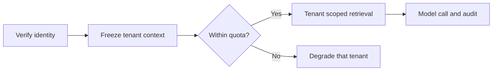

# Secure Multi-Tenant AI Platform: Introduction

## Overview

A provider wants one AI platform for many customer organisations, because a stack per customer costs too much. The hard part is isolation. Acme must never see Globex's documents, whether through a database row, a cache hit, a log line or the model's prompt. A tenant ID on a row does not guarantee that.

The design derives tenant context once from verified identity, freezes it on the request, and enforces it independently at seven layers: row, object, cache, queue, log, vector index and key. Spend is metered before the model call, fair queues stop one heavy tenant from slowing the rest, region rules cover logs and backups, and offboarding proves that keys and copies are gone. Shared infrastructure is the default; a dedicated tier is for tenants whose residency, risk or performance needs justify it.

This is the anchor case for shared AI platforms. Per-customer budgets, one unusually active tenant and a cross-tenant retrieval incident reuse the same tenant context and request path and change what dominates.

## The core idea

Tenant context comes from verified identity once, and every store and model call checks it on its own.

## Who it is for

Engineers preparing for Forward Deployed, solutions or applied-AI engineering interviews, especially a round that asks you to design a shared AI platform or explain tenant isolation.

## Objectives

After this case you can:

- explain the system end to end at interview depth, starting from its dangerous constraint: no tenant may read, write, hit a cache entry or enter a model context that belongs to another tenant;
- answer follow-up questions on identity, the seven isolation layers, quotas and fairness, regional routing, offboarding, leak response and rollout.

## What it assumes

Comfort with single sign-on, database row-level security, caching and retrieval, and basic cloud architecture. The related reviews at the foot of each section cover each one.

## How to use it

1. Read the three mandatory sections in order: Interview Guide, Technical Deep Dive, Quick Review.
2. Mark each part as read when you finish it. The case counts as done in your progress when every part is read.
3. Open the Full Design when you need a worked number, a source or the reasoning behind a step.
4. Come back to the Quick Review the night before the interview.

## The sections

| Section | What it is for | Interview prep |
|---|---|---|
| [Interview Guide](#main) | The answer you would talk through in the interview, from the questions to ask and the requirements to the seven isolation layers, fairness, regions, failures and the interview close. Start here: it stands on its own. | Mandatory |
| [Technical Deep Dive](#deep-dive) | The detail behind each component, from immutable tenant context and isolation that survives a missed check to unit economics, offboarding and a trace-first diagnosis of a cross-tenant leak. Read it after the Interview Guide, to answer follow-up questions. | Mandatory |
| [Quick Review](#cheat-sheet) | The whole case on one page: the request flow, the seven layers, sizing and the cost formula, default failure responses and the leak drill, for recall before the interview. | Mandatory |
| [Full Design](#full-pack) (5 parts) | The complete, referenced write-up the other sections were drawn from: sizing, regional routing, the adversarial isolation suite, rollout order, a fifty-minute delivery plan, the cost pivot, the leak debug and the sources. | Optional |

## Practise it

When you have read the mandatory sections, try the [Secure Multi-Tenant AI Platform worksheet](/practice/secure-multi-tenant-ai-platform). It asks you to produce the same design from a blank page, which shows what you can explain without the guide open.
