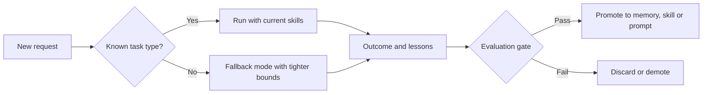

# Agent That Adapts to New Tasks: Introduction

## Overview

An internal operations agent handles requests such as "restart service X" and "roll back flag Y", and new request types appear every week as teams ship new systems. The ask is an agent that adapts to those new tasks on its own, without a person retraining it.

The hard constraint is that every change the agent makes to itself is a regression nobody reviewed. It needs the freedom to change its behaviour, yet it must never quietly get worse, and it must never grant itself more permission, budget or irreversible reach.

The design treats adaptation as five rungs, from context to weights, each about ten times costlier and harder to undo than the one before, and works from the cheap end. A runtime loop and a learning loop meet at one evaluation gate, and every memory write, promoted skill, prompt change or weight update passes the gate a human pull request would.

## The core idea

Adapt in the cheapest, most reversible place first, and send every self-change through the same gate as a human change.

## Who it is for

Engineers preparing for Forward Deployed, solutions or applied-AI engineering interviews, especially an agent design round that asks how a system learns or improves over time.

## Objectives

After this case you can:

- explain the design end to end at interview depth, starting from the five rungs of adaptation and the one gate every change passes;
- answer follow-up questions on novelty detection, the memory write policy, skill promotion and demotion, prompt optimisation, when to fine-tune, limits on the agent's autonomy and the cost pivot.

## What it assumes

This is an advanced case. It assumes comfort with LLM agents, tool calling and agent memory, and with offline evaluation, shadow testing and release gates.

## How to use it

1. Read the Interview Guide, one part at a time. It stands on its own.
2. Read the Answer Template, then practise filling it in from memory.
3. Rehearse the 60-minute delivery plan in the guide's last part aloud, with a timer.
4. Mark each part as read when you finish it. The case counts as done in your progress when every part is read.
5. Come back to the level calibration and key takeaways in the guide's last part the night before the interview.

## The sections

| Section | What it is for | Interview prep |
|---|---|---|
| [Interview Guide](#guide) (3 parts) | The whole design on one running example: what "adapt" means, requirements, sizing, the two loops and the gate, novelty detection, memory, skills, prompts and weights, limits on autonomy, failure modes, a 60-minute delivery plan and the cost pivot. | Mandatory |
| [Answer Template](#interview-template) | A reusable structure for answering this prompt under time pressure, from the problem statement and requirements to the MVP, discovery questions and a 30-second summary. | Mandatory |
